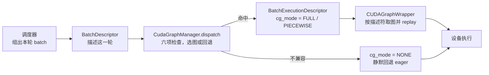

import BucketDispatch from '../../../../explainers/react/BucketDispatch';

前面四篇讲清了「什么能进图、什么不能」。这一篇讲运行时**怎么决定本轮走哪条路**：有一堆预先捕获好的图，来了一个 batch，选哪张？选不到怎么办？

读完你能照着源码说出完整的匹配条件、解释为什么有的条件是「容量 ≥」而有的必须「严格相等」、以及回退为什么是性能问题里最难发现的一类。

> 本篇按本地快照 commit `cf5cea2d` 的代码写。**这块 API 变动频繁**——早期版本里叫 `CudagraphDispatcher`，现在是 `CudaGraphManager`，描述符也从 `BatchDescriptor` 变成了 `BatchExecutionDescriptor`。读的时候请以自己那份源码为准。

## 先看一个例子

假设服务启动时捕获了 4 张图：3 张 decode 专用（容量 2、4、8 个请求）和 1 张通用的分段图（容量 16 token）。现在来了 3 个请求、每个 1 个 token 的 decode batch：

<BucketDispatch client:visible title="图 05-1：逐个检查候选图的六项条件，命中第一个装得下的" />

注意三件事：

1. 候选按顺序检查，**命中第一个够大的就停**——不是找最接近的，也不是找最大的。
2. 命中的是容量 4 的图，而本轮只要 3 个 → **padding 1 个 token**。
3. 容量 2 的图被跳过了，因为它装不下。

## 机制

### 两个描述符

| 名字                       | 位置                                          | 作用                                          |
| -------------------------- | --------------------------------------------- | --------------------------------------------- |
| `BatchDescriptor`          | `vllm/forward_context.py:29-53`               | 放在 forward context 里，描述**这一轮的批次** |
| `BatchExecutionDescriptor` | `vllm/v1/worker/gpu/cudagraph_utils.py:74-89` | 描述**一张已捕获的图**，以及该用什么模式跑    |

`BatchDescriptor` 的注释值得一读：

> We should keep the num of items as minimal as possible to properly and uniquely describe the padded batch for cudagraph.

**字段越少越好**——因为每多一个字段，图的种类就可能成倍增加。这是这套设计的核心约束。它目前的字段：

| 字段               | 含义                                                            |
| ------------------ | --------------------------------------------------------------- |
| `num_tokens`       | 本轮 token 数                                                   |
| `num_reqs`         | 请求数；**PIECEWISE 图可以为 `None`**（这类图能处理任意请求数） |
| `uniform`          | 是否所有请求的 token 数都相同                                   |
| `num_active_loras` | 活跃的 LoRA 适配器数量                                          |

`BatchExecutionDescriptor` 多了 `cg_mode`、`uniform_token_count`、`max_query_len`、`num_ubatches`。

### 六项兼容检查

核心在 `cudagraph_utils.py:115-142` 的 `_is_compatible`。它返回六个条件的合取：

```python
return (
    (desc.uniform_token_count is None
     or desc.uniform_token_count == uniform_token_count)
    and (desc.max_query_len is None
         or (max_query_len is not None and desc.max_query_len >= max_query_len))
    and (desc.num_reqs is None or desc.num_reqs >= num_reqs)
    and desc.num_tokens >= num_tokens
    and desc.num_active_loras == num_active_loras
    and desc.num_ubatches == num_ubatches
)
```

逐条读：

| #   | 条件            | 关系              | 为什么是这个关系                                                             |
| --- | --------------- | ----------------- | ---------------------------------------------------------------------------- |
| 1   | 每请求 token 数 | `None` 或**相等** | decode 图是为「每请求恰好 q 个 token」捕获的，多一个少一个都不行             |
| 2   | query 长度上界  | `None` 或 `>=`    | 图能容纳更长的 query；但**调用方必须也跟踪了这个值**，否则不能匹配带约束的图 |
| 3   | 请求数          | `None` 或 `>=`    | 容量够就行，少的部分 padding                                                 |
| 4   | token 数        | `>=`              | 同上                                                                         |
| 5   | **LoRA 数**     | **严格相等**      | —                                                                            |
| 6   | **ubatch 数**   | **严格相等**      | —                                                                            |

**为什么 3、4 是「≥」而 5、6 必须「相等」？**

因为 3、4 可以用 padding 补齐：多出来的位置填垃圾数据，算了不用就是了，结果不受影响。而 LoRA 数和 microbatch 数改变的是**计算的结构本身**——某些 kernel（比如 `fused_moe_lora`）的 grid 尺寸直接取决于 `num_active_loras`，捕获时定下来就改不了；ubatch 数决定批次被切成几份，更是图结构的一部分。

**padding 能补的是「量」，补不了「形状」。** 这是整个图桶机制的边界所在。

第 2 条还有一个细节值得注意：源码注释写着「a caller that does not track max_query_len must not match one that does」。也就是说，如果图声明了 query 长度上界，而调用方传的是 `None`（没跟踪），**不能匹配**——宁可保守回退，也不赌。

### 候选是怎么来的

`dispatch`（`cudagraph_utils.py:558-600`）先按 `(num_tokens, effective_loras)` 取出候选列表，然后对**统一 decode 批次**做一个优先处理：

```python
candidates = self._candidates.get((num_tokens, effective_loras), [])
if uniform_token_count is not None:
    decode_descs = self._decode_descs.get(
        (uniform_token_count, effective_loras, num_ubatches), [])
    n = cdiv(num_tokens, uniform_token_count)      # 需要多少个请求位
    if n < len(decode_descs):
        candidates = [decode_descs[n], *candidates]   # 插到最前面
```

意思是：如果本轮是统一 decode（每个请求 token 数相同），就按 `ceil(token数 / 每请求token数)` 算出需要多少个请求位，直接取对应的 decode 图**插到候选队首**。

这是一条快速路径：**decode 是最常见也最该走图的情形，所以它被优先匹配**。其余批次退到按 token 数索引的通用图。

然后遍历候选，第一个通过 `_is_compatible` 的就返回。都不通过就：

```python
return BatchExecutionDescriptor(
    cg_mode=CUDAGraphMode.NONE,     # ← 回退 eager
    num_tokens=num_tokens,
    num_reqs=num_reqs,
    ...
)
```

### 回退：正确但慢，而且不出声

回退路径返回的是 `cg_mode=NONE` 的描述符——**一个完全合法的结果**。请求照常完成，输出完全正确，只是这一轮没走图。

这使得它成为最难发现的性能问题：

- 不报错、不抛异常；
- 日志默认不打（捕获那条在 `cuda_graph.py:272`，是 `debug` 级别）；
- 只有吞吐曲线上一个说不清的凹陷。

把条件对照一遍就知道有多容易触发：batch 里混进一个 prefill（`uniform` 变 false）、某个请求用了不同的 LoRA（条件 5 不等）、batch 大小超过最大的桶（条件 4 不过）——任意一条都足够。

<BucketDispatch
  client:visible
  req={{ numReqs: 40, numTokens: 40, uniformTokenCount: 1, maxQueryLen: 1 }}
  title="图 05-2：batch 超过最大的桶——四个候选全不兼容，静默回退 eager"
/>

## 官方那张图怎么读

vLLM 文档里有一张图把这套设计画全了：


对照前面讲的内容看三处：

1. **右上角 `Dispatched by runtime_mode + key`**：这就是本篇讲的选路。虚线分别指向 FULL wrapper 和 PIECEWISE wrapper——**选路的结果决定哪一层 wrapper 被激活**。
2. **中间 `torch.compile → split graph`**：第 02 篇的编译图和分段。注意 `attn` 被画在 submod 之间，正是第 04 篇说的「attention 留在图外」。
3. **底部三行**：三种运行时模式的最终执行形态。PIECEWISE 是 `cg → eager → cg → eager …` 交替，FULL 是一整条 `cg`，NONE 全是 `eager`。

### 嵌套 wrapper：两种模式怎么共存

这张图解释了一个我一开始没想明白的问题：**FULL 和 PIECEWISE 两种图怎么在同一个模型里共存？**

官方文档给的答案是**嵌套**：在整个模型外面包一个 `FULL` 模式的 wrapper，同时在编译出的每个片段里各包一个 `PIECEWISE` 模式的 wrapper。然后：

| 本轮 runtime_mode | FULL wrapper        | PIECEWISE wrapper        | 结果            |
| ----------------- | ------------------- | ------------------------ | --------------- |
| `FULL`            | 激活，捕获/重放整图 | **不激活**（模式不匹配） | 一次整图 replay |
| `PIECEWISE`       | 不激活              | 激活                     | 分段 replay     |
| `NONE`            | 不激活              | 不激活                   | 全程 eager      |

每个 wrapper 只认自己的模式，不匹配就直接透传。**于是两套图天然互斥，不需要额外的协调逻辑**——这正是第 07 篇 Ascend wrapper docstring 里那句「blindly trust」的来由：判断集中在 manager 一处，wrapper 只管执行。

官方文档还给了一张 wrapper 内部的流程图：


左半边是嵌套位置：`FULL` wrapper 包在 Model 外，`PIECEWISE` wrapper 包在 `SplitGraph` 之后的每个片段上，而且整个编译部分标着 **Only if vLLM compile enabled**——又一次说明编译图和设备图可以分开开关（第 02 篇）。

右半边是单个 wrapper 的 `__call__`：**先判断 runtime mode 是否匹配**（不匹配直接透传），匹配了再按 key 去 `cuda_graphs: map[CUDAGraphDispatchKey, CUDAGraphItem]` 里查——**有就 Replay，没有就 Capture**。捕获和重放走的是同一条代码路径，区别只在表里有没有这个 key。这解释了第 03 篇说的「捕获由 `_dummy_run` 首次 forward 触发」：启动时用假数据跑一遍，表是空的，于是每个 key 都走 Capture 分支。

> 读这份官方文档时注意：正文里仍写着 `CudagraphDispatcher`，而代码里已经是 `CudaGraphManager`（文档开头的组件列表是对的）。**文档也会落后于代码**，以源码为准。

## 代码实现

> 完整可运行脚本见文章目录下的 `toy.py`，纯 Python。它把 `_is_compatible` 的六项条件照抄了一遍。

```python
def is_compatible(desc, req):
    """照搬 vllm/v1/worker/gpu/cudagraph_utils.py:_is_compatible 的六项条件。"""
    return all([
        desc['uniform_token_count'] is None
            or desc['uniform_token_count'] == req['uniform_token_count'],
        desc['max_query_len'] is None
            or (req['max_query_len'] is not None
                and desc['max_query_len'] >= req['max_query_len']),
        desc['num_reqs'] is None or desc['num_reqs'] >= req['num_reqs'],
        desc['num_tokens'] >= req['num_tokens'],
        desc['num_active_loras'] == req['num_active_loras'],   # 严格相等
        desc['num_ubatches'] == req['num_ubatches'],           # 严格相等
    ])
```

输出：

```
候选图：FULL(2 tok/2 req)  FULL(4/4)  FULL(8/8)  PIECEWISE(16 tok, 不限请求)

batch 3 请求 / 3 token / 统一    → 命中 图1 FULL，padding 1 token (25.0%)
batch 5 请求 / 5 token / 统一    → 命中 图2 FULL，padding 3 token (37.5%)
batch 12 请求 / 12 token / 统一  → 命中 图3 PIECEWISE，padding 4 token (25.0%)
batch 40 请求 / 40 token / 统一  → 回退 eager（没有够大的桶或条件不符）
batch 3 请求 / 9 token / 非统一  → 命中 图3 PIECEWISE，padding 7 token (43.8%)
batch 3 请求 / 3 token / LoRA=1 → 回退 eager（没有够大的桶或条件不符）

一天的 batch 分布模拟（1000 轮，batch 大小 1..10 均匀分布）：
  命中图：1000 轮（100.0%），平均 padding 浪费 22.4%
  把最大的桶从 16 降到 4 之后：
  命中图：411 轮（41.1%），回退 589 轮（58.9%）
```

倒数第二行值得单独看：非统一批次只能落到 PIECEWISE 图上，于是 3 个请求 9 个 token 被 padding 到 16，**浪费 43.8%**。混合批次既配不上 decode 图、又要向上取到通用桶——这是 prefill 与 decode 混在一起时的真实代价。

最后那组则是本篇最该记住的：**桶的上限设小了，超出的部分全部静默回退**。58.9% 的轮次没走图，而监控上只看到吞吐低了一截。

## 真实实现在哪

| 概念                         | 位置                                                              |
| ---------------------------- | ----------------------------------------------------------------- |
| `BatchDescriptor`            | `vllm/forward_context.py:29-53`                                   |
| `BatchExecutionDescriptor`   | `vllm/v1/worker/gpu/cudagraph_utils.py:74-89`                     |
| `_is_compatible`（六项条件） | `vllm/v1/worker/gpu/cudagraph_utils.py:115-142`                   |
| `CudaGraphManager`           | `vllm/v1/worker/gpu/cudagraph_utils.py:154-...`                   |
| `dispatch`（候选与回退）     | `vllm/v1/worker/gpu/cudagraph_utils.py:558-600`                   |
| `run_fullgraph`（整图重放）  | `vllm/v1/worker/gpu/cudagraph_utils.py:604-...`                   |
| 捕获与重放的封装             | `vllm/compilation/cuda_graph.py:234-358`                          |
| 捕获入口                     | `vllm/v1/worker/gpu/model_runner.py:1132-1175`（`capture_model`） |
| 桶的生成                     | `vllm/config/compilation.py:78-126`、`1278-1302`                  |

三层的分工现在可以完整串起来了：



## 代价与边界

- 匹配是「第一个够大」而不是「最接近」，所以候选的**排列顺序**会影响 padding 量。源码把 decode 图插到队首正是在利用这一点。
- 桶越多命中率越高，但捕获时间和显存都涨（第 04 篇量化过）。
- 回退是静默的。**要确认服务真的在走图，必须看日志或 profiler，不能假设配置开了就生效了。**
- 本篇的 `toy.py` 只复刻匹配逻辑，不涉及真实捕获、显存或时间。
- 这块 API 变动频繁，行号与类名按 commit `cf5cea2d`；换一个版本要重新核对。

## 自测

1. 六项条件里哪些是「容量 ≥」、哪些必须「严格相等」？从「padding 能补什么」的角度解释这个区别。
2. 为什么统一 decode 批次会被插到候选队首？这利用了匹配策略的什么性质？
3. 列出三种会导致静默回退的常见情况。为什么它比报错更难排查？
4. `BatchDescriptor` 的注释说字段越少越好。多加一个字段会带来什么代价？
5. 动手：在 `toy.py` 里把桶改成 `[1, 2, 4, 8, 16, 32]`，重跑那个 1000 轮的模拟。命中率和平均 padding 各变成多少？再把 batch 分布改成「90% 是 1、10% 是 50」，看哪套桶更合适。

## 来源

- 源码行号按本地快照 `reference/vllm`（commit `cf5cea2d`）
- [vLLM CUDA Graphs 设计文档](https://github.com/vllm-project/vllm/blob/main/docs/design/cuda_graphs.md)（最小可容纳桶的匹配、eager 回退、嵌套 wrapper 设计）
- **图 05-3、05-4 来自 vLLM 官方文档**：`docs/assets/design/cuda_graphs/current_design.png` 与 `wrapper_flow.png`，原样引用未作修改；vLLM 以 Apache License 2.0 发布
- 上一篇：[04 · 四条边界](../04-boundaries/)
- 下一篇：[无设备练习](../06-practice/)（尚未按本系列约定重写）——把这套匹配逻辑自己写一遍。
