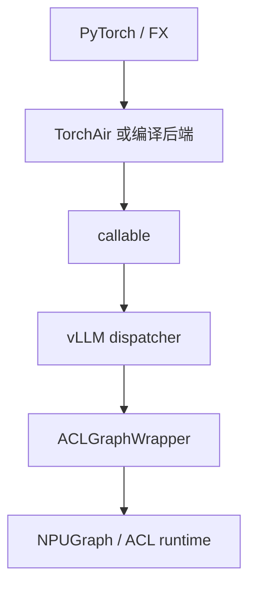
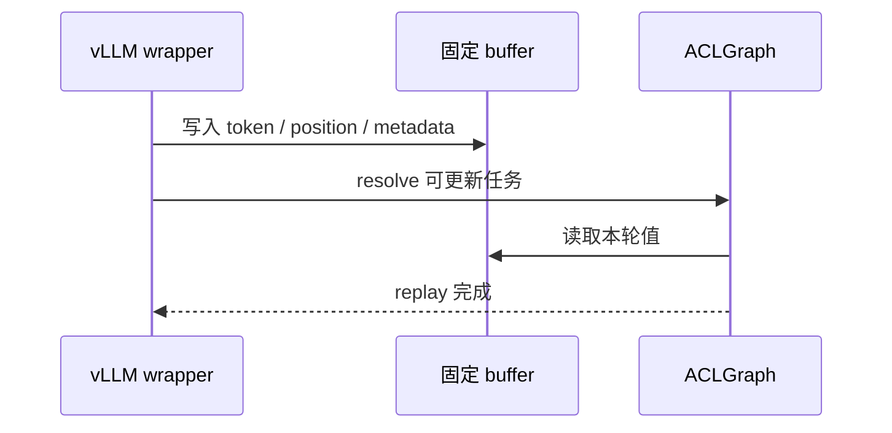

Ascend 代码里会同时出现 `NPUGraph`、TorchAir、`npugraph_ex` 和 `ACLGraphWrapper`。它们不是同一个 API 的四种叫法，而是处在不同层次：编译后端生成 callable，PyTorch NPU 图负责捕获/重放，vLLM wrapper 负责运行时选路，ACL 负责设备侧执行。

## 名称与层次

| 名称              | 所在层      | 读代码时问什么                   |
| ----------------- | ----------- | -------------------------------- |
| TorchAir          | 编译/图转换 | 计算图怎样变成 Ascend callable   |
| `NPUGraph`        | PyTorch NPU | 捕获对象和 replay 生命周期是什么 |
| `npugraph_ex`     | 扩展能力    | 哪些参数可更新、如何提交任务     |
| `ACLGraphWrapper` | vLLM 运行时 | 本轮为什么 replay 或回退         |

## 三条路径

- **编译路径**：FX 图经 Ascend 后端优化，返回可调用实现。
- **NPU 图路径**：在稳定 shape 和地址上 capture/replay。
- **ACLGraph 路径**：vLLM 维护图实例和可更新任务，wrapper 按 descriptor 选择。

它们可以叠加，也可以独立存在。日志里的“编译成功”不等于“ACLGraph replay”。

## FULL attention 的参数更新

FULL decode 通常需要把每轮变化的 token、position、block table 或 attention 元数据写进固定 buffer。更新顺序必须早于本轮 kernel 读取；如果 wrapper 只更新了主输入，attention 仍可能读取上一轮 metadata。

## prefill、decode 与平台能力

prefill 的 shape 和工作量变化较大，通常比 decode 更难用一张固定图覆盖；decode 的单 token 路径更容易桶化。具体支持取决于 vLLM、vLLM-Ascend、PyTorch、CANN、驱动和模型 backend 的组合，不能只看某一个类名。

## 没有 NPU 时怎么读

把源码按四层对照：配置解析 → dispatcher → wrapper → 设备 API。检查每个字段何时写入、何时读取，以及 `NONE` 是否仍能执行普通 callable。不要在 CPU 上模拟 ACLGraph 的真实性能，也不要安装 NPU 依赖来“试试看”。

## 检查点

- TorchAir 是编译层，ACLGraph 是运行时/设备图层。
- 参数更新和 replay 有明确先后，顺序错误会产生旧数据。
- FULL/PIECEWISE/NONE 是 vLLM 选路，不是 Ascend API 的名称。

## 来源

- [vLLM-Ascend compilation](https://github.com/vllm-project/vllm-ascend/tree/main/vllm_ascend/compilation)
- [Ascend/pytorch NPUGraph](https://github.com/Ascend/pytorch/tree/master/torch_npu)
- [Ascend CANN 文档](https://www.hiascend.com/document)
