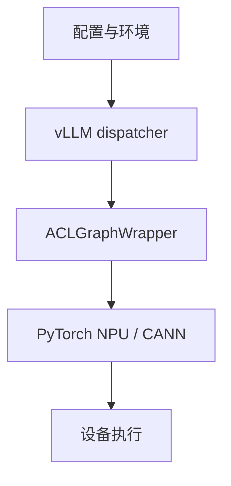

Ascend 图模式的报错经常跨越 Python、编译后端、vLLM wrapper 和 CANN。先按层次定位，比盯着最后一行异常更快。没有 NPU 时可以完成配置审计、源码阅读和日志分类；capture、replay、正确性与性能仍要在目标设备复核。

## 软件层次

先确认版本组合和目标路径，再问问题属于哪一层：

| 现象              | 优先检查                         |
| ----------------- | -------------------------------- |
| 模式始终是 `NONE` | descriptor、配置、能力判断       |
| 编译失败          | FX graph、TorchAir、后端算子支持 |
| capture 失败      | 动态分配、stream、shape、预热    |
| replay 结果旧     | 固定 buffer、metadata 更新顺序   |
| 结果正确但变慢    | padding、同步、通信、命中率      |

## 配置判断

配置文件、环境变量和命令行参数可能在不同层被读取。阅读时记录“默认值 → 归一化 → dispatcher 使用”的完整链条，避免把一个未生效的变量当成开关。

建议先回答四个问题：

1. 当前请求是 prefill 还是 decode？
2. attention backend 和 KV cache layout 是否支持目标模式？
3. 图桶的 shape、batch、token 上限是否覆盖当前 descriptor？
4. wrapper 是否允许本轮更新所有变化的 metadata？

## 按现象排错

### 一直回退 `NONE`

这通常是能力判断或 key 不匹配，不一定是设备故障。记录 descriptor、候选桶、回退原因和当前 backend；不要只看最终 mode。

### 捕获成功，随后 replay 失败

优先查 buffer 是否被重新分配、stream/event 是否一致、capture 使用的 memory pool 是否仍然存活。若只有特定 batch 失败，比较该 batch 与捕获 key 的 shape 和 stride。

### 输出偶发旧值

确认本轮 token、position、block table 和 attention metadata 都写入捕获时的固定地址，并且写入发生在 replay 前。多流场景还要检查事件依赖。

### 日志说成功但没有加速

把初始化、首次 capture、稳态 replay、padding 比例和 fallback 分开计时。图模式可能节省提交，却增加 padding、同步或通信成本。

## 有设备后的验证路线

1. 固定软件版本、模型和输入分布。
2. 先跑 `NONE` 基线，确认输出和错误率。
3. 再逐步启用 `PIECEWISE`、`FULL`，记录每次回退。
4. 用 profiler 验证 capture/replay、同步和通信。
5. 最后比较稳态吞吐、首 token 延迟和显存。

## 检查点

- 先分层，再根据现象缩小范围。
- `FULL` 日志不是 replay 证据，编译成功也不是性能证据。
- fallback 和日志字段是排错能力的一部分，不应删除。

## 来源

- [vLLM-Ascend 文档](https://vllm-ascend.readthedocs.io/)
- [vLLM-Ascend compilation](https://github.com/vllm-project/vllm-ascend/tree/main/vllm_ascend/compilation)
- [Ascend CANN 文档](https://www.hiascend.com/document)
