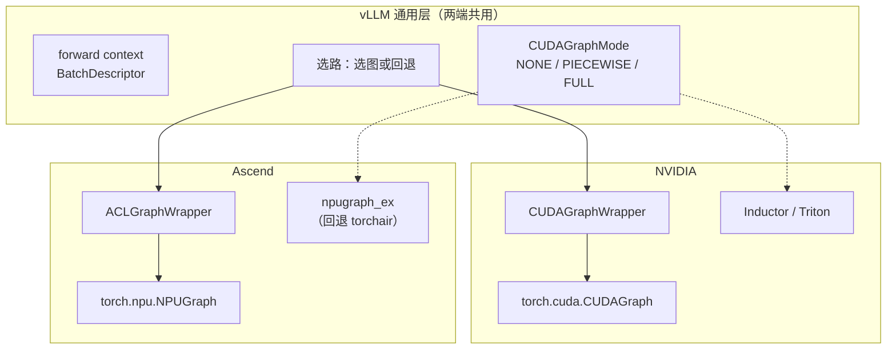

import BucketDispatch from '../../../../explainers/react/BucketDispatch';

前面六篇讲的是 CUDA。这一篇换一个后端，验证一件事：**前面那套抽象是不是真的通用**。

答案基本是肯定的——vLLM-Ascend 复用了同一套 forward context、同一套运行时模式、同一套描述符。但有一处差别值得专门留意，它直接关系到排错。

读完你能回答：ACLGraph / NPUGraph / TorchAir 分别在哪一层、Ascend 的 wrapper 和 CUDA 版差在哪、以及为什么那个差别会让某类 bug 更难发现。

> 本篇按本地快照 commit `28e9e97b` 的 vLLM-Ascend 代码写。**本机没有 NPU，也没有安装 CANN**，所有结论都来自静态源码阅读，没有运行验证。

## 两套栈的对应关系



逐层对照：

| 层         | NVIDIA                                                     | Ascend                         | 位置                                                    |
| ---------- | ---------------------------------------------------------- | ------------------------------ | ------------------------------------------------------- |
| 运行时模式 | `CUDAGraphMode`                                            | **同一个枚举**                 | `vllm/config/compilation.py:129-164`                    |
| 描述符     | `BatchDescriptor`                                          | **同一个类**                   | `vllm/forward_context.py:29-53`                         |
| 图 wrapper | `CUDAGraphWrapper`（`vllm/compilation/cuda_graph.py:144`） | `ACLGraphWrapper`              | `vllm_ascend/compilation/acl_graph.py:66`               |
| 设备图对象 | `torch.cuda.CUDAGraph`                                     | `torch.npu.NPUGraph`           | `acl_graph.py:55-63`（`ACLGraphEntry`）                 |
| 编译后端   | Inductor                                                   | `npugraph_ex`，回退 `torchair` | `vllm_ascend/compilation/compiler_interface.py:199-263` |

**通用层是真的共用的**，不是「各写一份长得像」。Ascend 通过平台 hook 把自己的 wrapper 注册进去[^ascend-platform-code]（`vllm_ascend/platform.py:242-246`）：

```python
@classmethod
def get_static_graph_wrapper_cls(cls) -> str:
    return "vllm_ascend.compilation.acl_graph.ACLGraphWrapper"
```

所以第 05 篇那套选路逻辑在 Ascend 上**原样适用**——描述符、六项兼容检查、命中与回退全都一样：

<BucketDispatch client:visible title="图 07-1：同一套选路逻辑，换后端不变" />

## wrapper 的四步工作流

`ACLGraphWrapper` 的 docstring 把流程写得很清楚[^ascend-acl-code]（`acl_graph.py:66-92`）：

1. 初始化时给 wrapper 指定一个运行时模式（`FULL` 或 `PIECEWISE`）。
2. 运行时从 forward context 拿到 `runtime_mode` 和 `batch_descriptor`，**无条件信任它们**。
3. 如果 `runtime_mode` 是 `NONE`，或者和 wrapper 自己的模式不符 → 直接调用原 runnable（不走图）。
4. 否则按 key 查缓存：没有就捕获一个新 entry，有就重放。

第 2 步的「blindly trust」很关键：**wrapper 不做判断，判断在选路那一层已经做完了**。这是一个干净的职责切分，也意味着 wrapper 层的 bug 通常不是「选错了」，而是「选对了但执行出错」。

## 一处关键差别

`ACLGraphWrapper` 的 docstring 里有一段 CUDA 版没有的说明：

> **ACLGraphWrapper does not store persistent buffers or copy any runtime inputs into that buffers for replay.** We assume implementing them is done outside of the wrapper. That is because we do not make any assumption on the dynamic shape (batch size) of the runtime inputs, as a trade-off for staying orthogonal to compilation logic. Nevertheless, tracing and checking the input addresses to be consistent during replay is guaranteed when `VLLM_LOGGING_LEVEL == "DEBUG"`.

拆开看三件事：

1. **wrapper 不管理持久缓冲区**，也不把运行时输入 copy 进去。第 03 篇那条「必须用固定地址的静态缓冲区」依然成立——只是**这件事由 wrapper 之外的代码负责**。
2. 这是一个有意的取舍：wrapper 不对输入的动态形状做任何假设，以此保持与编译逻辑正交。
3. **地址一致性检查只在 `VLLM_LOGGING_LEVEL == "DEBUG"` 下进行。**

第 3 点直接关系到排错。回忆第 03 篇那个最常见的 bug：给 Python 变量重新赋值而不是 `copy_`，图读的还是旧地址——**不报错，结果错**。在 Ascend 这条路径上，默认日志级别下**连地址检查都不做**，这类错误会更安静。

对应的字段是 `ACLGraphEntry.input_addresses`（`acl_graph.py:55-63`），注释写着「for aclgraph debugging, track the input addresses during capture, and check if they are the same during replay」。

**实践结论：在 Ascend 上调试图模式相关的数值问题时，第一步就应该把 `VLLM_LOGGING_LEVEL` 设成 `DEBUG`**，让地址检查生效。

## 编译后端：npugraph_ex 与 TorchAir

这是最容易混淆的一层。`compiler_interface.py:199-263` 的逻辑是[^ascend-compiler-code]：

```python
# Try npugraph_ex first, fall back to torchair for backward compatibility.
try:
    import npugraph_ex as nge
    ...
    backend = nge.get_npu_backend(compiler_config=config)
except ImportError:
    from torchair import get_npu_backend
    ...
```

**先试 `npugraph_ex`，导入失败才回退 `torchair`。** 两者都是把 FX graph 接到 NPU 编译器上——对应 NVIDIA 侧的 Inductor，属于**编译图**那一层（第 02 篇），不是设备图。

所以三个名字各自归位：

| 名字                           | 哪一层                       | 对应 NVIDIA 的         |
| ------------------------------ | ---------------------------- | ---------------------- |
| **TorchAir** / **npugraph_ex** | 编译图（torch.compile 后端） | Inductor               |
| **NPUGraph**                   | 设备图对象                   | `torch.cuda.CUDAGraph` |
| **ACLGraph**                   | 设备图机制的统称             | CUDA Graph             |

把 TorchAir 和 ACLGraph 当成一回事，是读这块资料时最常见的错误。它们分属第 02 篇和第 03 篇讲的两种图，**可以单独开关**。

### 一个值得看的工程细节

`compiler_interface.py` 里有一段缓存逻辑：编译好的图会被写到磁盘缓存，但**含 Triton kernel 的图不缓存**，理由写在注释里：

> Triton kernel indices (kernel_side_table) are registered in-process at compile time and are not serializable across process boundaries.

Triton 的 kernel 索引是进程内注册的，跨进程反序列化会在 `kernel_side_table.get_kernel()` 处断言失败。于是实现选择**跳过这类图的缓存**而不是冒险。

这类细节说明一件事：**编译缓存不是全有或全无的**。如果你发现某些图每次启动都要重编译，可能不是配置问题，而是它命中了这类不可缓存的情形。

## 代码实现

本篇没有新的 toy——第 05、06 篇的选路模型在 Ascend 上原样适用，因为那一层代码是共用的。

要在 Ascend 上确认图模式真的生效，查这处日志（`acl_graph.py:190`，DEBUG 级别）：

```
Capturing ACL graph ...          ← 捕获发生了
```

对照 NVIDIA 侧（`vllm/compilation/cuda_graph.py:272`）：

```
Capturing a cudagraph on (...)
```

两端的日志语义一致，而且都是 `debug` 级别——**默认看不到**。另有一条跳过捕获的 warning 在 `vllm/v1/worker/gpu/model_runner.py:1142`。

## 代价与边界

- 本篇全部来自静态源码阅读。**本机没有 NPU、没有装 CANN，没有运行任何捕获**，也不给任何性能数字。
- vLLM-Ascend 的 API 跟随 vLLM 上游变动，而且还要匹配 CANN、驱动、torch_npu 的版本。本篇行号按 commit `28e9e97b`，换版本必须重新核对。
- `npugraph_ex` 与 `torchair` 的能力差异、各自支持哪些算子、在什么情况下回退，本篇没有展开——那需要在真实环境里验证。
- 「通用层是共用的」是从代码结构得出的结论；具体到某个算子或某个 attention 后端在 Ascend 上能不能进图，仍要按第 04 篇那套边界逐条确认。

## 自测

1. TorchAir、NPUGraph、ACLGraph 分别在哪一层？哪两个属于同一层？
2. Ascend 的 wrapper 和 CUDA 版在「持久缓冲区」上的职责划分有什么不同？这个差别带来什么风险？
3. 为什么在 Ascend 上排查图模式的数值问题要先设 `VLLM_LOGGING_LEVEL=DEBUG`？
4. 平台是通过哪个 hook 把自己的 wrapper 注册进 vLLM 通用层的？这种设计让哪些代码得以共用？
5. 为什么含 Triton kernel 的图不进编译缓存？这会表现成什么现象？

## 来源

- 行号按本地快照 `reference/vllm-ascend`（commit `28e9e97b`）、`reference/vllm`（commit `cf5cea2d`）
- [vLLM-Ascend 仓库](https://github.com/vllm-project/vllm-ascend) · [Ascend CANN 文档](https://www.hiascend.com/document)
- 下一篇：[08 · 排错](../08-debugging/)——把前面七篇的判断串成一条排查路径。

[^ascend-platform-code]: `vllm_ascend/platform.py:242-246`（get_static_graph_wrapper_cls）。

[^ascend-acl-code]: `vllm_ascend/compilation/acl_graph.py:55-92`（ACLGraphEntry 与 ACLGraphWrapper；工作流与缓冲区说明见 docstring）。

[^ascend-compiler-code]: `vllm_ascend/compilation/compiler_interface.py:199-263`（npugraph_ex → torchair 回退、编译缓存）。
