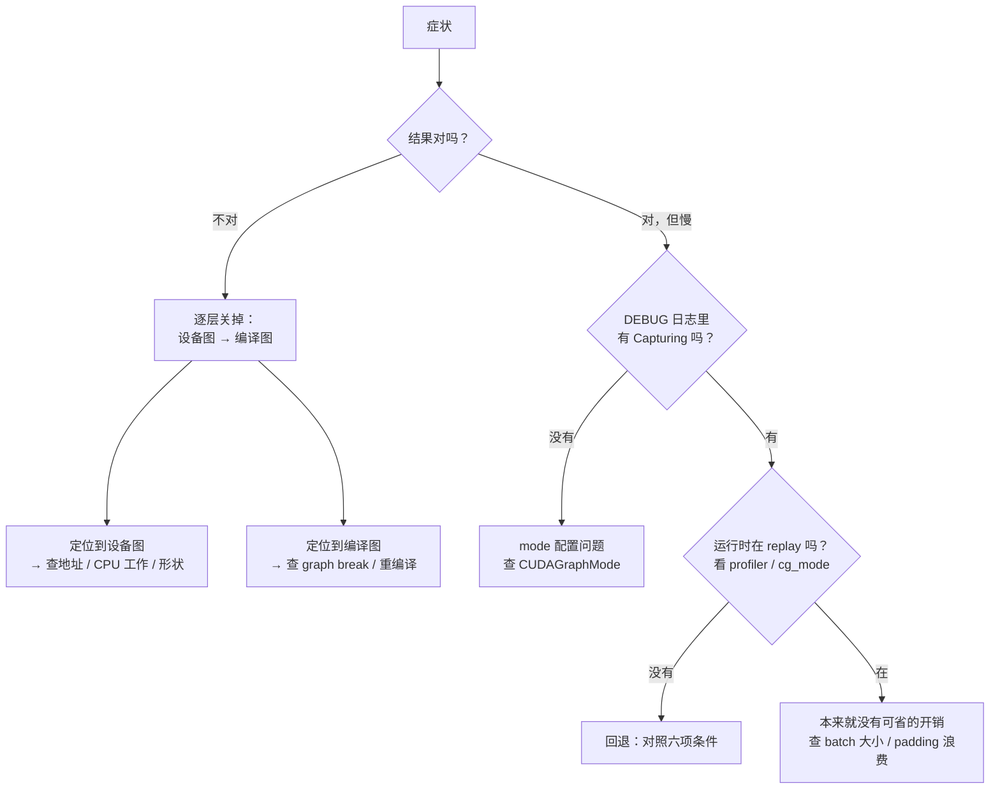

import SubmitTimeline from '../../../../explainers/react/SubmitTimeline';

前面七篇讲了机制。这一篇讲「出事了怎么办」。

图模式的问题有个共同特点：**大部分不报错**。回退是合法路径，地址用错只是数值不同，CPU 工作被跳过更是悄无声息。所以排查的第一步永远不是「找错误」，而是**先确认现在到底在走哪条路**。

## 三类症状

| 症状                    | 最可能的原因                                     | 去第几节 |
| ----------------------- | ------------------------------------------------ | -------- |
| **开了图模式但没变快**  | 根本没走图（静默回退），或者本来就没有可省的开销 | §1、§2   |
| **结果不对 / 数值漂移** | 固定地址被破坏，或 CPU 工作被跳过                | §3       |
| **启动很慢 / 显存爆**   | 图太多（桶太密），或内存池问题                   | §4       |

## §1 第一步：确认在走哪条路

**不要从「为什么慢」开始，要从「有没有走图」开始。** 这一步做完能砍掉一半的可能性。

```bash
# NVIDIA：捕获日志是 debug 级别，默认看不到
VLLM_LOGGING_LEVEL=DEBUG vllm serve ... 2>&1 | grep -i "capturing a cudagraph"

# Ascend：同上，而且 DEBUG 还会打开输入地址一致性检查
VLLM_LOGGING_LEVEL=DEBUG python -m vllm.entrypoints... 2>&1 | grep -i "capturing acl graph"
```

对应的源码位置：

| 日志                                  | 位置                                       | 含义                      |
| ------------------------------------- | ------------------------------------------ | ------------------------- |
| `Capturing a cudagraph on (...)`      | `vllm/compilation/cuda_graph.py:272`       | 某个 key 的图**被捕获了** |
| `Capturing ACL graph (...)`           | `vllm_ascend/compilation/acl_graph.py:190` | 同上，Ascend              |
| `Skipping ... CUDA graph capture ...` | `vllm/v1/worker/gpu/model_runner.py:1142`  | 压根没打算捕获            |

**两个必须分清的事实**：

- 看到「Capturing」只能说明**启动时建过这张图**，不等于**请求时用上了**。
- 没看到任何 Capturing，说明 mode 是 `NONE` 或 manager 判定不需要捕获——这时去查配置，不是查性能。

要确认「请求时是否真的在 replay」，得看 profiler 或者 `cg_mode` 相关的运行时统计（`make_cudagraph_stats`，`cudagraph_utils.py:93-102`，里面有 `num_paddings` 和 `runtime_mode`）。

## §2 没走图：对照六项条件

确认了「建了图但没用上」，就是回退。按第 05 篇那六项条件逐条对：

| #   | 条件                | 常见触发                 | 怎么确认                               |
| --- | ------------------- | ------------------------ | -------------------------------------- |
| 1   | 每请求 token 数相等 | batch 里混进了 prefill   | 看这一轮是不是纯 decode                |
| 2   | query 长度上界      | 投机解码让 query_len > 1 | 看是否开了 MTP / speculative           |
| 3   | 请求数容量          | 并发超过最大桶           | 对比并发数与 `cudagraph_capture_sizes` |
| 4   | token 容量          | 同上                     | 同上                                   |
| 5   | **LoRA 数相等**     | 请求带了不同的 LoRA      | 看是否启用 LoRA                        |
| 6   | **ubatch 数相等**   | 开了 DBO / 微批          | 看相关配置                             |

第 1 条是最常见的：**只要 batch 里混进一个 prefill，`uniform` 就为 false，整轮配不上 decode 图**。这也是 `FULL_DECODE_ONLY` 这个模式存在的原因——它承认了「只有纯 decode 轮次才有机会走整图」。

第 05 篇的 `toy.py` 可以直接拿来对：把你的真实 batch 参数填进去，看它命中哪个桶、或者卡在哪一条。

### 没走图之外：走了图也可能不快

如果确认在 replay 却仍然没变快，回到第 00 篇那个结论：**图模式只在提交开销暴露在关键路径上时才有收益**。

<SubmitTimeline
  client:visible
  mode="eager"
  launchCost={0.2}
  ops={[
    { name: 'norm', exec: 3 },
    { name: 'qkv', exec: 8 },
    { name: 'attn', exec: 10 },
    { name: 'out', exec: 6 },
    { name: 'ffn', exec: 12 },
  ]}
  title="图 08-1：算子够大时，eager 的设备空闲已经接近 0——这种情况下图模式没有可省的"
/>

自检三个问题：

1. batch 是不是已经很大（算子够大，提交被掩盖）？
2. 是不是 prefill 为主的负载（本来就不是提交受限）？
3. padding 浪费是不是吃掉了收益（第 06 篇：均匀分桶能浪费 71.8%）？

**第 3 条尤其容易被忽略**：桶设计得差时，图模式省下的提交时间可能还不够补 padding 多算的那部分。

## §3 结果不对：三个静默陷阱

数值问题几乎总是落在第 03 篇那三条「静默」约束上。按这个顺序查：

### ① 地址被换掉了（约束 8）

```python
static_in = new_tensor          # ✗ 图里的指针没变，replay 读的还是旧数据
static_in.copy_(new_tensor)     # ✓
```

**确认办法**：Ascend 上设 `VLLM_LOGGING_LEVEL=DEBUG`，`ACLGraphEntry.input_addresses` 的检查会生效（`acl_graph.py:55-63`）。NVIDIA 侧 `CUDAGraphWrapper` 也有 `is_debugging_mode`（`cuda_graph.py:190`）。

**特征**：结果「像是上一轮的」或者固定不变。

### ② CPU 工作被跳过（约束 7）

被捕获的代码里的 Python 逻辑 replay 时**一次都不执行**：计数器不增、缓存不更新、条件不重算。

**特征**：某个状态在 eager 下正常、开图之后就不动了。

### ③ 形状对不上（约束 9）

padding 到桶之后，如果某处仍按**真实长度**而不是**padding 后的长度**取数据，就会读到 padding 区域的垃圾。

**特征**：只有某些 batch 大小出错，且往往是非 2 的幂的那些。

### 分治确认

三者都可以用同一个方法定位——**逐层关掉**：

```
cudagraph_mode=NONE  + 编译开  → 还错吗？  错 → 不是设备图的问题，查编译
cudagraph_mode=NONE  + 编译关  → 还错吗？  错 → 和图模式无关，查模型/kernel
                                            对 → 问题在编译图
                                 上一行对 → 问题在设备图，回到 ①②③
```

这个顺序之所以有效，是因为第 02 篇那条结论：**编译图和设备图是两件正交的事，可以分别开关**。

## §4 启动慢 / 显存爆

| 现象                   | 原因                                                      | 处理方向                       |
| ---------------------- | --------------------------------------------------------- | ------------------------------ |
| 启动阶段卡很久         | 桶太多，每个都要 `_dummy_run` 捕获一遍                    | 减少 `cudagraph_capture_sizes` |
| 显存比 eager 高一截    | 每张图的私有内存池 + 固定缓冲区                           | 同上；评估整图 vs 分段         |
| 某些图每次启动都重编译 | 命中了不可缓存的情形（如含 Triton kernel 的图，第 07 篇） | 看编译缓存日志                 |

捕获发生在 `capture_model`（`vllm/v1/worker/gpu/model_runner.py:1132-1175`），由 `_dummy_run` 用假数据触发（`:878-900`）。**桶的数量直接决定启动时间和显存占用**——第 06 篇的练习五就是在做这个权衡。

## 一条完整的排查路径



## 一份最小检查清单

排查前先把这些问题答出来，很多时候答完就知道原因了：

1. 这一轮是纯 decode 还是混合批次？（条件 1）
2. 并发数的上界是多少？最大的桶是多少？（条件 3、4）
3. 有没有启用 LoRA、投机解码、DBO？（条件 2、5、6）
4. `VLLM_LOGGING_LEVEL=DEBUG` 下看得到 Capturing 吗？
5. batch 典型值是多少？算子够大吗？（图模式还值不值得）
6. 桶的分布贴着实际负载吗？padding 浪费多少？

## 代价与边界

- 本篇的日志名与行号按本地快照（vLLM `cf5cea2d`、vLLM-Ascend `28e9e97b`）。**这块变动频繁**，用之前先在自己的版本里 grep 一遍。
- 「逐层关掉」的分治法假设编译图与设备图可独立开关。某些配置组合（如 `reduce-overhead`）会把两者绑在一起，要用更底层的开关。
- 本机没有 GPU/NPU：本篇**没有任何实测**，所有命令和日志都来自源码阅读，没有在真实服务上跑过。
- 性能结论最终只能由 profiler 加可重复对照得出。日志只能证明「某条路径被选中」，不能证明「快了多少」。

## 自测

1. 为什么排查要从「有没有走图」开始，而不是从「为什么慢」开始？
2. 看到 `Capturing a cudagraph` 能说明什么、不能说明什么？
3. 结果不对时，为什么要先关设备图再关编译图？这利用了哪条结论？
4. 「走了图但没变快」的三种可能分别是什么？
5. 一个服务并发稳定在 12，桶是 `[1,2,4,8]`。会发生什么？在日志里表现成什么？

## 来源

- 日志与入口：`vllm/compilation/cuda_graph.py:272`、`vllm/v1/worker/gpu/model_runner.py:1132-1175`、`vllm_ascend/compilation/acl_graph.py:190`
- 运行时统计：`vllm/v1/worker/gpu/cudagraph_utils.py:93-102`（`make_cudagraph_stats`）
- 兼容条件：`vllm/v1/worker/gpu/cudagraph_utils.py:115-142`
- 行号按本地快照 `reference/vllm`（`cf5cea2d`）与 `reference/vllm-ascend`（`28e9e97b`）
- 上一篇：[07 · Ascend 图模式](../07-ascend/)
- 回到 [系列首页](../)
