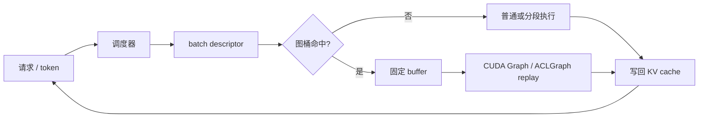

这套文章只追一条链：**请求怎样变成 batch，batch 怎样选到图桶，固定地址里的工作怎样被 replay**。先讲可在 CPU 上阅读的控制流，再讲需要 GPU/NPU 才能验证的设备行为。文章不要求本机有 GPU/NPU，也不要求安装 CUDA、CANN 或 PyTorch。

## 阅读路线

| 章                                                      | 你会解决的问题                                     |
| ------------------------------------------------------- | -------------------------------------------------- |
| [00 · 一次 decode 提交了什么](./00-inference-overhead/) | prefill、decode、KV cache 和提交开销分别在哪一层？ |
| [01 · 编译图](./01-compile-graphs/)                     | FX、guards、graph break 和设备图有什么关系？       |
| [02 · CUDA Graph](./02-cuda-graph/)                     | capture、固定地址和 replay 为什么需要图桶？        |
| [03 · 边界](./03-cuda-boundaries/)                      | 动态 shape、通信、内存池和多流应该放在哪里？       |
| [04 · vLLM 选路](./04-vllm-dispatch/)                   | descriptor、dispatcher、wrapper 如何共同决定模式？ |
| [05 · 无设备练习](./05-dispatch-practice/)              | 不装依赖怎样练习桶匹配、padding 和回退？           |
| [06 · Ascend 图模式](./06-ascend-graph/)                | TorchAir、NPUGraph、ACLGraph 分别处在哪一层？      |
| [07 · Ascend 排错](./07-ascend-debugging/)              | 日志显示回退、捕获失败或变慢时从哪里查？           |

推荐先读 00、05、01，再读 02–04；有 Ascend 代码阅读需求时接着读 06、07。

## 一张总图

编译图可能在这条链的前面生成 callable，设备图只负责重复提交已确定的设备工作。两者可以叠加，也可以单独使用。

## 统一术语

| 词         | 本系列中的含义                                      |
| ---------- | --------------------------------------------------- |
| eager      | 每轮由框架逐步执行算子                              |
| 编译图     | FX/后端表示的算子和数据依赖                         |
| 设备图     | 固定地址、shape、stream 和任务依赖的可重放工作      |
| descriptor | 描述本轮 batch、attention 和 cache 状态的运行时输入 |
| 图桶       | 一组固定 shape/地址约束的图实例                     |
| replay     | 提交已经捕获的设备工作                              |
| fallback   | 不满足约束时进入普通或分段执行                      |

## 证据等级

源码可以证明字段、调用顺序和分支条件；日志可以证明某个路径被选择或某个图被捕获；只有 profiler 和可重复对照才能证明设备上的时间收益。本文的 Mermaid、draw.io 和交互播放器都是机制示意，不是硬件 benchmark。

## 版本与环境边界

源码链接以文章标注的提交或当前主干为准，vLLM、vLLM-Ascend、PyTorch、CANN、驱动和模型 backend 的兼容性必须按目标部署重新核对。没有 GPU/NPU 时不要安装依赖或运行设备 capture；可先完成纯 Python 练习和静态源码审计。

## 参考入口

- [vLLM repository](https://github.com/vllm-project/vllm)
- [vLLM-Ascend repository](https://github.com/vllm-project/vllm-ascend)
- [PyTorch CUDA Graph 文档](https://docs.pytorch.org/docs/stable/notes/cuda.html)
- [Ascend CANN 文档](https://www.hiascend.com/document)
