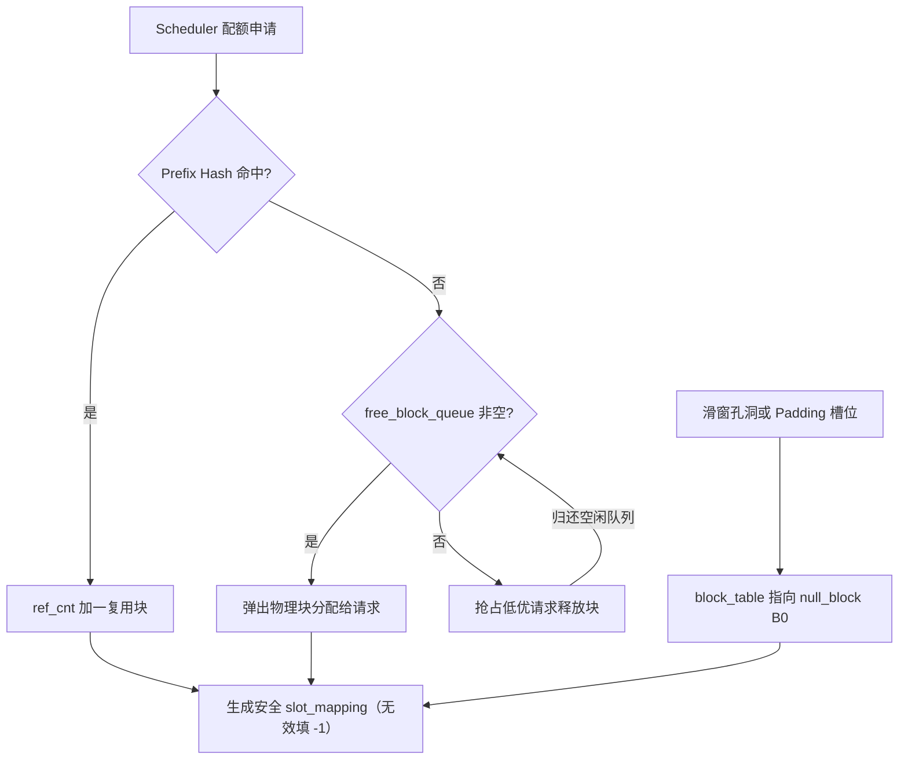

import PagedSchedulerExplainer from '../../../../explainers/vllm/PagedSchedulerExplainer';

当几十条提示词长短不一、生成步数各异的请求同时涌入推理服务时，运行时在每个前向步都要面对两个耦合难题。一方面要为动态增长的 **KV Cache（Key-Value Cache，键值缓存）**分配显存而不留碎片；另一方面要在不拖慢已有解码延迟的前提下，把新到达的提示词塞进同一批计算。

早期静态推理框架为每条请求预先申请长度为最大上下文上限 $L_{\max}$ 的连续显存数组。这种做法会同时制造两类物理浪费：第一类是**内部碎片**，请求往往远未达到 $L_{\max}$ 就遇到结束符提前退出，已预留却未写满的尾部槽位无法转借给其他请求，未来解码步的空间也被提前锁死。

第二类是**外部碎片**：不同大小的连续内存块随请求到达与退出反复申请释放，很快把整块显存切割成零散空隙。即便空闲总字节数充足，也凑不出一段足够长的连续空间。

## 从连续显存碎片到块表分页映射

借鉴操作系统虚拟内存的分页思路，PagedAttention 将每条请求逻辑上连续的 KV 序列切分为固定容量为 $B_s$ 个 token 的物理块（例如 $B_s = 16$），使显存分配颗粒缩减到按块按需步进[^paged-attention-paper]。

设某条请求当前处理到逻辑位置 $t \in \{0, 1, \dots, L-1\}$，物理块大小为 $B_s$，核心页表映射通过整除与取模完成两级寻址：

$$
\begin{aligned}
k &= \lfloor t / B_s \rfloor \\
b &= \text{block\_table}[k] \\
o &= t \bmod B_s \\
\text{slot\_mapping}[t] &= b \cdot B_s + o
\end{aligned}
$$

其中 $k$ 为逻辑块序号，$\text{block\_table}[k]$ 保存该逻辑块对应的物理块号 $b$，$o$ 为块内相对偏移，最终得到的扁平槽位号 $\text{slot\_mapping}[t]$ 直接交给底层注意力与缓存写入算子定位显存行。

以一个微型池为例：假设显存池共有 $16$ 个物理块（$B_0\text{–}B_{15}$），每块容纳 $B_s = 4$ 个 token。由于系统初始化时会从空闲队列头部永久弹出 $B_0$ 作为保留占位块 `null_block`[^vllm-block-pool]，实际可供请求分配的只有 $B_1\text{–}B_{15}$ 共 $15$ 块（$60$ 个有效槽位）。

若请求 A 写入 $12$ 个提示词 token 并映射到物理块 `[1, 2, 3]`，逻辑位置 $t = 9$ 落在第 $k = \lfloor 9 / 4 \rfloor = 2$ 个逻辑块（物理块 $b = 3$）、块内偏移 $o = 9 \bmod 4 = 1$，对应全局槽位 $3 \times 4 + 1 = 13$。随后请求 B 若与 A 共享前 $4$ 个系统提示词 token，就会直接复用物理块 $B_1$，只将新块分配在 $B_4$。

下面的交互推演展示了这一 16 块物理池在预留空块、前缀命中、混排预算、块满抢占与负槽位防护六种典型状态下的页表变化，可点击步进查看块表指针与空闲块计数。

<PagedSchedulerExplainer client:visible title="图 1：V1 调度器、Prefix Caching 与抢占交互推演" />

## 链式前缀缓存与零拷贝共享

多轮对话、系统提示词与少样本模板通常让大量并发请求拥有完全相同的开头前缀。**Prefix Caching（前缀缓存）**允许后续请求直接复用已经算好的历史 KV 物理块，省去重复前向计算与显存复制。

vLLM 只将 **full block（写满的完整物理块）**纳入标准前缀哈希索引[^vllm-kv-manager][^vllm-prefix-hash]。原因在于尚未写满的尾部块会在接下来的解码步继续追加新 token，其内部槽位内容仍在不断变化；如果允许共享未满块，多条请求后续各自生成不同 token 时就会在同一块上产生写冲突。此外，当整段提示词全部命中缓存时，`KVCacheManager` 会刻意将命中长度上限截断到 `prompt_length - 1`[^vllm-kv-manager]，确保至少重新计算最后一个 token 以产出采样所需的 logits。

在构建哈希键时，`hash_block_tokens` 会把上一块的哈希结果串成链式输入，连同当前块的 $B_s$ 个 token 与附加键一起计算摘要[^vllm-prefix-hash]：

$$
\begin{aligned}
h_k &= \operatorname{Hash}\bigl(h_{k-1},\; \text{tuple}(\text{tokens}_k),\; \text{extra\_keys}_k\bigr) \\
h_{-1} &= \text{NONE\_HASH}
\end{aligned}
$$

这种链式依赖源于因果自注意力的数学性质：位置 $t$ 生成的 Key 与 Value 状态不仅取决于当前词本身，还经过了前序注意力层与 $0 \dots t-1$ 所有历史 token 的上下文融合。如果省略父块哈希 $h_{k-1}$，两条系统设定不同、仅恰好出现相同后缀块文本的请求就会误判命中，进而读出污染后的历史 KV。附加字段 `extra_keys` 则进一步隔离多模态特征片段或 **LoRA（Low-Rank Adaptation，低秩适配）**适配器编号。

物理块的零拷贝复用与淘汰顺序由 `BlockPool` 中的引用计数 `ref_cnt` 与双向空闲队列共同维持[^vllm-block-pool]。当新请求命中已缓存块时，池管理器执行 `touch` 将该块的 `ref_cnt` 加一（若原值为 $0$ 则顺便将其从空闲队列摘除）；当请求结束或被抢占并释放块时，系统再把 `ref_cnt` 减一。

一旦 `ref_cnt` 归零，带有前缀哈希的块会被追加到空闲队列**尾部**，按 **LRU（Least Recently Used，最近最少使用）**顺序延后覆盖。不带哈希的普通块则直接插回队列**头部**，供后继请求按 **LIFO（Last-In First-Out，后进先出）**立刻重用，从而在有限显存中尽可能保住热点前缀。

## 统一预算调度与重算抢占

早期 V0 引擎把 **Prefill（预填充）**和 **Decode（解码）**拆成两个互斥执行阶段。一旦队列里插进一条上万 token 的长提示词，整批正在进行的解码请求就必须停下来等待该预填充跑完，形成明显的延迟毛刺。

vLLM V1 取消了这两类阶段的调度隔离。在每一步 `Scheduler.schedule()` 中，引擎只维护一个全局 token 配额上限 `token_budget` 与统一的调度映射 `num_scheduled_tokens`[^vllm-scheduler]。调度器眼里没有独立的 Prefill 或 Decode 模式。每条请求只记录已计算长度 `num_computed_tokens` 与含草稿目标长度 `num_tokens_with_spec`。图 2 展示了这套统一调度器到硬件 KV 写入算子的完整流向。


每轮调度优先遍历运行中的请求。自回归生成通常只申请 $1$ 个新 token；推进中的 **Chunked Prefill（分块预填充）**切片则按单步阈值与剩余 `token_budget` 切出一段。还有剩余预算时再从等待队列接纳新请求。按照前文 16 token 预算的微例，两条解码请求各占 $1$ 个 token，剩余 $14$ 个预算正好分给一条长提示词切片，三者在同一个前向步内混合批执行。

并发骤增把 $B_1\text{–}B_{15}$ 全部分配殆尽后，若已有运行请求的解码扩容申请新块失败，调度器必须立即触发抢占[^vllm-scheduler]。在默认 **FCFS（First-Come First-Served，先到先服务）**策略下，引擎从运行队列末尾摘出最近加入或优先级最低的请求，回收它持有的物理块以保住高进度解码请求。随后，被抢占请求的 `num_computed_tokens` 归零并插回等待队列头部等待重启，即 **Recompute（重算）抢占**。

早期 Swap 策略会把被驱逐请求的 KV 整批拷回主机内存，恢复时再搬回显存。相比之下，V1 默认采用 Recompute 抢占源于算力与带宽的现实对比：现代加速卡的矩阵乘算力充裕。系统保留了未覆盖的尾部缓存块。待资源宽裕时分段重算前缀，往往比跨 **PCIe（Peripheral Component Interconnect Express，高速串行总线）**换入换出开销更低、尾部延迟也更稳。图 3 总结了物理块在分配、前缀命中、抢占回收与占位防护之间的状态流转。



## 空占位块与负槽位边界防护

在静态图或滑动窗口等生产场景下，批处理张量常会混入用于对齐批形状的 `Padding token`，或出现滑窗淘汰留下的局部空洞。为了同时守住内存“读安全”与“写安全”，vLLM 在页表层与槽位层各自设置了独立哨兵。

读路径由 `null_block`（固定为 `block_id = 0`）负责兜底[^vllm-block-pool]。当某组 `Padding` 槽位没有分配任何物理块，或滑窗注意力的前沿块已被释放回收时，页表整理 Kernel 会把对应 `block_table` 条目统一写为 0[^vllm-block-table]。因为块 0 永不分配给真实用户且经过零初始化，底层注意力 Kernel 无需在热循环里加条件分支判断槽位有效性。所有读访存都会落在合法内存页上，既避免非法地址访问，也杜绝读入残留 `NaN` 污染在线 Softmax 归约。

仅有读保护还不足以保障写安全。如果多个 `Padding token` 顺着 `block_table` 指向的块 0 同时写入无效键值，会在共享页上引发无意义的写竞争。更危险的是上一轮分块预填充留下了合法的旧槽位编号，若下一轮批大小缩容时未抹除缓冲尾部的旧数据，写入算子就会顺着残余编号覆写其他请求的活跃 KV 页。

为此，槽位计算 Kernel 在构建 `slot_mapping` 时，会把所有 `Padding` 槽位及真实 token 之后的整个填充尾部显式覆写为 `PAD_SLOT_ID = -1`[^vllm-attn-utils][^vllm-block-table]。NVIDIA GPU 与昇腾 NPU 的写入算子在核内遇到负槽位时均直接跳过写回操作，形成读写双向隔离。

## 链式哈希验证与双仓源码对照

下面这段自包含的 Python 代码演示了 `BlockPool` 保留 `null_block` 与链式前缀哈希（支持任意大于 255 的真实词表 ID，能区分同文本但前缀不同的块）。代码同时验证了 V1 统一 16 token 预算混排，以及 `PAD_SLOT_ID = -1` 对块 0 的写保护：

```python
import hashlib
from collections import deque
import torch

num_blocks, block_size, PAD_SLOT_ID = 16, 4, -1
free_queue = deque(range(num_blocks))
null_block = free_queue.popleft()  # 永久保留 B0 作为 null_block
assert null_block == 0 and len(free_queue) == 15

NONE_HASH = hashlib.sha256(b"vllm-none-hash").digest()[:8]
prefix_cache: dict[bytes, int] = {}
ref_cnt = {i: 0 for i in range(num_blocks)}

def hash_block_tokens(parent_hash: bytes, chunk: list[int]) -> bytes:
    # 串联父块哈希与当前块元组，保护因果前缀并支持任意词表 token ID
    payload = parent_hash + repr(tuple(chunk)).encode("utf-8")
    return hashlib.sha256(payload).digest()[:8]

def alloc_prompt(tokens: list[int]) -> list[int]:
    table, parent_hash = [], NONE_HASH
    for off in range(0, len(tokens), block_size):
        chunk = tokens[off : off + block_size]
        if len(chunk) == block_size:
            h = hash_block_tokens(parent_hash, chunk)
            parent_hash = h
            if h in prefix_cache:
                bid = prefix_cache[h]
                ref_cnt[bid] += 1
                table.append(bid)
                continue
            bid = free_queue.popleft()
            ref_cnt[bid] = 1
            prefix_cache[h] = bid
            table.append(bid)
        else:
            bid = free_queue.popleft()
            ref_cnt[bid] = 1
            table.append(bid)
    return table

sys_tok = [1024, 1025, 1026, 1027]
shared_tail = [2048, 2049, 2050, 2051]
req_a = alloc_prompt(sys_tok + [3001, 3002, 3003, 3004] + shared_tail)
req_b = alloc_prompt(sys_tok + shared_tail)
# req_b 仅命中前缀块 B1；因父哈希不同，shared_tail 不会被错映射到 B3
assert req_a == [1, 2, 3] and req_b == [1, 4] and ref_cnt[1] == 2

num_scheduled_tokens = {"reqA": 1, "reqB": 1, "reqC": 14}
assert sum(num_scheduled_tokens.values()) == 16

# 按页表公式计算 slot = b * block_size + o，填充位置置 PAD_SLOT_ID = -1
slot_a = req_a[10 // block_size] * block_size + (10 % block_size)
slot_b = req_b[4 // block_size] * block_size + (4 % block_size)
slot_mapping = torch.tensor([slot_a, slot_b, PAD_SLOT_ID, PAD_SLOT_ID])
kv_cache = torch.zeros(num_blocks * block_size, 4)
new_kv = torch.tensor([[1.0], [2.0], [99.0], [99.0]]).expand(4, 4)
valid = slot_mapping >= 0
kv_cache[slot_mapping[valid]] = new_kv[valid]
assert kv_cache[0:block_size].sum().item() == 0.0

print(
    f"req_a={req_a}, req_b={req_b}, shared_blk=1, "
    f"ref_cnt={ref_cnt[1]}, free={len(free_queue)}"
)
budget_used = sum(num_scheduled_tokens.values())
null_sum = kv_cache[0:block_size].sum().item()
print(
    f"budget_used={budget_used}/16, "
    f"slots={slot_mapping.tolist()}, null_sum={null_sum:.1f}"
)
```

运行输出如下：

```text
req_a=[1, 2, 3], req_b=[1, 4], shared_blk=1, ref_cnt=2, free=11
budget_used=16/16, slots=[14, 16, -1, -1], null_sum=0.0
```

在上游 `vllm` 与昇腾 `vllm-ascend` 的生产源码中，调度器、块池及槽位保护协议高度一致，底层 KV 写入路径则分别调用各自平台的 Scatter 写入 Kernel[^vllm-flash-attn][^ascend-kv-cache]：

```python
# Upstream: vllm/v1/attention/backends/flash_attn.py:1431-1440 (vllm@bb23c0a8)
reshape_and_cache_flash(
    key, value, key_cache, value_cache, slot_mapping,
    self.kv_cache_dtype, layer._k_scale, layer._v_scale,
)

# Upstream: vllm_ascend/attention/attention_v1.py:1867-1873 (vllm-ascend@3649b8ff)
torch_npu.npu_scatter_pa_kv_cache(
    key=key[: attn_metadata.num_actual_tokens],
    value=value[: attn_metadata.num_actual_tokens],
    key_cache=k_cache_layer, value_cache=v_cache_layer,
    slot_mapping=slots[: attn_metadata.num_actual_tokens],
)
```

| 调度与缓存维度 | GPU（`vllm` `bb23c0a8`）         | 昇腾 NPU（`vllm-ascend` `3649b8ff`） |
| -------------- | -------------------------------- | ------------------------------------ |
| 统一批配额调度 | `Scheduler.schedule` 单一配额    | 复用上游 V1 调度框架                 |
| 占位块与负槽位 | `block 0` 占位，尾填 `-1`        | 同协议，Kernel 粒度展开页表          |
| KV 写入实现    | `reshape_and_cache_flash` 跳负槽 | `npu_scatter_pa_kv_cache` 写分形池   |

当融合算子物理块大小与调度块大小不同时，`AscendBlockTables` 会在写入设备前按倍率展开管理器块号。同时它还会维护 `int32` 类型的 `slot_mappings`，以对齐 CANN Scatter 写入算子的入参要求[^ascend-block-table]。

到这里，显存碎片与批配额混合调度已经理顺，但在小批量解码场景下做性能采样时，设备执行轨依然充满空白间隔——瓶颈源于 CPU 把指令递交给硬件的速度落后于硬件消耗的速度。下一章[第 2 章：异步执行模型与发射墙](../02-async-execution-and-launch-wall/)将拆解主机与设备之间的异步发射队列为何以及何时会发生断流。

[^paged-attention-paper]: Woosuk Kwon 等，“Efficient Memory Management for Large Language Model Serving with PagedAttention”，SOSP 2023，[arXiv:2309.06180](https://arxiv.org/abs/2309.06180)，§3–§4.5。

[^vllm-block-pool]: `vllm`（commit `bb23c0a8`），`vllm/v1/core/block_pool.py:129-174`（`BlockPool.__init__` 弹出 `block_id=0` 作为 `null_block`）与 `774-840`（`touch` 与 `free_blocks` 的 LRU/LIFO 队列管理）。

[^vllm-kv-manager]: `vllm`（commit `bb23c0a8`），`vllm/v1/core/kv_cache_manager.py:287-349`（`get_computed_blocks` 将命中上限设为 `prompt_length - 1`）与 `400-490`（`allocate_slots`）。

[^vllm-prefix-hash]: `vllm`（commit `bb23c0a8`），`vllm/v1/core/kv_cache_utils.py:697-727`（`hash_block_tokens` 从 `NONE_HASH` 起串联 `parent_block_hash`）与 `972-1012`（仅对满块生成链式哈希）。

[^vllm-scheduler]: `vllm`（commit `bb23c0a8`），`vllm/v1/core/sched/scheduler.py:691-985`（`Scheduler.schedule` 统一 `token_budget` 与 LIFO 抢占循环）及 `1814-1859`（`_preempt_request` 释放物理块并重置进度回退到等待队列）。

[^vllm-block-table]: `vllm`（commit `bb23c0a8`），`vllm/v1/worker/gpu/block_table.py:173-224`（`gather_block_tables` 屏蔽滑窗过期块）与 `347-427`（`_compute_slot_mappings_kernel` 抹除尾部并填入 `PAD_ID`）。

[^vllm-attn-utils]: `vllm`（commit `bb23c0a8`），`vllm/v1/attention/backends/utils.py:55-56`（定义 `PAD_SLOT_ID = -1` 与 `NULL_BLOCK_ID = 0`）。

[^vllm-flash-attn]: `vllm`（commit `bb23c0a8`），`vllm/v1/attention/backends/flash_attn.py:1378-1440`（`FlashAttentionImpl.forward` 与 `do_kv_cache_update` 调用 `reshape_and_cache_flash`）。

[^ascend-kv-cache]: `vllm-ascend`（commit `3649b8ff`），`vllm_ascend/attention/attention_v1.py:1841-1876`（调用 `torch_npu.npu_scatter_pa_kv_cache` 写入 `PA_NZ` 分形缓存）及 `vllm_ascend/attention/attention_c8_mxfp.py:290`（说明算子跳过负槽位 `PAD_SLOT_ID`）。

[^ascend-block-table]: `vllm-ascend`（commit `3649b8ff`），`vllm_ascend/worker/v2/block_table.py:55-167`（`AscendBlockTables` 按 `blocks_per_kv_block` 展开块表并维护 `int32` 类型 `slot_mappings`）。
