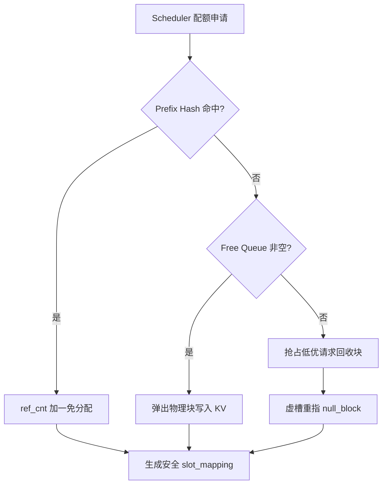

import PagedSchedulerExplainer from '../../../../explainers/vllm/PagedSchedulerExplainer';

在[基础 03：KV Cache 与 GQA](../../foundations/03-kv-cache-and-gqa/)和[DeepSeek 架构演进总览](../../deepseek/10-architecture-synthesis/)中，我们拆解了单步前向时 Attention 与 MLA 在计算层的张量路径。接下来进入推理引擎层，先解决最前端的问题：**几十条长度各异的请求同时涌入时，引擎如何在不浪费显存、也不卡死计算流的前提下把它们塞进同一个批处理步？**

传统推理把每条请求的 KV Cache 预先分配为最大长度连续显存，导致高达六成空间被内部和外部碎片吞噬。vLLM 借鉴操作系统虚拟内存分页思想提出 **PagedAttention**：将逻辑上连续的 Token 上下文切分为固定大小的 Block，再经块表离散映射到物理显存池。

## 从连续显存碎片到 BlockPool 页表映射

假设某层单 Token 的 KV 字节为 $s_{\text{tok}}$，若系统强制为支持 $L_{\max}=4096$ 的请求预留连续数组，即使该请求第 10 步就生成 EOS 结束，剩余 $4086$ 个槽位也无法被他人复用。切分成块大小为 $B_s$（例如 16 或 4）的物理块后，分配颗粒瞬间缩小为按需步进。

但在工程实现中，物理块池藏着一个极易被忽略的哨兵细节：在 `vllm` V1 的 `BlockPool.__init__` 初始化时，引擎首先从 `free_block_queue` 头部永久弹出 `block_id = 0` 作为 **`null_block`** 占位块[^1]。

这意味着一个容量为 16 块的物理池里，真正能分给用户请求的只有 $B_1\text{–}B_{15}$ 共 15 块，而 $B_0$ 专门兜底 Graph 虚填充请求与被驱逐后的安全指针映射。

<PagedSchedulerExplainer client:visible title="图 1：V1 调度器、Prefix Caching 与抢占交互推演" />

**图 1** 的交互步完整还原了这套生命周期：第 1 步 $B_0$ 固定标为 `RSV (null_blk)`；第 2 至第 3 步两条请求因系统提示词完全一致，哈希命中物理块 $B_1$ 使 `ref_cnt` 升至 2，实现零重复 Prefill 与零冗余 KV 拷贝。

## V1 统一预算调度与抢占保护机制

早期 V0 引擎把 Prefill 与 Decode 拆成互斥分支，一条长请求未跑完就会阻塞整批 Decode 的延迟表现（即所谓 Prefill-Decode 阶段墙）。vLLM V1 彻底拆掉这道墙，如**图 2** 所示。


每轮 `Scheduler.schedule()` 只维护一个全局 `token_budget` 上限和统一的 `num_scheduled_tokens` 字典：先从正在运行的 Decode 请求各扣 1 个 token，再把剩余额度切给等待队列的 Chunked Prefill 切片。对应**图 1** 第 4 步中，两个 Decode（`+1`、`+1`）与长提示切片（`+14`）完美打满 `16` token 配额。

当突发并发把 $B_1\text{–}B_{15}$ 全部耗尽而某请求需要扩容新块时，`KVCacheManager` 分配失败，触发第 5 步的抢占机制：调度器从低优先级或队尾挑出牺牲请求（如 Req C），状态回退为 `PREEMPTED` 并整块归还 $B_5\text{–}B_8$，保住高频 Decode 请求不断流。

**图 3** 总结了物理块在分配、前缀复用、驱逐回收与空槽兜底四条状态路径之间的闭环流转。



最后也是最致命的一环落在**图 1** 第 6 步：当批处理为迎合静态图垫齐虚请求（Dummy Request）或刚发生抢占清理时，填充位置的 `slot_mapping` 必须显式写为 `PAD_SLOT_ID = -1`，而其 `block_table` 缺省指回 `B0`（`null_block`）。一旦写入内核忘记校验负槽位，虚请求就会把垃圾激活写穿有效 KV 页！

## PyTorch 核心实现与双平台源码对照

下面这段自包含的 PyTorch 代码浓缩了 `BlockPool` 保留 `null_block`、块级前缀哈希复用、V1 统一配额分配以及 `PAD_SLOT_ID = -1` 越界写保护的核心校验逻辑：

```python
import hashlib
from collections import deque
import torch

num_blocks, block_size, PAD_SLOT_ID = 16, 4, -1
free_queue = deque(range(num_blocks))
null_block = free_queue.popleft()  # 永久弹出 B0 作为 null_block
assert null_block == 0 and len(free_queue) == 15

prefix_cache: dict[bytes, int] = {}
ref_cnt = {i: 0 for i in range(num_blocks)}

def block_hash(tokens: list[int]) -> bytes:
    return hashlib.sha256(bytes(tokens)).digest()[:8]

def alloc_prompt(tokens: list[int]) -> list[int]:
    table = []
    for off in range(0, len(tokens), block_size):
        chunk = tokens[off : off + block_size]
        if len(chunk) == block_size and (h := block_hash(chunk)) in prefix_cache:
            bid = prefix_cache[h]
            ref_cnt[bid] += 1
            table.append(bid)
            continue
        bid = free_queue.popleft()
        ref_cnt[bid] = 1
        if len(chunk) == block_size:
            prefix_cache[block_hash(chunk)] = bid
        table.append(bid)
    return table

sys_tok = [10, 11, 12, 13]
req_a = alloc_prompt(sys_tok + [20, 21, 22, 23, 24, 25, 26, 27])
req_b = alloc_prompt(sys_tok + [30, 31, 32, 33])
assert req_a[0] == req_b[0] == 1 and ref_cnt[1] == 2 and len(free_queue) == 11

# V1 统一预算: 2 个 decode + 1 个 14-token prefill chunk
num_scheduled_tokens = {"reqA": 1, "reqB": 1, "reqC": 14}
assert sum(num_scheduled_tokens.values()) == 16

# 模拟 KV Cache 写入守卫：slot < 0 绝不写入 null_block(B0)
slot_mapping = torch.tensor([req_a[-1] * block_size, req_b[-1] * block_size, PAD_SLOT_ID, PAD_SLOT_ID])
kv_cache = torch.zeros(num_blocks * block_size, 4)
new_kv = torch.tensor([[1.0], [2.0], [99.0], [99.0]]).expand(4, 4)
valid = slot_mapping >= 0
kv_cache[slot_mapping[valid]] = new_kv[valid]
assert kv_cache[0:block_size].sum().item() == 0.0
```

上述代码在 `torch 2.15.0` 下验证输出的精确状态为：
`req_a=[1, 2, 3]`, `req_b=[1, 4]`, `shared_prefix_blk=1`, `ref_cnt=2`, `free=11`, `null_block_guard_sum=0.0`。

对照上游双仓实现，虽然两者共享同一套调度器与页表数据结构，但在最底层的 KV 写入算子与越界哨兵上各自对接原生硬件扩展：

| 模块职责            | NVIDIA GPU（`vllm` `bb23c0a8`）                                | 华为昇腾 NPU（`vllm-ascend` `3649b8ff`）                  |
| ------------------- | -------------------------------------------------------------- | --------------------------------------------------------- |
| 统一批配额调度      | `Scheduler.schedule()` 生成 `num_scheduled_tokens`[^2]         | 完全复用上游 `vLLM V1 Scheduler`，无额外分叉              |
| `null_block` 与块池 | `BlockPool.__init__` 弹出 `block_id=0` 占位[^1]                | 完全复用，并在 `PAD_SLOT_ID = -1` 上对齐                  |
| KV 写入算子实现     | `reshape_and_cache_flash`（CUDA/FlashAttn 内核跳过负槽位）[^3] | `torch_npu.npu_scatter_pa_kv_cache` 散列写入 HBM 页块[^4] |

在 `vllm` 侧，`flash_attn.py` 直接向融合内核传入 `slot_mapping`；而在 `vllm-ascend` 的 `attention_v1.py` 中，则会从层状态读取物理索引后调用 CANN 原生 `torch_npu.npu_scatter_pa_kv_cache` 将 Key/Value 散列落入多维分页格式[^4]。

然而当工程师打开 Profiler 观察刚跑通的连续批服务时，常常会撞见更反直觉的瓶颈：显存碎片的确没了，算子耗时也不长，可设备计算轨上却密密麻麻布满空白气泡。下一章我们沿着请求提交路径往下走：[第 2 章：异步执行模型与发射墙](../02-async-execution-and-launch-wall/)，拆解 CPU 到 GPU/NPU 之间的发射管道为何会卡死。

[^1]: `vllm/v1/core/block_pool.py`（`bb23c0a8`），`BlockPool.__init__` 弹出首块为 `self.null_block`。

[^2]: `vllm/v1/core/sched/scheduler.py`（`bb23c0a8`），`Scheduler.schedule` 统一构建 `num_scheduled_tokens`。

[^3]: `vllm/v1/attention/backends/flash_attn.py`（`bb23c0a8`），调用 `reshape_and_cache_flash` 完成分页 KV 写入。

[^4]: `vllm_ascend/attention/attention_v1.py`（`3649b8ff`），调用 `torch_npu.npu_scatter_pa_kv_cache` 将键值写入 Ascend KV 页表。
