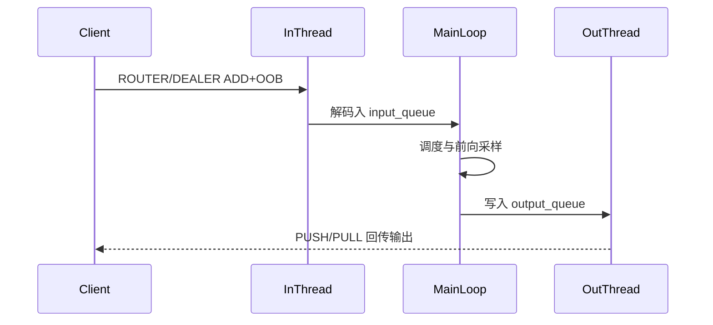
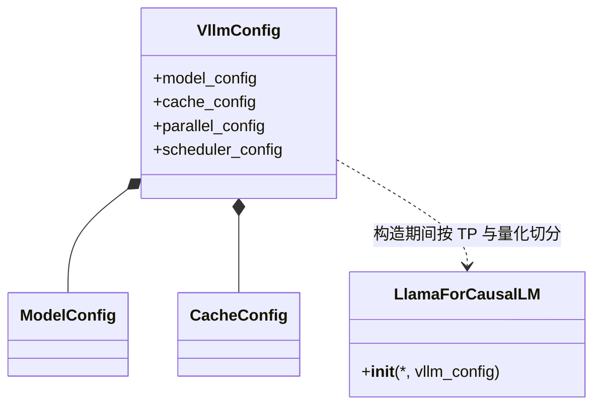
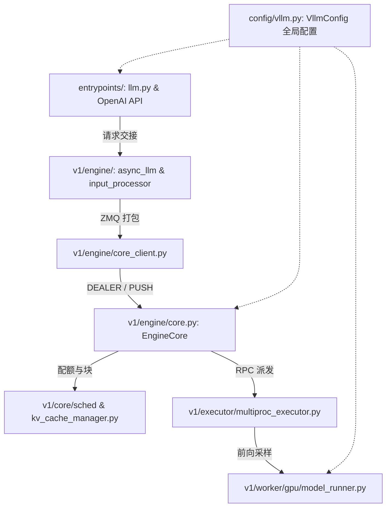

import RequestLifecycleExplainer from './explainers/request-lifecycle';

把开源大模型部署为在线服务时，最直观的做法是用 FastAPI 包一层 HuggingFace 的 `model.generate()`。一旦并发请求涌入，这套单进程方案会接连遇到三道工程高墙。

首先是 **GIL（Global Interpreter Lock，全局解释器锁）** 与 CPU 阻塞。BPE 分词、聊天模板渲染与流式文本拼接都跑在 Python 线程里；它们与设备驱动发射抢占同一个进程与解释器锁，导致设备算力单元在步间反复空转。

其次是请求级串行锁死批形状。`model.generate()` 必须等整批里最长的序列生成结束才一起返回，短请求被迫陪跑，也无法按步流式输出刚采样的 token。

最后是先加载再切分引发的 **OOM（Out of Memory，显存溢出）**。以 405B 稠密模型为例，**BF16（Brain Floating Point 16，脑浮点 16 位格式）** 权重约占 $810\text{ GiB}$；分到 16 张 80 GiB H100 上，每卡理论只需 $810 / 16 = 50.625\text{ GiB}$。若每张卡都先把完整权重读进显存再切分，单卡峰值直接冲破 80 GiB 上限。

## 从“Hello vLLM”看端到端生命周期

为把过程算明白，我们用一条贯穿全章的微型请求做例子。提示词 `"Hello vLLM"` 经分词切出 $L_{\text{in}} = 4$ 个 token ID `[15496, 2159, 44, 151645]`，设为 `max_tokens = 2` 与贪心采样。

假设单次分词耗时 $T_{\text{tok}} = 3\text{ ms}$，单步调度耗时 $T_{\text{sched}} = 1\text{ ms}$，设备前向与采样耗时 $T_{\text{gpu}} = 8\text{ ms}$，增量解码耗时 $T_{\text{detok}} = 2\text{ ms}$。在单进程串行循环里，所有环节首尾相接，单步端到端间隔如下：

$$
T_{\text{naive}} = T_{\text{tok}} + T_{\text{sched}} + T_{\text{gpu}} + T_{\text{detok}} = 3 + 1 + 8 + 2 = 14\text{ ms}
$$

而在 vLLM V1 的异步流水线中，分词与增量解码被剥离到前端进程并行推进，核心引擎循环只承担调度与驱动派发，稳态步间间隔收敛为：

$$
T_{\text{step}} \approx \max(T_{\text{sched}},\; T_{\text{gpu}}) = \max(1,\; 8) = 8\text{ ms}
$$

下面的交互推演按六个因果节拍追踪 `"Hello vLLM"` 如何穿过三层进程边界，并对照 V1 解耦与单进程串行的步时构成。

<RequestLifecycleExplainer client:visible title="图 1：vLLM V1 请求全生命周期推演" />

沿着图 1 的六步路径，单条请求在系统内部依次经历六个交接阶段：

1. `AsyncLLM.add_request` 在线程池完成分词，事件循环保持非阻塞[^vllm-async-llm][^vllm-input-proc]。
2. `InputProcessor` 封装 `EngineCoreRequest`，将 ID 打包为 16 字节 `int32` 数组[^vllm-input-proc][^vllm-core-client]。
3. `AsyncMPClient` 经 **ZMQ（ZeroMQ，异步消息库）** 发出请求，由输入线程入队[^vllm-core-client][^vllm-engine-core]。
4. 主循环扣除 $4$ 预算并分配 **KV Cache（Key-Value Cache，键值缓存）**，再派发批任务[^vllm-engine-core]。
5. 各卡 `Worker` 运行 $1/16$ 分片前向并采样 token $9906$，写回输出队列[^vllm-worker][^vllm-engine-core]。
6. 前端输出协程调用 `DecodeStream` 拼出 `" world"`[^vllm-async-llm][^vllm-output-detok]，经 **SSE（Server-Sent Events，服务端推送事件）** 推出。

## 为什么要拆出三层进程边界

早期 vLLM V0 的 `LLMEngine` 把分词、调度与执行驱动装进同一个主循环，在线服务层的 `AsyncLLMEngine` 只是在外面套了一层 `asyncio` 封装[^vllm-arch-doc]。只要 HTTP 解析、多模态解码或停用词扫描出现抖动，下一次调度就会被直接卡住。

vLLM V1 博客解释了架构重构的动机[^vllm-v1-blog]：旧主干状态补丁过多，V1 改用 **Phase-less（无阶段）调度循环** 与统一张量接口。引擎由此拆出如图 2（TP=4 六进程）与图 3 所示的三层隔离进程[^vllm-arch-doc]。


按部署形态与并行度，系统启动的进程数量遵循明确计数规则[^vllm-arch-doc]。最外层是 $A$ 个 **API Server / Frontend 进程**，数量默认等于 **DP（Data Parallelism，数据并行）** 规模。该层承载 `AsyncLLM`、分词、多媒体加载与 SSE 流式响应。

中间层对应 $\text{DP}$ 个 **EngineCore 进程**，每组数据并行拥有 1 个 `EngineCoreProc`，专注运行 `Scheduler` 与 `KVCacheManager` 主循环。最底层是 $N = \text{DP} \times \text{PP} \times \text{TP}$ 个 **Worker 进程**，每张加速卡独占 1 个进程，承载 `GPUModelRunner` 与权重分片。

此外，当启用多机或多卡数据并行（$\text{DP} > 1$）时，系统会额外启动 1 个 DP Coordinator 进程负责负载均衡与跨组步调对齐[^vllm-arch-doc]。离线批处理入口 `LLM` 则通过 `SyncMPClient` 复用同一套 `EngineCoreProc` 多进程底座[^vllm-config-model][^vllm-core-client]。

## 零拷贝通信与后台套接字线程

把前端与调度器拆进不同进程后，若每步用通用 JSON 序列化成百上千个请求，CPU 编解码开销会高于调度本身。vLLM V1 通过 `msgspec.Struct`（`array_like=True`、`gc=False`）、`int32` 数组 `copy=False` 带外传输与单字节枚举头实现零拷贝跨进程通信[^vllm-engine-types][^vllm-core-client]。

如图 4 所示，请求通道采用 `ROUTER` 对 `DEALER`，结果通道采用 `PUSH` 对 `PULL`。`EngineCoreProc` 内两个后台守护线程经内存队列与主调度循环彼此隔离[^vllm-engine-core]。



借助图 4 的双守护线程隔离，套接字收发与编解码能够全程和设备前向计算并行重叠，避免打断主调度循环。

## 统一配置与初始化阶段分片

如果每层构造函数都单独罗列几十个超参，每增加一个开关都要逐级修改引擎、执行器与模型签名。vLLM 用 `VllmConfig` 单对象聚合子配置并向下透传[^vllm-arch-doc][^vllm-config-model]，完整组装与分片落地关系如图 5 所示。



所有模型入口统一使用仅关键字签名 `def __init__(self, *, vllm_config: VllmConfig, prefix: str = "")`[^vllm-arch-doc][^vllm-config-model]。并行线性层在构造期就按 `parallel_config` 与量化配置直接分配本地分片。回到 405B 模型案例，全量 BF16 权重 $810\text{ GiB}$ 分摊到 16 张 80 GiB H100 时，每卡从一开始只分配 $50.625\text{ GiB}$ 权重缓冲，彻底绕开先完整加载再切分的瞬时 OOM 崩溃。

## 核心源码目录与阅读路线

在 `vllm@99b0b0b0` 中，V1 引擎实现高度集中在 `vllm/v1/` 子树下，配置骨架独立放在 `vllm/config/`。初次切入源码时，建议按请求进入系统的顺序从入口层逐级往下追踪，不要一头扎进底层算子。

```text
vllm/
├── entrypoints/              # 服务与离线编程入口（OpenAI API、LLM 类）
│   └── llm.py                # 离线推理入口，内部装配 Processor 与 SyncMPClient
├── config/
│   └── vllm.py               # VllmConfig 全局配置树与编译/设备参数汇聚
└── v1/                       # V1 引擎主实现（三层进程与调度执行核心）
    ├── engine/               # Tier 1 前端与 Tier 2 EngineCore 通信边界
    │   ├── async_llm.py      # AsyncLLM 异步协程入口与输出派发循环
    │   ├── input_processor.py# 线程池 BPE 分词、校验与请求构建
    │   ├── core_client.py    # AsyncMPClient / SyncMPClient 与 ZMQ 多帧打包
    │   ├── core.py           # EngineCoreProc 主循环、后台收发线程与单步执行
    │   └── output_processor.py # DecodeStream 增量解码与停用词裁剪
    ├── core/                 # Tier 2 调度器与 KV 显存管理器
    ├── executor/             # 多进程（Multiproc）与 Ray 执行器抽象
    └── worker/               # Tier 3 单卡 Worker（GPUWorker / GPUModelRunner）
```

如图 6 所示，`VllmConfig` 贯穿三层目录边界，各子目录沿着单条请求流转顺序耦合：



下表汇总了 `vllm` 核心架构模块在源码中的精确落点，供后续对照调试与二次开发查阅：

| 层级与模块   | 核心类与入口                               | 工程职责                                                                                          |
| :----------- | :----------------------------------------- | :------------------------------------------------------------------------------------------------ |
| 前端入口     | `AsyncLLM` / `LLM`                         | 异步请求接纳、统计上报与离线入口封装[^vllm-async-llm][^vllm-config-model]                         |
| 输入输出处理 | `InputProcessor` / `OutputProcessor`       | 线程池分词校验、增量 `DecodeStream` 与停用词裁剪[^vllm-input-proc][^vllm-output-detok]            |
| 跨进程客户端 | `AsyncMPClient` / `SyncMPClient`           | `msgspec` 编码、`int32` 打包与 ZMQ 套接字收发[^vllm-core-client]                                  |
| 核心引擎进程 | `EngineCoreProc` / `EngineCore`            | 后台收发线程、调度主循环与 **RPC（Remote Procedure Call，远程过程调用）** 派发[^vllm-engine-core] |
| 执行与模型层 | `Worker` / `GPUModelRunner` / `VllmConfig` | 统一配置透传、初始化阶段分片加载与前向采样[^vllm-config-model][^vllm-worker]                      |

到这里，请求从 HTTP 入口穿过 ZMQ 与 `EngineCore` 直达设备计算的纵向边界已经清晰。在多卡集群上，系统还会在 DP 之外叠加 **TP（Tensor Parallelism，张量并行）** 与 **PP（Pipeline Parallelism，流水线并行）**。

面对长上下文与稀疏专家模型，引擎还会引入 **PCP（Prefill Context Parallelism，预填充上下文并行）** 和 **EP（Expert Parallelism，专家并行）**。这些并行维度如何映射到物理进程、ZMQ 端口与每张加速卡，将在下一章[02 运行时拓扑与并行映射](../02-runtime-topology-and-parallel-mapping/)继续拆解。

[^vllm-arch-doc]: `vllm`（commit `99b0b0b0`），`docs/design/arch_overview.md:67-130`（V1 三层进程边界与进程数量计算）及 `245-352`（`VllmConfig` 透传与初始化分片），另见 [vLLM 官方架构文档](https://docs.vllm.ai/en/latest/design/arch_overview/)。

[^vllm-v1-blog]: 官方工程博客 [_vLLM V1 Alpha Release_](https://blog.vllm.ai/2025/01/27/v1-alpha-release.html)（阐述 V1 无阶段调度循环、低 CPU 开销控制面与重新设计动机）。

[^vllm-async-llm]: `vllm`（commit `99b0b0b0`），`vllm/v1/engine/async_llm.py:94-205`（`AsyncLLM.__init__` 装配处理器与客户端）、`411-604`（`add_request` 异步分词与入队）及 `870-951`（`_run_output_handler` 分片消费输出）。

[^vllm-input-proc]: `vllm`（commit `99b0b0b0`），`vllm/v1/engine/input_processor.py:40-85`（`InputProcessor` 绑定 `renderer._executor` 生成 `process_inputs_async`）与 `361-500`（`process_inputs` 校验与构建请求）。

[^vllm-engine-types]: `vllm`（commit `99b0b0b0`），`vllm/v1/engine/__init__.py:164-245`（`EngineCoreRequest` 紧凑 `msgspec.Struct` 定义）及 `264-375`（`EngineCoreOutput`、`EngineCoreOutputs` 与单字节 `EngineCoreRequestType`）。

[^vllm-core-client]: `vllm`（commit `99b0b0b0`），`vllm/v1/engine/core_client.py:86-94`（`_with_packed_prompt` 转换 `int32` `np.ndarray`）、`988-1050`（`SyncMPClient`）及 `1184-1378`（`AsyncMPClient` 基于 `zmq.ROUTER`/`PULL` 与 `copy=False` 发送）。

[^vllm-engine-core]: `vllm`（commit `99b0b0b0`），`vllm/v1/engine/core.py:703-732`（`EngineCore.step`）、`1328-1445`（`EngineCoreProc` 创建收发线程）、`1801-1888`（`run_busy_loop` 主循环）及 `2168-2344`（`process_input_sockets` `DEALER` 与 `process_output_sockets` `PUSH`）。

[^vllm-output-detok]: `vllm`（commit `99b0b0b0`），`vllm/v1/engine/output_processor.py:731-870`（`OutputProcessor.process_outputs` 单循环解码）及 `vllm/v1/engine/detokenizer.py:32-240`（`IncrementalDetokenizer` 与 `FastIncrementalDetokenizer` 调用 `DecodeStream`）。

[^vllm-config-model]: `vllm`（commit `99b0b0b0`），`vllm/config/vllm.py:377-556`（`VllmConfig`）、`vllm/model_executor/models/llama.py:461-495`（`LlamaForCausalLM` 仅关键字构造函数）及 `vllm/entrypoints/llm.py:62-200`（`LLM` 离线入口）。

[^vllm-worker]: `vllm`（commit `99b0b0b0`），`vllm/v1/executor/multiproc_executor.py:149-475`（`MultiprocExecutor`）、`vllm/v1/worker/gpu_worker.py:228-625`（`Worker`）及 `vllm/v1/worker/gpu/model_runner.py:208-410,1826-2250`（`GPUModelRunner`）。
