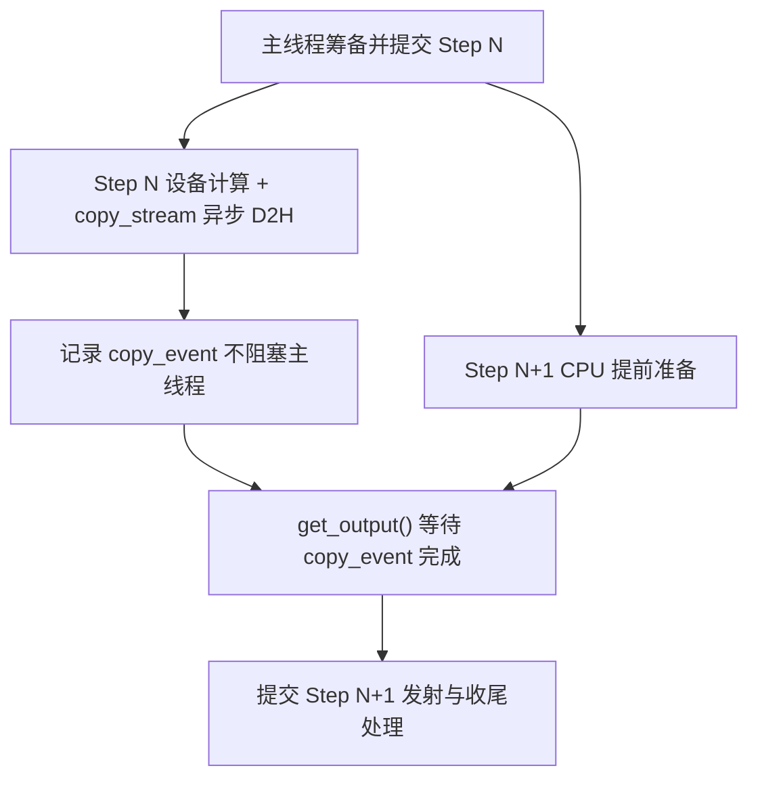

连续批调度消除显存碎片并填满 token 配额后，小批量 **Decode（解码）**的 **Trace（执行时间线）**上仍会出现显著失衡。计算单元上的每个 Kernel 本身只执行短短几微秒，算子之间的硬件时间轨却留出大片空白间隔。

这种硬件等待源于 CPU 主机侧的指令供给速度落后于设备消耗速度，在推理系统中称为 **Launch Wall（发射墙）**。在真实集群上，Python 线程通过 PyTorch C++ **Dispatcher（算子分发器）**向 CUDA 或昇腾 CANN 驱动提交单个轻量算子，通常需要 5–15 μs。一个 60 层 Transformer 单步前向要穿过数百个归一化、激活、线性投影与残差加法节点，累计主机下发耗时往往达到 2–5 ms。

## 同步发射与异步队列的两副面孔

要看清空闲间隔从何而来，我们先从最朴素的**同步发射模式**算起。如果 CPU 每发起一个算子就阻塞等待设备算完返回，那么顺序执行 $N$ 个算子的总耗时为两侧耗时之和：

$$
T_{\text{sync}} = \sum_{i=1}^{N} (t_{\text{cpu}, i} + t_{\text{dev}, i})
$$

其中 $t_{\text{cpu}, i}$ 为第 $i$ 个算子在主机侧的解析与提交耗时，$t_{\text{dev}, i}$ 为硬件执行耗时。在微缩算术比例下取 $5$ 个算子、$t_{\text{cpu}} = 0.8\text{ ms}$、$t_{\text{dev}} = 0.6\text{ ms}$，同步串行总耗时达到 $5 \times (0.8 + 0.6) = 7.00\text{ ms}$，设备利用率只有 $3.0 / 7.0 = 42.9\%$。

PyTorch 默认采用**异步 FIFO（First-In First-Out，先进先出）队列**打破逐个等待，硬件通道底层机制见[异构算力流](../../execgraph/01-heterogeneous-streams-and-events/)。Python 线程把任务描述符压入 **CUDA Stream（计算流）**或昇腾 **TaskQueue（任务队列）**后立刻返回，设备则从队头消费。

设第 $i$ 个算子由主机完成提交的时刻为 $t_{\text{cpu}}^{(i)}$，在设备完成执行的时刻为 $t_{\text{dev}}^{(i)}$（初始 $t_{\text{cpu}}^{(0)} = t_{\text{dev}}^{(0)} = 0$），异步流时序满足如下递推关系：

$$
\begin{aligned}
t_{\text{cpu}}^{(i)} &= t_{\text{cpu}}^{(i-1)} + t_{\text{cpu}, i} \\
t_{\text{dev}}^{(i)} &= \max\bigl(t_{\text{cpu}}^{(i)},\; t_{\text{dev}}^{(i-1)}\bigr) + t_{\text{dev}, i}
\end{aligned}
$$

从这组递推式可以看出，异步入队在不同负载比例下会呈现出两副面孔。第一种情况是 **Compute-bound（计算或访存主导，$t_{\text{dev}} \ge t_{\text{cpu}}$）**，常见于较大批量的预填充阶段。取缩比参数 $t_{\text{cpu}} = 0.6\text{ ms} < t_{\text{dev}} = 0.8\text{ ms}$，第 1 个算子在 $0.60\text{ ms}$ 入队后，CPU 在 $3.00\text{ ms}$ 就把全部 $5$ 个算子填进队列，而硬件需要运行到 $0.6 + 5 \times 0.8 = 4.60\text{ ms}$。

队列提前积攒出排队库存，把除首算子外的启动延迟完全掩盖，设备利用率升至 $87.0\%$（扩展到 $60$ 个算子时达 $98.8\%$）。但只要代码在结尾处调用一次 `.item()`、`.cpu()` 或 `torch.nonzero()`，主机就必须阻塞 $1.60\text{ ms}$ 等整条队列排空，已攒出的异步缓冲随之清零。

第二种情况则是 **Launch-bound（发射主导，$t_{\text{cpu}} > t_{\text{dev}}$）**，这正是小批量解码的真实处境。取 $t_{\text{cpu}} = 0.8\text{ ms} > t_{\text{dev}} = 0.6\text{ ms}$（对应实机 5–15 μs 下发耗时对比 2–3 μs 小批量算子），设备在 $1.40\text{ ms}$ 算完第 1 个算子时，CPU 要等到 $1.60\text{ ms}$ 才提交完第 2 个算子。

由于每个算子恒有 $t_{\text{cpu}}^{(i)} > t_{\text{dev}}^{(i-1)}$，FIFO 队列里永远攒不出库存，硬件在每两个算子之间都要空等 $(t_{\text{cpu}} - t_{\text{dev}})$。对于连续 $N$ 个同类发射受限算子，总耗时化简为：

$$
T_{\text{launch\_bound}} = \sum_{i=1}^{N} t_{\text{cpu}, i} + t_{\text{dev}, N}
$$

这意味着即使代码里一处 `.item()` 同步都不写，发射受限场景的设备利用率也存在渐近天花板 $t_{\text{dev}} / t_{\text{cpu}}$（例如 $0.6 / 0.8 = 75.0\%$，而在 3 μs 对 10 μs 的实机比例下上限仅约 30%）。图 1 直观对比了同步串行、异步队列积攒、`op5` 隐式同步排空以及跨步异步输出的轨间空隙。

 同步清空对比')

## 跨步异步调度与两阶段采样交接

把视角从单步内部拉高到连续推理步之间，还会碰到一个表面上矛盾的数据依赖。自回归生成时，Step $N+1$ 的模型输入恰好就是 Step $N$ 刚刚采样出的新 token。如果 CPU 不等设备把采样结果经 **D2H（Device-to-Host，设备到主机拷贝）**传回主机，调度器又怎么提前编排并提交 Step $N+1$ 的前向计算？

vLLM V1 通过**调度器乐观占位**、**设备侧持久化状态衔接**与**独立拷贝流延迟兑现**三段协作解开了这个环[^vllm-async-core][^vllm-async-sched][^vllm-mrv2-runner]。在核心调度循环 `step_with_batch_queue` 中，引擎维护一个在途批队列允许 CPU 领先设备向前推进[^vllm-async-core]。

启用异步调度后，`AsyncScheduler` 在 Step $N$ 结束时就为解码请求提前登记 `num_output_placeholders` 输出占位计数[^vllm-async-sched]。若开启投机解码，它还会同步预留占位草稿槽位，仅在结构化输出语法掩码未就绪或请求到达 `max_tokens` 上限时才暂缓占位。

更关键的依赖消除发生在模型执行器内部：Step $N$ 采样出的 token 整数值只服务于**设备上下一步的词嵌入层**，无需在发射前交由 CPU 调度器读取。在 `GPUModelRunner.sample_tokens` 阶段，主计算流采样完后紧接着运行后处理 Kernel。它直接把新 token ID 原地写入常驻张量 `last_sampled_tokens` 与全序列缓存，并在显存内递增已计算计数[^vllm-mrv2-runner][^vllm-input-batch]。

Step $N+1$ 的异步批指令随后到达执行器时，输入拼装 Kernel 在主计算流上直接读取 `last_sampled_tokens` 填充下一轮 `input_ids` 缓冲。整条 token ID 传递链全程留在 **HBM（High Bandwidth Memory，高带宽显存）**内部，由同一个计算流的入队顺序保证可见性，CPU 无需得知具体数字即可提前发射下一轮算子。

与此同时，为了把采样结果最终交还外层调度器用于停机判断与文本返回，执行器会在创建后处理前构造 `AsyncOutput`（见图 2）[^vllm-async-output]。它让独立的 `copy_stream` 先等待主计算流到达采样完成点，再以 `non_blocking=True` 将采样 token ID 与数量异步拷向 CPU **Pinned Memory（锁页内存）**。最后它记录一个阻塞型 `copy_event`，并立即把控制权交还主线程。

```mermaid caption="图 2：GPU AsyncOutput 与 NPU 异步事件机制对比"
flowchart TD
    subgraph GPU["NVIDIA GPU · AsyncOutput (MRV2)"]
        G1["GPUModelRunner 主线程<br/>无同步入队 Step N"] --> G2["Default CUDA Stream<br/>前向计算与采样"]
        G2 -->|"async copy"| G3["copy_stream + AsyncOutput<br/>锁页 D2H + copy_event"]
        G3 -->|"copy_event"| G4["AsyncOutput.get_output()<br/>Step N+1 准备完再同步"]
    end
    subgraph NPU["Ascend NPU · NPUModelRunner 流水"]
        A1["NPUModelRunner 主线程<br/>异步下发至 CANN TaskQ"] --> A2["CANN TaskQueue 流水<br/>AICore 连续消费任务块"]
        A2 -->|"async copy"| A3["copy_stream + AscendAsyncOutput<br/>锁页拷贝并记录事件"]
        A3 -->|"NPU Event"| A4["aclrtSynchronizeEvent<br/>读 token 时才等待完成"]
    end
```



如此一来，CPU 在后台 **DMA（Direct Memory Access，直接内存访问）**引擎搬运 Step $N$ 采样结果的同时，已经开始组织并提交 Step $N+1$ 的计算任务。直到引擎必须读取真实 token 序列检查停止符或返回客户端时，才调用 `get_output()` 执行 `copy_event.synchronize()` 兑现同步[^vllm-async-output]。图 3 概括了这套两阶段交错周期。



在昇腾平台上，`vllm-ascend` 的 `NPUModelRunner` 继承了 V2 异步调度协议，将算子非阻塞压入 CANN `TaskQueue`，并针对投机采样校正维护锁页主机计数缓冲[^ascend-v2-runner]。运行时检查钩子则通过外层 `AscendAsyncOutput` 推迟触发[^ascend-async-guard]：等内层 `get_output()` 完成事件同步与有效长度裁剪后再执行检错，避免在主线程引入隐式流同步。

## 队列时序模拟与双平台异步输出对照

下面的独立 Python 模拟脚本按给定参数量化验证了上述三组时序规律。脚本在缩放时间尺度下对比同步阻塞基线、Compute-bound 队列遭遇 `.item()` 的排空代价、Launch-bound（$t_{\text{cpu}} > t_{\text{dev}}$）空转气泡，以及跨 4 步异步重叠后的端到端耗时压缩比：

```python
def simulate_fifo(
    ops: int, op_cpu: float, op_dev: float
) -> tuple[float, float, float, float]:
    t_cpu, t_dev = 0.0, 0.0
    for _ in range(ops):
        t_cpu += op_cpu
        t_dev = max(t_cpu, t_dev) + op_dev
    drain_wait = max(0.0, t_dev - t_cpu)
    util = (ops * op_dev) / t_dev
    return t_dev, t_cpu, drain_wait, util

# 1. 同步基线 (每算子均阻塞等待硬件完成)
sync_total = 5 * (0.8 + 0.6)
sync_util = (5 * 0.6) / sync_total

# 2. Compute-bound 异步入队 (t_cpu=0.6 < t_dev=0.8) 与 .item() 排空代价
cb5_tot, cb5_cpu, cb5_drain, cb5_util = simulate_fifo(5, 0.6, 0.8)
cb60_tot, _, _, cb60_util = simulate_fifo(60, 0.6, 0.8)
assert abs(cb5_drain - 1.60) < 1e-6

# 3. Launch-bound 异步入队 (t_cpu=0.8 > t_dev=0.6): 队列无余量，设备每步干等
lb5_tot, lb5_cpu, _, lb5_util = simulate_fifo(5, 0.8, 0.6)
lb5_idle = lb5_tot - 5 * 0.6
lb60_tot, _, _, lb60_util = simulate_fifo(60, 0.8, 0.6)
lb60_idle = lb60_tot - 60 * 0.6
assert abs(lb5_tot - 4.60) < 1e-6 and abs(lb60_idle - 12.60) < 1e-6

# 4. 跨 4 步调度重叠模型: 步间同步 vs AsyncOutput 延迟兑现
steps, step_cpu, step_dev, d2h = 4, 1.8, 3.4, 0.5
serial_steps = steps * (step_cpu + step_dev + d2h)
async_steps = step_cpu + steps * step_dev + d2h
assert async_steps < serial_steps

print(f"sync(5 ops): total={sync_total:.2f}ms, util={sync_util:.1%}")
print(
    f"compute_bound(5 ops): total={cb5_tot:.2f}ms, "
    f"host_done={cb5_cpu:.2f}ms, drain_wait={cb5_drain:.2f}ms, util={cb5_util:.1%}"
)
print(f"compute_bound(60 ops): total={cb60_tot:.2f}ms, util={cb60_util:.1%}")
print(
    f"launch_bound(5 ops): total={lb5_tot:.2f}ms, "
    f"host_done={lb5_cpu:.2f}ms, dev_idle={lb5_idle:.2f}ms, util={lb5_util:.1%}"
)
print(
    f"launch_bound(60 ops): total={lb60_tot:.2f}ms, "
    f"dev_idle={lb60_idle:.2f}ms, util={lb60_util:.1%}"
)
print(
    f"4step_overlap: serial={serial_steps:.1f}ms, "
    f"async={async_steps:.1f}ms, ratio={serial_steps/async_steps:.2f}x"
)
```

运行输出如下：

```text
sync(5 ops): total=7.00ms, util=42.9%
compute_bound(5 ops): total=4.60ms, host_done=3.00ms, drain_wait=1.60ms, util=87.0%
compute_bound(60 ops): total=48.60ms, util=98.8%
launch_bound(5 ops): total=4.60ms, host_done=4.00ms, dev_idle=1.60ms, util=65.2%
launch_bound(60 ops): total=48.60ms, dev_idle=12.60ms, util=74.1%
4step_overlap: serial=22.8ms, async=15.9ms, ratio=1.43x
```

模拟数字印证了两条结构性边界：在算力主导区，算子数增至 $60$ 个可以把首包等待摊薄到 $98.8\%$ 利用率。但在发射主导区，即便扩展到 $60$ 个算子且不触发任何主机同步，设备仍有 $12.60\text{ ms}$ 耗在等待主机递交上，利用率始终被压在 $75.0\%$ 理论比值以下。

对照上游双仓实现，GPU 与昇腾 NPU 在异步回传和延迟等待处保持了完全一致的非阻塞契约[^vllm-async-output][^ascend-async-guard]：

```python
# Upstream: vllm/v1/worker/gpu/async_utils.py:147-193 (vllm@bb23c0a8)
with stream(copy_stream, main_stream):
    copy_stream.wait_stream(main_stream)
    self.sampled_token_ids = async_copy_to_np(sampler_output.sampled_token_ids)
    self.copy_event.record(copy_stream)
# 在需要消费数据时才触发同步:
self.copy_event.synchronize()

# Upstream: vllm_ascend/observability/runtime_guard/hooks.py:332-346 (vllm-ascend@3649b8ff)
class AscendAsyncOutput(AsyncModelRunnerOutput):
    def get_output(self) -> ModelRunnerOutput:
        output = self._inner.get_output()
        _safe_check_after_sample(self._runner, output)
        return output
```

| 异步执行维度      | NVIDIA GPU（`vllm` `bb23c0a8`）             | 华为昇腾 NPU（`vllm-ascend` `3649b8ff`）       |
| ----------------- | ------------------------------------------- | ---------------------------------------------- |
| 非阻塞异步封装    | `AsyncOutput` 继承 `AsyncModelRunnerOutput` | `AscendAsyncOutput` 包装内层 `AsyncOutput`     |
| 异步 D2H 拷贝路径 | 独立 `copy_stream` + 锁页内存非阻塞拷贝     | 继承 `copy_stream` 锁页回传与 CANN `TaskQueue` |
| 延迟同步与检查    | `get_output` 调用 `copy_event.synchronize`  | 同步并裁剪后触发采样检错，拦截主线程隐式同步   |

跨步异步调度藏起了步间编排与 D2H 拷贝延迟，但单步 `model.forward()` 的主机发射墙仍需由下层 `torch.compile` 与静态图抹平（详见[推理执行图编译与静态图两章](../../execgraph/02-torch-compile-fundamentals/)）。多批形态变化与多卡接入运行时之后，[第 3 章：多卡 DP 共识与运行时协同](../03-runtime-dispatch-and-nesting/)将拆解 DP 共识如何驱动双端执行图。

[^vllm-async-core]: `vllm`（commit `bb23c0a8`），`vllm/v1/engine/core.py:750-871`（`EngineCore.step_with_batch_queue` 维护在途批队列并重叠下轮调度与输出等待）。

[^vllm-async-sched]: `vllm`（commit `bb23c0a8`），`vllm/v1/core/sched/async_scheduler.py:18-61`（`AsyncScheduler._update_after_schedule` 预增 `num_output_placeholders` 与占位草稿位）。

[^vllm-mrv2-runner]: `vllm`（commit `bb23c0a8`），`vllm/v1/worker/gpu/model_runner.py:1580-1591`（`prepare_inputs` 调用 `combine_sampled_and_draft_tokens`）及 `2330-2378`（`sample_tokens` 先构建 `AsyncOutput` 再调用 `postprocess_sampled`）。

[^vllm-input-batch]: `vllm`（commit `bb23c0a8`），`vllm/v1/worker/gpu/input_batch.py:415-513`（`_combine_sampled_and_draft_tokens_kernel` 从设备侧读取 `last_sampled_tokens`）与 `584-686`（`_post_update_kernel` 原地更新设备请求状态）。

[^vllm-async-output]: `vllm`（commit `bb23c0a8`），`vllm/v1/worker/gpu/async_utils.py:117-205`（`AsyncOutput` 在 `copy_stream` 异步拷贝至锁页内存并记录 `copy_event`，由 `get_output` 触发事件同步）。

[^ascend-v2-runner]: `vllm-ascend`（commit `3649b8ff`），`vllm_ascend/worker/v2/model_runner.py:269-278, 342-366, 1038-1049`（`NPUModelRunner` 继承 V2 异步输入拼接与采样流程，并维护锁页 `num_computed_tokens_cpu`）。

[^ascend-async-guard]: `vllm-ascend`（commit `3649b8ff`），`vllm_ascend/observability/runtime_guard/hooks.py:319-347`（`AscendAsyncOutput` 推迟至 `get_output` 完成 D2H 裁剪后再执行采样检查）。
