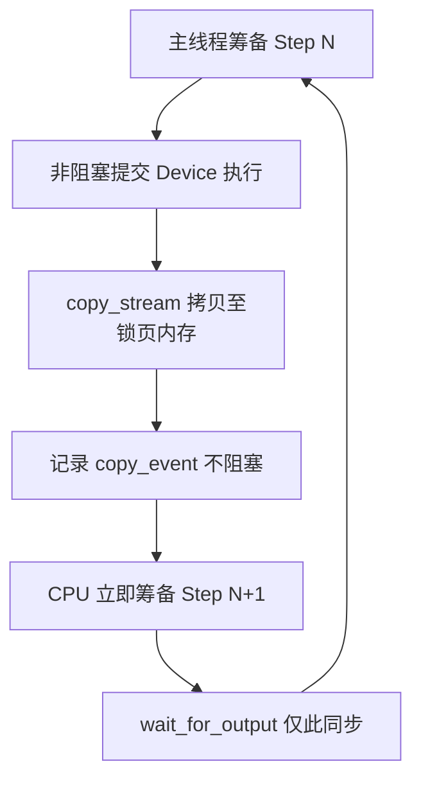

import AsyncLaunchQueueExplainer from '../../../../explainers/vllm/AsyncLaunchQueueExplainer';

在[第 1 章：PagedAttention 与连续批处理调度](../01-paged-attention-and-scheduler/)中，我们消除了 KV 显存碎片并让混合批塞满了 token 配额。但把小批量 Decode 服务拉去抓 Trace 时，往往会出现反直觉一幕：GPU 或 NPU 计算轨布满密密麻麻的**黑色空洞（Idle Bubbles）**，硬件在大量时间里无事可做。

造成这种现象的元凶不是算子不够快，而是主机侧（CPU）的指令供给跟不上设备消耗——工程上称为 **Launch Wall（发射墙）**。

## Host-Device 队列模型与发射墙数学条件

在 PyTorch 默认异步模式下，Python 线程调用一个算子并不等设备算完才返回，而是把内核描述符压入 **CUDA Stream** 或昇腾 **CANN TaskQueue**，自己立刻推进下一行 Python 代码。因此整步耗时由两条流水线的速度竞争决定：

$$T_{\text{launch\_bound}} \iff t_{\text{cpu\_dispatch}} > t_{\text{device\_exec}}$$

假设小批量 Decode 时单个轻量算子只需 $0.6\text{ ms}$ 计算（微缩尺度示例，实机为数微秒），而 Python 解释器叠加 PyTorch C++ Dispatcher 耗费 $0.8\text{ ms}$。如果每步之后还强行同步等待返回，设备气泡就会长期徘徊在 50% 以上。

<AsyncLaunchQueueExplainer
  client:visible
  title="图 1：CPU-Device 启动墙、Async FIFO 与 .item() 同步清空推演"
/>

顺着**图 1** 的五步时间线推演：第 1 步同步基线下设备利用率仅 $43\%$；第 2 步切换为非阻塞连续入队后，Host 提前向 FIFO 攒出 $3$ 个富余任务，设备瞬间实现紧凑流水；但第 3 步揭示了一个常见陷阱——只要在 **`op5`** 末尾调用一次 `.item()` 或 `.cpu()`，Host 就必须死等整个 FIFO 排空，并发库存瞬间归零。

## vLLM V1 的两阶段异步调度与 AsyncOutput

为了不让调度器在步与步之间变成全局 `.item()` 同步屏障，vLLM V1 把“准备下轮输入”与“拷贝上轮采样结果”拆成了互相重叠的双流架构，如**图 2** 所示。


在 NVIDIA 侧，`vllm` MRV2（`GPUModelRunner` 与 `AsyncOutput`[^1]）在默认计算流刚提交完前向与采样内核后，立刻切换到独立的 **`copy_stream`** 异步把采样结果考向 Host 锁页内存（Pinned Memory）并插下 `CUDAEvent`，随即不加等待地返回执行权。

在华为昇腾侧，`vllm-ascend` 遵循同样思想，由 `NPUModelRunner` 向 CANN `TaskQueue` 异步压入 ACL 任务[^2]，再由 `AscendAsyncOutput` 配合辅助流与事件机制延迟兑现同步点[^3]。**图 3** 概括了两轮请求之间 CPU 与 Device 的零等待交错闭环。



需要特别警惕的是：Async Scheduling 仅把**步间循环调度、日志打点与 D2H 传回**遮掩到了后台，但它无法抹平单步 `model.forward()` 内部数百个碎片算子之间各自的 PyTorch Dispatch 开销。想要打穿单步内的密集微内核发射墙，必须依赖后两章将要介绍的图编译融合与整图重放。

## PyTorch/NumPy 核心验证与双仓源码对照

下面这段自包含的 Python 模拟程序精确计算了三种时序模型：`op5` 同步点对队列的排空等待（`drain_wait`），以及引入 `AsyncOutput` 后跨 4 个推理步的端到端重叠加速比：

```python
ops, sync_cpu, sync_dev = 5, 0.8, 0.6
sync_total = ops * (sync_cpu + sync_dev)
sync_util = (ops * sync_dev) / sync_total

# Async FIFO 运行 5 个算子后于 op5 触发 .item() 同步排水
op_cpu, op_dev = 0.6, 0.8
t_cpu, t_dev = 0.0, 0.0
for _ in range(ops):
    t_cpu += op_cpu
    t_dev = max(t_cpu, t_dev) + op_dev
drain_wait = max(0.0, t_dev - t_cpu)  # Host 在 op5 等候队列排空
assert abs(drain_wait - 1.60) < 1e-6

# 4 个推理步对比：步间同步 vs AsyncOutput 双流重叠
steps, step_cpu, step_dev, d2h = 4, 1.8, 3.4, 0.5
serial_steps = steps * (step_cpu + step_dev + d2h)
async_steps = step_cpu + steps * step_dev + d2h
assert async_steps < serial_steps
print(f"sync={sync_total:.1f}ms (util={sync_util:.1%}), op5_drain={drain_wait:.2f}ms")
print(f"4-step serial={serial_steps:.1f}ms vs async={async_steps:.1f}ms ({serial_steps/async_steps:.2f}x)")
```

执行输出实测如下：
`sync=7.0ms (util=42.9%), op5_drain=1.60ms`；
`4-step serial=22.8ms vs async=15.9ms (1.43x)`。

| 关键机制          | NVIDIA GPU（`vllm` `bb23c0a8`）                         | 华为昇腾 NPU（`vllm-ascend` `3649b8ff`）                 |
| ----------------- | ------------------------------------------------------- | -------------------------------------------------------- |
| 非阻塞异步封装类  | `AsyncOutput(AsyncModelRunnerOutput)`[^1]               | `AscendAsyncOutput(AsyncModelRunnerOutput)`[^3]          |
| 异步 D2H 拷贝介质 | 独立 `copy_stream` + `non_blocking=True` 锁页张量       | CANN `copy_stream` + 锁页 H2D/D2H 异步传输               |
| 延迟等待同步点    | `wait_for_output()` 调用 `copy_event.synchronize()`[^1] | `aclrtSynchronizeEvent` / `copy_event.synchronize()`[^2] |

注意符号演进：`vllm` 早期 V1 MRV1 曾使用 `AsyncGPUModelRunnerOutput`，在当前 `bb23c0a8` MRV2 分支中已统一重命名为 `AsyncOutput`；而 `vllm-ascend` 不仅继承相同协议，还在运行时守卫中封装了 `AscendAsyncOutput` 以拦截非法主线程隐式同步[^3]。

清除了步与步之间的 Host 卡点后，我们的视线终于可以聚焦到最内层的 `model.forward()`：为什么一个几十层 Transformer 要触发数百次分散发射？请看[第 3 章：torch.compile 与分段编译](../03-torch-compile-and-piecewise/)。

[^1]: `vllm/v1/worker/gpu/async_utils.py`（`bb23c0a8`），`AsyncOutput` 定义基于 `copy_stream` 与 `copy_event` 的异步延迟输出。

[^2]: `vllm_ascend/worker/v2/model_runner.py`（`3649b8ff`），`NPUModelRunner` 实现 NPU 异步任务下发与双步重叠准备。

[^3]: `vllm_ascend/observability/runtime_guard/hooks.py`（`3649b8ff`），`AscendAsyncOutput` 包装异步输出并守卫运行时同步行为。
