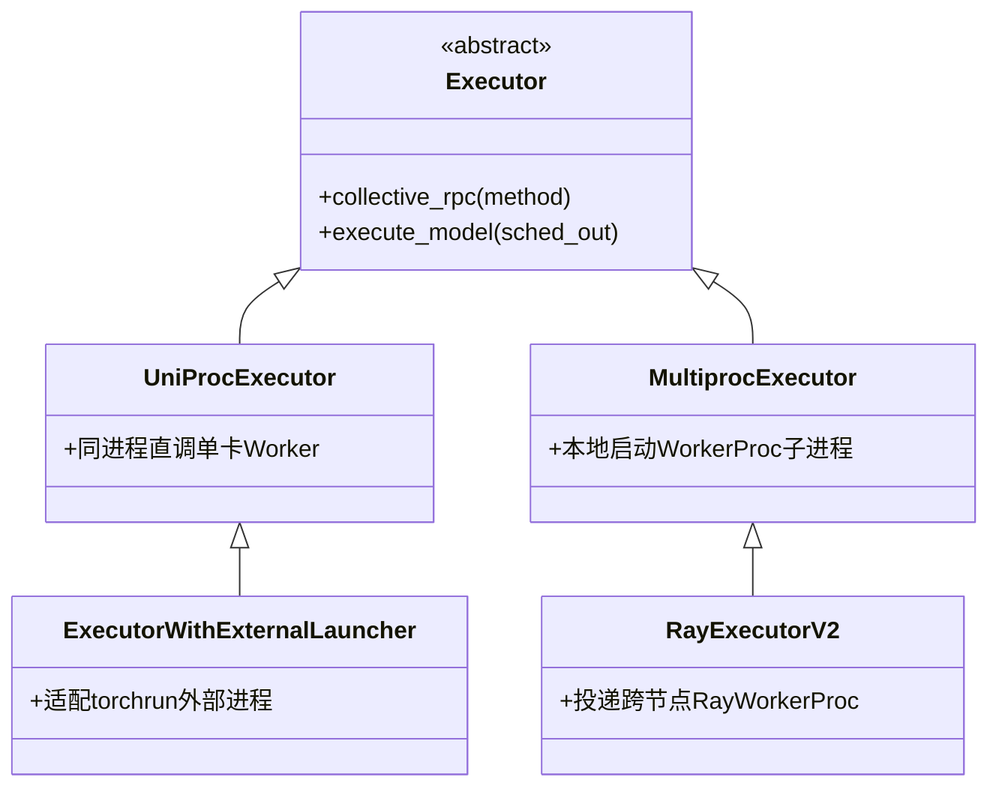
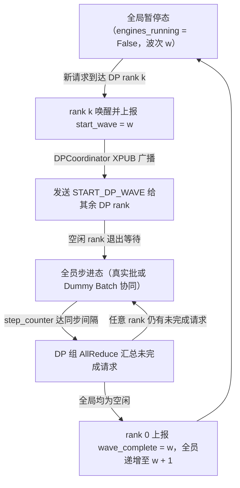
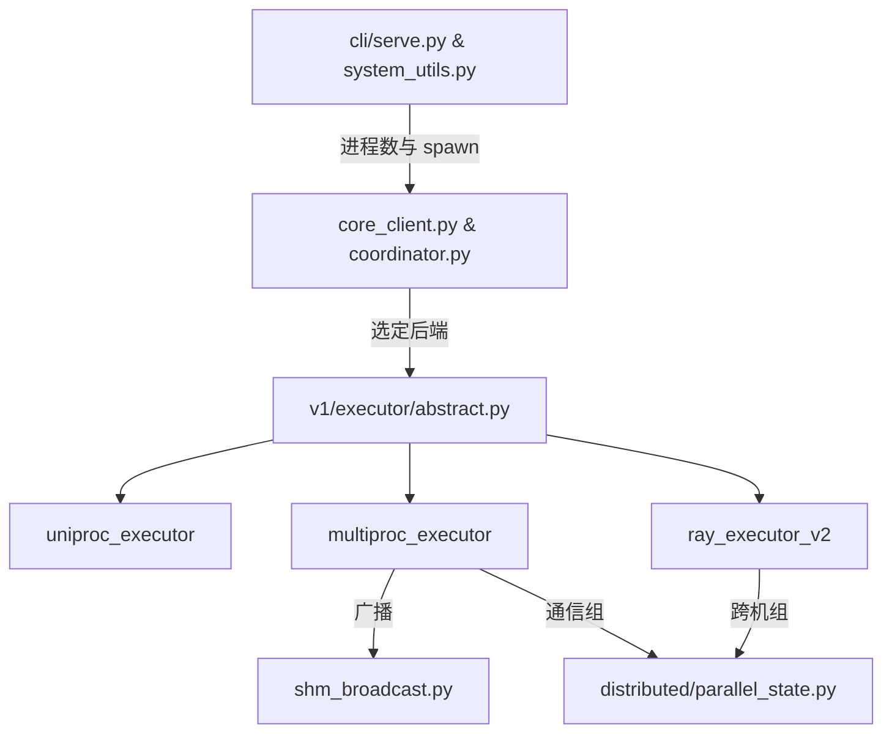

把在线推理服务从单卡扩展到 8 卡或 16 卡并混用多种并行策略时，工程师最容易在运行拓扑上产生三个疑问：系统究竟拉起了多少个操作系统进程？按层拆分的流水线阶段会不会各自多出调度器？启用专家并行时，为什么总卡数没有跟着翻倍？

在 vLLM V1 中，并行维度、进程边界与 **IPC（Inter-Process Communication，进程间通信）**通道是按严格层次解耦的。弄清进程映射规则与五维编号张量，就能在部署前精确算出节点进程数、通信域归属与多卡协同方式。

## 进程总数与三条硬映射规则

vLLM V1 将在线服务拆分为四类进程角色[^vllm-arch-overview]。前端 `API Server` 负责 HTTP 解析、分词与多模态预处理。`EngineCore` 持有调度器与 KV Cache 块表，`Worker` 独占设备执行前向计算。当存在多副本时，`DPCoordinator` 负责汇总负载与波次状态[^vllm-coordinator]。

决定这四类进程数量的配置规则可以归纳为三条硬映射：

1. 物理加速卡与 `Worker` 进程始终保持 $1:1$ 绑定，计算总卡数为 $N = \text{DP} \times \text{PP} \times \text{PCP} \times \text{TP}$。
2. 只有 **DP（Data Parallelism，数据并行）**会裂变出多个 `EngineCore` 与调度器进程，其余并行维度共享同一调度循环。
3. 当 $\text{DP} > 1$ 时启动 $1$ 个 `DPCoordinator` 进程，内部负载均衡模式下默认将前端 `API Server` 数量 $A$ 设为与 $\text{DP}$ 相等[^vllm-serve-cli]。

由此得到集群总进程数公式：

$$
P_{\text{total}} = A + \text{DP} + N + \mathbb{I}(\text{DP} > 1)
$$

其中 $\mathbb{I}(\text{DP} > 1)$ 为示性函数，多副本时取 $1$，单副本取 $0$。以常见的 4 卡单机 `TP=4` 部署为例，系统启动 $1 + 1 + 4 + 0 = 6$ 个进程；当扩展为 8 卡混合并行 `DP=2, PP=2, TP=2` 时，总进程数变为 $2 + 2 + 8 + 1 = 13$ 个。而官方常见的 `TP=2, DP=4`（8 卡）多副本全网拓扑则总共启动 $17$ 个进程（图 1）。


这里 `API Server` 与 `EngineCore` 通过多对多套接字相连，任意前端实例都可以把请求路由给任意副本。仅当外部负载均衡器尚未切分流量时，系统才默认按副本数启动多个前端进程[^vllm-serve-cli]。

## 五维编号张量与八卡拓扑切分

物理卡就位后，`initialize_model_parallel` 会把 $0$ 到 `world_size - 1` 的全局设备编号重塑为一个五维张量[^vllm-parallel-state]：

$$
\text{all\_ranks} = \operatorname{arange}(W).\operatorname{reshape}(\text{ExternalDP},\; \text{DP},\; \text{PP},\; \text{PCP},\; \text{TP})
$$

最内层为 **TP（Tensor Parallelism，张量并行）**。中间两维依次嵌套 **PP（Pipeline Parallelism，流水线并行）**与 **PCP（Prefill Context Parallelism，预填充上下文并行）**。

解码阶段还支持 **DCP（Decode Context Parallelism，解码上下文并行）**来分摊长序列 KV 读取。最外层预留给外部数据并行，五个维度的嵌套顺序直接对应硬件互联带宽的衰减梯度：

- **TP 位于最内层**：每层触发两次 AllReduce，同组成员必须落在单机高速域。
- **PCP 与 DCP 紧邻内层**：两者切分长上下文，启用 DCP 时按全局编号升序对齐[^vllm-parallel-state]。
- **PP 位于 DP 内侧**：PP 在阶段间点对点传递中间激活，适合跨节点部署。
- **ExternalDP 位于最外层**：供外层调度独立发请求，内部 DP 副本则需协同步进。

那么，为什么开启 **MoE（Mixture of Experts，混合专家模型）**的 **EP（Expert Parallelism，专家并行）**不额外增加物理卡？原因在于 vLLM 通过交换第 $1$ 维与第 $2$ 维并合并内侧维度，把同一流水线阶段内的不同副本与张量切片复用到同一组卡上：

$$
\text{EP 组大小} = \text{DP} \times \text{PCP} \times \text{TP}
$$

若同时开启 **EPLB（Expert Parallelism Load Balancer，专家并行负载均衡）**，源码还会用完全相同的设备编号新建一个隔离通信组[^vllm-parallel-state]。该通信组名为 `eplb`，用于防止权重重排与前向集合通信发生死锁。

以一个 `DP=2, PP=2, TP=2`（`PCP=1`、`ExternalDP=1`）八卡实例验证这一映射。把 `[0..7]` 填入形状 `(1, 2, 2, 1, 2)` 的张量后，各并行维度的通信组切分如下：

- **TP 组（4 组）**：`[0, 1]`、`[2, 3]`、`[4, 5]`、`[6, 7]`，负责层内张量归约。
- **PP 组（4 组）**：`[0, 2]`、`[1, 3]`、`[4, 6]`、`[5, 7]`，跨阶段点对点传激活。
- **DP 组（4 组）**：`[0, 4]`、`[2, 6]`、`[1, 5]`、`[3, 7]`，按对应位置同步状态。
- **EP 组（2 组）**：`[0, 1, 4, 5]`（阶段 0）与 `[2, 3, 6, 7]`（阶段 1），零新增卡。

上述 13 个进程的控制面连线、共享内存域以及同 8 张加速卡上的四类通信组划分如图 2 所示。


## 四种执行器拓扑与进程启动约束

在 `EngineCore` 与底层 `Worker` 之间，`Executor.get_class` 根据 `distributed_executor_backend` 选择进程启动方式[^vllm-executor-abstract]。四种执行器的继承体系与控制面通道如图 3 所示：



结合图 3，四类后端分别对应不同部署规模与控制路径[^vllm-uniproc][^vllm-multiproc][^vllm-ray-v2]：

| 执行器后端                     | 适用部署规模         | Worker 托管方式              | 控制面通道                     |
| :----------------------------- | :------------------- | :--------------------------- | :----------------------------- |
| `UniProcExecutor`              | 单卡或单进程调试     | 同进程内直接托管             | 函数直调，无跨进程开销         |
| `ExecutorWithExternalLauncher` | 外部 `torchrun` 拉起 | 每个外部进程持一卡           | 要求关闭 V1 多进程并确定性调度 |
| `MultiprocExecutor`            | 单机多卡及多机主从   | 本地拉起 `WorkerProc` 子进程 | 同机走共享内存环，跨机走 TCP   |
| `RayExecutorV2`                | 跨节点弹性集群调度   | 投递 `RayWorkerProc` Actor   | 同节点共享内存，跨节点 TCP     |

`system_utils.py` 会在检测到 CUDA、XPU、Ray Actor、NUMA 或 WSL 环境时，强制将多进程启动模式切换为 `spawn`[^vllm-system-utils][^vllm-mp-docs]。把 vLLM 嵌入 Python 脚本时，入口文件必须保留 `if __name__ == "__main__":` 保护，否则子进程递归重放主模块会触发引导期报错。

## 三层进程通信栈与无锁共享内存环

从请求进入前端到设备执行算子，消息按传输延迟与载荷大小分层下沉到三条通道，如图 4 所示。


第一层位于 `API Server` 与 `EngineCore` 之间，通过 ZMQ 套接字与 `Msgpack` 编解码传输入参请求和流式输出[^vllm-core-client]。

第二层在 `EngineCore` 与本地 `Workers` 之间运行。调度器每步都要广播包含调度元数据的 `SchedulerOutput` 并回收执行结果，若每步都走套接字拷贝和序列化会明显拉高 CPU 开销。

为此，`MultiprocExecutor` 借助 `shm_broadcast.MessageQueue` 在 `/dev/shm` 上开辟固定槽位数的环形缓冲区 `ShmRingBuffer`[^vllm-shm-broadcast]。每个槽位由一段定长数据区和 `1 + n_reader` 字节的元数据区组成，首字节为 `written_flag`，其余字节依次记录每个本地读取方的消费状态。

写入方与读取方遵循严格的原子状态序与内存屏障约定[^vllm-shm-broadcast]：

1. 写入方检查目标槽位是否未写或已被所有读取方读完，环满时调用 `sched_yield` 让出调度等待背压释放。
2. 写入数据后，先清零全部读取标志，插入 `memory_fence()` 确保数据对其他 CPU 核可见，再置位 `written_flag = 1`。
3. 读取方通过 `SpinCondition` 先短时自旋再按需休眠等待 `PUB/SUB` 通知，读取完成后置位自身读取标志并推进游标。
4. 若单次载荷达到或超过 $24\text{ MiB}$ 默认上限，写入方在槽位写入 `overflow = 1` 标记，载荷改由 ZMQ `XPUB` 通道直传。

第三层则在 `Worker` 进程组内部运行。NVIDIA 平台基于 **NCCL（NVIDIA Collective Communications Library，英伟达集合通信库）**通信。张量 `AllReduce`、流水线点对点传输与 MoE `All-to-All` 均在此完成。昇腾 NPU 则走 **HCCL（Huawei Collective Communication Library，华为集合通信库）**完成同构设备通信。

## 负载均衡与全局波次同步

当 $\text{DP} > 1$ 且启用异步服务时，`EngineCoreClient.make_async_mp_client` 根据流量分发方式在两类客户端间切换[^vllm-core-client]。配置外部负载均衡时，每个客户端实例化为 `DPAsyncMPClient`，仅与归属自己的本地 `EngineCore` 通信。

未配置外部转发时，系统启用内部负载均衡客户端 `DPLBAsyncMPClient`。它后台订阅 `DPCoordinator` 定期发布的队列状态快照，并结合本地在途请求数与 KV Cache 占用率打分，优先避开显存吃紧且排队较长的副本[^vllm-core-client]。

对于稠密模型，各 DP 副本完全独立执行，一个副本空闲时可直接休眠。但在 MoE 模型下，所有 DP 副本的专家层需要共同参与跨卡 `All-to-All` 集合通信，若某一副本提前休眠就会导致其余正在计算的副本永久阻塞死锁。为此 `DPCoordinator` 与 `DPEngineCoreProc` 联合维护了一套全局波次同步协议，状态流转如图 5 所示[^vllm-coordinator][^vllm-dp-core]。



当全部副本处于暂停态时，只要任意一个副本收到新请求，它就立刻恢复运行并向协调器上报 `start_wave`[^vllm-dp-core]。协调器随即通过后端 `XPUB` 通道广播唤醒信号，没有真实请求的副本也会执行 `Dummy Batch（空跑预热）` 陪伴通信[^vllm-coordinator][^vllm-dp-core]。随后 `DP` 组周期性执行 `AllReduce` 汇总未完成请求，确认全员空闲后由首副本上报 `wave_complete`，全体同步推进到下一波次并重新暂停[^vllm-dp-core]。

## 拓扑与执行器源码目录结构

并行拓扑与多进程执行在仓库中横跨 `entrypoints/`、`v1/engine/`、`v1/executor/` 与 `distributed/` 四个目录。调试多卡拉起失败或跨进程阻塞时，可以从这四层快速锁定负责启动、通信组切分与消息广播的具体源码文件。

```text
vllm/
├── entrypoints/cli/
│   └── serve.py                     # CLI 入口，推导 api_server_count 与 DP 端口表
├── utils/
│   └── system_utils.py              # get_mp_context：CUDA/Ray 条件下强制 spawn
├── v1/engine/
│   ├── core_client.py               # DPAsyncMPClient / DPLBAsyncMPClient 路由客户端
│   └── coordinator.py               # DPCoordinator：XPUB 波次广播与负载聚合
├── v1/executor/
│   ├── abstract.py                  # Executor.get_class 按后端分派实现类
│   ├── uniproc_executor.py          # 单卡 UniProc / ExternalLauncher
│   ├── multiproc_executor.py        # 本地多进程 WorkerProc 拉起与队列装配
│   └── ray_executor_v2.py           # 跨节点 RayWorkerProc 调度与状态同步
└── distributed/
    ├── parallel_state.py            # 五维通信组切分（_TP/_PP/_DP/_PCP/_EP）
    └── device_communicators/
        └── shm_broadcast.py         # MessageQueue 无锁共享内存环形广播队列
```

如图 6 所示，主进程先确定进程模型与客户端路由策略，再经抽象工厂按部署规模分派给四类执行器，最后由各 Worker 调用设备通信组与共享内存环完成握手：



阅读多卡拓扑源码时建议按“先启动、再通信、后切组”的顺序切入。先查 `serve.py` 与 `system_utils.py` 确认多进程上下文与副本数，再对照 `multiproc_executor.py` 和 `shm_broadcast.py` 跟踪广播响应环。最后进入 `parallel_state.py` 核对每张卡在 5 个并行维度上的分组结果。

至此，各个 `EngineCore` 与底层 `Workers` 已经通过 ZMQ、`shm_broadcast` 与设备集合通信连接成稳定拓扑。下一章[第 3 章：PagedAttention 与块式 KV Cache 管理](../03-paged-attention-and-block-kv-cache/)将进入调度器内部，拆解每个 `EngineCore` 如何在动态并发下管理数十 GB 的 KV 显存而不制造碎片。

[^vllm-arch-overview]: `vllm`（commit `99b0b0b0`），`docs/design/arch_overview.md:67-133`（`V1 Process Architecture` 对 API Server、Engine Core、GPU Worker 与 DP Coordinator 四类进程的数量统计）。

[^vllm-coordinator]: `vllm`（commit `99b0b0b0`），`vllm/v1/engine/coordinator.py:23-135`（`DPCoordinator` 启动协调子进程）及 `195-464`（`process_input_socket` 聚合队列计数并发送 `START_DP_WAVE`）。

[^vllm-serve-cli]: `vllm`（commit `99b0b0b0`），`vllm/entrypoints/cli/serve.py:113-130`（内部负载均衡模式下默认把 `api_server_count` 设为 `data_parallel_size`）。

[^vllm-parallel-state]: `vllm`（commit `99b0b0b0`），`vllm/distributed/parallel_state.py:2186-2459`（`initialize_model_parallel` 构建五维 `all_ranks` 并切分 `_TP`、`_DCP`、`_PCP`、`_PP`、`_DP`、`_EP` 与 `_EPLB`）。

[^vllm-executor-abstract]: `vllm`（commit `99b0b0b0`），`vllm/v1/executor/abstract.py:65-105`（`Executor.get_class` 分派 `ray`、`mp`、`uni`、`external_launcher` 四类后端）。

[^vllm-uniproc]: `vllm`（commit `99b0b0b0`），`vllm/v1/executor/uniproc_executor.py:51-198`（`UniProcExecutor` 与 `ExecutorWithExternalLauncher`）。

[^vllm-multiproc]: `vllm`（commit `99b0b0b0`），`vllm/v1/executor/multiproc_executor.py:157-315`（`MultiprocExecutor._init_executor` 创建广播与响应队列）及 `742-957`（`WorkerProc` 进程创建与就绪握手）。

[^vllm-ray-v2]: `vllm`（commit `99b0b0b0`），`vllm/v1/executor/ray_executor_v2.py:79-237`（`RayWorkerProc` 延迟初始化）及 `284-486`（`RayExecutorV2._init_executor` 发现物理设备并连接消息队列）。

[^vllm-mp-docs]: `vllm`（commit `99b0b0b0`），`docs/design/multiprocessing.md:20-147`（`spawn`、`fork`、`forkserver` 权衡与 `__main__` 保护）及 [vLLM 多进程与 DP 部署指南](https://docs.vllm.ai/en/latest/serving/data_parallel_deployment/)。

[^vllm-system-utils]: `vllm`（commit `99b0b0b0`），`vllm/utils/system_utils.py:123-204`（`_maybe_force_spawn` 与 `get_mp_context` 在 CUDA/Ray/NUMA 条件下强制 `spawn`）。

[^vllm-core-client]: `vllm`（commit `99b0b0b0`），`vllm/v1/engine/core_client.py:153-186`（`make_async_mp_client` 分派）及 `1541-1882`（`DPAsyncMPClient` 与 `DPLBAsyncMPClient` 负载均衡打分）。

[^vllm-shm-broadcast]: `vllm`（commit `99b0b0b0`），`vllm/distributed/device_communicators/shm_broadcast.py:90-107`（`memory_fence`）、`123-240`（`SpinCondition`）、`280-416`（`ShmRingBuffer`）及 `498-1048`（`MessageQueue` 读写与 24 MiB 溢出回退）。

[^vllm-dp-core]: `vllm`（commit `99b0b0b0`），`vllm/v1/engine/core.py:2564-2876`（`DPEngineCoreProc` 的 `add_request`、`START_DP_WAVE` 处理、`run_busy_loop` 空跑与 `_has_global_unfinished_reqs` 共识同步）。
