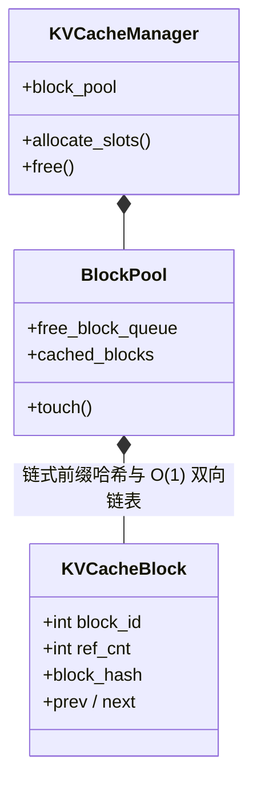
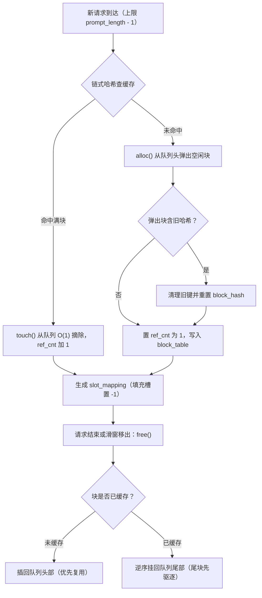

在线大语言模型推理在解码阶段往往卡在 **HBM（High Bandwidth Memory，高带宽显存）**容量而非计算单元算力。以 130 亿参数的 OPT-13B 模型为例，在半精度 FP16 下每个 token 的键值向量需要 $2 \times 5120 \times 40 \times 2\text{ B} = 800\text{ KB}$ 显存，单条 $2048$ 长度的序列就会占满 $1.6\text{ GB}$ 空间[^paper-kv-size]。

早期推理引擎要求每个请求的 **KV Cache（Key-Value Cache，键值缓存）**在显存中连续存放。由于输出长度在请求到达时未知，引擎只能按最大允许序列长度静态预分配整块张量，造成三类浪费[^paper-frag]：

- **预留槽位浪费**：为尚未生成的未来 token 提前占位，长请求执行期间持续挤占并发槽位。
- **内部碎片**：请求提前遇到结束符终止后，末尾未使用的预留空间直到释放前始终空转。
- **外部碎片**：不同请求按各自最大长度切分显存，释放后留下的夹缝难以拼入新请求。

实测表明，在这三类浪费叠加下，早期系统的有效 KV 显存利用率最低仅 $20.4\%$[^paper-frag]。硬件算力明明还有余量，并发批量却因为显存被碎片锁死而无法放大。

## 逻辑块表与两级物理寻址

借鉴操作系统虚拟内存的分页思想，**PagedAttention（分页注意力）**把连续逻辑 KV 空间切分为固定容量 $B_s$ 的逻辑块[^paper-paged]。每条请求维护独立的页表 `block_table`，映射到物理上可完全不连续的显存块。

先用一个小型物理块池示例建立直觉。设物理 KV 池共有 $16$ 个块（$B_0$ 至 $B_{15}$），每块容纳 $B_s = 4$ 个 token，其中 $B_0$ 永久保留为只读零块 `null_block`。请求 A 带着 $7$ 个提示词 token 抵达时，需要 $\lceil 7 / 4 \rceil = 2$ 个逻辑块 $L_0, L_1$，调度器为其分配不连续的物理块，写入 `block_table_A = [7, 1]`[^paper-walkthrough]。

首轮生成第 $8$ 个 token（下标 $t = 7$）时，$L_1$ 尚有 $1$ 个空槽，直接写入 $B_1$ 的末槽；第二轮生成下标 $t = 8$ 时 $L_1$ 已满，调度器新配物理块 $B_3$，页表追加为 `[7, 1, 3]`。整条序列在运行期只需把碎片压在最后一个未满块内，内部浪费严格低于 $B_s - 1$ 个槽位。

写入和读取阶段都要把一维逻辑位置 $t$ 换算成物理槽位下标。计算过程分为两步：先定位逻辑块号 $k$ 与块内偏移 $o$，再查 `block_table` 得到物理块号 $b$ 并拼出线性槽位索引 `slot_mapping`：

$$
k = \lfloor t / B_s \rfloor, \quad b = \text{block\_table}[k], \quad o = t \bmod B_s, \quad \text{slot\_mapping}[t] = b \cdot B_s + o
$$

代入请求 A 的 $t = 5$ 验证：$k = \lfloor 5 / 4 \rfloor = 1$，查表得 $b = \text{block\_table}_A[1] = 1$，块内偏移 $o = 5 \bmod 4 = 1$，于是 `slot_mapping[5]` $= 1 \times 4 + 1 = 5$。当 $t = 8$ 落入新块时，$k = 2, b = 3, o = 0$，物理槽位跳至 $12$。图 1 对照了连续预分配碎片与这套两级寻址方案。


## 分块注意力计算与张量布局演进

允许物理块离散存放后，注意力算子不再扫描连续矩阵，而是沿着 `block_table` 逐块拉取键块 $K_j = (k_{(j-1)B_s+1}, \dots, k_{jB_s})$ 与值块 $V_j = (v_{(j-1)B_s+1}, \dots, v_{jB_s})$。论文第 4 式把单次查询 $q_i$ 对上下文的分块注意力写为[^paper-eq4]：

$$
A_{ij} = \frac{\exp(q_i^\top K_j / \sqrt{d})}{\sum_{t=1}^{\lceil i / B_s \rceil} \exp(q_i^\top K_t \mathbf{1} / \sqrt{d})}, \quad o_i = \sum_{j=1}^{\lceil i / B_s \rceil} V_j A_{ij}^\top
$$

块大小 $B_s$ 是一道经典的硬件权衡。$B_s$ 过小会削弱单个 GPU Warp 沿序列维度的并行读取宽度，增加页表查表次数；$B_s$ 过大则会放大每条序列末块的尾部闲置，并降低后续前缀缓存的块级命中率。因此 GPU 后端（如 FlashAttention）常将默认块大小选在 $16$ 至 $64$ 之间[^fa-blocksize]。

在物理张量排布上，vLLM 经历了一次明显的布局演进。初版手写算子为了配合线程组 $16$ 字节合并访存，将键缓存拆成五维形状 `[num_blocks, num_kv_heads, head_size/x, block_size, x]`，值缓存拆成四维。其中打包宽度 $x = 16 / \text{sizeof}(\text{dtype})$，FP16 下等于 $8$[^legacy-layout]。

现代 FlashAttention 后端则采用统一的底层块池 `[num_blocks, num_kv_heads, block_size, 2*head_size]`。前向先通过 `transpose(1, 2)` 与 `split` 切出四维视图 `[num_blocks, block_size, num_kv_heads, head_size]`。随后再由 `reshape_and_cache_flash` 按 `slot_mapping` 执行 Scatter 写入[^fa-layout]。

若服务部署在华为昇腾 NPU 上，底层硬件要求分形格式存储，缓存布局会变为 `PA_NZ` 五维分形张量。具体对齐与搬运细节将在[昇腾第 3 章](../../vllm-ascend/03-npu-worker-runner-and-kv-layout/)中展开。

## 从写时复制到链式前缀缓存

多个请求共享同一段前缀时，只需让逻辑页表指向同一组物理块，并靠物理块引用计数 `ref_cnt` 保护内容不被覆写[^paper-sharing]。初版论文采用 **CoW（Copy-on-Write，写时复制）**处理并发分支，并行采样与束搜索分别可省下 $12\%$ 与最高 $55\%$ 显存。进入 vLLM V1 后，跨请求复用改由 **APC（Automatic Prefix Caching，自动前缀缓存）**主导，对象协作与索引结构如图 2 所示。



V1 的页表与哈希缓存遵循两条刚性约束。第一是 **Append-Only 页表**，运行中只允许尾部追加块，禁止中途替换已分配块[^v1-append-only]。第二是**满块缓存与减一上限**，仅写满 $B_s$ 个 token 的块写入缓存，检索上限截断在 `prompt_length - 1`[^v1-cap]，保证末个提示词必经前向算出 `Logits`。

标识每个满块的链式哈希把上一块 `parent_block_hash`（首块锚定全局常量）、当前块 token 序列与扩展隔离键拼成摘要[^v1-chain-hash]。隔离键按需注入多模态图像标识、LoRA 名称、多租户盐 `cache_salt` 与嵌入摘要[^v1-extra-keys]。默认 `sha256` 支持跨节点复现；选用非加密 `xxhash` 时会为初始锚点注入每进程随机种子，防止碰撞窥探[^v1-hash-algo]。

## 逆序释放队列与读写边界哨兵

前缀缓存把大量已完成请求释放的块留在显存里待命，但若每次驱逐还要遍历字典或维护堆，调度器在微秒级路径里就会出现抖动。为此 V1 直接把双向链表指针嵌入 `KVCacheBlock` 对象内部，构成零包装开销的 **LRU（Least Recently Used，最近最少使用）**空闲队列 `free_block_queue`[^v1-lru-queue]。

当请求命中已缓存前缀时，调度器调用 `touch` 把命中块的 `ref_cnt` 加 $1$。若该块原本处于空闲状态（`ref_cnt` 为 $0$），就直接靠前后指针在 $O(1)$ 时间内从链表摘除，避免后续分配误将其驱逐[^v1-touch]。

当请求结束调用 `free` 归还物理块时，调度器必须把列表**逆序**送回空闲队列[^v1-reverse-free]。如果一个块连哈希都没有（例如未写满的尾块或已淘汰的旧块），它会被插到队列**头部**优先复用以维持空间局部性；已写入前缀哈希的块则按逆序追加到队列**尾部**。因为越靠后的块对应越长的历史前缀，在未来请求中被复用的概率越低，逆序挂尾能让长后缀深层块先一步抵达队头被淘汰，尽量把高频共享的系统提示词首块留在池尾[^v1-free-policy]。

除了块生命周期管理，前向计算和写回的边界越界也由两个专用哨兵常量提供边界保护[^v1-sentinels]。在读侧，占用物理编号 $0$ 的 `null_block` 在初始化时即从空闲队列永久移出[^v1-null-init]。当滑动窗口把早期块移出窗口，或静态图填充行需要占满批表时，页表对应槽位填入 $0$，保证注意力算子只读到全零安全区。

在写侧，静态图末尾填充 token、上下文并行非本地分片以及空跑预热请求的槽位均被赋值为 `PAD_SLOT_ID = -1`[^v1-pad-slot]。写回算子 `reshape_and_cache_flash` 遇负下标直接跳过写回，防止污染有效物理块。图 3 概括了 `BlockPool` 在前缀命中、分配驱逐、逆序释放与读写哨兵之间的状态流转。



## 混合注意力分组与命中交集

越来越多模型（如 Gemma 2/3、Jamba、Llama 4）在同一网络里混排多种注意力算子。全注意力层必须保留全部历史块，而 **SWA（Sliding Window Attention，滑动窗口注意力）**层只需保留最近 `sliding_window` 个 token。若按注意力类型拆出多个物理内存池，显存容量又会重演静态切分时的跨池碎片。

V1 混合缓存管理器的核心策略是让所有分组共享同一个物理块池，前提是每个 **KVCacheGroup（KV 缓存分组）**必须拥有完全相同的物理页大小 $\text{page\_size} = \text{num\_layers} \times \text{block\_size} \times \text{kv\_hidden\_size}$[^hybrid-page]。针对不同层数比例，分组器采用三档对齐方式：

- **整比模型**：$10$ 层 Full 配 $20$ 层 SWA（$1:2$），拆成 $1$ 个 Full 组与 $2$ 个 SWA 组，每组 $10$ 层。
- **非整比模型**：Gemma-3-27B 含 $52$ 层 SWA 与 $10$ 层 Full，按最小层数 $10$ 切组，末组补齐 $8$ 空位。
- **异构状态层**：Mamba 单 token 状态更大，放大注意力层 `block_size` 使每页字节齐平。

共享单池后，缓存键空间从单纯的哈希值扩展为 `(block_hash, group_id)`，各组在前缀命中上各自独立检索再求一致前缀长度[^v1-hybrid-coord]。具体到最常见的 Full + SWA 混合模型，`HybridKVCacheCoordinator` 把两类管理器的检索顺序编排为一次双向交集扫描，如图 4 所示：

- **Full 左向右扫描**：遇首个 Miss 即终止，得到公共前缀长度上界 $L_{\text{full}}$。
- **SWA 右向左扫描**：在 $[0, L_{\text{full}})$ 内凑够 $\lceil (\text{sliding\_window} - 1) / B_s \rceil$ 个连续块即提前终止扫描。
- **裁剪对齐**：若 SWA 命中更短，则把 Full 已收集的尾部块裁剪到同一 token 边界。


官方混合 KV 缓存管理器在组件分层上由 `KVCacheManager` 统领三类协调器与多种单一注意力管理器，如图 5 所示[^hybrid-page]。


## 参考实现与上游源码对照

下面这段纯 Python 参考实现把 $16$ 块物理池（$B_s = 4$）、`null_block`、写掩码、链式哈希与逆序队列串在一起运行[^v1-src-all]。它同时也验证了 Full + SWA 双向交集的完整逻辑：

```python
import hashlib, pickle

PAD_SLOT_ID, NULL_BLOCK_ID = -1, 0
NONE_HASH = hashlib.sha256(b"vllm-none-hash").digest()

def chain_hashes(tokens, bs=4, cache_salt=None):
    out, prev = [], NONE_HASH
    for i in range(0, (len(tokens) // bs) * bs, bs):
        extra = (("cache_salt", cache_salt),) if i == 0 and cache_salt else None
        prev = hashlib.sha256(pickle.dumps((prev, tuple(tokens[i:i + bs]), extra))).digest()
        out.append(prev)
    return out

class Block:
    def __init__(self, bid, is_null=False):
        self.bid, self.is_null, self.ref_cnt, self.key = bid, is_null, 0, None

class BlockPool:
    def __init__(self, num_blocks=16, bs=4):
        self.bs = bs
        self.blocks = [Block(i, is_null=(i == NULL_BLOCK_ID)) for i in range(num_blocks)]
        self.free_q = [self.blocks[i] for i in range(1, num_blocks)]
        self.cache = {}
    def alloc(self, n):
        got, self.free_q = self.free_q[:n], self.free_q[n:]
        for b in got:
            if b.key is not None and self.cache.get(b.key) is b:
                del self.cache[b.key]
            b.key, b.ref_cnt = None, 1
        return got
    def touch(self, blks):
        for b in blks:
            if not b.is_null:
                if b.ref_cnt == 0:
                    self.free_q.remove(b)
                b.ref_cnt += 1
    def free_reverse(self, blks):
        evict_first, evict_last = [], []
        for b in reversed(blks):
            if not b.is_null:
                b.ref_cnt -= 1
                if b.ref_cnt == 0:
                    (evict_first if b.key is None else evict_last).append(b)
        self.free_q = evict_first + self.free_q + evict_last
    def cache_block(self, b, h, gid):
        if not b.is_null and b.key is None:
            b.key = (h, gid)
            self.cache.setdefault(b.key, b)
    def lookup(self, h, gid):
        return self.cache.get((h, gid))

def hybrid_hit(pool, hashes, max_len, sw_size):
    full_blks = []
    for h in hashes[:max_len // pool.bs]:
        if not (b := pool.lookup(h, 0)):
            break
        full_blks.append(b)
    n_full, need = len(full_blks), (sw_size - 1 + pool.bs - 1) // pool.bs
    swa_blks, run = [pool.blocks[NULL_BLOCK_ID]] * n_full, 0
    for i in range(n_full - 1, -1, -1):
        if b := pool.lookup(hashes[i], 1):
            swa_blks[i], run = b, run + 1
            if run >= need:
                return full_blks[:i + run], swa_blks[:i + run], (i + run) * pool.bs
        else:
            run = 0
    return full_blks[:run], swa_blks[:run], run * pool.bs

pool, tokens = BlockPool(16, 4), list(range(100, 116))
h_a = chain_hashes(tokens, 4, cache_salt="tenant-a")
f_blks, s_blks = pool.alloc(4), pool.alloc(4)
for i, h in enumerate(h_a):
    pool.cache_block(f_blks[i], h, 0)
    if i >= 1:
        pool.cache_block(s_blks[i], h, 1)
pool.free_reverse(f_blks)
pool.free_reverse(s_blks)
print("free_q after reverse free:", [b.bid for b in pool.free_q])
hit_f, hit_s, hit_len = hybrid_hit(pool, h_a, len(tokens) - 1, 9)
pool.touch(hit_f + hit_s)
print("tenant-a hit_len:", hit_len, "full:", [b.bid for b in hit_f], "swa:", [b.bid for b in hit_s])
print("free_q after touch:", [b.bid for b in pool.free_q])
_, _, miss_len = hybrid_hit(pool, chain_hashes(tokens, 4, "tenant-b"), len(tokens) - 1, 9)
bt = [b.bid for b in hit_f]
slots = [PAD_SLOT_ID if p < 0 else bt[p // 4] * 4 + (p % 4) for p in (0, 5, 11, -1)]
print("tenant-b hit_len:", miss_len, "slot_mapping:", slots)
assert hit_len == 12 and miss_len == 0 and slots == [4, 9, 15, -1]
```

运行上述脚本，实测终端打印结果如下：

```text
free_q after reverse free: [5, 9, 10, 11, 12, 13, 14, 15, 4, 3, 2, 1, 8, 7, 6]
tenant-a hit_len: 12 full: [1, 2, 3] swa: [0, 6, 7]
free_q after touch: [5, 9, 10, 11, 12, 13, 14, 15, 4, 8]
tenant-b hit_len: 0 slot_mapping: [4, 9, 15, -1]
```

观察输出结果：SWA 未缓存的块 $5$ 被前置到队头优先复用，Full 与 SWA 已缓存块则逆序挂入队尾。随后 `tenant-a` 凭借上限 $15$ 截断并命中 $12$ 个 token，SWA 跳过的块 $0$ 自动补入 `null_block`，而 `tenant-b` 因盐值变化全链失配。最终 `slot_mapping` 将位置 $5$ 落入物理槽 $9$，负值填充位保持 $-1$。

至此，KV 显存已经被虚拟化为可复用、可混合部署且具备读写哨兵保护的物理块池。下一章[04 连续批处理与调度器](../04-continuous-batching-and-scheduler/)将回到调度层。面对每轮动态增减的请求流，调度器如何利用块池预算 token 配额并触发抢占恢复？

[^paper-kv-size]: Kwon et al., _Efficient Memory Management for Large Language Model Serving with PagedAttention_ (SOSP '23, [arXiv:2309.06180](https://arxiv.org/abs/2309.06180), CC BY 4.0), §3 “Large KV cache”。

[^paper-frag]: 同上，§3.1 Fig. 2 与 Fig. 3 对比了预留槽、内部碎片与外部碎片，报告静态预分配的有效显存最低为 20.4%。

[^paper-paged]: 同上，§4.1 与 §4.2 描述了以固定大小 KV 块与逻辑到物理 `block_table` 实现的非连续分页机制。

[^paper-walkthrough]: 同上，§4.3 Fig. 6 给出了 7 token 提示词映射到物理块 7、1，并在第 2 步解码新配物理块 3 的完整例示。

[^paper-eq4]: 同上，§4.1 Eq. 4 给出了按块切分键值向量后分块计算 Softmax 与输出加权的数学形式。

[^fa-blocksize]: 见 `vllm@99b0b0b0` 仓库 `vllm/v1/attention/backends/flash_attn.py:454-472` 中 `get_supported_kernel_block_sizes` 与 `get_preferred_block_size`（常见为 16 的倍数，SM90 FP8 等场景为 64）。

[^legacy-layout]: 见 `vllm@99b0b0b0` 仓库 `docs/design/paged_attention.md:58-59` 与 `vllm/v1/attention/ops/paged_attn.py:17-29`（`PagedAttention.split_kv_cache`）。

[^fa-layout]: 见 `vllm@99b0b0b0` 仓库 `vllm/v1/attention/backends/flash_attn.py:1359` 与 `1539-1558`（`kv_cache.transpose(1, 2).split(self.head_size, dim=-1)` 后调用 `reshape_and_cache_flash`）。

[^paper-sharing]: 见 [arXiv:2309.06180](https://arxiv.org/abs/2309.06180) §3 与 §4.4：并行采样（Parallel Sampling）在提示词阶段共享可省 12% 显存，束搜索（Beam Search）最高可省 55% 显存，二者与共享前缀均通过 `ref_cnt` 与 CoW 协同。

[^v1-append-only]: 见 `vllm@99b0b0b0` 仓库 `docs/design/prefix_caching.md:194` 与 `vllm/v1/core/block_pool.py:38-105`（`BlockHashToBlockMap` 通过 `_dup_ids` 允许短暂存在同哈希多块）。

[^v1-cap]: 见 `vllm@99b0b0b0` 仓库 `vllm/v1/core/kv_cache_manager.py:310-321` 与 `vllm/v1/request.py:357-361`（`get_max_cache_hit_length` 将上限设为 `num_tokens - 1`）。

[^v1-chain-hash]: 见 `vllm@99b0b0b0` 仓库 `vllm/v1/core/kv_cache_utils.py:697-727`（`hash_block_tokens`）。

[^v1-extra-keys]: 见 `vllm@99b0b0b0` 仓库 `vllm/v1/core/kv_cache_utils.py:512-665`（`_gen_mm_extra_hash_keys`、`_gen_lora_extra_hash_keys`、`_gen_prompt_embeds_extra_hash_keys` 与 `generate_block_hash_extra_keys`）。

[^v1-hash-algo]: 见 `vllm@99b0b0b0` 仓库 `docs/design/prefix_caching.md:25-31` 与 `vllm/v1/core/kv_cache_utils.py:102-156`（`NONE_HASH`、`DEFAULT_NONE_HASH_SEED` 与 `resolve_none_hash_seed`），另见 [vLLM 前缀缓存设计文档](https://docs.vllm.ai/en/latest/design/prefix_caching/)。

[^v1-lru-queue]: 见 `vllm@99b0b0b0` 仓库 `vllm/v1/core/kv_cache_utils.py:160-200`（`KVCacheBlock`）与 `248-475`（`FreeKVCacheBlockQueue`）。

[^v1-touch]: 见 `vllm@99b0b0b0` 仓库 `vllm/v1/core/block_pool.py:774-793`（`BlockPool.touch`）。

[^v1-reverse-free]: 见 `vllm@99b0b0b0` 仓库 `vllm/v1/core/single_type_kv_cache_manager.py:729-738`（`free` 向 `block_pool.free_blocks` 传入 `reversed(...)`）。

[^v1-free-policy]: 见 `vllm@99b0b0b0` 仓库 `vllm/v1/core/block_pool.py:798-837`（`blocks_to_evict_first` 前置队头，`blocks_to_evict_last` 追加队尾）。

[^v1-sentinels]: 见 `vllm@99b0b0b0` 仓库 `vllm/v1/attention/backends/utils.py:55-56`（`PAD_SLOT_ID = -1`、`NULL_BLOCK_ID = 0`）。

[^v1-null-init]: 见 `vllm@99b0b0b0` 仓库 `vllm/v1/core/block_pool.py:161-165`（`self.null_block = self.free_block_queue.popleft()`，`is_null = True`）。

[^v1-pad-slot]: 见 `vllm@99b0b0b0` 仓库 `vllm/v1/worker/gpu/block_table.py:247-290` 与 `351-432`（`_compute_slot_mappings_kernel` 将填充行、虚拟请求及非本地分片映射为 `PAD_ID = -1`）。

[^hybrid-page]: 见 `vllm@99b0b0b0` 仓库 `docs/design/hybrid_kv_cache_manager.md:28-155`（同页大小定义及三种分组策略），另见 [vLLM 混合 KV 缓存文档](https://docs.vllm.ai/en/latest/design/hybrid_kv_cache_manager/)。

[^v1-hybrid-coord]: 见 `vllm@99b0b0b0` 仓库 `vllm/v1/core/kv_cache_coordinator.py:565-809`（`HybridKVCacheCoordinator.find_longest_cache_hit`）与 `vllm/v1/core/single_type_kv_cache_manager.py:874-958,1068-1235`（`FullAttentionManager` 与 `SlidingWindowManager`）。

[^v1-src-all]: 本章参考实现精简自 `vllm@99b0b0b0` 的 `block_pool.py`、`kv_cache_utils.py`、`kv_cache_coordinator.py` 与 `single_type_kv_cache_manager.py`，可直接使用 Python 标准库独立运行验证。
