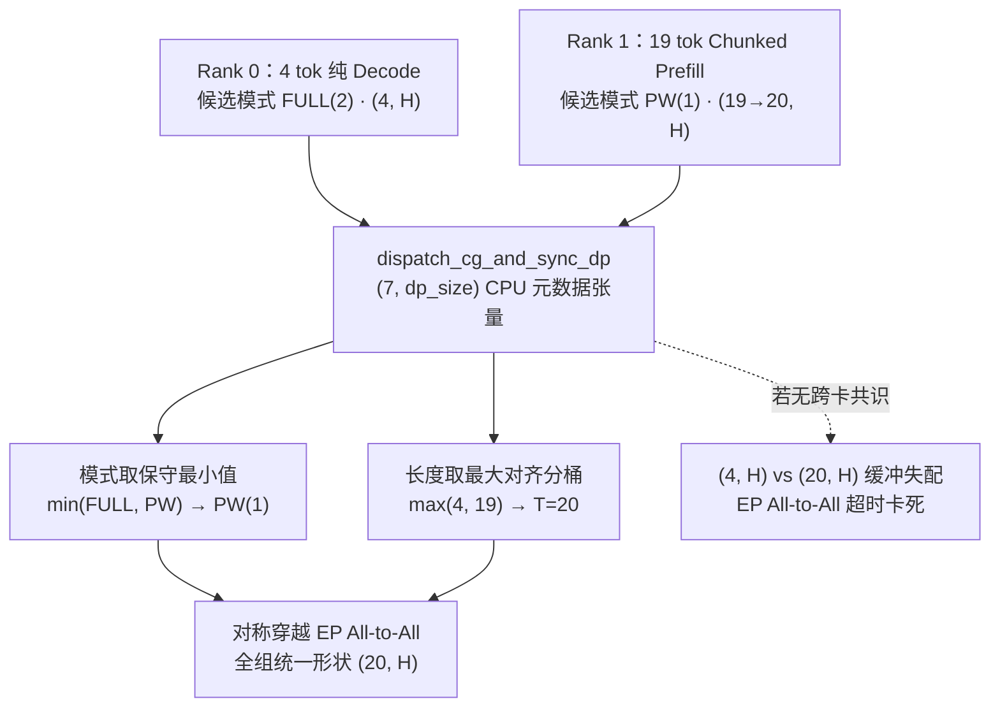
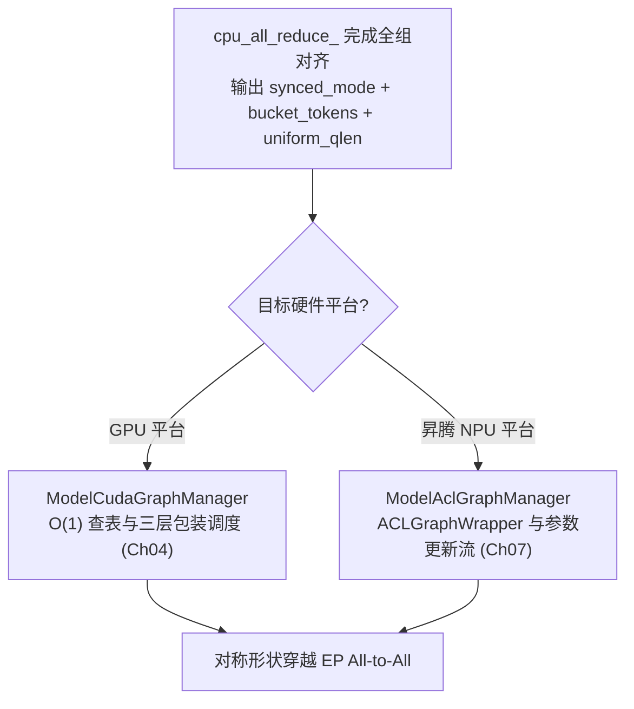

单卡的 `CUDAGraphMode` 分级、自动降级与三层同心包装已由[《推理执行图》第 4 章](../../execgraph/04-vllm-cudagraph-modes/)给出完整拆解。把静态图推进多卡 **DP（Data Parallelism，数据并行）** 服务后，引擎面临一层新的协调问题。当模型开启 **MoE（Mixture-of-Experts，混合专家架构）** 并行时，各卡批构成往往不同。如果各自按本地负载选模式或分桶长度，跨卡集合通信就会因形状或入图状态失配而直接卡死。

## 多卡 DP 共识与集合通信防死锁

理解跨卡模式对齐前，需要先厘清拓扑前提。对普通 **Dense（稠密）**模型做标准 DP 部署时，每个副本独立持有完整权重并在本地前向，层间不产生跨 DP 卡的激活交换。此时即便 Rank 0 跑整图、Rank 1 跑分段图，双方各自推进也互不干扰。

一旦进入 **MoE“Attention 走 DP + 专家层走 EP（Expert Parallelism，专家并行）”**的混合并行拓扑，情况就会改变。每一层的注意力仍在各 DP 卡本地独立计算，但紧接着的 MoE 专家 **Dispatch（分发）**与 **Combine（合并）**必须在 EP/DP 通信组内执行跨卡 `All-to-All` 集合通信[^vllm-dp-utils]。

假设某一步中，Rank 0 仅承载 $4$ 个解码 token 并本地走 `FULL` 整图（形状 `(4, H)`）。Rank 1 则处理 $19$ 个混排 token，对齐到桶 $20$ 后退回 `PIECEWISE`（形状 `(20, H)`）。两张卡抵达同一层 `All-to-All` 时传入的张量长度分别是 $4$ 与 $20$，不仅收发缓冲无法对齐，还会因两卡算子入图状态不一致而触发通信超时或死锁。

为此，`GPUModelRunner` 在进入模型前向之前，会先调用 `dispatch_cg_and_sync_dp` 执行一次纯主机侧的状态汇总[^vllm-dp-utils][^vllm-model-runner]。每张卡在 CPU 上把本地 `num_tokens`、`cg_mode`、`uniform_token_count` 与其余 $4$ 项批约束写入形状 $7 \times \text{dp\_size}$ 的 CPU 张量。随后通过 `cpu_all_reduce_()` 完成跨卡交换，全程不阻塞 GPU 计算流。

汇总结束后，所有存活卡按同一套保守规则联合裁决：全局图模式取枚举最小值（`NONE = 0`、`PIECEWISE = 1`、`FULL = 2`），只要任意一卡需要降级，全体同步降级[^vllm-dp-utils]。若全组仍有卡保持图执行，则统一取最大 token 数在共享档位中重新分桶对齐；一旦对均匀查询长度意见不一，即置为 `None` 并退出均匀解码路径。

沿用前面的 `(4, FULL)` 与 `(19, PIECEWISE)` 示例，全组最终一致对齐到 `PIECEWISE` 与分桶 $T = 20$。所有 Rank 从而以对称的 `(20, H)` 张量穿越每一层 `All-to-All`。图 1 展示了从本地投票分化到主机共识对齐的完整链路。



## 共识结果驱动单卡执行图

集群主机端达成一致后，每张计算卡拿到完全对称的三元组 `(synced_mode, bucket_tokens, uniform_qlen)`。此后各卡不再自己临时决定模式，而是把该共识三元组直接喂给本地执行图管理器（图 2）[^vllm-model-runner][^vllm-cudagraph-manager]：

- **NVIDIA GPU 路径**：交由 `ModelCudaGraphManager`，按三层包装透传契约查表命中 `FULL` 或 `PIECEWISE`[^vllm-cudagraph-manager]。
- **华为昇腾 NPU 路径**：交由 `ModelAclGraphManager` 与 `ACLGraphWrapper`，整图重放前刷新切片参数[^ascend-aclgraph-mgr]。



关于 GPU 单卡的三层包装透传不变量与 $O(1)$ 查表展平结构，详见[《推理执行图》第 4 章](../../execgraph/04-vllm-cudagraph-modes/)；昇腾平台对 `FULL` 模式的限制及队列配额预算，详见[《推理执行图》第 7 章](../../execgraph/07-acl-graph-fullstack-and-vllm-ascend/)。

## PyTorch 多卡共识仿真与双仓对照

下面的自包含 PyTorch 验证脚本还原了 `dp_utils.py` 在两类多卡场景下的 `min(mode)` / `max(tokens)` 共识算法，并演示对齐结果如何分发给单卡图执行器：

```python
import torch

MODE_NAME = {0: "NONE", 1: "PIECEWISE", 2: "FULL"}


def sync_dp_dispatch(
    rank_tokens: torch.Tensor,
    rank_modes: torch.Tensor,
    rank_qlen: torch.Tensor,
    buckets: list[int],
) -> tuple[int, int, int | None]:
    """模拟 cpu_all_reduce_ 后按最保守模式与最大 token 数完成全组对齐。"""
    synced_mode = int(rank_modes.min().item())
    synced_tokens = int(rank_tokens.max().item())
    bucket_tokens = next(b for b in buckets if b >= synced_tokens)
    has_non_uniform = bool(torch.any(rank_qlen == -1).item())
    qlen_agree = bool(torch.all(rank_qlen == rank_qlen[0]).item())
    uniform_qlen = (
        None
        if (has_non_uniform or not qlen_agree)
        else int(rank_qlen[0].item())
    )
    return synced_mode, bucket_tokens, uniform_qlen


def route_local_graph(synced_mode: int, bucket_tokens: int, uniform_qlen: int | None) -> str:
    if synced_mode == 2 and uniform_qlen is not None:
        return f"FULL_GRAPH(bucket={bucket_tokens}, qlen={uniform_qlen})"
    if synced_mode == 1:
        return f"PIECEWISE_GRAPH(bucket={bucket_tokens}, attn=eager)"
    return f"EAGER_PASSTHROUGH(tokens={bucket_tokens})"


buckets = [4, 8, 16, 20, 32]
# 场景 1：Rank 0 为 4 token 纯解码，Rank 1 为 19 token 混排预填充
m1, b1, q1 = sync_dp_dispatch(
    torch.tensor([4, 19]), torch.tensor([2, 1]), torch.tensor([1, -1]), buckets
)
# 场景 2：两卡均为单步解码，全组保留 FULL(2) 并按最大负载对齐到桶 8
m2, b2, q2 = sync_dp_dispatch(
    torch.tensor([4, 6]), torch.tensor([2, 2]), torch.tensor([1, 1]), buckets
)
assert (m1, b1, q1) == (1, 20, None) and (m2, b2, q2) == (2, 8, 1)

print(f"hetero_dp: mode={MODE_NAME[m1]}({m1}), target={route_local_graph(m1, b1, q1)}")
print(f"decode_dp: mode={MODE_NAME[m2]}({m2}), target={route_local_graph(m2, b2, q2)}")
```

运行上述脚本，输出如下：

```text
hetero_dp: mode=PIECEWISE(1), target=PIECEWISE_GRAPH(bucket=20, attn=eager)
decode_dp: mode=FULL(2), target=FULL_GRAPH(bucket=8, qlen=1)
```

下表对比了多卡 DP 共识协议及与单卡图管理器衔接逻辑在双仓中的落点：

| 多卡协同与分发维度 | GPU（`vllm` `bb23c0a8`）             | 昇腾 NPU（`vllm-ascend` `3649b8ff`）                    |
| ------------------ | ------------------------------------ | ------------------------------------------------------- |
| 多卡 DP 跨卡共识   | `dispatch_cg_and_sync_dp` 主机对齐   | 复用同共识协议完成全组同步                              |
| 共识后单卡图管理器 | `ModelCudaGraphManager` 查表分发     | `ModelAclGraphManager` 查表与透传[^ascend-aclgraph-mgr] |
| 通信对称缓冲保障   | `All-to-All` 前统一分桶 `num_tokens` | 同分桶形状对齐，协同更新流刷新切片参数                  |

在集群视角下，DP 主机共识确保了跨卡通信与单卡执行图之间的步调一致。终章[第 4 章：性能观测与线上故障定位](../04-profiling-and-debugging/)将继续围绕服务指标与 Profiler 轨迹展开排障。

[^vllm-dp-utils]: `vllm` 项目（commit `bb23c0a8`），`vllm/v1/worker/gpu/dp_utils.py:49-353` 中的 `sync_cudagraph_and_dp_padding` 与 `dispatch_cg_and_sync_dp`（通过 `cpu_all_reduce_` 聚合 7 项调度状态并取保守图模式与最大 token 上限）。

[^vllm-model-runner]: `vllm` 项目（commit `bb23c0a8`），`vllm/v1/worker/gpu/model_runner.py:1894-2177`（调用 `dispatch_cg_and_sync_dp` 并在 `FULL` 与 `PIECEWISE` / Eager 间切换）。

[^vllm-cudagraph-manager]: `vllm` 项目（commit `bb23c0a8`），`vllm/v1/worker/gpu/cudagraph_utils.py:74-427, 531-618` 中的 `BatchExecutionDescriptor` 与 `ModelCudaGraphManager`。

[^ascend-aclgraph-mgr]: `vllm-ascend` 项目（commit `3649b8ff`），`vllm_ascend/worker/v2/aclgraph_utils.py:83-198` 中的 `ModelAclGraphManager` 与 `vllm_ascend/compilation/acl_graph.py:160-177` 中的 `ACLGraphWrapper.__call__`。
