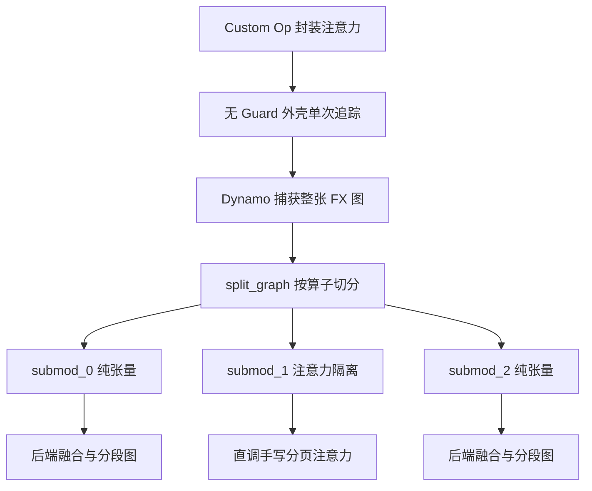
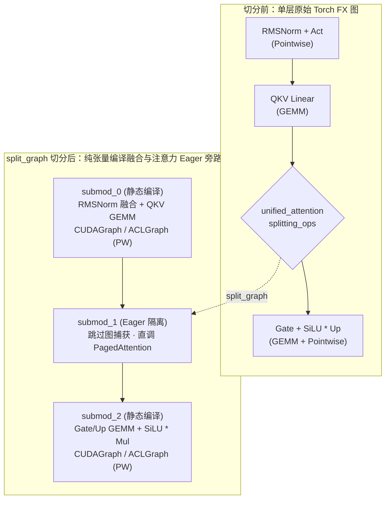

跨步异步调度把调度逻辑与回传拷贝藏到了后台，但控制权一旦走进单步 `model.forward()`，逐算子执行依然耗时巨大。在 PyTorch Eager 模式下，`RMSNorm`、**RoPE（Rotary Position Embedding，旋转位置编码）**、`SiLU` 与残差加法仍会一个个穿过 C++ 分发器。这不仅迫使 CPU 发起数百次 Kernel 发射，还会频繁把中间激活写回 **HBM（High Bandwidth Memory，高带宽显存）**再重新读出。

从直觉上看，开启 `torch.compile` 把整张模型图编译融合就能合并零碎算子、削减发射次数与访存流量；但在大语言模型推理场景下，直接对原生模型套用标准全图编译会在两处同时受阻。

第一处障碍是 **`Dynamo Guard` 引发的反复重编译**：标准 `torch.compile` 会为动态批大小生成形状 Guard 与 0/1 特化约束。在线流量每一步的 `num_tokens` 都在变化，导致编译产物频频失效，并在服务请求期间触发耗时数秒的即时重编译。

第二处障碍是**变长注意力引发的 `Graph Break`（断图）**：分页注意力依赖动态块表索引、原地 KV 缓存 Scatter 写入以及按预填充与解码切换的多路径分发。一旦追踪器钻进注意力内部，无法静态分析的控制流就会把整张计算图切碎，跨算子融合随之落空。

## 黑盒封装、无 Guard 追踪与切图

为了在不牺牲注意力灵活性的前提下保留整层纯张量算子的跨层融合能力，vLLM 在 `VLLM_COMPILE` 模式下采用了三层联动架构，整体流向如图 1 所示。



第一道桥梁是**用 PyTorch Custom Op（自定义不透明算子）封装注意力，防止发生 `Graph Break`**。vLLM 把 KV Cache 写入与计算分别注册为黑盒算子，例如标准路径的 `unified_kv_cache_update` 与 `unified_attention_with_output`[^vllm-custom-op]。**MLA（Multi-Head Latent Attention，多头潜在注意力）**路径与昇腾端 `mla_forward` 也采用同样封装[^vllm-mla-op][^ascend-mla-op]。

写入算子通过注册 `fake_impl` 抽象推导返回一个零元素依赖占位张量传入注意力算子，借此在图里锁定“先更新 KV 再读取计算”的顺序，防止编译器重排。注意力算子则以 `mutates_args` 声明直接覆写预分配的 `output` 缓冲；Dynamo 追踪时只将其视为已知形状的黑盒节点，得以一次扫通整张 `fx.GraphModule`。

第二层机制落在模型入口的 **`TorchCompileWithNoGuardsWrapper`**[^vllm-wrapper]。在非 `STOCK_TORCH_COMPILE` 模式下，它会向编译器注入跳过检查的过滤函数 `guard_filter_fn`。PyTorch 2.10 及以上版本调用 `torch.compiler.skip_all_guards_unsafe`；早期版本则通过返回全 `False` 列表并搭配动态形状策略消除 0/1 特化。

随后，包装器在启动热身期以 `fullgraph=True` 完成整图单次追踪与缓存（可搭配字节码 Hook 替换 `forward.__code__` 或开启重编拦截）。进入运行期后，无论 `num_tokens` 如何变化都零校验直接复用编译结果，避免线上请求触发额外追踪[^vllm-wrapper][^vllm-torch-compile-doc]。

第三层机制则由编译后端入口 **`VllmBackend`** 接棒执行主动切图[^vllm-backends]。虽然 Dynamo 逻辑上扫通了整张大图，但 TorchInductor 和设备静态图仍无法直接处理变长页表调度。

收到完整 FX 图后，`VllmBackend` 会调用 `split_graph` 扫描全图节点[^vllm-backends][^vllm-comp-config]。凡命中 `splitting_ops` 列表（含注意力与 KV 更新算子）的节点，前后都会划开边界：纯张量段归入 `submod_0`、`submod_2`，注意力节点单独隔离进 `submod_1`。

切分调用 `split_module` 时必须传入 `keep_original_order=True` 以保持原地写入顺序，并合并连续相邻的切分算子与空壳子图。

## 纯张量融合与注意力隔离

切图完成后，整层计算被拆成性质不同的两类子图，切分与融合前后的形态对照见图 2。



纯张量子图（如 `submod_0` 与 `submod_2`）内部只包含形状拓扑静态的 `RMSNorm`、QKV 线性投影、旋转位置编码、激活与残差加法，仅有批维度 `num_tokens` 为符号变量。

`PiecewiseCompileInterpreter` 会为每个纯张量子图创建 `PiecewiseBackend`，把动态符号区间与静态 `compile_sizes` 一并编译妥当[^vllm-piecewise]。在 GPU 上，TorchInductor 会把相邻的归一化、激活与量化算子垂直融合成单条 Triton Kernel，减少中间张量在 HBM 之间的往返。

随后 `wrap_with_cudagraph_if_needed` 为每段产物外包一层 `PIECEWISE` 静态图壳[^vllm-backends]。若开启实验性图分区，拆分也可推迟到 Inductor 完成全图融合之后的代码生成阶段[^vllm-comp-config]。

与之相对，命中切分条件的注意力子图 `submod_1` 在解释器阶段被跳过编译。运行时它直接退出编译域，以 Eager 模式调用针对变长页表优化的原生手写算子（如 FlashAttention、FlashMLA 或昇腾融合注意力）。这样既保住了密集算子的融合收益，也留出了注意力调度灵活性。

## Inductor 与昇腾双路编译管线

走出 FX 切图阶段进入硬件后端代码生成时，NVIDIA GPU 与华为昇腾 NPU 分化出两条编译与缓存管线，具体对比见图 3。

```mermaid caption="图 3：PyTorch Inductor 与昇腾 AscendCompiler 管线对比"
flowchart TD
    subgraph GPU["NVIDIA GPU · TorchInductor + Triton"]
        G0["TorchCompileWithNoGuardsWrapper<br/>跳过动态 Shape Guard"] --> G1["VllmBackend + split_graph<br/>按 splitting_ops 切分 FX"]
        G1 --> G2["TorchInductor FX Fusion<br/>编译生成 Triton 融合算子"]
        G2 --> G3["CUDAGraphWrapper (PW)<br/>捕获静态分段低开销重放"]
    end
    subgraph NPU["Ascend NPU · AscendCompiler + npugraph_ex"]
        A0["TorchCompileWithNoGuardsWrapper<br/>共用上层无 Guard 入口"] --> A1["AscendCompiler.compile<br/>oot_compiler (禁用 Inductor)"]
        A1 --> A2["npugraph_ex / GraphFusionPass<br/>下沉 GE 图或模式匹配融合"]
        A2 --> A3["ACLGraphWrapper / Updatable<br/>aclmdlRI 静态捕获与热更新"]
    end
```



在 NVIDIA 侧，`VllmBackend` 默认启用 PyTorch TorchInductor，通过内置图优化 Pass 生成 Triton 融合 Kernel。生成的编译产物会直接持久化到磁盘缓存，以便下次服务重启时复用[^vllm-torch-compile-doc]。

在华为昇腾侧，`vllm-ascend` 的平台配置显式将 `use_inductor` 设为 `False`，把后端替换为 `AscendCompiler`[^ascend-platform]。在分段模式下，它还会把昇腾自定义算子 `mla_forward` 等追加进 `splitting_ops`；若使用整图模式，则清空切分列表以减少静图切碎。

进入 `AscendCompiler.compile` 后，系统根据 `enable_npugraph_ex` 配置在两条路径间切换[^ascend-compiler]。开启该开关时，引擎调用 `npugraph_ex_compile` 优先加载 `npugraph_ex` 后端，并关闭原地重写以免 GELU 回退到 CPU。同时它按需打开静态核编译与 `SuperKernel` 优化。

若当前环境未安装 `npugraph_ex`，管线会自动兜底到旧版 `torchair`（`reduce-overhead` 模式）。纯张量 FX 子图随即下沉交由 CANN **GE（Graph Engine，图引擎）**优化。而隔离出的注意力子图则直调 **FIA（Fused Infer Attention，融合推理注意力，即 `npu_fused_infer_attention_score`）**等 NPU 原生算子。

当关闭 `enable_npugraph_ex` 时，流程进入 `fusion_pass_compile`[^ascend-compiler][^ascend-fusion-pass]。它通过 `aot_autograd` 把子图交给 `GraphFusionPassManager` 执行 NPU 定制融合 Pass。这些 Pass 覆盖了 `AddRMSNormQuant`、QK 归一化与 RoPE、乘加以及行并行矩阵乘与 `ReduceScatter` 等融合，不经 GE 下沉而直接返回融合后的 FX 图。

这里有一处极隐蔽的跨进程缓存约束：`npugraph_ex_compile` 若在生成代码文本 `py_code` 中检测到 `"triton_kernel_wrapper"`，就会跳过写入磁盘缓存[^ascend-compiler]。原因在于 Triton 算子编译时会向当前进程内的全局表 `kernel_side_table` 注册核函数，生成的 Python 代码里只保存了**进程局部的整数索引**。

如果把带整数索引的代码写盘并在下次启动的新进程中反序列化加载，新进程的 `kernel_side_table` 中并没有对应键，查询就会直接报错失败。只有主动跳过磁盘缓存并在加载缺失时于当前进程重新编译，才能重新注册正确的核索引。

## FX 切图实现与双仓源码对照

下面这段自包含的 PyTorch 代码利用 `torch.fx.symbolic_trace` 与 `split_module` 还原了 `split_graph` 的核心逻辑。代码先用 `torch.fx.wrap` 将 `unified_attention` 标记为不透明原子节点，再在命中前后两次递增 `submod_id` 完成前后段切分，并验证切分前后输出数值等价：

```python
import torch
import torch.fx as fx
import torch.nn as nn

def unified_attention(q: torch.Tensor, k: torch.Tensor, v: torch.Tensor) -> torch.Tensor:
    scale = q.shape[-1] ** -0.5
    return torch.softmax((q @ k.transpose(-1, -2)) * scale, dim=-1) @ v

torch.fx.wrap("unified_attention")  # 类比 Custom Op，阻止 tracer 展开注意力内部逻辑

class MiniDecoderBlock(nn.Module):
    def __init__(self, d: int = 8) -> None:
        super().__init__()
        self.q_proj = nn.Linear(d, d, bias=False)
        self.k_proj = nn.Linear(d, d, bias=False)
        self.v_proj = nn.Linear(d, d, bias=False)
        self.gate = nn.Linear(d, d, bias=False)
        self.up = nn.Linear(d, d, bias=False)

    def forward(self, x: torch.Tensor) -> torch.Tensor:
        attn_out = unified_attention(self.q_proj(x), self.k_proj(x), self.v_proj(x))
        h = x + attn_out
        return torch.nn.functional.silu(self.gate(h)) * self.up(h)

torch.manual_seed(0)
model = MiniDecoderBlock(8).eval()
gm = fx.symbolic_trace(model)

submod_id, node_to_id, split_ids = 0, {}, set()
for node in gm.graph.nodes:
    if node.op in ("placeholder", "output"):
        continue
    if node.op == "call_function" and node.target is unified_attention:
        submod_id += 1  # 进入 splitting_op 前递增，结束前置纯张量子图 (submod_0)
        node_to_id[node] = submod_id
        split_ids.add(submod_id)
        submod_id += 1  # 离开 splitting_op 后再次递增，开启后置纯张量子图 (submod_2)
    else:
        node_to_id[node] = submod_id

split_gm = fx.passes.split_module.split_module(
    gm, None, lambda n: node_to_id[n], keep_original_order=True
)
submods = [n for n, _ in split_gm.named_children() if n.startswith("submod_")]
x = torch.randn(4, 8)
with torch.no_grad():
    max_diff = (model(x) - split_gm(x)).abs().max().item()
assert (
    submods == ["submod_0", "submod_1", "submod_2"]
    and split_ids == {1}
    and max_diff < 1e-6
)

print(f"submods={submods}, split_ids={sorted(split_ids)}, max_diff={max_diff:.2e}")
for name in submods:
    sub = getattr(split_gm, name)
    ops = [n.name for n in sub.graph.nodes if n.op not in ("placeholder", "output")]
    print(f"{name}: nodes={ops}")
```

运行输出如下：

```text
submods=['submod_0', 'submod_1', 'submod_2'], split_ids=[1], max_diff=0.00e+00
submod_0: nodes=['q_proj', 'k_proj', 'v_proj']
submod_1: nodes=['unified_attention']
submod_2: nodes=['add', 'gate', 'silu', 'up', 'mul']
```

上游源码在切分器顺序保持与昇腾缓存过滤上的核心逻辑如下[^vllm-backends][^ascend-compiler]：

```python
# Upstream: vllm/compilation/backends.py:605-635 (vllm@bb23c0a8)
if should_split(node, splitting_ops):
    subgraph_id += 1
    node_to_subgraph_id[node] = subgraph_id
    split_op_graphs.append(subgraph_id)
    if should_split(node.next, splitting_ops):
        subgraph_id -= 1  # 合并连续切分算子
    else:
        subgraph_id += 1
# keep_original_order=True 防止重排带有原地 KV 状态写入的算子
split_gm = torch.fx.passes.split_module.split_module(
    graph, None, lambda node: node_to_subgraph_id[node], keep_original_order=True,
)

# Upstream: vllm_ascend/compilation/compiler_interface.py:229-239 (vllm-ascend@3649b8ff)
if "triton_kernel_wrapper" in py_code:
    logger.info("Skipping npugraph_ex cache for graph containing Triton kernels ...")
else:
    with open(cache_path, "w") as f:
        f.write(py_code)
```

| 分段编译维度   | GPU（`vllm` `bb23c0a8`）         | 昇腾 NPU（`vllm-ascend` `3649b8ff`）          |
| -------------- | -------------------------------- | --------------------------------------------- |
| 黑盒与无 Guard | Custom Op 配无 Guard 追踪包装    | 复用入口外壳并补齐 `mla_forward`              |
| 子图切分与隔离 | `split_graph` 保序切分合并空段   | 复用切分器；`FULL` 清空切分表                 |
| 后端融合与缓存 | `TorchInductor` 生成 Triton 写盘 | `AscendCompiler` 切换 GE/Pass，禁 Triton 缓存 |

`torch.compile` 与 `split_graph` 把零碎逐元素算子融合进少量 Kernel，显著削减了中间激活的 HBM 读写往返。但在小批量解码下，CPU 仍需逐子图、逐层向驱动提交发射调用，发射墙的最后一程还没有走完。下一章[第 4 章：CUDA Graph 四道硬边界与共享图池](../04-cuda-graph-and-boundaries/)将进入硬件静态图，拆解单次发射整串算子的录制方式与四道约束。

[^vllm-custom-op]: `vllm`（commit `bb23c0a8`），`vllm/model_executor/layers/attention/attention.py:773-850`（`unified_kv_cache_update` 带 `fake_impl` 返回依赖占位张量，`unified_attention_with_output` 以 `mutates_args` 声明原地写回输出）。

[^vllm-mla-op]: `vllm`（commit `bb23c0a8`），`vllm/model_executor/layers/attention/mla_attention.py:1710-1809`（`unified_mla_kv_cache_update` 与 `unified_mla_attention_with_output`）。

[^ascend-mla-op]: `vllm-ascend`（commit `3649b8ff`），`vllm_ascend/ops/mla.py:299-330`（将 `mla_forward` 注册至 `PrivateUse1` 分发键并附带 `mla_forward_fake`）。

[^vllm-wrapper]: `vllm`（commit `bb23c0a8`），`vllm/compilation/wrapper.py:66-230`（`TorchCompileWithNoGuardsWrapper` 注入 `skip_all_guards_unsafe` 跳过动态 Guard 并单次编译 `fullgraph=True`）。

[^vllm-torch-compile-doc]: `vllm`（commit `bb23c0a8`），`docs/design/torch_compile.md:10-255`（编译缓存键、Guard 丢弃与 `UNBACKED` / `BACKED_SIZE_OBLIVIOUS` 动态形状策略及 Piecewise 图分割）。

[^vllm-backends]: `vllm`（commit `bb23c0a8`），`vllm/compilation/backends.py:580-711, 1186-1237`（`VllmBackend.__call__`、`split_graph` 与 `wrap_with_cudagraph_if_needed`）。

[^vllm-comp-config]: `vllm`（commit `bb23c0a8`），`vllm/config/compilation.py:583-600, 926-948, 1322-1400`（`splitting_ops`、`_attention_ops` 及 `use_inductor_graph_partition`）。

[^vllm-piecewise]: `vllm`（commit `bb23c0a8`），`vllm/compilation/piecewise_backend.py:86-192, 244-277`（`PiecewiseBackend` 预编译通用符号范围与 concrete `compile_sizes`）。

[^ascend-platform]: `vllm-ascend`（commit `3649b8ff`），`vllm_ascend/platform.py:212-245, 1466-1503`（设置 `use_inductor = False`、注册 `AscendCompiler` 并在分段模式下扩充 `splitting_ops`）。

[^ascend-compiler]: `vllm-ascend`（commit `3649b8ff`），`vllm_ascend/compilation/compiler_interface.py:49-70, 189-413`（`AscendCompiler`、`npugraph_ex_compile`、兜底 `torchair`、`fusion_pass_compile` 及跳过含 `triton_kernel_wrapper` 缓存）。

[^ascend-fusion-pass]: `vllm-ascend`（commit `3649b8ff`），`vllm_ascend/compilation/graph_fusion_pass_manager.py:28-79`（`GraphFusionPassManager` 配置与执行 Ascend FX 算子融合 Pass）。
