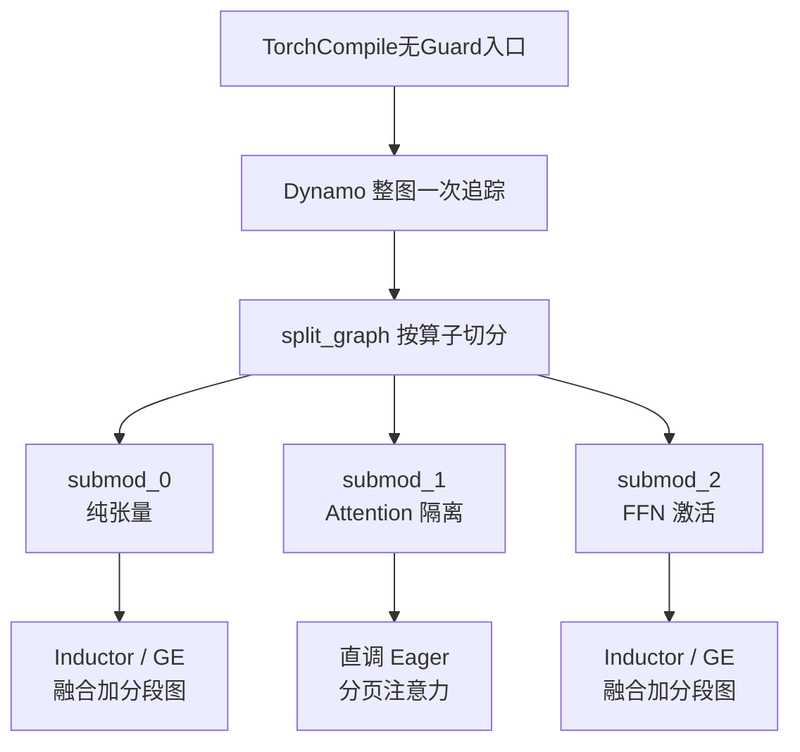

在[第 2 章：异步执行模型与发射墙](../02-async-execution-and-launch-wall/)里，异步调度把步间等待藏到了硬件执行背后。然而当控制权真正走进单步的 `model.forward()` 时，PyTorch Eager 模式仍要让 `RMSNorm`、`Add`、`SiLU`、`Mul` 等逐元素算子一个个穿越 C++ Dispatcher，频繁把激活值吐回 HBM 再重新读出，同时迫使 CPU 发起数百次内核发射。

按直觉，`torch.compile` 只要“把整模型一键编译”就能合并所有小算子；但在大语言模型推理里，直接全图编译必然撞墙。原因是 Attention 算子高度依赖变长的 KV 页表指针、变长切片位置和跨卡调度状态，一旦硬塞进整图编译器，要么触发图中断（Graph Break）碎成几十片，要么每次 Batch 序列变化就引发耗时的重编译。

## 无 Guard 追踪与 Piecewise 分段编译流水

vLLM 采用了一套极具工程巧思的折中架构：**入口取消 Guard，内部按自定义算子硬切分**。整个分段编译路径如**图 1** 所示。



入口处的 `TorchCompileWithNoGuardsWrapper`[^1] 做了两件关键事：在非标准模式（`!= STOCK_TORCH_COMPILE`）下向 Inductor 注入跳过守卫的 `guard_filter_fn`（PyTorch 2.10+ 直接使用 `torch.compiler.skip_all_guards_unsafe`），保证模型在首次运行完成追踪后，往后无论 `num_tokens` 如何动态起伏，都不会再触发 Dynamo 重编译风暴。

## split_graph 算子隔离与硬件融合结果

完成无 Guard 捕获得到整张 `fx.GraphModule` 后，`vllm/compilation/backends.py` 中的 `split_graph(graph, splitting_ops)` 扫描所有计算节点[^2]。只要节点命中配置列表（例如 `unified_attention`、`mla_forward` 或昇腾侧自定义注意力算子），就在它前后划开子图边界，具体效果对比见**图 2**。


切分必须传入 `keep_original_order=True` 调用 `torch.fx.passes.split_module.split_module`，防止重排带有原地 KV 状态写入的算子顺序，并通过连续切分合并规则避免无意义的空子图。

切出来的纯张量段（`submod_0`、`submod_2`）不包含动态控制流与页表指针，随后被送入硬件编译后端合并 Pointwise 与归约内核（例如将 `RMSNorm + 量化` 或 `SiLU * Mul` 合成单条 Triton/NPU Kernel）；而受隔离的 `submod_1`（Attention）退出编译域直接 Eager 调用最优手写库（FlashAttention / FlashMLA / FIA），最后再用分段 `CUDAGraphWrapper(PIECEWISE)` 将 `submod_0` 与 `submod_2` 分别包进硬件静态图[^2]。

## Inductor/Triton 与昇腾 AscendCompiler 路线对比

走到编译后端代码生成这一步，NVIDIA GPU 与华为昇腾 NPU 衍生出两条清晰分叉的技术管线，详见**图 3**。


在 NVIDIA 侧，`VllmBackend` 默认激活 PyTorch TorchInductor，通过内置优化 Pass 生成 PTX 级的融合 Triton 代码并落盘缓存。而在昇腾侧，`vllm-ascend` 的 `platform.py` 显式设置了 `compilation_config.use_inductor = False` 并将后端替换为 `AscendCompiler`[^3]。

进入 `AscendCompiler.compile` 后存在两条分支：若开启 `enable_npugraph_ex`，系统调用 `npugraph_ex.get_npu_backend`（缺失时自动兜底 `torchair`）把纯张量 FX 子图下沉至 CANN GE 静态计算图优化；若未开启，则走 `fusion_pass_compile` 执行基于 FX 模式匹配的 `GraphFusionPassManager` 算子融合 Pass。值得一提的是，`npugraph_ex_compile` 还会主动嗅探生成源码中是否含 `triton_kernel_wrapper`——因进程内 `kernel_side_table` 索引不可跨进程序列化，遇到 Triton 算子时会自动跳过落盘缓存，避免下一次重启加载崩溃[^3]。

## PyTorch FX 切分核心实现与源码映射

下面这段可执行的 PyTorch 代码利用真实的 `torch.fx.symbolic_trace` 与 `split_module`，演示 `unified_attention` 如何像一把手术刀将一层 Decoder 精准拆成 `submod_0`、`submod_1` 与 `submod_2`，并验证切分前后数值完全一致：

```python
import torch
import torch.fx as fx
import torch.nn as nn

def unified_attention(q: torch.Tensor, k: torch.Tensor, v: torch.Tensor) -> torch.Tensor:
    scale = q.shape[-1] ** -0.5
    return torch.softmax((q @ k.transpose(-1, -2)) * scale, dim=-1) @ v

torch.fx.wrap("unified_attention")

class MiniDecoderBlock(nn.Module):
    def __init__(self, d: int = 8) -> None:
        super().__init__()
        self.q_proj, self.k_proj, self.v_proj = nn.Linear(d, d, bias=False), nn.Linear(d, d, bias=False), nn.Linear(d, d, bias=False)
        self.gate, self.up = nn.Linear(d, d, bias=False), nn.Linear(d, d, bias=False)

    def forward(self, x: torch.Tensor) -> torch.Tensor:
        attn_out = unified_attention(self.q_proj(x), self.k_proj(x), self.v_proj(x))
        h = x + attn_out
        return torch.nn.functional.silu(self.gate(h)) * self.up(h)

model = MiniDecoderBlock(8).eval()
gm = fx.symbolic_trace(model)

submod_id, node_to_id, split_ids = 0, {}, set()
for node in gm.graph.nodes:
    if node.op in ("placeholder", "output"):
        continue
    if node.op == "call_function" and node.target is unified_attention:
        submod_id += 1
        node_to_id[node] = submod_id
        split_ids.add(submod_id)
        submod_id += 1
    else:
        node_to_id[node] = submod_id

split_gm = fx.passes.split_module.split_module(gm, None, lambda n: node_to_id[n], keep_original_order=True)
submods = [n for n, _ in split_gm.named_children() if n.startswith("submod_")]
assert submods == ["submod_0", "submod_1", "submod_2"] and split_ids == {1}
x = torch.randn(4, 8)
with torch.no_grad():
    assert torch.allclose(model(x), split_gm(x), atol=1e-6)
```

在 `torch 2.15.0` 上实测验证输出完全匹配：
`submods=['submod_0', 'submod_1', 'submod_2']`, `split_attention_id=[1]`, `allclose=True`。

| 编译链阶段         | NVIDIA GPU（`vllm` `bb23c0a8`）                  | 华为昇腾 NPU（`vllm-ascend` `3649b8ff`）                                            |
| ------------------ | ------------------------------------------------ | ----------------------------------------------------------------------------------- |
| 无 Guard 追踪外壳  | `TorchCompileWithNoGuardsWrapper`[^1]            | 共用相同无 Guard 包装类                                                             |
| FX 子图拆分引擎    | `split_graph(..., keep_original_order=True)`[^2] | 复用 `split_graph` 并注入昇腾自定义 Attention                                       |
| 下沉融合与代码生成 | TorchInductor FX 融合 -> Triton PTX 内核         | `AscendCompiler` -> `npugraph_ex`（兜底 `torchair`）或 `GraphFusionPassManager`[^3] |

`torch.compile` 与 `split_graph` 帮我们大幅缩减了算子数量并挡住了 HBM 来回拷贝，但只要 CPU 依然需要逐子图、逐层提交内核发射调用，发射墙的最后一公里就还未打通。下一章 [第 4 章：CUDA Graph 与四道硬边界](../04-cuda-graph-and-boundaries/) 将潜入硬件指令缓存，看静态图如何做到单条发射跑完全网。

[^1]: `vllm/compilation/wrapper.py`（`bb23c0a8`），`TorchCompileWithNoGuardsWrapper` 跳过非白名单动态 Guard 避免重追踪。

[^2]: `vllm/compilation/backends.py`（`bb23c0a8`），`split_graph` 与 `wrap_with_cudagraph_if_needed` 完成 FX 分段及 `PIECEWISE` 包装。

[^3]: `vllm_ascend/compilation/compiler_interface.py`（`3649b8ff`），`AscendCompiler` 实现 `npugraph_ex_compile`、缓存过滤及 `fusion_pass_compile` 切换。
