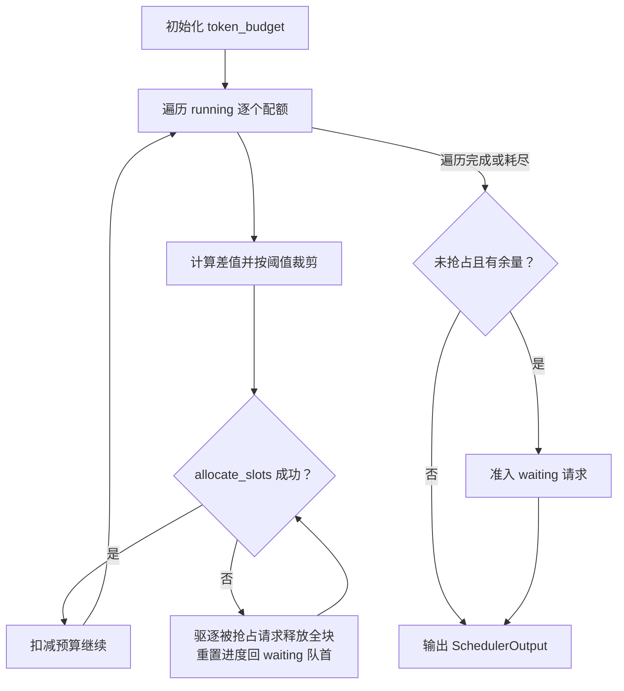
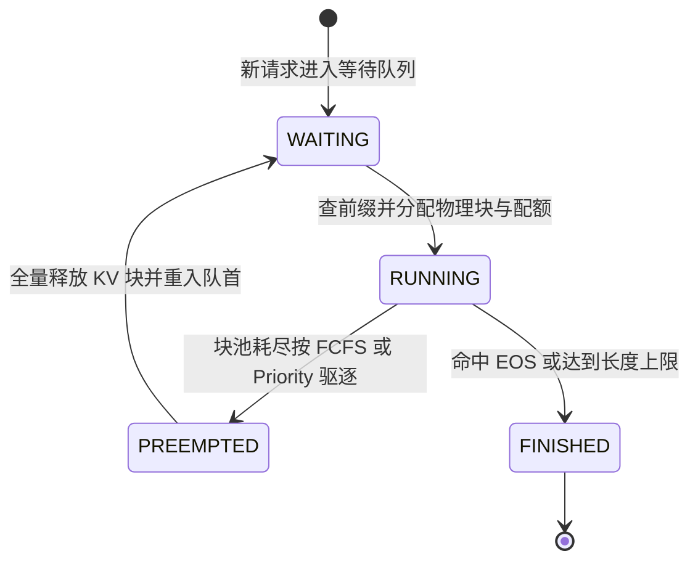
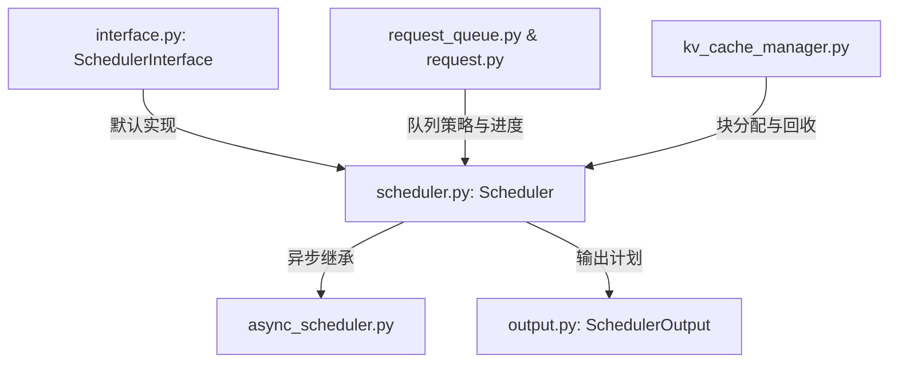

import PagedSchedulerExplainer from './explainers/PagedSchedulerExplainer';

自回归大模型每生成一个新 token，都必须把数十 GB 的网络权重从 **HBM（High Bandwidth Memory，高带宽显存）**完整读入计算单元一次。当批大小为 $1$ 时，计算核心在绝大多数时间里都在等待访存，算力利用率长期低于 $5\%$。

把多条并发请求装进同一个前向步，就能把一次权重读取的开销分摊给多条序列，将算术强度拉升到算力受限区[^paged-attention-paper]。但线上推理的请求到达时间错落、输入提示词与生成长度差距悬殊，静态拼批很快会暴露出排队延迟与空转浪费。

## 从静态批到统一配额的四代演进

考虑一个便于手动追踪的三请求小规模负载：共有 $3$ 条请求先后到达。其中 $R_0$ 在第 $0$ 步到达（提示词 $4$、输出 $4$），$R_1$ 同在 $0$ 步到达（提示词 $8$、输出 $7$），$R_2$ 在第 $2$ 步到达（提示词 $32$、输出 $2$）。每步算子耗时按线性近似 $1.0 + 0.25 \cdot N_{\text{exec}}$ 毫秒计。

第一代 **Static Batching（静态批处理）**以整批请求为粒度设置执行屏障。第 $0$ 步同时启动 $R_0$ 与 $R_1$ 时，较短的 $R_0$ 必须在输入侧补齐 $4$ 个 `Padding` 槽位；当 $R_0$ 在第 $3$ 步提前生成结束符后，仍被锁在批内空转 $3$ 步，直到第 $6$ 步 $R_1$ 收尾才一起退出。第 $2$ 步到达的 $R_2$ 只能全程在队列外干等，批利用率跌至 $88.5\%$。

第二代 **Continuous Batching（连续批处理）**由 Orca 等系统率先引入，将调度粒度从整批下沉到单次迭代[^paged-attention-paper]。每完成一个前向步，结束的序列立即退出，等待队列中的新请求只需等当前步结束即可插入；配合将所有有效 token 压平为 1D Ragged 张量的扁平打包，序列间的 `Padding` 算力浪费彻底清零。

连续批处理必须与第 3 章拆解的分页 **KV Cache（Key-Value Cache，键值缓存）**配对，才能真正把并发批大小推高。若沿用早期系统的连续显存预留，即便能步级进出，每条请求锁死的预留尾部仍会快速耗尽显存。PagedAttention 论文图 13 表明，在 OPT-13B 与 ShareGPT 负载下，vLLM 的平均并发批大小达到 Orca（Oracle）的 $2.2\times$、Orca（Max）的 $4.3\times$[^paged-attention-paper]。

第三代架构则为了消除预填充与解码之间的资源抢占。早期 V0 引擎把 **Prefill（预填充）**与 **Decode（解码）**拆成互斥阶段：第 $2$ 步 $R_2$ 携带 $32$ 个提示词到达时，整批会挂起 $R_0$ 与 $R_1$ 去独占执行 $R_2$ 的全量预填充。线上出现上万 token 的长提示词时，正在解码的用户会遭遇明显的 **TPOT（Time Per Output Token，单 token 生成延迟）**毛刺。

**Chunked Prefill（分块预填充）**通过单步 token 上限打破这一阻塞。以上述示例设单步上限为 $16$：第 $2$ 步先为 $R_0$ 与 $R_1$ 各分配 $1$ 个解码槽，再切出 $14$ 个预算执行 $R_2$ 的首块提示词。高算力密度的预填充矩阵乘与访存密集型的解码读取同批执行，将峰值 TPOT 从 $10.75$ 毫秒压半至 $5.00$ 毫秒。

第四代 **vLLM V1 统一调度器**进一步删掉了预填充与解码的阶段标签[^vllm-arch-doc][^vllm-scheduler-loop]。调度器内部只记录每条请求已完成的 `num_computed_tokens` 以及含投机草稿的总目标长度 `num_tokens_with_spec`[^vllm-request]。每步围绕唯一配额 `token_budget`（来自 `max_num_scheduled_tokens`）拉平两者差值。同一循环即可同时打包解码、分块预填充、前缀缓存与 **Speculative Decoding（投机解码）**验证[^vllm-arch-doc]。


图 1 按比例对比了四代调度器在 $R_0, R_1, R_2$ 示例上的时间线。静态批因屏障浪费 $11.5\%$ 有效算力，阶段隔离在 $t_2$ 触发长停顿，而 V1 用单一配额循环把全部形态纳入平坦的步长预算之内。

## 分页显存池与统一配额调度

理解统一调度如何与分页显存联动，可以先看一个更紧凑的 $16$ 块物理池案例。每块容量为 $4$ 个 token，初始时 `BlockPool` 弹出 $B_0$ 永久保留为安全哨兵 `null_block`。其余 $B_1\text{–}B_{15}$ 共 $15$ 个块可供分配，单步预算 `token_budget` 仍为 $16$。

请求 A 率先完成 $9$ 个 token 预填充，占用 $B_1\text{–}B_3$ 并将写满的 $B_1$ 登记进前缀缓存。随后的请求 B 共享相同系统前缀，直接复用 $B_1$ 省去重复计算。接着新到的请求 C 在同一 $16$ token 预算内与进入解码阶段的 A、B（各 $1$ 个 token）混排，分块消耗余下的 $14$ 个预算。当突发请求占满 $B_9\text{–}B_{15}$ 引发块枯竭时，调度器驱逐低优的请求 C，并把静态图补齐槽位指向 $B_0$ 与负槽位 `-1`。

<PagedSchedulerExplainer client:visible title="图 2：V1 调度器、Prefix Caching 与抢占交互演示" />

## 统一调度主循环与源码路径

vLLM V1 将整套控制逻辑集中在 `Scheduler.schedule()` 中执行[^vllm-scheduler-loop]。每次调用先以 `max_num_scheduled_tokens` 初始化 `token_budget`，并先后扫描运行队列 `running` 与等待队列 `waiting`。图 3 概括了单步调度循环的决策路径。



在第一段循环中，调度器优先保证已经进入 `running` 的请求推进[^vllm-scheduler-loop]。每条请求的待调度 token 数先由 `num_tokens_with_spec + num_output_placeholders - num_computed_tokens` 算出。若配置了长预填充单步阈值，调度器还会做一次上限裁剪，再与剩余 `token_budget` 及投机草稿预留槽取最小值。

随后调度器调用 `KVCacheManager.allocate_slots` 申请物理块。当空闲块不足以容纳新 token 时，系统在内部循环中不断挑选淘汰目标请求（victim request）执行抢占，直到腾出足够物理块或当前请求自身也被驱逐[^vllm-scheduler-preempt]。

只要本轮触发过任意一次抢占（`preempted_reqs` 非空），调度器在第二段就会直接跳过等待队列准入[^vllm-scheduler-wait]。这能防止刚驱逐旧请求释放的物理块立刻被新请求抢走，导致系统陷入反复颠簸。对于未被阻塞的等待请求，调度器会先查询本地与外部前缀缓存命中长度，再把剩余未算部分作为新调度步纳入 `running`。

## 调度策略与全量抢占权衡

vLLM 支持两种队列调度策略[^vllm-arch-doc][^vllm-request-queue]，决定等待队列的准入次序以及显存耗尽时的被抢占请求人选：

- **FCFS（First-Come First-Served，先到先服务）**：默认策略，按到达顺序服务，显存耗尽时淘汰最晚加入的 `running[-1]`。
- **Priority（优先级调度）**：按整数优先级与到达时间 `(priority, arrival_time)` 排序，优先淘汰优先级最低且最晚到达的请求。

与操作系统按冷热页逐页换出不同，LLM 预测下一个 token 必须同时访问全部历史键值状态[^paged-attention-paper]。因此 vLLM 采用全量抢占粒度，请求状态随块分配与驱逐按图 4 流转：



| 恢复方式      | 核心动作                                 | 带宽与算力敏感点                 | V1 默认选型与原因                          |
| :------------ | :--------------------------------------- | :------------------------------- | :----------------------------------------- |
| Swapping      | 经总线拷出到主机内存，恢复时再异步搬回   | 小块下频繁小传输拖垮总线有效带宽 | 非默认，仅外置连接器卸载场景使用           |
| Recomputation | 释放块并清零已算进度，重入后按新提示重算 | 依赖现代加速卡充裕的矩阵乘算力   | 默认选型，可借前缀缓存或外部加载跳过重复块 |

PagedAttention 论文对比表明，块尺寸较小时主机换出拷贝会严重拉低 **PCIe（Peripheral Component Interconnect Express，高速串行总线）**带宽。块尺寸为 $16\text{–}64$ 时换入换出与重算性能接近[^paged-attention-paper]。V1 因此默认重算恢复[^vllm-arch-doc]，请求重入时将历史序列批量重算[^vllm-scheduler-wait]，还可复用前缀缓存跳过重复块。

## 调度器源码目录与核心类关系

V1 统一调度代码收敛在 `vllm/v1/core/` 目录下，状态结构、队列策略、物理块管理器与输出契约相互拆离，各自只有一个主文件。按图 5 的类关系与依赖方向顺着往下读，就能快速看清每步调度的边界。

```text
vllm/v1/
├── request.py                  # Request 实体：维护 num_tokens 与已算进度
└── core/
    ├── kv_cache_manager.py     # KVCacheManager：物理块申请、释放与前缀命中
    └── sched/
        ├── interface.py        # SchedulerInterface 调度器抽象基类
        ├── scheduler.py        # Scheduler 默认统一调度循环与抢占恢复
        ├── async_scheduler.py  # AsyncScheduler 子类：异步占位步进扩展
        ├── request_queue.py    # SchedulingPolicy、FCFS 与 Priority 队列实现
        ├── output.py           # NewRequestData / CachedRequestData / SchedulerOutput
        └── utils.py            # 步级配额裁剪与长提示词分块辅助函数
```



零基础阅读这一模块时，可按四步逐文件展开：

1. 先读 `output.py`，掌握调度器最终向执行端交付哪些字段，明确上下游契约。
2. 再看 `request_queue.py` 与 `request.py`，了解请求怎样按策略排队以及进度计数如何定义。
3. 主体精力放在 `scheduler.py` 的 `schedule` 主循环，对照图 3 验证准入裁剪与抢占分支。
4. 最后对比 `async_scheduler.py`，观察异步模式如何仅通过覆写少数钩子就实现占位步进。

`Scheduler.schedule()` 在主机进程内算完配额与块映射后，并不直接拼装显存张量。它只输出一份轻量的 `SchedulerOutput` 计划，包含首次调度的请求列表 `scheduled_new_reqs`、已缓存请求增量与配额字典 `num_scheduled_tokens`[^vllm-sched-output]。这份指令如何跨越进程边界，被 `Worker` 与 `ModelRunner V2` 转化为设备侧输入缓冲与槽位映射，将在[下一章](../05-worker-and-model-runner-v2/)详细展开。

[^paged-attention-paper]: Woosuk Kwon et al., _Efficient Memory Management for Large Language Model Serving with PagedAttention_ (SOSP '23), `arXiv:2309.06180`, §2.3, §4.5, §6.2 (Fig. 13), §7.3 (Fig. 19), CC BY 4.0。

[^vllm-arch-doc]: `vllm` (`99b0b0b0`), `docs/design/arch_overview.md` (`L134-185`, Scheduler / Scheduling Policies / Preemption / Async Scheduling), Apache-2.0。

[^vllm-scheduler-loop]: `vllm` (`99b0b0b0`), `vllm/v1/core/sched/scheduler.py` (`Scheduler.schedule`, `L702-834`, `L985-1015`, `_update_after_schedule`, `L1879-1910`), Apache-2.0。

[^vllm-request]: `vllm` (`99b0b0b0`), `vllm/v1/request.py` (`num_tokens`, `num_tokens_with_spec`, `L337-344`), Apache-2.0。

[^vllm-scheduler-preempt]: `vllm` (`99b0b0b0`), `vllm/v1/core/sched/scheduler.py` (`L897-984`, `_preempt_request`, `L1831-1878`), Apache-2.0。

[^vllm-scheduler-wait]: `vllm` (`99b0b0b0`), `vllm/v1/core/sched/scheduler.py` (`L1041-1096`, `L1337-1390`, `L1606-1625`), Apache-2.0。

[^vllm-request-queue]: `vllm` (`99b0b0b0`), `vllm/v1/core/sched/request_queue.py` (`SchedulingPolicy`, `FCFSRequestQueue`, `PriorityRequestQueue`, `L13-198`), Apache-2.0。

[^vllm-sched-output]: `vllm` (`99b0b0b0`), `vllm/v1/core/sched/output.py` (`NewRequestData`, `CachedRequestData`, `SchedulerOutput`, `L40-286`), Apache-2.0。
