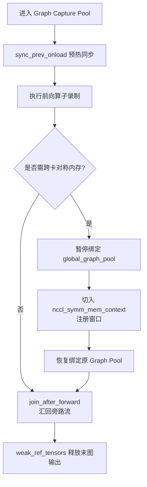

import CudaGraphBoundariesExplainer from '../../../../explainers/vllm/CudaGraphBoundariesExplainer';

在[第 3 章：torch.compile 与 Piecewise](../03-torch-compile-and-piecewise/)里，TorchInductor 把零碎的逐元素算子合并成少数 Triton 内核，但只要模型前向依然需要 CPU 逐个提交 `cuLaunchKernel`，小批 Decode 的指令发射墙就还没有真正推平。

要彻底绕过主机发射循环，推理引擎必须把整段甚至整张模型的内核序列提前录制成硬件级指令拓扑——也就是 NVIDIA 的 **CUDA Graph** 与昇腾的 **ACLGraph**。重放时，CPU 仅用一条 `cudaGraphLaunch` 即可直接驱动几十个硬件内核顺序执行。

## Stream Capture 与 Replay：用静态确定性换极致速度

静态图的底层运行遵循两阶段契约。**捕获期（Capture）**把流切入录制模式，沿路执行的所有算子都不会在当场写回真实计算结果，而是把核函数指针、Grid/Block 维度与张量物理地址整段记录为一张有向无环图（DAG）。

**重放期（Replay）**则完全跳过 Python 逻辑、PyTorch Dispatcher 与所有形状判断，硬件命令处理器（Command Processor）直接按录制好的指针表高速发包。这笔零发射开销的红利，要求开发者必须严守四道不可动摇的硬件边界，推演流程见**图 1**。

<CudaGraphBoundariesExplainer
  client:visible
  title="图 1：静态图 Capture 与 Replay 的四大铁律推演"
/>

顺着**图 1** 依次步进可以看到：第 1 步捕获将静态缓冲区锁定在 `0x7f00_1000`（输入）、`0x7f00_2000`（槽位索引）与 `0x7f00_3000`（输出）；第 2 步以 $B=3$ 垫入 `B_cap=4` 原地拷贝重放，第 4 槽填 `-1`；而后三步逐一演示每条边界被破坏时的崩溃机制。

## 静态图四大硬边界与尾部填充安全

我将这四道边界整理为线上开发速查卡，如**图 2** 所示。


第一道边界是**内存地址恒定**。若调用方重放前未执行 `static_in[:B].copy_(x)` 原地写，而误写了 `hidden_states = torch.empty(...)`（产生新虚拟地址 `0x7f00_9000`），重放依然死读硬编码在图里的旧地址 `0x7f00_1000`。在 `CUDAGraphWrapper` 中开启 Debug 日志时，系统会逐张比对 `data_ptr()` 列表以拦截指针漂移[^1]。

第二道边界是**静态形状与安全 Padding**。图内绝不能根据张量值动态扩容；对于不足桶大小 $B_{\text{cap}}$ 的空缺位置，不仅 `hidden_states` 要填零，`vllm/v1/worker/gpu/block_table.py` 中的 Triton 内核还会从真实 token 数起将整段尾巴刷成 `PAD_SLOT_ID = -1`，防止上一轮 Chunked Prefill 遗留的合法 `slot_id` 在本轮缩容时写穿别人请求 KV Cache[^2]。

第三道边界是**零主机控制流同步**。捕获与重放期内任何 `.item()`、`.cpu()` 或 `torch.nonzero()` 都会企图打断流并按运行时数值分叉，直接触发 `cudaErrorStreamCaptureUnsupported`。所有分支长度检查必须在进入图前在 CPU 侧预先算好。

## 全局图内存池（Graph Pool）与跨卡通信窗隔离

若系统为 `B=1, 2, 4, 8, ...` 每个图桶各自独立开辟激活工作区，几百个捕获图会把显存瞬间瓜分殆尽。为此，`vllm` 为同设备所有静态图共享同一个 `global_graph_pool`，并在最后一段子图输出上套用 `weak_ref_tensors()` 及时归还临时激活页[^1]。

更棘手的是多卡对称通信内存池与 Offloader 旁路拷贝流。如果在全局图池活跃时直接往通信窗分配缓冲区，会导致拓扑冲突，完整隔离与流汇合生命周期见**图 3**。



如图所示，在 `nccl_symm_mem_context` 进入对称内存分配前，必须调用底层接口短暂暂停图内存池绑定，注册完窗口基底地址后再恢复；同时前向结束前调用 `get_offloader().join_after_forward()`，防止未汇合的 `copy_stream` 触发 `Unjoined Stream` 错误[^3]。

## PyTorch 地址锁验证与源码对照

下面这段自包含的 PyTorch 验证代码演示了：原地 `copy_()` 如何始终保住捕获虚拟地址，而重新绑定 `new_alloc` 如何立即触发指针地址漂移（即图依然读旧址的根因）：

```python
import torch

B_cap, H = 4, 8
static_in = torch.zeros((B_cap, H), dtype=torch.float32)
static_out = torch.zeros((B_cap, H), dtype=torch.float32)
weight = torch.ones((H, H), dtype=torch.float32) * 0.5
captured_in_ptr = static_in.data_ptr()  # 类比图内硬编码的 0x7f00_1000

def replay_graph() -> torch.Tensor:
    static_out.copy_(static_in @ weight)
    return static_out

# 健康路径: B=3 原地拷入静态缓冲区，第 4 槽填零安全执行
batch = torch.arange(24, dtype=torch.float32).reshape(3, H)
static_in[:3].copy_(batch)
static_in[3:].zero_()
assert static_in.data_ptr() == captured_in_ptr
out_ok = replay_graph()

# 指针漂移错误: 重新赋值生成了新底层内存（类比 0x7f00_9000），图重放却仍死读旧指针
new_alloc = torch.ones((B_cap, H), dtype=torch.float32) * 9.0
assert new_alloc.data_ptr() != captured_in_ptr
out_stale = static_in @ weight
assert torch.allclose(out_stale, out_ok)
```

在 `torch 2.15.0` 上运行该检验脚本验证地址锁断言全部通过：
`captured_ptr=0x7f00_1000 (sim=...), drift_ptr != captured_ptr, pointer_lock_verified=True`。

| 边界工程细节         | NVIDIA GPU（`vllm` `bb23c0a8`）                             | 华为昇腾 NPU（`vllm-ascend` `3649b8ff`）            |
| -------------------- | ----------------------------------------------------------- | --------------------------------------------------- |
| 静态图包装与地址校验 | `CUDAGraphWrapper` + `weak_ref_tensors`[^1]                 | `ACLGraphWrapper` + `weak_ref_workspaces`[^4]       |
| 尾巴安全 Padding     | Triton `_compute_slot_mappings_kernel` 填 `PAD_ID = -1`[^2] | 沿用 `PAD_SLOT_ID = -1`，并在算子端防 `507011` 踩踏 |
| 副流闭环与通信池     | `join_after_forward()` + `nccl_symm_mem_context`[^3]        | `join_after_forward()` + `ExternalEvent` 同步[^4]   |

掌握了单张图内部的四道硬边界，工程上的新难题马上浮现：真实在线服务既有单卡上的 `FULL` 与 `PIECEWISE` 模式随时切换，又有 DP 集群多卡同时遇到不均负载——同一模型到底该嵌套哪些 Wrapper？多卡之间怎样确保绝不会因为某张卡进了图而另一张卡回退 Eager 造成集合通信死锁？请看[第 5 章：运行时分发与嵌套包装](../05-runtime-dispatch-and-nesting/)。

[^1]: `vllm/compilation/cuda_graph.py`（`bb23c0a8`），`CUDAGraphWrapper` 捕获、地址一致性调试及 `weak_ref_tensors` 输出弱引用释放。

[^2]: `vllm/v1/worker/gpu/block_table.py`（`bb23c0a8`），`_compute_slot_mappings_kernel` 显式擦除尾部遗留槽位为 `PAD_ID`。

[^3]: `vllm/distributed/device_communicators/pynccl_allocator.py`（`bb23c0a8`），`nccl_symm_mem_context` 在捕获期间暂停图内存池并登记对称内存窗口。

[^4]: `vllm_ascend/compilation/acl_graph.py`（`3649b8ff`），`ACLGraphWrapper` 继承 `join_after_forward` 与地址校验规范。
