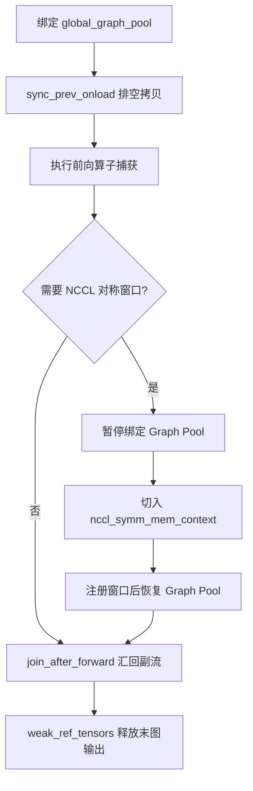

分段编译把逐元素算子合并成少数 Triton 融合 Kernel 并隔离了动态注意力（见[第 3 章](../03-torch-compile-and-piecewise/)）。但只要每次前向仍由 CPU 逐一提交 `cuLaunchKernel`，小批 **Decode（解码）**阶段的端到端延迟就依然受限于主机发射回路。在常见层数下，单步解码仅执行数微秒的计算算子却需要数十至数百次入队，大量时间耗在 Python 框架、PyTorch 分发器与驱动接口之间。

要绕过主机侧的逐算子发射循环，引擎必须在预热阶段把算子序列录制成硬件级 **DAG（Directed Acyclic Graph，有向无环图）**。这就是 NVIDIA 的 **CUDA Graph**，对应昇腾平台上的 ACLGraph。重放时，主机只需发起一次 `cudaGraphLaunch` 即可驱动整段算子连续执行，但这份零发射循环的收益建立在四道硬件边界之上。

## 捕获与重放的两阶段契约

CUDA Graph 的运行分为 **Capture（捕获）**与 **Replay（重放）**两个阶段。处于捕获模式时，提交到计算流上的算子不会立即写回计算结果。底层驱动改为记录 Kernel 函数指针、**Grid/Block（线程网格与线程块）**维度、张量虚拟显存指针与流间事件同步边，在结束时固化成不可变静态图。

进入重放阶段后，引擎跳过 Python 控制流、PyTorch 算子分发与运行时形状分支，由 `GPU Command Processor` 按捕获期固化的指令包与指针表直接下发。因此重放期间绝不能改变任何被捕获张量的底层地址，也不能依赖运行时张量数值动态决定执行路径。

为了把抽象规则落到具体数值上，假设我们为解码阶段捕获一张容量上限为 $B_{\text{cap}} = 4$、隐藏维度为 $H = 8$ 的静态图。捕获时，输入缓冲 `hidden_states` 锁定在虚拟地址 `0x7f00_1000`。KV 槽位表 `slot_mapping` 与输出缓冲则分别锁在 `0x7f00_2000` 和 `0x7f00_3000`。

当真实请求批量为 $B = 3$ 时，运行期会把这 3 行真实激活原位拷入 `0x7f00_1000` 的前 3 槽，把第 4 槽输入清零并将槽位索引置为 $-1$，随后直接重放整张图。图 1 以 $B_{\text{cap}} = 4$ 为例总结了捕获、健康重放以及四道边界违例时的失效形态。


## 四道硬件边界与防护实现

工程实践中，任何一处看似普通的动态写法都会破坏静态图契约，且不同边界违规带来的后果各异——有的在捕获期直接崩溃，有的则在重放期悄无声息地算出错误结果。图 2 对这四项硬件约束与典型违规征兆做了汇总对照。


### 显存地址恒定与原地缓冲覆写

底层驱动在捕获期将每个 Kernel 参数中的设备虚拟指针（`data_ptr()`）硬编码进图节点。重放阶段跳过 Python 变量重绑定，静态图只认捕获瞬间记录下来的那片物理显存位置。

一旦调用方在重放前未执行原地拷贝，而是通过赋值或切片生成新张量（例如把输入变量重新绑定到 `0x7f00_9000` 的新内存），重放过程不会抛出异常。图内节点会直接读取旧地址 `0x7f00_1000` 里残留的历史数据，导致整批输出与当前请求脱节。

为此，vLLM MRV2 的 `InputBuffers` 在初始化时预分配持久化设备缓冲，涵盖 `input_ids`、`positions`、`is_padding` 等张量[^vllm-input-batch]。每步调度仅用 `.copy_()` 原地覆写这批固定指针。

在调试排查时，打开 `VLLM_LOGGING_LEVEL=DEBUG` 会触发 `CUDAGraphWrapper` 核验地址[^vllm-cudagraph-wrapper]。它会把捕获期记录的 `input_addresses` 与重放输入指针逐一比对，一旦发现漂移立刻断言中止。

### 静态张量形状与分桶安全填充

静态图的网格维度与内存步长在捕获时全部固定，图内部既不能按输入标量动态申请张量，也无法临时扩容。因此实际批大小（请求数 `num_reqs` 或总 token 数 `num_tokens`）必须预先向上对齐到已捕获的分桶规格，满足 $B \le B_{\text{cap}}$ 或 $T \le T_{\text{cap}}$。

分桶填充会带来一个易被忽略的静默污染风险。假设上一轮 **Chunked Prefill（分块预填充）**写满了容量为 $4$ 的槽位表 `[2, 3, 4, 5]`，下一轮批量缩容为 $B = 2$。若调度层只更新前 2 个槽位，第 3、4 槽仍残留着上一轮的物理块号 `4, 5`；重放按 $B_{\text{cap}} = 4$ 发射时，就会把 `Padding token` 的无效张量写进其他请求的活跃 KV 块。

vLLM 在 MRV2 中通过双重隔离堵住这一漏洞。第一道在槽位层：`BlockTables` 的槽位计算 Kernel 从**实际 token 数**起循环刷写到 `max_num_tokens`[^vllm-block-table]。它把尾部全设为 `PAD_SLOT_ID = -1`，使 KV 写入算子自动跳过这些槽位。

第二道在掩码层：`InputBuffers.is_padding` 会将超出真实长度的填充区间置为 `True`[^vllm-input-batch][^vllm-model-runner]。这层掩码能直接隔绝 MoE 路由与权重累加对 `Padding` 行的误计数。

### 零主机同步与无数据依赖分支

在 `Stream Capture` 模式下，计算流进入录制状态而非实际求值阶段，硬件并未产生任何中间计算结果，要等到后续 `cudaGraphLaunch` 重放时才会真正算完。

如果在捕获区间内调用 `.item()`、`.cpu()` 或 `torch.nonzero()` 等同步接口，或者写出依赖设备张量值的条件分支，主机线程就会尝试立即读取尚未计算的设备结果。这种行为和动态算子拓扑直接打破 `Stream Capture` 语义，驱动会当场抛出 `cudaErrorStreamCaptureUnsupported` 错误中止捕获。

因此，所有依赖批形态的判断（例如当前批是否属于均匀解码、是否包含预填充行、命中哪一个分桶描述符）必须在入图前由 CPU 依据调度器元数据预先计算完毕。同时，vLLM 在预热后激活 `VLLM_GPU_SYNC_CHECK` 检测机制，在热路径上拦截未声明 `gpu_sync_allowed()` 的隐式主机设备同步，避免同步语句意外溜入静态图区间[^vllm-sync-debug]。

### 多流分叉与同步汇合

现代推理引擎常借助旁路流重叠计算与搬运，例如 `Weight Offload（Offloader）` 在 `copy_stream` 上异步预取下一层权重。如果在静态图捕获窗口内部通过事件等待从主流分叉出了副流操作，那么这些副流任务也会被纳入同一张捕获拓扑中。

CUDA 图捕获对流拓扑有一条硬约束：凡是在捕获期间从捕获主流派生出的旁路流，必须在主流结束捕获之前通过事件同步重新汇合回主流。否则图引擎在收尾时无法闭合 DAG 拓扑，会直接报错 `cudaErrorStreamCaptureUnjoined`；即便未立即报错，前一步预留的拷贝任务也可能在下次重放覆盖缓冲时引发读写竞态。

为此，vLLM 在模型封装层引入了明确的跨流起止协议[^vllm-offloader-prefetch][^vllm-cudagraph-wrapper]。进入捕获或每次重放前，外层先调用 `get_offloader().sync_prev_onload()`，确保前序滞留的异步预取拷贝全部完成。前向结束、即将退出捕获上下文前，再调用 `get_offloader().join_after_forward()`。它为主流挂上针对未等待预取事件的 `wait_event`，强制让 `copy_stream` 在捕获结束前完成汇合。

## 全局图内存池与对称通信窗口隔离

解决了单图内部的四道边界后，显存容量很快成为第二重制约。若引擎为 `1, 2, 4, 8, ...` 等几十个请求分桶各自开辟独立的激活工作区，重复占用的临时显存会迅速挤干 KV Cache 配额。为此，同一张设备上的所有静态图共同绑定到全局唯一的 `global_graph_pool`[^vllm-cudagraph-wrapper][^vllm-cudagraph-manager]。

几十个不同规格的静态图共用同一个图内存池不会互相踩踏，背后有两项关键机制支撑。第一，线上推理每个前向步只会选中**其中一个**分桶重放，不同分桶之间的中间激活张量在时间线上完全互斥，图池分配器可以把同一组物理显存页安全地复用到多个分桶上。

第二，`ModelCudaGraphManager` 按先 `PIECEWISE` 后 `FULL`、且各模式内部按 token 数从大到小降序执行捕获[^vllm-cudagraph-manager]。只要 `FULL` 图的宽度不超过已捕获的最大 `PIECEWISE` 图，它就能直接复用池中切好的激活缓冲页，无需额外向系统申请新显存。

共用图池还必须配合精细的引用生命周期管理。分段图捕获中，如果 Python 侧长期持有末段子图输出 `output` 的强引用，图池分配器就会认为该显存块在整个服务期间始终活跃，拒绝将其回收给后续捕获的图分桶，引发隐性显存泄漏。

因此 `CUDAGraphWrapper` 会在末段子图结束及保存 `entry.output` 时调用 `weak_ref_tensors()`，剥离 Python 对底层存储的强持有[^vllm-cudagraph-wrapper][^vllm-weak-ref]。中间子图的输出仍需传给下一段消费，故只在末图及外部缓存字典中置为弱引用。

更微妙的冲突来自多卡对称内存通信。启用 NCCL 对称内存时，需用 `ncclMemAlloc` 分配跨卡地址对齐的对称显存，并注册基址窗口（`register_comm_window_raw`）[^vllm-pynccl-alloc]。其他卡随后就能通过 NVLink 或 RDMA 直接读写。如果这段分配发生在静态图池绑定的捕获流上，PyTorch 会把请求截留到当前设备私有的 `global_graph_pool` 中，导致无法形成跨卡对称映射。图 3 展示了共享图池、对称通信窗口隔离与旁路流汇合的生命周期。



如图所示，当捕获期遇到跨卡对称内存窗口初始化时，`nccl_symm_mem_context` 会先检测当前流是否处于捕获状态，随即暂停当前线程向图内存池分配。随后它切入独立的 `nccl_mem_pool` 完成分配与窗口登记，退出上下文后再恢复原有的 `global_graph_pool` 绑定，从而在不打断录制的前提下避开私有池劫持[^vllm-pynccl-alloc][^vllm-cudagraph-pool]。

## PyTorch 指针漂移复现与双仓对照

下面的自包含 PyTorch 脚本构造了一个 `FrozenReplayGraph` 模拟器：初始化捕获闭包直接绑定 `static_x` 与 `static_out` 的底层缓冲区。若调用方把 `buf_ref` 重绑定到新张量，重放仍只读取冻结旧指针里的陈旧快照。只有原地 `.copy_()` 写入原缓冲，同时把缩容后的尾部 `static_slot` 刷写为 $-1$，结果才随新输入更新：

```python
import torch


class FrozenReplayGraph:
    """模拟静态图捕获后仅按原缓冲区地址重放的行为。"""

    def __init__(self, b_cap: int, hidden: int) -> None:
        self.static_x = torch.zeros((b_cap, hidden), dtype=torch.float32)
        self.static_slot = torch.full((b_cap,), -1, dtype=torch.int64)
        self.static_out = torch.zeros((b_cap, hidden), dtype=torch.float32)
        self.weight = torch.full((hidden, hidden), 0.25, dtype=torch.float32)
        self.captured_ptr = self.static_x.data_ptr()
        # 捕获闭包直接锁定原缓冲区引用，不感知调用方后续的 Python 重绑定
        x_buf, out_buf, w = self.static_x, self.static_out, self.weight
        self._kernel = lambda: out_buf.copy_(x_buf @ w)

    def replay(self) -> torch.Tensor:
        self._kernel()
        return self.static_out


graph = FrozenReplayGraph(b_cap=4, hidden=4)

# 第 1 步（健康执行 B=3 -> B_cap=4）：原位写前 3 行，尾部槽位显式置 -1
batch_step1 = torch.ones((3, 4), dtype=torch.float32)
graph.static_x[:3].copy_(batch_step1)
graph.static_x[3:].zero_()
graph.static_slot[:3] = torch.tensor([10, 11, 12], dtype=torch.int64)
graph.static_slot[3:] = -1
out_step1 = graph.replay().clone()

# 第 2 步（指针漂移误区）：调用方重绑定 buf_ref 指向新内存，重放却仍读第 1 步旧快照
buf_ref = graph.static_x
new_batch = torch.full((2, 4), 5.0, dtype=torch.float32)
buf_ref = torch.cat([new_batch, torch.zeros((2, 4))], dim=0)
ptr_match_buggy = buf_ref.data_ptr() == graph.captured_ptr
out_buggy = graph.replay().clone()
assert not ptr_match_buggy and torch.allclose(out_buggy, out_step1)

# 第 3 步（正确修复 B=2）：保持地址恒定原地 copy_()，并清空多余行与尾部槽位
graph.static_x[:2].copy_(new_batch)
graph.static_x[2:].zero_()
graph.static_slot[:2] = torch.tensor([20, 21], dtype=torch.int64)
graph.static_slot[2:] = -1
ptr_match_fixed = graph.static_x.data_ptr() == graph.captured_ptr
out_fixed = graph.replay().clone()
assert ptr_match_fixed and torch.allclose(out_fixed[:2], torch.full((2, 4), 5.0))
assert torch.allclose(out_fixed[2:], torch.zeros((2, 4)))

row0_bug = out_buggy[0, 0].item()
print(
    f"rebind_ptr_match={ptr_match_buggy}, "
    f"buggy_row0_val={row0_bug:.1f} (stale_snapshot)"
)
print(
    f"inplace_ptr_match={ptr_match_fixed}, "
    f"fixed_row0_val={out_fixed[0, 0].item():.1f}, "
    f"pad_row2_val={out_fixed[2, 0].item():.1f}, "
    f"tail_slots={graph.static_slot[2:].tolist()}"
)
```

运行上述验证脚本，输出如下：

```text
rebind_ptr_match=False, buggy_row0_val=1.0 (stale_snapshot)
inplace_ptr_match=True, fixed_row0_val=5.0, pad_row2_val=0.0, tail_slots=[-1, -1]
```

下表总结了同一套静态图边界在 NVIDIA GPU（`vllm`）与华为昇腾 NPU（`vllm-ascend`）两个代码仓中的对应实现路径。

| 边界工程机制       | NVIDIA GPU（`vllm` `bb23c0a8`）         | 华为昇腾 NPU（`vllm-ascend` `3649b8ff`）                   |
| ------------------ | --------------------------------------- | ---------------------------------------------------------- |
| 静态图包装与地址锁 | `CUDAGraphWrapper` 校验指针并弱引用输出 | `ACLGraphWrapper` 沿用校验并弱引用工作区[^ascend-aclgraph] |
| 尾部填充与隔离保护 | `InputBuffers` 与 Kernel 刷写 $-1$ 槽位 | 复用 $-1$ 槽位并在算子端保护长效张量                       |
| 副流汇合与通信池   | `join_after_forward` 与 NCCL 对称窗隔离 | `join_after_forward` 配合事件同步汇合                      |

单张静态图的四道硬边界已经明确，但真实服务每一步的输入形态都在剧烈变化：单步可能全是均匀解码，下一步又混入分块预填充。在多卡 **DP（Data Parallelism，数据并行）**拓扑下，各张计算卡拿到的批长度甚至完全不同。引擎如何在同一模型上切换整图、分段图与 Eager，又如何防止多卡各自为战引发死锁？下一篇[第 5 章：运行时分发、三层包装与 DP 共识](../05-runtime-dispatch-and-nesting/)将拆解这套分层包装与跨卡共识协议。

[^vllm-input-batch]: `vllm` 项目（commit `bb23c0a8`），`vllm/v1/worker/gpu/input_batch.py:23-40` 中的 `InputBuffers`（预分配持久化缓冲区，含 `is_padding`）。

[^vllm-cudagraph-wrapper]: `vllm` 项目（commit `bb23c0a8`），`vllm/compilation/cuda_graph.py:144-358` 中的 `CUDAGraphWrapper`（Debug 态指针一致性断言、`sync_prev_onload` / `join_after_forward` 调用及 `weak_ref_tensors` 释放）。

[^vllm-block-table]: `vllm` 项目（commit `bb23c0a8`），`vllm/v1/worker/gpu/block_table.py:346-427` 中的 `_compute_slot_mappings_kernel`（从 `actual_num_tokens` 起填充 `PAD_ID = -1`）。

[^vllm-model-runner]: `vllm` 项目（commit `bb23c0a8`），`vllm/v1/worker/gpu/model_runner.py:1465-1472, 1677-1685`（在 `prepare_inputs` 与 `prepare_attn` 中维护 `is_padding` 与 `slot_mappings`）。

[^vllm-sync-debug]: `vllm` 项目（commit `bb23c0a8`），`vllm/utils/gpu_sync_debug.py:30-83, 369-403`（`VLLM_GPU_SYNC_CHECK` 与 `gpu_sync_allowed` 同步检测）。

[^vllm-offloader-prefetch]: `vllm` 项目（commit `bb23c0a8`），`vllm/model_executor/offloader/prefetch.py:280-335`（`sync_prev_onload` 与 `join_after_forward` 跨流事件汇合）。

[^vllm-cudagraph-manager]: `vllm` 项目（commit `bb23c0a8`），`vllm/v1/worker/gpu/cudagraph_utils.py:482-549`（`ModelCudaGraphManager.capture` 按 `PIECEWISE` 先于 `FULL`、降序 token 数捕获并共享 `global_graph_pool`）。

[^vllm-weak-ref]: `vllm` 项目（commit `bb23c0a8`），`vllm/utils/torch_utils.py:874-901` 中的 `weak_ref_tensors`。

[^vllm-pynccl-alloc]: `vllm` 项目（commit `bb23c0a8`），`vllm/distributed/device_communicators/pynccl_allocator.py:26-35, 134-199`（`ncclMemAlloc` 分配器与 `nccl_symm_mem_context` 暂停/恢复图内存池）。

[^vllm-cudagraph-pool]: `vllm` 项目（commit `bb23c0a8`），`vllm/compilation/cudagraph_pool.py:32-45` 中的 `capture_pool`。

[^ascend-aclgraph]: `vllm-ascend` 项目（commit `3649b8ff`），`vllm_ascend/compilation/acl_graph.py:66-328` 中的 `ACLGraphWrapper` 与 `weak_ref_workspaces`。
