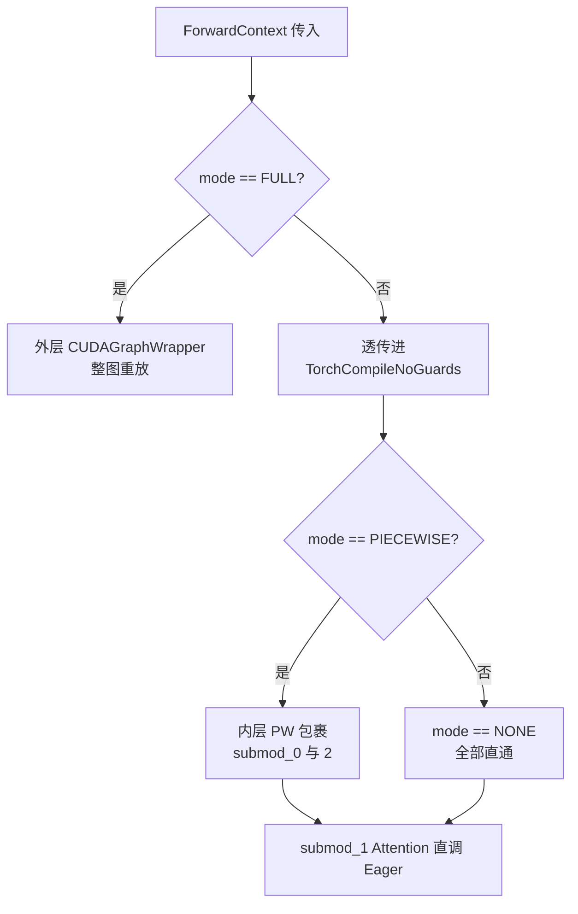
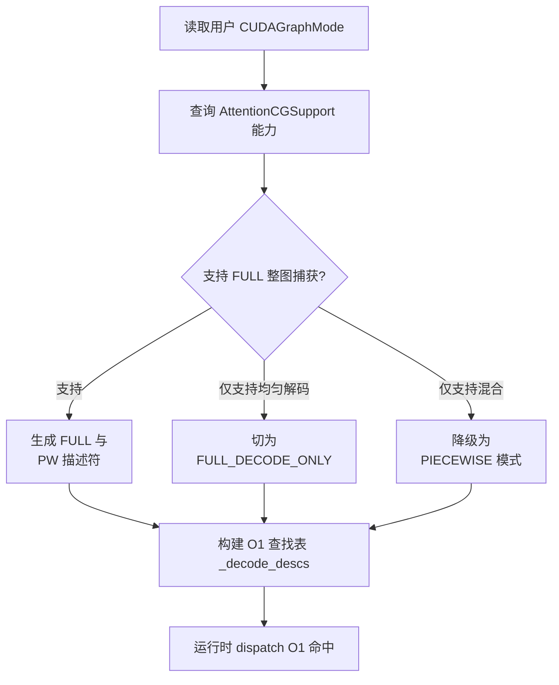

import DpDispatchConsensusExplainer from '../../../../explainers/vllm/DpDispatchConsensusExplainer';

经过前四章，我们已经集齐了所有底座积木：PagedAttention 块表、异步输出、无 Guard 的 `split_graph` 编译与遵守四大边界的静态图。然而一旦把模型摆到真实线上流量里，新的调度矛盾马上出现：**线上每一轮迭代的 Batch 构成都在剧烈变化**。

这一步可能全是单 token Decode，下一步就塞进了 Chunked Prefill，在 MoE 数据并行（DP）下甚至可能卡 0 只有 4 个 Decode token 而卡 1 正承载 19 个混排 Prefill token。引擎必须在单模型实例里无痛兼容多套图模式，并在微秒级完成全集群一致性对齐。

## 多卡 DP 运行时模式分歧与防死锁共识

如果卡 0 本地判定 `FULL(B=4)` 并通过整图重放推进到 MoE Expert All-to-All，而卡 1 本地只能走 `PIECEWISE(T=20)` 还在慢吞吞跑 Eager Attention，两条流传入集合通信的张量形状 `(4, H)` 与 `(20, H)` 就会当场错配，直接卡死整个集群。

**图 1** 推演了 `vllm/v1/worker/gpu/dp_utils.py` 中 `dispatch_cg_and_sync_dp` 如何彻底根除这种死锁隐患[^1]。

<DpDispatchConsensusExplainer client:visible title="图 1：多卡 DP 运行时模式对齐与防死锁共识推演" />

如**图 1** 所示，卡 0 与卡 1 先在 CPU 侧把各自本地 `num_tokens`、`cg_mode`、`uniform_token_count` 与 `max_query_len` 等 7 项状态打成整型小张量，利用 `get_dp_group().cpu_all_reduce_()` 完成零 GPU 阻塞的跨卡广播汇总。

决策规则非常保守却极其可靠：**所有卡对图模式取枚举最小值 `min(cg_mode_across_dp)`**（即只要有一张卡只能跑 `PIECEWISE` 甚至 `NONE`，全体自动降级对齐），而**对批大小取最大值 `max(num_tokens_across_dp)`** 并一起查表入桶垫齐到 `(20, H)`，保证穿越 MoE All-to-All 时所有节点形状完全对称。

## 三层嵌套包装与 NONE 透传不变量

为了让同一份 Python 模型对象能在运行时一秒切换成 `FULL`、`PIECEWISE` 甚至完全 Eager（`NONE`），vLLM 在启动构图期将模型外包成了三层同心结构，分发逻辑见**图 2**。



这个设计的关键在于 **`CUDAGraphWrapper.__call__` 的严格透传契约**[^2]：
当传入 `ForwardContext.cudagraph_runtime_mode` 既不是自己的 `self.runtime_mode`，或直接等于 `CUDAGraphMode.NONE` 时，包装器不做任何捕获或重放，直接把调用原样传给内层的 `self.runnable(*args, **kwargs)`。

于是乎，当共识判决为 `FULL` 时，最外层拦截并直接整图 `replay()` 完事；判决为 `PIECEWISE` 时，外层透明放行，由内层的分段编译子节点各自触发对应的分段小图捕获/重放；若处于热身期或 `NONE` 模式，两层壳全部透传直抵底层原算子。

## 启动期 CUDAGraphMode 自动降级与查表机制

在模型真正开跑前，`CudaGraphManager` 会根据 Attention 后端的真实支持能力与硬件特征在启动期对用户配置做一次安全裁切，流程见**图 3**。



在 `vllm/config/compilation.py` 中，`CUDAGraphMode` 枚举甚至把混合双模式定义成元组：`FULL_DECODE_ONLY = (FULL, NONE)` 与 `FULL_AND_PIECEWISE = (FULL, PIECEWISE)`[^3]。运行时 `CudaGraphManager.dispatch()` 则事先把不同长度、LoRA 激活数与微批数摊平在 `_decode_descs` 与 `_candidates` 字典中，线上只需一步索引即取回命中的 `BatchExecutionDescriptor`[^4]。

## PyTorch DP 模式共识实现与源码对照

下面这段自包含的 PyTorch 验证代码还原了 `dp_utils.py` 中双卡不同负载下通过全归约达成一致、避免 MoE All-to-All 形状错配的完整决策算法：

```python
import torch

# CUDAGraphMode 枚举映射: NONE=0, PIECEWISE=1, FULL=2
rank_tokens = torch.tensor([4, 19], dtype=torch.int64)
rank_modes = torch.tensor([2, 1], dtype=torch.int64)   # Rank0=FULL(2), Rank1=PIECEWISE(1)
rank_qlen = torch.tensor([1, -1], dtype=torch.int64)   # Rank1 混排非均匀解码 -> -1

# 模拟 cpu_all_reduce_ 汇总后按保守原则对齐
synced_mode = int(rank_modes.min().item())              # 取枚举最小 -> PIECEWISE(1)
synced_max_tokens = int(rank_tokens.max().item())       # 取 token 最大 -> 19
capture_buckets = [4, 8, 16, 20, 32]
bucket_tokens = next(b for b in capture_buckets if b >= synced_max_tokens)
uniform_qlen = None if torch.any(rank_qlen == -1).item() else int(rank_qlen.max().item())

assert synced_mode == 1 and bucket_tokens == 20 and uniform_qlen is None
print(f"synced_mode=PIECEWISE({synced_mode}), bucket_tokens={bucket_tokens}, qlen={uniform_qlen}")
```

运行输出严格验证：
`synced_mode=PIECEWISE(1), bucket_tokens=20, qlen=None`。

| 调度与包装层面     | NVIDIA GPU（`vllm` `bb23c0a8`）                            | 华为昇腾 NPU（`vllm-ascend` `3649b8ff`）                 |
| ------------------ | ---------------------------------------------------------- | -------------------------------------------------------- |
| 图模式状态机与描述 | `CUDAGraphMode` & `BatchExecutionDescriptor`[^3][^4]       | 直接复用相同枚举与 `BatchExecutionDescriptor`            |
| 两层嵌套静态图外壳 | `CUDAGraphWrapper`[^2] + `TorchCompileWithNoGuardsWrapper` | `ACLGraphWrapper` 严格遵守相同 `NONE` 透传契约           |
| 多卡 DP 对齐共识   | `dispatch_cg_and_sync_dp` 走 `cpu_all_reduce_`[^1]         | 复用 `dispatch_cg_and_sync_dp` 与 `_graph_relay` DP 对齐 |

至此，GPU 侧 CUDA Graph 从启动协商、嵌套包装、O(1) 查表到多卡防死锁的全栈路径已经彻底打通。下一章 [第 6 章：昇腾 ACLGraph 与 npugraph_ex](../06-ascend-aclgraph-and-npugraph/)，我们把镜头切向华为昇腾 NPU，拆解 CANN 硬件约束下如何演化出独具特色的 `ACLGraphWrapper`、`UpdatableGraph` 与 `npugraph_ex` 双引擎体系。

[^1]: `vllm/v1/worker/gpu/dp_utils.py`（`bb23c0a8`），`dispatch_cg_and_sync_dp` 与 `sync_cudagraph_and_dp_padding` 借助 `cpu_all_reduce_` 对齐多卡模式与填充上限。

[^2]: `vllm/compilation/cuda_graph.py`（`bb23c0a8`），`CUDAGraphWrapper.__call__` 在 `NONE` 或模式不匹配时直接透传底层函数。

[^3]: `vllm/config/compilation.py`（`bb23c0a8`），`CUDAGraphMode` 定义 `NONE`/`PIECEWISE`/`FULL`/`FULL_DECODE_ONLY`/`FULL_AND_PIECEWISE`。

[^4]: `vllm/v1/worker/gpu/cudagraph_utils.py`（`bb23c0a8`），`CudaGraphManager` 在启动期预建 `_decode_descs` 与 `_candidates` O(1) 分发索引。
