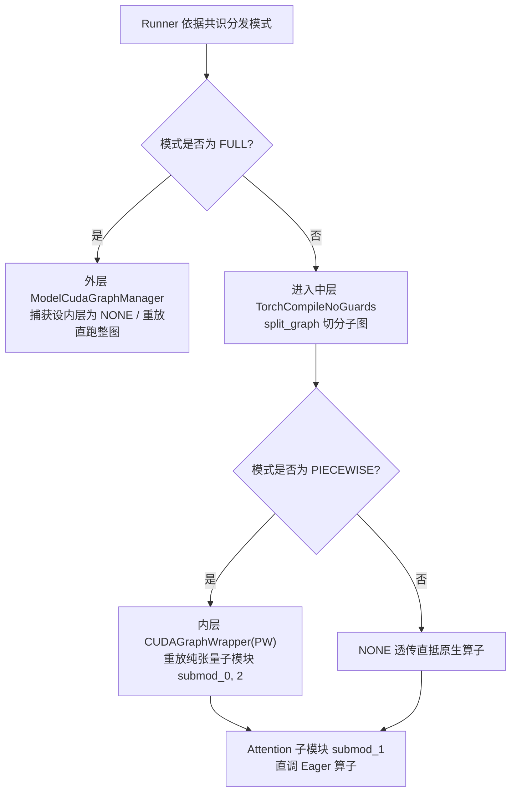
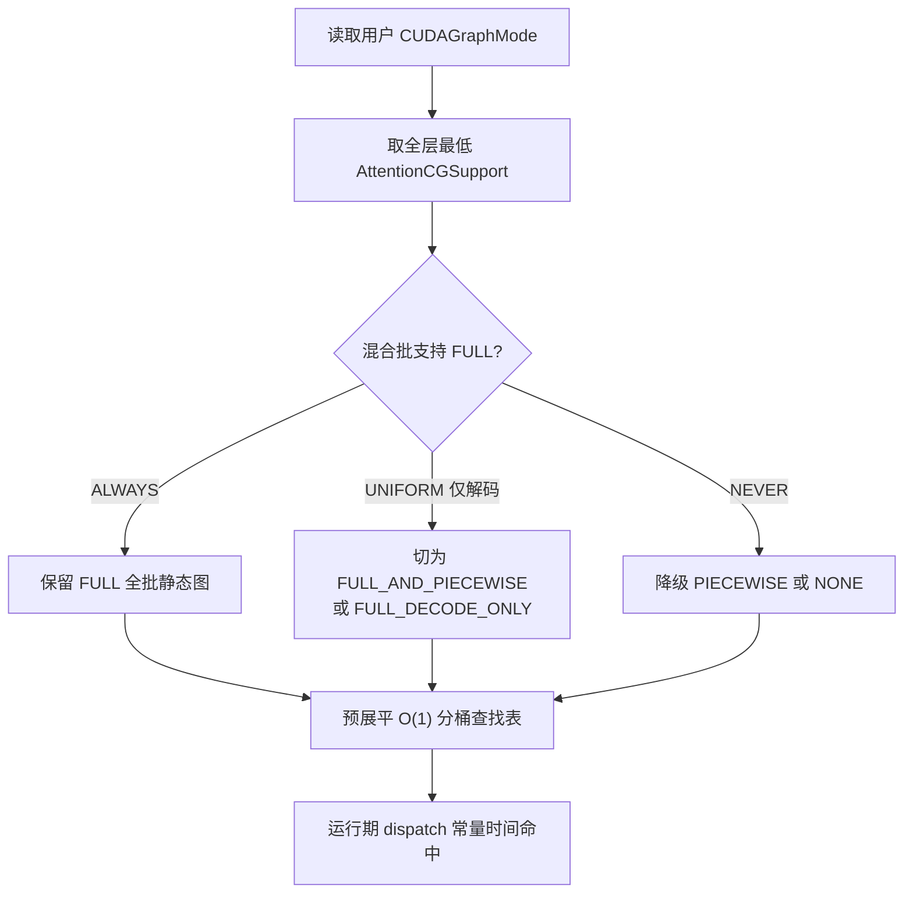

单张静态图守住四道边界后（见[第 4 章](../04-cuda-graph-and-boundaries/)），真实在线服务的动态性立刻带来两重冲突。第一重冲突在单卡内部：第 $t$ 步可能全是单 token 均匀 **Decode（解码）**，第 $t+1$ 步就混入 **Chunked Prefill（分块预填充）**。不同注意力算子能否进整图的能力各不相同，引擎必须在同一模型上动态切换整图 `FULL`、分段图 `PIECEWISE` 与 Eager 模式 `NONE`。

第二重冲突出现在多卡 **DP（Data Parallelism，数据并行）**集群上。当模型开启 **MoE（Mixture-of-Experts，混合专家架构）**并行时，各张计算卡的批构成往往不同。如果各卡只按本地负载选择图模式或填充长度，后续跨卡集合通信就会因形状或执行流不一致而直接挂死。vLLM 用**三层同心包装结构**解决单卡无痛切换，并用**主机侧轻量 DP 共识**锁住跨卡一致性。

## 多卡 DP 共识与集合通信防死锁

理解跨卡模式对齐前，需要先厘清拓扑前提。对普通 **Dense（稠密）**模型做标准 DP 部署时，每个副本独立持有完整权重并在本地前向，层间不产生跨 DP 卡的激活交换。此时即便 Rank 0 跑整图、Rank 1 跑分段图，双方各自推进也互不干扰。

一旦进入 **MoE“Attention 走 DP + 专家层走 EP（Expert Parallelism，专家并行）”**的混合并行拓扑，情况就会改变。每一层的注意力仍在各 DP 卡本地独立计算，但紧接着的 MoE 专家 **Dispatch（分发）**与 **Combine（合并）**必须在 EP/DP 通信组内执行跨卡 `All-to-All` 集合通信[^vllm-dp-utils]。

假设某一步中，Rank 0 仅承载 $4$ 个解码 token 并本地走 `FULL` 整图（形状 `(4, H)`）。Rank 1 则处理 $19$ 个混排 token，对齐到桶 $20$ 后退回 `PIECEWISE`（形状 `(20, H)`）。两张卡抵达同一层 `All-to-All` 时传入的张量长度分别是 $4$ 与 $20$，不仅收发缓冲无法对齐，还会因两卡算子入图状态不一致而触发通信超时或死锁。

为此，`GPUModelRunner` 在进入模型前向之前，会先调用 `dispatch_cg_and_sync_dp` 执行一次纯主机侧的状态汇总[^vllm-dp-utils][^vllm-model-runner]。每张卡在 CPU 上把本地 `num_tokens`、`cg_mode`、`uniform_token_count` 与其余 $4$ 项批约束写入形状 $7 \times \text{dp\_size}$ 的 CPU 张量。随后通过 `cpu_all_reduce_()` 完成跨卡交换，全程不阻塞 GPU 计算流。

汇总结束后，所有存活卡按同一套保守规则联合裁决：全局图模式取枚举最小值（`NONE = 0`、`PIECEWISE = 1`、`FULL = 2`），只要任意一卡需要降级，全体同步降级[^vllm-dp-utils]。若全组仍有卡保持图执行，则统一取最大 token 数在共享档位中重新分桶对齐；一旦对均匀查询长度意见不一，即置为 `None` 并退出均匀解码路径。

沿用前面的 `(4, FULL)` 与 `(19, PIECEWISE)` 示例，全组最终一致对齐到 `PIECEWISE` 与分桶 $T = 20$。所有 Rank 从而以对称的 `(20, H)` 张量穿越每一层 `All-to-All`。图 1 展示了从本地投票分化到主机共识对齐的完整链路。


## 三层同心包装与 NONE 透传不变量

确定全局模式后，单卡模型如何在运行期于 `FULL`、`PIECEWISE` 与 `NONE` 之间瞬时切换，而不必在内存里维护两份权重？vLLM 在启动构图期将同一个 Python 模型由外到内构造成**三层同心包装结构**，包含外、内两层静态图壳。最外层是 `ModelCudaGraphManager`，持有按批描述符索引的整模型 `FULL` 静态图集合，直接拦截并重放整张前向图[^vllm-cudagraph-manager]。

中层是 `TorchCompileWithNoGuardsWrapper`，持有经 `split_graph` 切分的整图，把模型拆成纯张量子模块与受隔离的注意力子模块[^vllm-compile-wrapper][^vllm-backends]。最内层则是包在每个纯张量编译子模块外围的 `CUDAGraphWrapper`，按 `PIECEWISE` 捕获重放；注意力子模块则保持原生 Eager 状态[^vllm-backends]。

这三层包装在运行时互不冲突，靠的是一条简洁的透传不变量：`CUDAGraphWrapper` 每次被调用时都会读取全局上下文中的 `cudagraph_runtime_mode`[^vllm-cudagraph-wrapper]。只要上下文模式等于 `NONE`，或与自身绑定的模式不匹配，该包装器就不做任何捕获或重放，直接把调用原样透传给内部的 `self.runnable`。图 2 给出了这套三层同心包装的完整分发决策树。



顺着这条不变量，三条运行时路径的开销与流向就清楚了。当共识选中 `FULL` 模式时，重放阶段由最外层调用 `run_fullgraph` 直接触发整张设备图，绕过中内层的 Python 包装。即便启动期首次捕获整图时，外层管理器也会把内层上下文设为 `NONE`[^vllm-cudagraph-manager]，让内层分段包装透传到融合 Kernel，避免触发嵌套 `Stream Capture` 错误。

当共识退回 `PIECEWISE` 时，外层整图管理器跳过拦截，请求进入中层编译图并逐段命中内层分段静态图壳，遇到 Attention 则落回原生 Eager。若处于热身、显存剖析或调试态（`NONE`），内外两层静态图壳全部透传。

## 注意力能力裁切与常量时间查表

三层包装决定了运行时可以走哪些路，而启动期究竟能捕获哪些模式的静态图，取决于模型中注意力后端的实际硬件能力。现实里，只有少数采用统一计算路由的注意力后端（例如 FlashAttention-3，能力等级标记为 `AttentionCGSupport.ALWAYS`）能在单张静态图内同时处理变长预填充与解码[^vllm-attn-backend][^vllm-cg-design]。

更多的后端（如 FlashMLA、FlashInfer）对单步解码（$q_{\text{len}} = 1$）或固定投机解码步长（$q_{\text{len}} = 1 + k$）使用规整的线程网格与静态步长，能够进入 `FULL` 整图。可一旦批中混入分块预填充，序列查询长度参差不齐，底层就需要动态切分块或变长调度表，无法放进固定形态的整图捕获中[^vllm-cg-design]。这类后端对应 `UNIFORM_BATCH` 或 `UNIFORM_SINGLE_TOKEN_DECODE` 等级；若算子组合暂不支持静态图，则为 `NEVER`[^vllm-attn-backend]。

为了让混合注意力架构自动落到安全组合，vLLM 把用户侧复合配置 `CUDAGraphMode` 设为二元组 `(decode_mode, mixed_mode)`[^vllm-compilation-cfg]。其中 `FULL_DECODE_ONLY` 对应 `(FULL, NONE)`，而 `FULL_AND_PIECEWISE` 对应 `(FULL, PIECEWISE)`。

启动协商阶段，`resolve_cudagraph_mode_and_sizes` 取全层最低注意力能力作为上限，对照用户配置自动裁切[^vllm-compilation-cfg]。如果请求全量 `FULL` 但后端仅达到 `UNIFORM_BATCH`，开启分段编译时就自动降为 `FULL_AND_PIECEWISE`，否则降为 `FULL_DECODE_ONLY`。

若最低能力为 `NEVER`，配置就会进一步退回 `PIECEWISE` 或 `NONE`。图 3 展示了从启动能力裁切到运行时查表命中的完整链路。



拿到裁切后的安全模式后，`CudaGraphManager` 在启动期会把所有捕获档位展开为 `BatchExecutionDescriptor`[^vllm-cudagraph-manager]。每个描述符记录图模式、token 数、请求数，以及均匀查询长度、最大查询长度、激活 LoRA 数和微批切分数。为了避免线上每步都在数百个描述符里遍历或二分查找，管理器在初始化时预先展平两张哈希表。

均匀解码批以均匀长度、有效 LoRA 与微批数为键，把请求数 $1, 2, \dots, N_{\max}$ 直接预填进定长数组。混合批或变长解码批则以 `num_tokens` 与有效 LoRA 为键，把每个原始 token 数直接映射到按顺序排好的候选描述符列表。

线上调用 `CudaGraphManager.dispatch()` 时，只需传入当前批的请求数、token 数、查询长度与 LoRA 等批形态字段[^vllm-cudagraph-manager]。经过一次哈希查表并校验兼容性条件，即可在 $O(1)$ 时间内取回匹配的 `BatchExecutionDescriptor`。

## PyTorch DP 模式共识实现与双仓对照

下面的自包含 PyTorch 验证脚本同时覆盖了本篇的两条核心机制。第一部分还原 `dp_utils.py` 在双卡异构负载（4 token 解码对比 19 token 混排）与纯解码负载下的 `min(mode)` / `max(tokens)` 共识算法。第二部分模拟三层同心包装的透传契约，验证 `FULL` 态下内层 `PIECEWISE` 自动让道、`PIECEWISE` 态下内层独立重放：

```python
import torch

MODE_NAME = {0: "NONE", 1: "PIECEWISE", 2: "FULL"}


def sync_dp_dispatch(
    rank_tokens: torch.Tensor,
    rank_modes: torch.Tensor,
    rank_qlen: torch.Tensor,
    buckets: list[int],
) -> tuple[int, int, int | None]:
    """模拟 cpu_all_reduce_ 后按最保守模式与最大 token 数完成全组对齐。"""
    synced_mode = int(rank_modes.min().item())
    synced_tokens = int(rank_tokens.max().item())
    bucket_tokens = next(b for b in buckets if b >= synced_tokens)
    has_non_uniform = bool(torch.any(rank_qlen == -1).item())
    qlen_agree = bool(torch.all(rank_qlen == rank_qlen[0]).item())
    uniform_qlen = (
        None
        if (has_non_uniform or not qlen_agree)
        else int(rank_qlen[0].item())
    )
    return synced_mode, bucket_tokens, uniform_qlen


class InnerPieceWrapper:
    """模拟内层 CUDAGraphWrapper(PIECEWISE)：模式为 NONE 或不匹配时直通。"""

    def __init__(self, runtime_mode: int, fn) -> None:
        self.runtime_mode = runtime_mode
        self.fn = fn

    def __call__(self, x: torch.Tensor, ctx_mode: int, trace: list[str]) -> torch.Tensor:
        if ctx_mode == 0 or ctx_mode != self.runtime_mode:
            trace.append("pw_passthrough")
            return self.fn(x)
        trace.append("pw_graph_replay")
        return self.fn(x)


def run_three_layer(x: torch.Tensor, synced_mode: int, inner_pw: InnerPieceWrapper):
    trace: list[str] = []
    if synced_mode == 2:
        # FULL 捕获/重放内部把 ForwardContext 模式置为 NONE(0)，令内层 PW 透传
        trace.append("outer_full_replay(inner_ctx=NONE)")
        out = inner_pw(x, ctx_mode=0, trace=trace)
    elif synced_mode == 1:
        trace.append("outer_full_bypass->compile")
        out = inner_pw(x, ctx_mode=1, trace=trace)
    else:
        trace.append("outer_full_bypass->eager")
        out = inner_pw(x, ctx_mode=0, trace=trace)
    return out, trace


buckets = [4, 8, 16, 20, 32]
# 场景 1：Rank 0 为 4 token 纯解码，Rank 1 为 19 token 混排预填充
m1, b1, q1 = sync_dp_dispatch(
    torch.tensor([4, 19]), torch.tensor([2, 1]), torch.tensor([1, -1]), buckets
)
# 场景 2：两卡均为单步解码，全组保留 FULL(2) 并按最大负载对齐到桶 8
m2, b2, q2 = sync_dp_dispatch(
    torch.tensor([4, 6]), torch.tensor([2, 2]), torch.tensor([1, 1]), buckets
)
assert (m1, b1, q1) == (1, 20, None) and (m2, b2, q2) == (2, 8, 1)

pw = InnerPieceWrapper(runtime_mode=1, fn=lambda t: t + 1.0)
_, tr_full = run_three_layer(torch.zeros(2, 4), synced_mode=2, inner_pw=pw)
_, tr_pw = run_three_layer(torch.zeros(2, 4), synced_mode=1, inner_pw=pw)
assert tr_full[-1] == "pw_passthrough" and tr_pw[-1] == "pw_graph_replay"

print(
    f"hetero_dp: mode={MODE_NAME[m1]}({m1}), bucket={b1}, "
    f"uniform_qlen={q1}, trace={tr_pw}"
)
print(
    f"decode_dp: mode={MODE_NAME[m2]}({m2}), bucket={b2}, "
    f"uniform_qlen={q2}, trace={tr_full}"
)
```

运行上述脚本，输出如下：

```text
hetero_dp: mode=PIECEWISE(1), bucket=20, uniform_qlen=None, trace=['outer_full_bypass->compile', 'pw_graph_replay']
decode_dp: mode=FULL(2), bucket=8, uniform_qlen=1, trace=['outer_full_replay(inner_ctx=NONE)', 'pw_passthrough']
```

下表对比了运行时模式状态机、多层同心包装与 DP 对齐逻辑在双仓中的落点。

| 分发与包装层级   | GPU（`vllm` `bb23c0a8`）             | 昇腾 NPU（`vllm-ascend` `3649b8ff`）                  |
| ---------------- | ------------------------------------ | ----------------------------------------------------- |
| 模式枚举与描述符 | `CUDAGraphMode` 与 $O(1)$ 描述符表   | 沿用同枚举与 $O(1)$ 描述符索引                        |
| 三层同心静态图壳 | `ModelCudaGraphManager` 协同内外双壳 | `ModelAclGraphManager` 复用透传[^ascend-aclgraph-mgr] |
| 多卡 DP 跨卡共识 | `dispatch_cg_and_sync_dp` 主机对齐   | 复用同共识协议并衔接更新流                            |

在 NVIDIA GPU 上，能力裁切、三层同心包装、$O(1)$ 分发与 DP 跨卡共识已经组成完整的静态图运行时链路。如果想系统了解昇腾 NPU 的影子模型流、物理队列配额、`TaskGrp` 原地刷新、条件子图及 `vllm-ascend` 四层集成细节，可转入姊妹专题[《执行图与昇腾 ACL Graph》](../../aclgraph/)。本系列最后一章[第 6 章：性能观测与线上故障定位](../06-profiling-and-debugging/)将继续围绕通用服务指标与 Profiler 轨迹展开排障。

[^vllm-dp-utils]: `vllm` 项目（commit `bb23c0a8`），`vllm/v1/worker/gpu/dp_utils.py:49-353` 中的 `sync_cudagraph_and_dp_padding` 与 `dispatch_cg_and_sync_dp`（通过 `cpu_all_reduce_` 聚合 7 项调度状态并取保守图模式与最大 token 上限）。

[^vllm-model-runner]: `vllm` 项目（commit `bb23c0a8`），`vllm/v1/worker/gpu/model_runner.py:1894-2177`（调用 `dispatch_cg_and_sync_dp` 并在 `FULL` 与 `PIECEWISE` / Eager 间切换）。

[^vllm-cudagraph-manager]: `vllm` 项目（commit `bb23c0a8`），`vllm/v1/worker/gpu/cudagraph_utils.py:74-427, 531-618` 中的 `BatchExecutionDescriptor`、`_is_compatible`、预建查找表 `_decode_descs` / `_candidates` 以及 `ModelCudaGraphManager`（`FULL` 捕获时向内层传入 `CUDAGraphMode.NONE`）。

[^vllm-compile-wrapper]: `vllm` 项目（commit `bb23c0a8`），`vllm/compilation/wrapper.py:66-230` 中的 `TorchCompileWithNoGuardsWrapper`。

[^vllm-backends]: `vllm` 项目（commit `bb23c0a8`），`vllm/compilation/backends.py:580-711` 中的 `split_graph` 与 `wrap_with_cudagraph_if_needed`（为纯张量切分子图包裹 `CUDAGraphMode.PIECEWISE` 包装器）。

[^vllm-cudagraph-wrapper]: `vllm` 项目（commit `bb23c0a8`），`vllm/compilation/cuda_graph.py:234-255` 中的 `CUDAGraphWrapper.__call__`（`NONE` 或模式失配透传契约）。

[^vllm-attn-backend]: `vllm` 项目（commit `bb23c0a8`），`vllm/v1/attention/backend.py:567-579` 中的 `AttentionCGSupport` 枚举。

[^vllm-cg-design]: `vllm` 项目（commit `bb23c0a8`），`docs/design/cuda_graphs.md:38-170`（`CudagraphModes`、嵌套包装与注意力后端兼容矩阵）。

[^vllm-compilation-cfg]: `vllm` 项目（commit `bb23c0a8`），`vllm/config/compilation.py:129-186, 1536-1645` 中的 `CUDAGraphMode` 复合元组定义与 `resolve_cudagraph_mode_and_sizes` 自动降级逻辑。

[^ascend-aclgraph-mgr]: `vllm-ascend` 项目（commit `3649b8ff`），`vllm_ascend/worker/v2/aclgraph_utils.py:83-198` 中的 `ModelAclGraphManager` 与 `vllm_ascend/compilation/acl_graph.py:160-177` 中的 `ACLGraphWrapper.__call__`。
