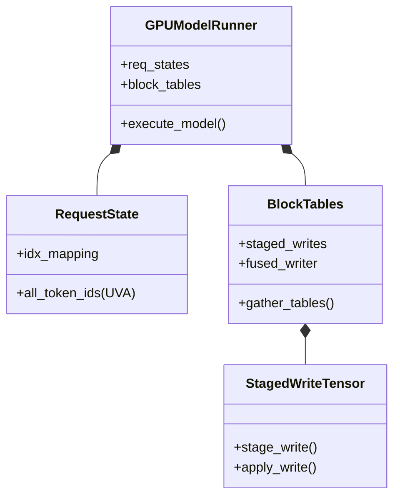
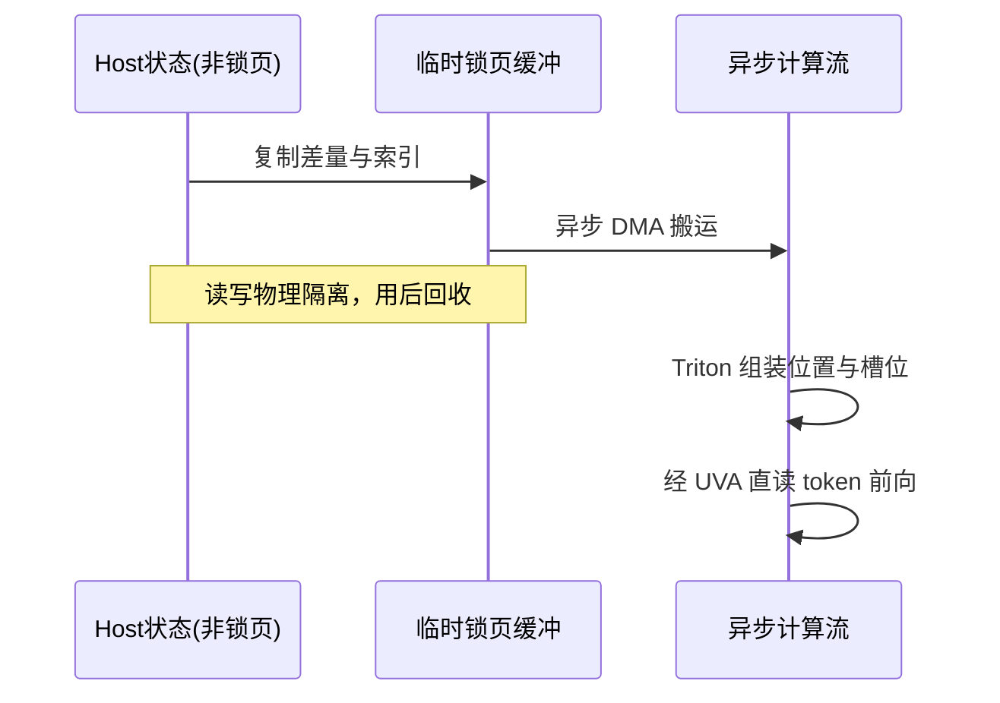

import PrepareInputsExplainer from './explainers/prepare-inputs';

调度器每步只输出一份轻量指令：各请求的配额字典 `num_scheduled_tokens` 以及逻辑块到物理块的编号列表[^vllm-sched-output]。模型前向开始前，GPU 既未加载分片权重，也不知道还能划出多少个 **KV Cache（Key-Value Cache，键值缓存）**物理块。

进入稳态服务后，执行器每步还必须在微秒级延迟内，把变长并发请求组装为一维扁平张量 `input_ids`、`positions`、`query_start_loc` 和 `slot_mapping`。`Worker` 与 `ModelRunner V2` 负责把这份调度单落地到显存计算流中。

## Worker 冷启动与四步显存测算

启动一台空卡时，服务并不知道模型前向峰值的瞬态激活占用，无法直接写出固定的 KV 块数配置。`vLLM` 的 `Worker` 通过四步顺序启动流程在加载后实测显存占用[^vllm-gpu-worker]，完整链路如图 1 所示。


第一步是 `init_device`。它绑定本地设备编号并启动模型并行通信组，同时预热一次矩阵乘锁定底层 **cuBLAS（基础线性代数库）**句柄[^vllm-gpu-worker]。随后记录 `init_snapshot` 并按 `gpu_memory_utilization` 算出可用上限 `requested_memory`[^vllm-utils]。

第二步是 `load_model`。执行器在权重内存池内直接按本地并行分片与量化格式加载参数，并通过 `DeviceMemoryProfiler` 统计模型权重实占字节 `model_memory_usage`[^vllm-gpu-worker][^vllm-mrv2-load]。

第三步是 `determine_available_memory`。系统以单步最大 token 数 `max_num_tokens` 触发 `profile_run` 空跑，测得瞬态激活峰值增量 `transient_peak_headroom`[^vllm-gpu-worker][^vllm-mem-prof][^vllm-mrv2-profile]。接着估算静态图池占用并从预算中扣除全部非缓存开销，将剩余 `available_kv_cache_memory_bytes` 整除单块字节数得出 `num_gpu_blocks`。

第四步是 `initialize_from_config` 与 `compile_or_warm_up_model`。前者按物理块数申请全层 KV 张量[^vllm-gpu-worker][^vllm-mrv2-kv]；后者则对预设尺寸触发 `torch.compile` 编译、算子调优与 **CUDA Graph（CUDA 计算图）**捕获[^vllm-gpu-worker]。

其中 `memory_profiling` 通过设备剩余显存差值统计持久消费 `total_consumed`，再单独叠加未释放的瞬态峰值差量，避免对权重和常驻通信缓冲重复扣减[^vllm-mem-prof]。自 v0.21.0 起，vLLM 默认在建池前加入 `profile_cudagraph_memory` 预估，消除后续静态图捕获阶段的 **OOM（Out of Memory，显存溢出）**风险[^vllm-gpu-worker]。

## 常驻请求行与输入元数据组装

显存池就绪后，执行器每步要把 `SchedulerOutput` 转化为模型输入。下面以一组小规模配置追踪整个组装过程：设最大并发槽位 `max_num_reqs` 为 $4$，最大长度 $M = 12$，物理块尺寸 $B = 2$，每请求最大块数 $K = 6$，单步预算 `token_budget` $= 10$[^vllm-ascend-prep]。

`RequestState` 预分配形状为 $[4, 12]$ 的 `all_token_ids` 常驻 token 表，`BlockTables` 预分配形状为 $[4, 6]$ 的块表并保留 $0$ 号空块为哨兵。此时有 $3$ 条请求到达，提示词长度分别为 $[3, 2, 8]$，依次占用常驻请求行（Persistent Row）$r \in \{0, 1, 2\}$，初始物理块分别为 $[1, 2]$、$[3]$ 与 $[4, 5, 6]$。

在首步中，调度器切出配额 `{'0': 3, '1': 2, '2': 5}`，总计 $10$ 个 token，请求 $2$ 触发 **Chunked Prefill（分块预填充）**并留下最后 $3$ 个提示词。各请求已算长度 `num_computed_tokens` 均为 $0$。

组装先定位输入 token。请求索引 `req_indices` 为 `[0,0,0, 1,1, 2,2,2,2,2]`，位置 `positions` 为 `[0,1,2, 0,1, 0,1,2,3,4]`。

按 $r \cdot 12 + p$ 算得扁平下标 `[0,1,2, 12,13, 24,25,26,27,28]` 取出 `input_ids`。同时前缀和累加得 `query_start_loc = [0, 3, 5, 10]` 与 `seq_lens = [3, 2, 5]`。

随后计算物理槽位。由 $r \cdot 6 + \lfloor p / 2 \rfloor$ 算块表下标 `[0,0,1, 6,6, 12,12,13,13,14]`，查表取出物理块号 `[1,1,2, 3,3, 4,4,5,5,6]`。再叠加块内偏移 $p \bmod 2$，由 `block * 2 + offset` 算得 `slot_mapping = [2,3,4, 6,7, 8,9,10,11,12]`。

首步前向结束时，请求 $0$ 与请求 $1$ 已完成预填充并各自采样出新 token $T_{0,3}$ 与 $T_{1,2}$，后处理算子直接把它们留在显存的 `last_sampled_tokens` 中。进入第二步，调度器下发混合配额 `{'0': 1, '1': 1, '2': 3}`，并为越过块上限的请求 $1$ 与请求 $2$ 分别新分配物理块 $7$ 和物理块 $8$。

第二步无需改动其他行。请求 $0$ 的位置 $3$ 落在物理块 $2$ 偏移 $1$（槽位 $5$）；请求 $1$ 的位置 $2$ 写入新块 $7$ 偏移 $0$（槽位 $14$）。请求 $2$ 的位置 $5,6,7$ 依次落入块 $6$ 偏移 $1$ 与块 $8$ 偏移 $0,1$（槽位 $13,16,17$），`query_start_loc` 更新为 `[0, 1, 2, 5]`，`seq_lens` 推进为 `[4, 3, 8]`。

图 2 分六个步骤展示了上述两步中常驻行状态、块表稀疏差量与无锁异步组装的联动过程。

<PrepareInputsExplainer
  client:visible
  title="图 2：ModelRunner V2 常驻行状态与输入元数据组装演示"
/>

## 常驻行解耦与稀疏差量写入

早期 V1 把持久张量直接充当模型输入，只要新请求插队或旧请求退出，CPU 就必须重排整块张量并保留冗余备份[^vllm-mrv2-design]。官方 **ModelRunner V2（简称 MRV2）** 博客将其核心重构原则概括为 **模块化、GPU 原生状态管理与异步优先**（可通过 `VLLM_USE_V2_MODEL_RUNNER=1` 启用）[^vllm-mrv2-blog]。如图 3 与图 4 所示，MRV2 仅按 `req_order` 收集活动行构成输入块表，彻底免除了 CPU 重排[^vllm-mrv2-design][^vllm-states]。




系统预分配 `max_num_reqs` 行常驻张量，每条请求保留不变的常驻行号[^vllm-mrv2-design][^vllm-mrv2-finish]；前向时只传轻量 `idx_mapping` 给设备侧收集输入行[^vllm-block-table]。块表改动改由 `StagedWriteTensor` 仅打包 `(row, start, values)` 稀疏差量，多组缓存由 `FusedStagedWriter` 合并为单次 Kernel 原地更新[^vllm-block-table][^vllm-buffer-utils]。

## 临时锁页隔离与设备侧组装

异步调度下，CPU 准备 Step $N+1$ 的同时 GPU 正在算 Step $N$。若复用固定 **Pinned Memory（锁页内存）**缓冲，就会触发 CPU 写入与 **DMA（Direct Memory Access，直接内存访问）**读取竞争[^vllm-mrv2-design]。MRV2 用临时锁页副本消除锁等待，完整数据流转时序如图 5 所示。



持久化状态保持非锁页，仅在发送时经 `async_tensor_h2d` 复制到只读临时锁页张量异步搬运[^vllm-mrv2-design][^vllm-torch-utils]。token 位置、槽位映射及 `all_token_ids` 读取全部交由 Triton 与 **UVA（Unified Virtual Addressing，统一虚拟寻址）** 处理。主机侧无需再为输入拼装加锁[^vllm-input-batch][^vllm-buffer-utils]。

## Triton 采样与显式静态图管理

输入解耦之外，MRV2 在采样器与图管理两条路径上也重写了抽象边界[^vllm-mrv2-design]。V1 依赖 PyTorch 原生算子显式展开全词表 `softmax` 概率与 `logprobs` 张量，遇到大词表和高并发时容易触发显存尖峰；MRV2 则基于 Triton 重写了 `Sampler`[^vllm-sampler]。

核心采样路径围绕三项优化展开：

1. `gumbel_sample` 在词表分块内借助无状态 Murmur3 伪随机数叠加 Gumbel 噪声并做分块 `argmax`，全程不展开全词表概率张量[^vllm-gumbel]。
2. `compute_topk_scores` 先在原始 `logits` 上选出前 $k$ 个候选 token，再仅对这 $k$ 个索引与真实采样 token 计算精确对数概率[^vllm-logprob]。
3. 投机解码每条请求对应多个 `logits` 行时，核内通过 `expanded_idx_mapping` 间接读取请求参数；长提示词对数概率支持句内细粒度分块计算[^vllm-mrv2-design][^vllm-sampler]。

在执行图管理上，V1 把显存峰值探测、编译预热、静态图捕获和空跑全部集中放入同一个重载的 `dummy_run` 分支，导致真实前向与空跑路径极易分叉出错[^vllm-mrv2-design]。MRV2 让 `execute_model` 原生支持无副作用的 `dummy_run=True` 标志[^vllm-mrv2-exec]，并抽出专职的 `CudaGraphManager` 统一管理捕获与派发[^vllm-cg-mgr]。

针对自回归 **Speculative Decoding（投机解码）**的多步 Draft 生成，MRV2 借助显式图管理实现了融合多步 Draft 解码路径[^vllm-mrv2-design][^vllm-ar-spec]。模型不再为每步 Draft token 单独重放小图，而是把多步 Draft 前向一次捕获进同一张 CUDA Graph。步间仅通过原位更新钩子推进位置与注意力元数据。

## 两步输入组装与差量写入验证

下面这段 $80$ 行纯 Python 标准库脚本完整复现了上文 3 请求、单步预算 $10$ 与块尺寸 $2$ 的两步执行过程。脚本同时验证了 `StagedWriteTensor` 在两步中各自打包的稀疏差量元素计数：

```python
class StagedWriteTensor:
    def __init__(self, rows: int, cols: int):
        self.gpu = [[0] * cols for _ in range(rows)]
        self._staged: list[tuple[int, int, list[int]]] = []

    def stage_write(self, row: int, start: int, vals: list[int]) -> None:
        if vals:
            self._staged.append((row, start, list(vals)))

    def apply_write(self) -> tuple[int, int]:
        writes, diff_elems = len(self._staged), sum(len(v) for _, _, v in self._staged)
        for row, start, vals in self._staged:
            self.gpu[row][start : start + len(vals)] = vals
        self._staged.clear()
        return writes, diff_elems

class MiniMRV2Runner:
    def __init__(self, max_reqs: int = 4, max_len: int = 12, blk_size: int = 2):
        self.max_len, self.blk_size = max_len, blk_size
        self.max_blks = max_len // blk_size
        self.free_rows = list(range(max_reqs - 1, -1, -1))
        self.req_to_row: dict[str, int] = {}
        self.all_token_ids = [[0] * max_len for _ in range(max_reqs)]
        self.computed = [0] * max_reqs
        self.prefill_len = [0] * max_reqs
        self.last_sampled = [0] * max_reqs
        self.block_table = StagedWriteTensor(max_reqs, self.max_blks)

    def add_request(self, req_id: str, prompt_ids: list[int], blocks: list[int]) -> int:
        r = self.free_rows.pop()
        self.req_to_row[req_id] = r
        self.prefill_len[r] = len(prompt_ids)
        self.all_token_ids[r][: len(prompt_ids)] = prompt_ids
        self.block_table.stage_write(r, 0, blocks)
        return r

    def step(self, sched: dict[str, int], new_blocks: dict[str, tuple[int, list[int]]]):
        for req_id, (start, blks) in new_blocks.items():
            self.block_table.stage_write(self.req_to_row[req_id], start, blks)
        writes, diff_elems = self.block_table.apply_write()
        req_idx, pos, tok_idx, in_ids = [], [], [], []
        bt_idx, blk_nums, blk_offs, slots = [], [], [], []
        q_loc, seq_lens = [0], []
        for req_id, n in sched.items():
            r, base = self.req_to_row[req_id], self.computed[self.req_to_row[req_id]]
            q_loc.append(q_loc[-1] + n)
            seq_lens.append(base + n)
            for k in range(n):
                p = base + k
                req_idx.append(r); pos.append(p); tok_idx.append(r * self.max_len + p)
                tok = self.last_sampled[r] if p >= self.prefill_len[r] else self.all_token_ids[r][p]
                in_ids.append(tok)
                col = p // self.blk_size
                bt_idx.append(r * self.max_blks + col)
                blk = self.block_table.gpu[r][col]
                off = p % self.blk_size
                blk_nums.append(blk); blk_offs.append(off); slots.append(blk * self.blk_size + off)
            self.computed[r] += n
        return {
            "writes": writes, "diff_elems": diff_elems, "pos": pos, "tok_idx": tok_idx,
            "in_ids": in_ids, "bt_idx": bt_idx, "blk_nums": blk_nums,
            "blk_offs": blk_offs, "slots": slots, "q_loc": q_loc, "seq_lens": seq_lens,
        }

runner = MiniMRV2Runner()
runner.add_request("0", [100, 101, 102], [1, 2])
runner.add_request("1", [200, 201], [3])
runner.add_request("2", [300, 301, 302, 303, 304, 305, 306, 307], [4, 5, 6])

s1 = runner.step({"0": 3, "1": 2, "2": 5}, {})
assert s1["pos"] == [0, 1, 2, 0, 1, 0, 1, 2, 3, 4]
assert s1["tok_idx"] == [0, 1, 2, 12, 13, 24, 25, 26, 27, 28]
assert s1["bt_idx"] == [0, 0, 1, 6, 6, 12, 12, 13, 13, 14]
assert s1["blk_nums"] == [1, 1, 2, 3, 3, 4, 4, 5, 5, 6]
assert s1["slots"] == [2, 3, 4, 6, 7, 8, 9, 10, 11, 12]
assert s1["q_loc"] == [0, 3, 5, 10] and s1["seq_lens"] == [3, 2, 5]

runner.last_sampled[0], runner.last_sampled[1] = 103, 202
s2 = runner.step({"0": 1, "1": 1, "2": 3}, {"1": (1, [7]), "2": (3, [8])})
assert s2["pos"] == [3, 2, 5, 6, 7] and s2["tok_idx"] == [3, 14, 29, 30, 31]
assert s2["in_ids"] == [103, 202, 305, 306, 307]
assert s2["blk_nums"] == [2, 7, 6, 8, 8] and s2["slots"] == [5, 14, 13, 16, 17]
assert s2["q_loc"] == [0, 1, 2, 5] and s2["seq_lens"] == [4, 3, 8]
assert s2["writes"] == 2 and s2["diff_elems"] == 2

for name, res in [("Step 1", s1), ("Step 2", s2)]:
    print(f"{name}: diffs={res['writes']}({res['diff_elems']}/24) q_loc={res['q_loc']} seq_lens={res['seq_lens']}")
    print(f"  pos={res['pos']} tok_idx={res['tok_idx']}")
    print(f"  blks={res['blk_nums']} slots={res['slots']}")
```

运行上述脚本得到以下结果：

```text
Step 1: diffs=3(6/24) q_loc=[0, 3, 5, 10] seq_lens=[3, 2, 5]
  pos=[0, 1, 2, 0, 1, 0, 1, 2, 3, 4] tok_idx=[0, 1, 2, 12, 13, 24, 25, 26, 27, 28]
  blks=[1, 1, 2, 3, 3, 4, 4, 5, 5, 6] slots=[2, 3, 4, 6, 7, 8, 9, 10, 11, 12]
Step 2: diffs=2(2/24) q_loc=[0, 1, 2, 5] seq_lens=[4, 3, 8]
  pos=[3, 2, 5, 6, 7] tok_idx=[3, 14, 29, 30, 31]
  blks=[2, 7, 6, 8, 8] slots=[5, 14, 13, 16, 17]
```

输出与手工推算的每一组索引和物理槽位完全吻合：第 2 步仅向设备写入 $2$ 个整数差量（全表 $24$ 格），同时直接从显存 `last_sampled` 接力生成解码输入。

至此，ModelRunner V2 已经消除了主机侧的状态维护重排和锁页复制竞争，并把输入组装与采样收进设备算子。但当小批量解码单步仍需派发数百个微秒级算子，且外部调度循环还要读回采样结果判断是否结束时，CPU 派发吞吐与步间数据等待依然会限制设备利用率，这些问题将在[下一章](../06-async-execution-and-launch-wall/)展开分析。

[^vllm-sched-output]: `vllm` (`99b0b0b0`), `vllm/v1/core/sched/output.py` (`SchedulerOutput`, `L240-349`), Apache-2.0。

[^vllm-gpu-worker]: `vllm` (`99b0b0b0`), `vllm/v1/worker/gpu_worker.py` (`Worker.init_device`, `L498-615`; `load_model`, `L653-693`; `determine_available_memory`, `L740-908`; `initialize_from_config`, `L954-1031`; `compile_or_warm_up_model`, `L1072-1230`), Apache-2.0。

[^vllm-utils]: `vllm` (`99b0b0b0`), `vllm/v1/worker/utils.py` (`request_memory`, `L792-840`), Apache-2.0。

[^vllm-mrv2-load]: `vllm` (`99b0b0b0`), `vllm/v1/worker/gpu/model_runner.py` (`GPUModelRunner.load_model`, `L407-465`), Apache-2.0。

[^vllm-mem-prof]: `vllm` (`99b0b0b0`), `vllm/utils/mem_utils.py` (`MemorySnapshot`, `L128-210`; `memory_profiling`, `L245-336`), Apache-2.0。

[^vllm-mrv2-profile]: `vllm` (`99b0b0b0`), `vllm/v1/worker/gpu/model_runner.py` (`GPUModelRunner.profile_run`, `L1100-1135`; `profile_cudagraph_memory`, `L1152-1160`), Apache-2.0。

[^vllm-mrv2-kv]: `vllm` (`99b0b0b0`), `vllm/v1/worker/gpu/model_runner.py` (`GPUModelRunner.initialize_kv_cache`, `L800-901`), Apache-2.0。

[^vllm-ascend-prep]: `vllm-ascend` (`b776261`), `docs/source/developer_guide/Design_Documents/ModelRunner_prepare_inputs.md` (`L88-281`), Apache-2.0。

[^vllm-mrv2-design]: `vllm` (`99b0b0b0`), `docs/design/model_runner_v2.md` (`L11-201`), Apache-2.0，另见 [vLLM MRV2 设计文档](https://docs.vllm.ai/en/latest/design/model_runner_v2/)。

[^vllm-mrv2-blog]: 官方工程博客 [_Model Runner V2: A Modular and Faster Core for vLLM_](https://vllm.ai/blog/2026-03-24-mrv2)（阐释模块化、GPU 原生状态管理与异步优先原则）。

[^vllm-states]: `vllm` (`99b0b0b0`), `vllm/v1/worker/gpu/states.py` (`RequestState`, `L9-134`), Apache-2.0。

[^vllm-mrv2-finish]: `vllm` (`99b0b0b0`), `vllm/v1/worker/gpu/model_runner.py` (`finish_requests`, `L1286-1300`; `add_requests`, `L1315-1375`; `update_requests`, `L1376-1396`), Apache-2.0。

[^vllm-block-table]: `vllm` (`99b0b0b0`), `vllm/v1/worker/gpu/block_table.py` (`BlockTables`, `L34-289`; `_gather_block_tables_kernel`, `L293-349`; `_compute_slot_mappings_kernel`, `L352-432`), Apache-2.0。

[^vllm-buffer-utils]: `vllm` (`99b0b0b0`), `vllm/v1/worker/gpu/buffer_utils.py` (`UvaBuffer`, `L39-48`; `UvaBackedTensor`, `L146-166`; `StagedWriteTensor`, `L169-299`), Apache-2.0。

[^vllm-torch-utils]: `vllm` (`99b0b0b0`), `vllm/utils/torch_utils.py` (`async_tensor_h2d`, `L723-750`), Apache-2.0。

[^vllm-input-batch]: `vllm` (`99b0b0b0`), `vllm/v1/worker/gpu/input_batch.py` (`InputBuffers`, `L23-40`; `InputBatch`, `L42-228`; `prepare_prefill_inputs`, `L329-353`; `prepare_pos_seq_lens`, `L393-411`; `combine_sampled_and_draft_tokens`, `L475-513`), Apache-2.0。

[^vllm-sampler]: `vllm` (`99b0b0b0`), `vllm/v1/worker/gpu/sample/sampler.py` (`Sampler`, `L42-220`), Apache-2.0。

[^vllm-gumbel]: `vllm` (`99b0b0b0`), `vllm/v1/worker/gpu/sample/gumbel.py` (`murmur3_uniform32`, `L120-132`; `gumbel_noised_argmax`, `L172-212`; `gumbel_sample`, `L393-489`), Apache-2.0。

[^vllm-logprob]: `vllm` (`99b0b0b0`), `vllm/v1/worker/gpu/sample/logprob.py` (`compute_token_logprobs`, `L85-109`; `compute_topk_scores`, `L112-190`), Apache-2.0。

[^vllm-mrv2-exec]: `vllm` (`99b0b0b0`), `vllm/v1/worker/gpu/model_runner.py` (`GPUModelRunner.execute_model`, `L1865-2275`), Apache-2.0。

[^vllm-cg-mgr]: `vllm` (`99b0b0b0`), `vllm/v1/worker/gpu/cudagraph_utils.py` (`CudaGraphManager`, `L154-235`), Apache-2.0。

[^vllm-ar-spec]: `vllm` (`99b0b0b0`), `vllm/v1/worker/gpu/spec_decode/autoregressive/speculator.py` (`AutoRegressiveSpeculator`, `L24-120`), Apache-2.0。
