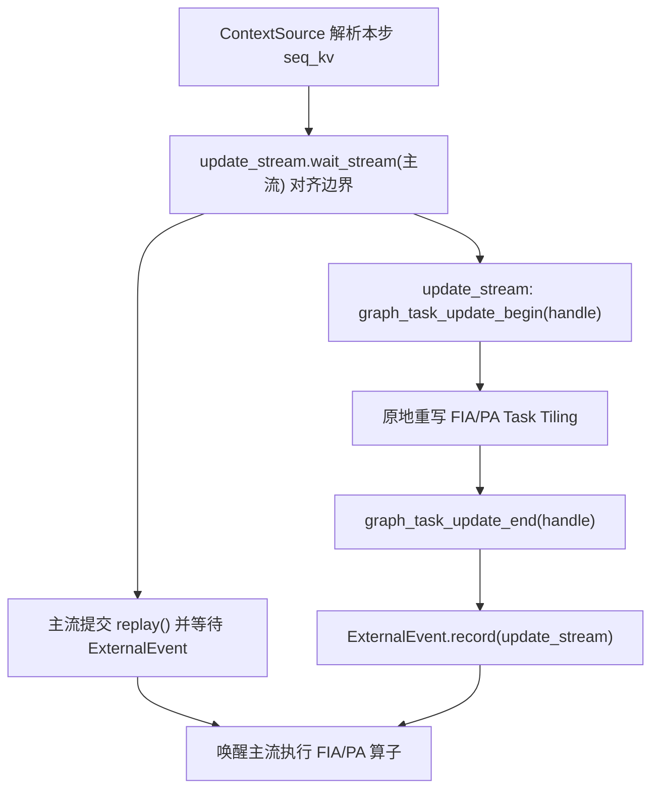

把统一的 `BatchExecutionDescriptor` 与 `FULL`、`PIECEWISE` 双模式调度迁到华为昇腾（Ascend）NPU 时，CANN 硬件执行栈带来了两条在 CUDA 上不会遇到的约束。一方面，NPU 底层物理 `Stream / Notify` 槽位与任务提交/完成队列（`SQ/CQ`）存在明确的硬件实体配额，无法像 NVIDIA GPU 那样为几十个细碎批大小密集捕获静态图；另一方面，昇腾融合注意力算子在捕获期会把 Host 侧计算的 Tiling 切分参数固化进硬件 Task 描述符，仅靠设备张量原地拷贝无法在重放时动态改变上下文长度。

为了在守住这两道约束的前提下维持静态图收益，`vllm-ascend` 演化出了结合稀疏硬件分桶、跨流热更新图实例 `UpdatableGraph` 以及 `AscendCompiler` 编译下沉的协同体系。

## 硬件流配额与稀疏分桶

在昇腾 NPU 上，静态图通过 CANN 的模型运行时实例 `aclmdlRI` 捕获与重放。每捕获一张独立的静态图分桶（以及图内绑定的跨流同步事件），都会向驱动层申请对应的硬件任务队列槽位（`SQ/CQ`）与 `Stream / Notify` 同步资源。如果在模型有几十层、同时启用分段捕获或多 LoRA 变体的场景下，仍沿用 CUDA 侧密集的捕获档位，硬件流与通知资源很快就会耗尽——早期 HDK/CANN 栈会直接报出 `Alloc sq cq fail`，新版本则会明确抛出流资源不足错误码 207008[^ascend-aclgraph]。

面对物理配额上限，`ModelAclGraphManager` 与平台配置从分桶密度与图模式两条路线同时压缩资源消耗。第一条路线是压缩捕获档位数量：部署时通过稀疏的 `cudagraph_capture_sizes`（或由平台层归并为 `reduced_cg_cap`）把细碎请求长度向上归并进少量离散硬件桶；在开启序列并行（SP）或共享专家 DP 时，平台初始化还会剔除不能被 `tp_size` 整除的档位，确保多卡张量切分整除对齐[^ascend-platform]。

第二条路线是在模式上优先采用 `FULL_DECODE_ONLY` 或纯 `FULL` 模式，节制使用 `FULL_AND_PIECEWISE`[^ascend-aclgraph]。原因在于 `PIECEWISE` 模式下每一层都会按非注意力子图数量切出多个独立捕获节点，总计占用与层数成正比的硬件流与任务槽；而 `FULL_DECODE_ONLY` 仅围绕少数几个解码档位创建整模型 `aclmdlRI` 实例，把预填充与混排步交还 Eager 或常规编译路径执行，从而在流配额受限的设备上避开 207008 错误[^ascend-aclgraph][^ascend-platform]。

当开启 MTP 等多步投机解码时，均匀解码查询长度 `decode_query_len` 大于 1，捕获描述符会把原始 `cudagraph_capture_sizes` 向上圆整为查询长度的整数倍（例如将档位 56 向上对齐到 60）。因此 `ModelAclGraphManager` 必须从展开后的真实描述符集合中收集最终捕获尺寸，避免因配置档位与实际捕获 token 数不一致而漏建任务更新句柄[^ascend-aclgraph-utils]。

在架构复用上，`vllm-ascend` 的 MRV2 Runner 直接继承上游 `ModelCudaGraphManager`，在捕获上下文里把图类映射到 `UpdatableGraph`、把图上下文管理器映射到 `torch_npu_graph_wrapper`[^ascend-v2-utils][^ascend-aclgraph-utils]。同时外层用 `ModelWithContext` 包装模型，仅在非 `PIECEWISE` 的静态图捕获流期间才向底层注意力传递捕获标记，从而复用上一章的分桶调度与先分段后整图的内存池顺序[^ascend-aclgraph-utils]。

遇到跨卡通信算子或异步旁路查表时，捕获与重放上下文还需要额外对齐。在捕获阶段，`ModelAclGraphManager.capture` 会通过 `communicator_switch` 临时将通信器切换为 `NPUCommunicator`，使 HCCL 集合通信算子正确录进静态图流[^ascend-v2-utils]；而在重放整图之前，若模型挂载了类似 Engram 的异步预取状态，运行器会先依据 DP 同步后的填充总长度触发 `prepare_engram()`，再由模型内部在首个消费层以 `ExternalEvent` 衔接查表结果[^ascend-aclgraph-utils]。

以一组实际运行批大小 `[17, 33, 45, 58]` 和稀疏硬件桶 `[32, 48, 64]` 为例：批大小 17 映射到桶 32，33 与 45 共同复用同一张桶 48 静态图，58 映射到桶 64。复用同一张桶 48 的不同请求不仅输入 token 数不同，在自回归解码推进过程中，各自的历史 KV 长度（`seq_kv`）还会从 16 逐轮增长到 33、45。图 1 以 `[32, 48, 64]` 稀疏分桶与桶 48 的变长 KV 重放为例，概括了参数热更新与事件同步的完整过程。

![昇腾 ACLGraph 稀疏分桶 [32, 48, 64]、UpdatableGraph 跨 update_stream 原地热更新 FIA/PA Task Tiling 与 ExternalEvent 同步链路](./diagrams/06-aclgraph-hot-update-timeline.drawio '图 1：昇腾 ACLGraph 稀疏分桶、UpdatableGraph 热更新与跨流同步机制')

## UpdatableGraph 热更新与跨流同步时序

### Host 侧 Tiling 固化与热更新机制

在 NVIDIA CUDA 上，FlashAttention 或 FlashMLA 等 Kernel 直接从设备显存里的 `seq_lens` 张量读取每条请求的 KV 长度；只要调用方重放前把新长度原位 `.copy_()` 进那块固定地址的显存，同一张 CUDA Graph 就能自动适配变长 KV，无需修改图节点内部参数。

昇腾 NPU 的融合推理注意力算子（`npu_fused_infer_attention_score`，简称 FIA）及分页注意力（PA）走了不同的硬件任务模型。算子启动前，主机侧需要依据本步实际查询长度 `actual_seq_lengths`、历史 KV 长度 `actual_seq_lengths_kv` 与页表维度计算出一整套 **Tiling 切分结构体**（决定 AI Core 分块边界、多核负载切分与临时工作区偏移），CANN 在图捕获阶段把这份 Tiling 结构体连同工作区指针一并固化进了底层硬件 Task 描述符[^ascend-fia][^ascend-mla]。倘若重放时只原地覆写设备显存里的输入张量，底层硬件 Task 仍然带着捕获时刻记录的旧 Tiling（例如 `seq_kv = 16`）去扫描缓存，导致注意力截断漏算。

`UpdatableGraph` 通过任务组句柄和独立的辅助更新流 `update_stream` 解决了“不重捕整图却能改写 Task 描述符”的矛盾[^ascend-updatable-graph]。图 2 展示了重放期主流与更新流之间的跨流同步与参数热更新时序。



这一跨流更新协议拆成捕获与重放两段落地。在捕获阶段，FIA 或 PA 算子通过 `UpdatableGraph.register_task` 注册可更新任务[^ascend-updatable-graph][^ascend-fia]：先在当前捕获流上插入一对 `ExternalEvent.wait(stream)` 与 `ExternalEvent.reset(stream)` 作为执行栅栏，再用 `torch.npu.graph_task_group_begin` 与 `graph_task_group_end` 把注意力算子单独框出，截获可改写的任务组 `handle`，并用弱引用保留可复用参数字典。

针对不同注意力算子的工作区分配，捕获与更新采用了差异化管理。对于 FIA 算子，捕获阶段通过 `get_capture_resource` 以 `use_max_workspace=True` 锁住同一分桶下各层的最大工作区尺寸[^ascend-fia][^ascend-updatable-graph]，重放期间无需再次申请；对于 PA 算子，重放热更新还会按输入签名缓存并按需计算工作区，避免反复触发设备内存分配[^ascend-updatable-graph]。

进入重放阶段后，`ModelAclGraphManager` 先通过 `ContextSource(attn_metadata)` 提取本步最新的 `actual_seq_lengths_kv` 与页表参数，解析出各层对应的 `GraphUpdateTask`[^ascend-aclgraph-utils][^ascend-updatable-graph]。随后，它调用 `self.update_stream.wait_stream(current_stream())` 让更新流对齐到当前主计算流边界，紧接着在主流提交整图 `replay()`，并在 `update_stream` 上依次执行 `graph_task_update_begin(update_stream, handle)`、按新参数重算 Tiling 写入原 Task 描述符以及 `graph_task_update_end(update_stream)`，最后调用 `event.record(update_stream)` 放行主流的 `ExternalEvent.wait`[^ascend-updatable-graph][^ascend-aclgraph-utils]。

在开启异步调度的标准路径下，`ACLGraphWrapper` 还会在发起下一次 `FULL` 重放前执行当前流同步，防止第 $i$ 步在 `update_stream` 上的参数改写与第 $i-1$ 步尚未完结的图重放发生读写踩踏[^ascend-aclgraph]。目前 GQA 的 FIA 与 PA 路径已统一迁入 `UpdatableGraph`，而部分 MLA 实现则沿用同一套 `graph_task_update_begin/end` 协议在专属参数更新入口中完成改写[^ascend-fia][^ascend-mla]。

### 异步重放与持久缓冲区生命周期陷阱

除了任务组参数的时序同步，异步执行的 `FULL` ACLGraph 还存在一类隐蔽的内存越界问题——底层异步错误码 507011。在捕获阶段，传入算子调用的所有张量参数（例如部分注意力算子所需的 per-head `sinks` 偏置张量、或重排后的局部输入视图）都会把设备虚拟地址直接编入硬件 Task，而 `UpdatableGraph` 的任务字典对部分参数同样采用弱引用以免长期锁死显存。

如果某个中间适配函数在捕获调用内部临时创建了局部张量（例如现场构造一份 `sinks`）而调用方并未持久持有该张量的引用，一旦函数返回，NPU 显存分配器就会在下一刻把这块内存回收并分配给其他张量；等到后续某步异步重放 ACLGraph 时，算子就会读写已经失效或已被覆写的虚拟地址，在内核态触发越界故障[^ascend-sparse-mla]。由于 NPU 设备算子是异步提交执行的，错误码 507011 不会在触发的那一层当场抛出，而是延迟到后续某个无关的 `synchronize()` 同步点才浮出水面。因此 `vllm-ascend` 在 `sparse_flash_mla` 等适配接口中强制校验 `sinks` 等长效缓冲必须由调用方模型状态持久持有[^ascend-sparse-mla]，并借由 `weak_ref_workspaces` 仅对临时工作区和末图输出解除强引用[^ascend-aclgraph]。

## ACLGraphWrapper 与编译图引擎的协作分工

在执行链上，除了运行时层面的 `ACLGraphWrapper`，昇腾侧还有负责 PyTorch FX 图优化与代码下沉的 `AscendCompiler`。两者的分工边界由用户选择的静态图模式决定，具体架构对照如图 3 所示。


在运行时提交层，`ACLGraphWrapper`（在 MRV2 中配合 `ModelAclGraphManager`）对标上游 `CUDAGraphWrapper`[^ascend-aclgraph][^ascend-aclgraph-utils]，把已经下发到流上的算子序列打包成 `aclmdlRI` 硬件图以消除主机发射间隙，同时严格遵守上一章的 `NONE` 模式透传不变量。对于不适合走 FX 静态切分编译的模型，昇腾还提供 `BreakableACLGraphWrapper`，在标记边界处原地切开捕获流并沿用完全相同的 `weak_ref_workspaces` 与重放前流同步契约[^ascend-breakable]。

在编译中间表示（FX IR）层，昇腾平台禁用 TorchInductor，统一由 `AscendCompiler` 接管[^ascend-platform][^ascend-compiler]，并依据静态图模式在两条后端路径之间切换。当配置包含分段图（`PIECEWISE` 或 `FULL_AND_PIECEWISE`）时，平台设置注意力切分算子列表并关闭 `npugraph_ex`，令 `AscendCompiler` 退回 `GraphFusionPassManager` 执行基于模式匹配的 NPU 算子融合 Pass（如规范化量化、QKNorm 与 RoPE 及矩阵乘与 `ReduceScatter` 融合），再将纯张量子模块交给内层 `ACLGraphWrapper(PIECEWISE)` 捕获[^ascend-platform][^ascend-fusion-mgr]。

而当部署配置仅启用整图模式（`FULL` 或 `FULL_DECODE_ONLY`，此时 `splitting_ops` 置空）时，`AscendCompiler` 激活 `npugraph_ex`（缺失时兜底至 `torchair` 的 `reduce-overhead` 模式）[^ascend-compiler]。此时编译器配置 `force_eager=True` 与 `inplace_pass=False` 防止算子回退至主机侧执行，并可选针对分桶批大小启用静态形状 ACLNN 内核预编译（`enable_static_kernel`）以及 `SuperKernel` 优化（`enable_super_kernel`）。

最终，经过图编译器整理或融合后的整网算子流，再交由外层的 `ModelAclGraphManager` 或 `ACLGraphWrapper(FULL)` 捕获为 `UpdatableGraph`（同步启用 `super_kernel_optimize` 完成核间调度与缓存整理）[^ascend-aclgraph]。图编译器负责跨算子静态融合与硬件内存规划，运行时图包装器负责跨步复用 `aclmdlRI` 实例与注意力参数热更新，两条路径协同运行、互不冲突。

## PyTorch 热更新模拟验证与双仓对照

下面的自包含 PyTorch 验证脚本严格在**固定张量形状**下模拟 `UpdatableGraph` 的行为（全程不使用动态布尔索引切片与图内 `.item()`）：脚本先完成 `[17, 33, 45, 58]` 到 `[32, 48, 64]` 的稀疏分桶路由，随后用 `torch.where(pos < frozen_tiling_len, kv_cache, zero_buf).sum(dim=-1)` 固定张量形状求和内核，显式对比“捕获期 `frozen_tiling_len = 16` 未经 `update_stream` 热刷新导致 `seq_kv = 33` 时依然截断错算”与“经 `update_stream` 原地刷新 Task 描述符为 33 和 45 后精确吻合预期”的数值差异。

```python
import torch

raw_sizes = [17, 33, 45, 58]
buckets = [32, 48, 64]
routed = {x: next(b for b in buckets if b >= x) for x in raw_sizes}
assert routed == {17: 32, 33: 48, 45: 48, 58: 64}

# 固定容量 64 的静态缓存与位置索引，模拟图内算子固定形状访存
kv_cache = torch.arange(1, 65, dtype=torch.float32).reshape(1, 64)
pos = torch.arange(64, dtype=torch.int32).unsqueeze(0)
zero_buf = torch.zeros_like(kv_cache)
# 模拟捕获阶段写入硬件 Task 描述符的初始 Tiling 长度 seq_kv=16
frozen_tiling_len = torch.tensor([16], dtype=torch.int32)


def replay_fia_fixed_shape() -> torch.Tensor:
    """固定形状模拟 FIA 重放：完全由固化的 frozen_tiling_len 决定有效归约边界。"""
    return torch.where(pos < frozen_tiling_len, kv_cache, zero_buf).sum(dim=-1)


# 1) 若不走 UpdatableGraph 热更新，即使请求 KV 实际已增至 33，图内 Task 仍按捕获期 16 截断
stale_33 = replay_fia_fixed_shape()

# 2) 经 update_stream 原地热更新 Task 描述符为 33 与 45（免重捕整图）
frozen_tiling_len.fill_(33)
patched_33 = replay_fia_fixed_shape()
frozen_tiling_len.fill_(45)
patched_45 = replay_fia_fixed_shape()

exp_33 = float(sum(range(1, 34)))
exp_45 = float(sum(range(1, 46)))
assert int(stale_33.sum()) == 136
assert int(patched_33.sum()) == int(exp_33) and int(patched_45.sum()) == int(exp_45)

print(f"bucket_routing={routed}")
print(f"without_task_update(seq=33): got={int(stale_33.sum())}, expected={int(exp_33)} (frozen_at_16)")
print(f"with_updatable_graph: seq_33={int(patched_33.sum())}, seq_45={int(patched_45.sum())}")
```

运行上述脚本，输出如下：

```text
bucket_routing={17: 32, 33: 48, 45: 48, 58: 64}
without_task_update(seq=33): got=136, expected=561 (frozen_at_16)
with_updatable_graph: seq_33=561, seq_45=1035
```

下表对比了静态图捕获、变长注意力参数更新、跨流同步与图编译器在 GPU 与 NPU 两个代码仓中的实现差异。

| 核心机制         | NVIDIA GPU（`vllm` `bb23c0a8`）     | 华为昇腾 NPU（`vllm-ascend` `3649b8ff`）                    |
| ---------------- | ----------------------------------- | ----------------------------------------------------------- |
| 静态图包装与实例 | `CUDAGraphWrapper` 封装 `CUDAGraph` | `ACLGraphWrapper` 封装 `UpdatableGraph`[^ascend-aclgraph]   |
| 变长参数更新路径 | 全部读自固定地址 GPU 静态张量       | `update_stream` 热改写 Task Tiling[^ascend-updatable-graph] |
| 跨流同步机制     | `CUDAEvent` 配合流汇合              | `ExternalEvent` 等待、重置与放行同步                        |
| 编译图优化路线   | TorchInductor 生成融合 Triton PTX   | `npugraph_ex` 或 `GraphFusionPassManager`[^ascend-compiler] |

到这里，我们已经把 GPU 与昇腾 NPU 两套静态图从底层边界、嵌套调度到硬件 Task 热更新的机制全部串联完毕。但在真实生产集群上，配置妥当之后依然可能出现吞吐莫名回落、TPOT 长尾抖动、跨卡同步卡顿甚至异步越界报错；如何从端到端服务指标出发，在避免采样工具自身失真的前提下快速从 Profiler 时间线定位根因，正是收官篇[第 7 章：性能观测与线上故障定位](../07-profiling-and-debugging/)要解决的问题。

[^ascend-aclgraph]: `vllm-ascend` 项目（commit `3649b8ff`），`vllm_ascend/compilation/acl_graph.py:34-52, 66-336` 中的 `ACLGraphWrapper`、`super_kernel_optimize`、`weak_ref_workspaces` 与资源上限 207008 / `Alloc sq cq fail` 报错处理。

[^ascend-platform]: `vllm-ascend` 项目（commit `3649b8ff`），`vllm_ascend/platform.py:1440-1509` 中的 `_setup_compile_backend`（TP 对齐捕获档位、分段模式下关闭 `npugraph_ex`、全图模式下清空 `splitting_ops`）。

[^ascend-aclgraph-utils]: `vllm-ascend` 项目（commit `3649b8ff`），`vllm_ascend/worker/v2/aclgraph_utils.py:53-275` 中的 `collect_sorted_captured_token_sizes`、`ModelAclGraphManager`（含 `prepare_engram` 接入）、`_updatable_graph_replay` 与 `ModelWithContext`。

[^ascend-v2-utils]: `vllm-ascend` 项目（commit `3649b8ff`），`vllm_ascend/worker/v2/utils.py:169-222` 中的 `communicator_switch`、`torch_npu_graph_wrapper` 与 `UpdatableGraph` 捕获桥接，及 `vllm_ascend/worker/v2/model_runner.py:1640-1669` 中的 `graph_manager_wrapper`。

[^ascend-fia]: `vllm-ascend` 项目（commit `3649b8ff`），`vllm_ascend/attention/attention_v1.py:647-656, 682-883` 中的 `full_graph_fia`、`full_graph_fia_v2` 与 `full_graph_pa`（通过 `register_task` 接入 `UpdatableGraph`）。

[^ascend-mla]: `vllm-ascend` 项目（commit `3649b8ff`），`vllm_ascend/attention/mla_v1.py:1055-1182` 中的 `AscendMLAImpl.update_graph_params`（在 `update_stream` 上刷新 `actual_seq_kvlen` 与 `actual_seq_qlen`）。

[^ascend-updatable-graph]: `vllm-ascend` 项目（commit `3649b8ff`），`vllm_ascend/compilation/updatable_graph.py:59-187` 中的 `GraphUpdateTask`、`UpdatableGraph`（`get_capture_resource`、`register_task`、`resolve_tasks`、`update`）与 `_get_ws_key`。

[^ascend-sparse-mla]: `vllm-ascend` 项目（commit `3649b8ff`），`vllm_ascend/attention/sparse_flash_mla.py:63-78` 中的 `_ensure_sinks`（长效引用约束与异步报错 507011 的机理）。

[^ascend-breakable]: `vllm-ascend` 项目（commit `3649b8ff`），`vllm_ascend/compilation/breakable_aclgraph.py:38-91` 中的 `BreakableACLGraphWrapper`。

[^ascend-compiler]: `vllm-ascend` 项目（commit `3649b8ff`），`vllm_ascend/compilation/compiler_interface.py:49-70, 189-413` 中的 `fusion_pass_compile`、`npugraph_ex_compile` 与 `AscendCompiler`。

[^ascend-fusion-mgr]: `vllm-ascend` 项目（commit `3649b8ff`），`vllm_ascend/compilation/graph_fusion_pass_manager.py:28-79` 中的 `GraphFusionPassManager`。
