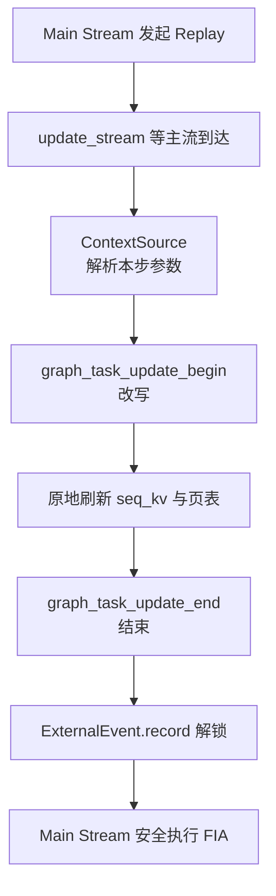

import AscendAclGraphExplainer from '../../../../explainers/vllm/AscendAclGraphExplainer';

在[第 5 章：运行时分发与嵌套包装](../05-runtime-dispatch-and-nesting/)中，我们理清了 vLLM 如何用一套统一的 `BatchExecutionDescriptor` 与 `dp_utils` 跨卡共识调度多种图模式。而把这套框架迁移到华为昇腾 NPU（Ascend）时，CANN 硬件底座带来了三道与 CUDA 截然不同的工程约束：

1. **硬件流配额严格（防 `207008` 错误）**：CANN 底层硬件 Stream/Notify 资源有上限，无法像 CUDA 那样肆意捕获几十个稠密 Batch 档位。
2. **Attention 变长参数混用 Host 标量**：昇腾融合注意力算子（FIA / MLA）的 `actual_seq_lengths_kv`、页表与 Tiling 参数无法仅靠输入 Tensor 地址覆盖自动变化。
3. **动态编译替代品（`npugraph_ex`）**：Ascend 侧禁用 TorchInductor，另辟了 FX 下沉 GE 的静态图路线。

## ACLGraph 分桶复用与 UpdatableGraph 热更新机制

**图 1** 推演了 `vllm-ascend`（`3649b8ff`）面对这三大挑战的核心解法。当真实批负载表现为 `[17, 33, 45, 58]` 等细碎长度时，`ModelAclGraphManager` 不会捕获 4 张甚至几十张碎图，而是将其稀疏归并进 `[32, 48, 64]` 三档硬件桶中——例如 `33` 与 `45` 共用 `Bucket 48`，极大压低 CANN 流资源消耗，彻底规避流耗尽错误码 `207008`（或老版本驱动报错 `Alloc sq cq fail`）[^1]。

<AscendAclGraphExplainer
  client:visible
  title="图 1：昇腾 ACLGraph 分桶复用、参数热更新与跨流闭合推演"
/>

而要让复用同一张 `Bucket 48` 图的不同请求在 KV 上下文长度每步递进时照样算对，主角便是 **`UpdatableGraph`**[^2]。如**图 1** 第 2 至第 5 步所示：捕获阶段 FIA 算子通过 `register_task` 埋入 `ExternalEvent` 等待并截取 `torch.npu.graph_task_group_end(stream)` 任务组句柄；重放时无需重抓整图，只需在异步 **`update_stream`** 上原地刷新 Tiling 参数并触发事件放行。

## ACLGraphWrapper 与 npugraph_ex 双轨对比

正如第 3 章铺垫的，在昇腾平台上存在**`ACLGraphWrapper`（模型运行时图捕获）**与 **`npugraph_ex`（FX 图编译下沉）**两股技术力量的协同，如**图 2** 所示。


两者各自解决不同层面的瓶颈：`ACLGraphWrapper` 本质对标 `CUDAGraphWrapper`，侧重把单步数百个已发出的 ACL Task 打包成 `aclmdlRI` 模型实例一次发射；而 `AscendCompiler` 中的 `npugraph_ex`（缺失时自动兜底 `torchair`）则是把纯张量 FX 子图送入 CANN 图编译器进行算子融合与硬件静态内存规划[^3]。当 `npugraph_ex` 遇上包含进程局部索引的 `triton_kernel_wrapper` 时，还会主动跳过磁盘写缓存以免多进程重启反序列化越界。

## UpdatableGraph 热更新与跨流踩踏防护时序

如果不把多流同步次序控制好，异步流水与原地热更新之间极易爆发前后两步互相踩踏参数表的灾难。**图 3** 展示了一条完整且安全的参数热更新与重放闭合协议。



在标准分支与 V2 Runner 的 `ModelAclGraphManager._updatable_graph_replay` 中[^4]：引擎先从 `ContextSource(attn_metadata)` 解析本步最新 Tiling 标量；随即让 `self.update_stream.wait_stream(current_stream())` 确保上一轮执行与当前入图边界有序；主流程下发图重放后，`update_stream` 通过 `graph_task_update_begin/end` 把最新标量填进静态 Task 参数表，最后用 `event.record(update_stream)` 解除主流 FIA 前的 `ExternalEvent.wait`[^2]。对于稀疏注意力（如 `SparseFlashMla`）还额外校验调用方持久持有的 `sinks` 缓冲区，防止图捕捉到瞬时局部变量导致重放时访问已释放地址陷阱 **`507011`**[^5]。

## PyTorch 分桶与热更新核心验证及源码对照

下面这段自包含的 PyTorch 验证代码展示了 `[17, 33, 45, 58]` 如何精准路由入 `[32, 48, 64]` 三档稀疏硬件桶，以及热更新固定缓冲区标量如何在免重新构图的前提下追踪变化后的真实序列求和结果：

```python
import torch

raw_sizes = [17, 33, 45, 58]
buckets = [32, 48, 64]
routed = {x: next(b for b in buckets if b >= x) for x in raw_sizes}
assert routed == {17: 32, 33: 48, 45: 48, 58: 64}

# 模拟 UpdatableGraph：捕获好固定长度 64 的掩码框架，仅通过热改写 captured_seq_kv 适应变长 KV
kv_cache = torch.arange(1, 65, dtype=torch.float32).reshape(1, 64)
captured_seq_kv = torch.tensor([16], dtype=torch.int32)
mask_buf = torch.zeros(1, 64, dtype=torch.bool)

def replay_updatable(seq_kv_val: int) -> float:
    captured_seq_kv.fill_(seq_kv_val)  # 对应 update_stream 原地刷新参数
    mask_buf[0] = torch.arange(64) < captured_seq_kv[0]
    return kv_cache[mask_buf].sum().item()

s33 = replay_updatable(33)
s45 = replay_updatable(45)
assert s33 == sum(range(1, 34)) and s45 == sum(range(1, 46))
```

实测输出精确验证：
`bucket_routing={17: 32, 33: 48, 45: 48, 58: 64}, updated_seq_33_sum=561, updated_seq_45_sum=1035`。

| 核心问题             | `vllm`（NVIDIA CUDA）                        | `vllm-ascend`（Ascend CANN `3649b8ff`）                         |
| -------------------- | -------------------------------------------- | --------------------------------------------------------------- |
| 图捕获封装与重放体   | `CUDAGraphWrapper`（`torch.cuda.CUDAGraph`） | `ACLGraphWrapper`（`UpdatableGraph` 继承 `NPUGraph`）[^1][^2]   |
| 注意力动态元数据刷新 | 全量放入 GPU Static Tensor 原地覆写          | `graph_task_update_begin` + `update_stream` 热改 Tiling[^2][^4] |
| 多流捕获同步闭环     | `CUDAEvent` + `join_after_forward()`         | `torch.npu.ExternalEvent` wait/reset/record 闭环[^2]            |
| 图编译器路线         | TorchInductor -> Triton PTX                  | `AscendCompiler` -> `npugraph_ex` / `torchair`[^3]              |

当单机 CUDA 与昇腾 NPU 两套静态执行栈全部跑通后，真实线上留下的最硬核考验是如何**快速看懂 Trace 并精准排错**——面对设备利用率突然砍半、DP 挂死或者莫名其妙的 `507011` 异步报错，应当看哪些轨迹指纹？请看收官篇[第 7 章：性能观测与线上故障定位](../07-profiling-and-debugging/)。

[^1]: `vllm_ascend/compilation/acl_graph.py`（`3649b8ff`），`ACLGraphWrapper` 与 `207008` 流资源耗尽、`Alloc sq cq fail` 老版本提示。

[^2]: `vllm_ascend/compilation/updatable_graph.py`（`3649b8ff`），`UpdatableGraph` 通过 `ExternalEvent` 与 `graph_task_group`/`graph_task_update` 实现无重捕热更新。

[^3]: `vllm_ascend/compilation/compiler_interface.py`（`3649b8ff`），`npugraph_ex_compile` 优先接入 `npugraph_ex`，缺失兜底 `torchair`，并规避含 Triton 算子的缓存。

[^4]: `vllm_ascend/worker/v2/aclgraph_utils.py`（`3649b8ff`），`ModelAclGraphManager` 实现稀疏捕获与 `_updatable_graph_replay`。

[^5]: `vllm_ascend/attention/sparse_flash_mla.py`（`3649b8ff`），针对持久缓冲区缺失与算子越界可能导致的异步 `507011` / `507015` 陷阱给出保护边界。
