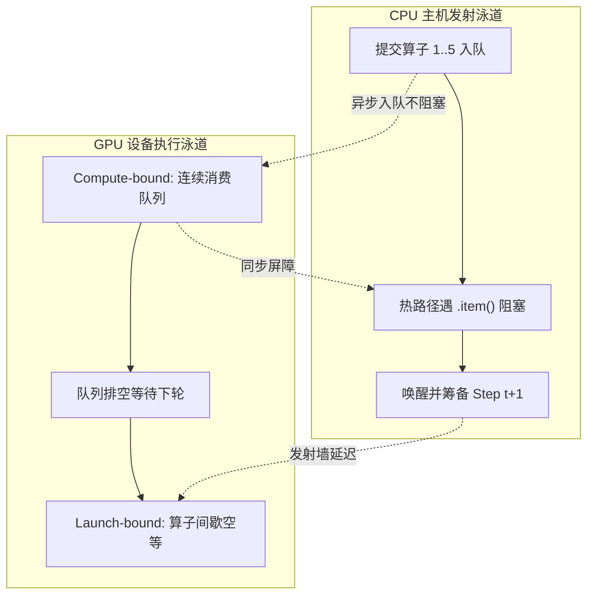
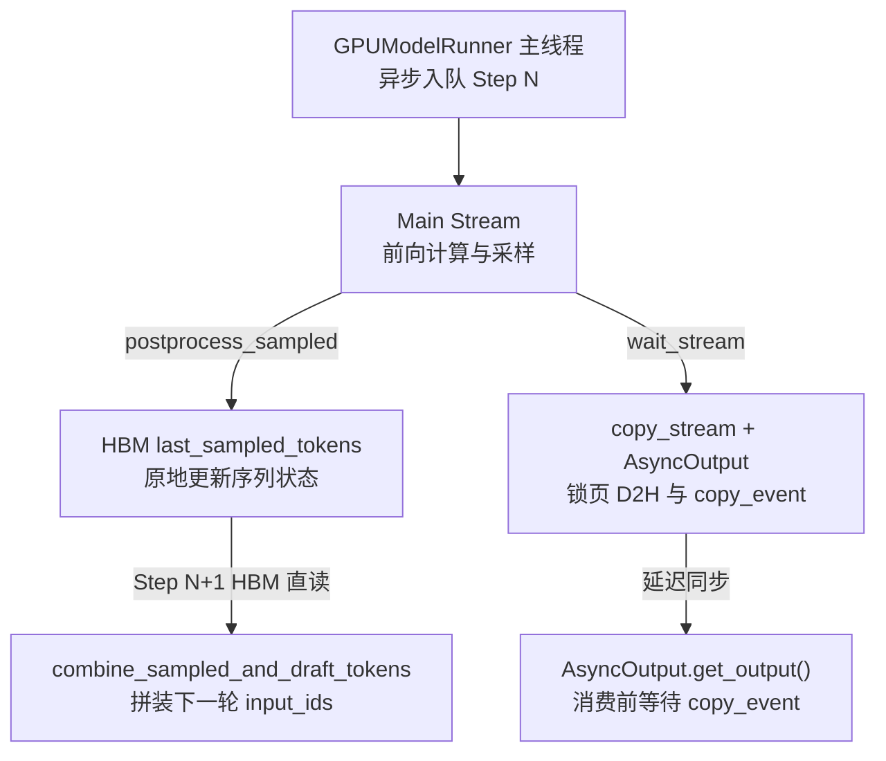
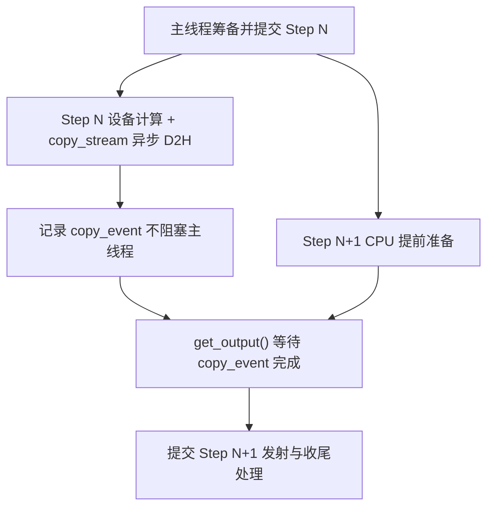
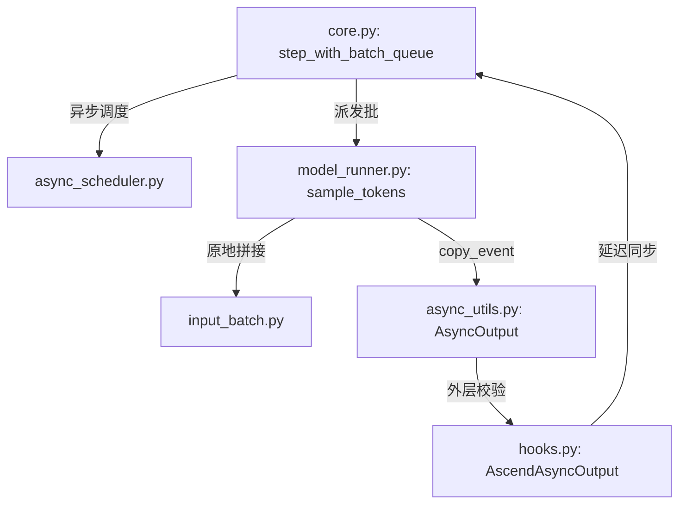

[ModelRunner V2](../05-worker-and-model-runner-v2/) 把请求状态常驻显存并压扁了跨步输入组装的拷贝开销，但小批量 **Decode（解码）**的 **Trace（执行时间线）**上仍会出现显著失衡。计算单元上的每个 Kernel 只跑短短几微秒，算子之间的硬件时间轨却留出大片空白间隔。

这种硬件等待源于 CPU 主机侧的指令供给速度落后于设备消耗速度，在推理系统中称为 **Launch Wall（发射墙）**。在真实集群上，Python 线程通过 PyTorch C++ **Dispatcher（算子分发器）**向底层计算驱动提交单个轻量算子通常需要 5–15 μs。一个 60 层 Transformer 单步前向要穿过数百个归一化、激活、线性投影与残差加法节点，累计主机下发耗时往往达到 2–5 ms。

## 同步发射、异步 FIFO 与两种瓶颈形态

要看清空闲间隔从何而来，我们先从最朴素的**同步发射模式**算起。如果 CPU 每发起一个算子就阻塞等待设备算完返回，那么顺序执行 $N$ 个算子的总耗时为两侧耗时之和：

$$
T_{\text{sync}} = \sum_{i=1}^{N} (t_{\text{cpu}, i} + t_{\text{dev}, i})
$$

其中 $t_{\text{cpu}, i}$ 为第 $i$ 个算子在主机侧的解析与提交耗时，$t_{\text{dev}, i}$ 为硬件执行耗时。按等比例缩放的算术参数取 $5$ 个算子、$t_{\text{cpu}} = 0.8\text{ ms}$、$t_{\text{dev}} = 0.6\text{ ms}$，同步串行总耗时达到 $5 \times (0.8 + 0.6) = 7.00\text{ ms}$，设备利用率只有 $3.0 / 7.0 = 42.9\%$。

PyTorch 默认采用**异步 FIFO（First-In First-Out，先进先出）队列**打破逐个等待，底层硬件流与事件同步机制见[异构执行流](../../execgraph/01-heterogeneous-streams-and-events/)。Python 线程把任务描述符压入 **CUDA Stream（计算流）**等设备任务队列后立刻返回，硬件则从队头连续消费。

设第 $i$ 个算子由主机完成提交的时刻为 $t_{\text{cpu}}^{(i)}$，在设备完成执行的时刻为 $t_{\text{dev}}^{(i)}$（初始 $t_{\text{cpu}}^{(0)} = t_{\text{dev}}^{(0)} = 0$），异步流时序满足如下递推关系：

$$
\begin{aligned}
t_{\text{cpu}}^{(i)} &= t_{\text{cpu}}^{(i-1)} + t_{\text{cpu}, i} \\
t_{\text{dev}}^{(i)} &= \max\bigl(t_{\text{cpu}}^{(i)},\; t_{\text{dev}}^{(i-1)}\bigr) + t_{\text{dev}, i}
\end{aligned}
$$

从这组递推式可以看出，异步入队在不同负载比例下会呈现出两种瓶颈形态。第一种情况是 **Compute-bound（计算或访存主导，$t_{\text{dev}} \ge t_{\text{cpu}}$）**，常见于较大批量的 **Prefill（预填充）**阶段。取等比例缩放参数 $t_{\text{cpu}} = 0.6\text{ ms} < t_{\text{dev}} = 0.8\text{ ms}$，第 1 个算子在 $0.60\text{ ms}$ 入队后，CPU 在 $3.00\text{ ms}$ 就把全部 $5$ 个算子填进队列，而硬件需要运行到 $0.6 + 5 \times 0.8 = 4.60\text{ ms}$。

队列提前积攒出排队库存，把除首算子外的启动延迟完全掩盖，设备利用率升至 $87.0\%$（扩展到 $60$ 个算子时达 $98.8\%$）。但只要代码在结尾处调用一次 `.item()`、`.cpu()` 或 `torch.nonzero()`，主机就必须阻塞 $1.60\text{ ms}$ 等整条队列排空，已攒出的异步缓冲随之清零。

第二种情况则是 **Launch-bound（发射主导，$t_{\text{cpu}} > t_{\text{dev}}$）**，这正是小批量解码的真实处境。取 $t_{\text{cpu}} = 0.8\text{ ms} > t_{\text{dev}} = 0.6\text{ ms}$（对应实机 5–15 μs 下发耗时对比 2–3 μs 小批量算子），设备在 $1.40\text{ ms}$ 算完第 1 个算子时，CPU 要等到 $1.60\text{ ms}$ 才提交完第 2 个算子。

由于每个算子恒有 $t_{\text{cpu}}^{(i)} > t_{\text{dev}}^{(i-1)}$，FIFO 队列里永远攒不出库存，硬件在每两个算子之间都要空等 $(t_{\text{cpu}} - t_{\text{dev}})$。对于连续 $N$ 个同类发射受限算子，总耗时化简为：

$$
T_{\text{launch\_bound}} = \sum_{i=1}^{N} t_{\text{cpu}, i} + t_{\text{dev}, N}
$$

即便代码里一处 `.item()` 同步都不写，发射受限场景的设备利用率也存在渐近天花板 $t_{\text{dev}} / t_{\text{cpu}}$（例如 $0.6 / 0.8 = 75.0\%$，而在 3 μs 对 10 μs 的实机比例下上限仅约 30%）。如图 1 与图 2 所示，同步串行、异步 FIFO 积攒、`.item()` 同步屏障以及发射受限场景的双泳道差异非常直观。

 同步清空对比')



## 跨步异步调度与两阶段采样交接

把视角从单步内部拉高到连续推理步之间，还会碰到一个表面上矛盾的数据依赖。自回归生成时，Step $N+1$ 的模型输入恰好就是 Step $N$ 刚刚采样出的新 token。如果 CPU 不等设备把采样结果经 **D2H（Device-to-Host，设备到主机拷贝）**传回主机，调度器又怎么提前编排并提交 Step $N+1$ 的前向计算？

vLLM V1 通过**调度器乐观占位**、**设备侧持久化状态衔接**与**独立拷贝流延迟兑现**三段协作解开了这个环[^vllm-async-core][^vllm-async-sched][^vllm-mrv2-runner]。在核心调度循环 `step_with_batch_queue` 中，引擎维护一个长度为 `batch_queue_size` 的在途批队列，允许 CPU 领先设备向前推进[^vllm-async-core]。

启用异步调度后，`AsyncScheduler` 在 Step $N$ 结束时就为解码请求提前登记 `num_output_placeholders` 输出占位计数[^vllm-async-sched]。若开启投机解码，它还会同步预留占位 Draft 槽位，仅在结构化输出语法掩码未就绪或请求到达 `max_tokens` 上限时才暂缓占位。

更关键的依赖消除发生在模型执行器内部：Step $N$ 采样出的 token 只供**设备上下一步词嵌入层**使用，无需交回 CPU 调度器读取。

如图 3 所示，MRV2 让 CPU 修改 `self.states` 而 GPU 只读临时快照 `tmp_states`，在不加异步屏障锁的情况下消除竞态[^vllm-mrv2-runner]。随后主计算流运行 `postprocess_sampled`，将新 token ID 原地写入 `last_sampled_tokens` 并递增已算计数[^vllm-mrv2-runner][^vllm-input-batch]。


Step $N+1$ 的异步批指令随后到达执行器时，输入拼装 Kernel 在主计算流上直接读取 `last_sampled_tokens` 填充下一轮 `input_ids` 缓冲[^vllm-input-batch]。整条 token ID 传递链全程留在 **HBM（High Bandwidth Memory，高带宽显存）**内部，由同一计算流的入队顺序保证可见性，CPU 无需得知具体数字即可提前发射下一轮算子。

与此同时，为了把采样结果最终交还外层调度器用于停机判断与文本返回，执行器会在调用 `postprocess_sampled` 前构造 `AsyncOutput`（如图 4 所示）[^vllm-mrv2-runner][^vllm-async-output]。它先让独立的 `copy_stream` 等待主计算流到达采样完成点，再以 `non_blocking=True` 将采样 token ID 与数量异步拷向 CPU **Pinned Memory（锁页内存）**。随后 `copy_stream` 记录 `copy_event`，主线程立刻恢复执行。



如此一来，CPU 在后台 **DMA（Direct Memory Access，直接内存访问）**引擎搬运 Step $N$ 采样结果的同时，已经开始组织并提交 Step $N+1$ 的计算任务。直到引擎必须读取真实 token 序列检查停止符或返回客户端时，才调用 `get_output()` 执行 `copy_event.synchronize()` 兑现同步[^vllm-async-output]。图 5 与图 6 概括了跨步调度、输入准备与 GPU 执行的三轨时间片交错流水。




## 异步调度与输出封装源码结构

跨步异步调度的工程代码分布在引擎循环、调度器、模型运行器与异步拷贝辅助类四个目录中。顺着单步请求流转，可以在下面这组文件里分别查到主机编排队列、占位状态、设备侧原地拼装以及延迟同步封装：

```text
vllm/v1/
├── engine/
│   └── core.py                       # step_with_batch_queue 维护在途批队列
├── core/sched/
│   └── async_scheduler.py            # AsyncScheduler 预增占位输出计数
└── worker/gpu/
    ├── model_runner.py               # prepare_inputs 与 sample_tokens 主入口
    ├── input_batch.py                # 合并上步采样结果并原地更新状态矩阵
    └── async_utils.py                # AsyncOutput 借助 copy_stream 异步 D2H

vllm_ascend/observability/runtime_guard/
└── hooks.py                          # AscendAsyncOutput 延迟同步后执行采样检查
```

如图 7 所示，主线程借由 `EngineCore` 在途队列把第 $N+1$ 步的调度与第 $N$ 步的设备计算错开。执行端则通过 `AsyncOutput` 把真实 `.synchronize()` 延后到 `get_output()` 被消费的那一刻：



对照上游源码片段，GPU 侧 `AsyncOutput` 与昇腾外层 `AscendAsyncOutput` 保持了完全一致的非阻塞契约[^vllm-async-output][^ascend-async-guard]。昇腾 NPU 的 `TaskQueue` 异步流水与锁页计数维护细节见[vLLM-Ascend 第 3 章](../../vllm-ascend/03-npu-worker-runner-and-kv-layout/)。

```python
# Upstream: vllm/v1/worker/gpu/async_utils.py:147-193 (vllm@99b0b0b0)
with stream(copy_stream, main_stream):
    copy_stream.wait_stream(main_stream)
    self.sampled_token_ids = async_copy_to_np(sampler_output.sampled_token_ids)
    self.copy_event.record(copy_stream)
# 在需要消费数据时才触发同步:
self.copy_event.synchronize()

# Upstream: vllm_ascend/observability/runtime_guard/hooks.py:332-346 (vllm-ascend@b776261)
class AscendAsyncOutput(AsyncModelRunnerOutput):
    def get_output(self) -> ModelRunnerOutput:
        output = self._inner.get_output()
        _safe_check_after_sample(self._runner, output)
        return output
```

| 异步执行维度      | vLLM GPU（`AsyncOutput`）                   | 昇腾适配（[vLLM-Ascend 第 3 章](../../vllm-ascend/03-npu-worker-runner-and-kv-layout/)） |
| ----------------- | ------------------------------------------- | ---------------------------------------------------------------------------------------- |
| 非阻塞异步封装    | `AsyncOutput` 继承 `AsyncModelRunnerOutput` | `AscendAsyncOutput` 包装内层 `AsyncOutput`                                               |
| 异步 D2H 拷贝路径 | 独立 `copy_stream` + 锁页内存非阻塞拷贝     | 继承 `copy_stream` 锁页回传与 `TaskQueue`                                                |
| 延迟同步与检查    | `get_output` 调用 `copy_event.synchronize`  | 同步并裁剪后触发采样检错，拦截主线程同步                                                 |

跨步异步调度藏起了步间编排与 D2H 拷贝延迟，单步 `model.forward()` 的主机发射墙则仍需交由下层 `torch.compile` 与静态图抹平（详见[图编译基础](../../execgraph/02-torch-compile-fundamentals/)）。把异步执行扩展到多副本数据并行与跨节点服务时，各 DP 副本的静态图对齐与 PD 分离场景的 KV 交接会带来新的协调问题。这部分机制将在[第 7 章：多卡 DP 协同与 PD 分离 KV 传输](../07-dp-coordination-and-kv-transfer/)展开。

[^vllm-async-core]: `vllm`（commit `99b0b0b0`），`vllm/v1/engine/core.py:746-871`（`EngineCore.step_with_batch_queue` 维护在途批队列并重叠下轮调度与输出等待）。

[^vllm-async-sched]: `vllm`（commit `99b0b0b0`），`vllm/v1/core/sched/async_scheduler.py:18-62`（`AsyncScheduler._update_after_schedule` 预增 `num_output_placeholders` 与占位草稿位）。

[^vllm-mrv2-runner]: `vllm`（commit `99b0b0b0`），`vllm/v1/worker/gpu/model_runner.py:1616-1627`（`prepare_inputs` 调用 `combine_sampled_and_draft_tokens`）及 `2377-2424`（`sample_tokens` 先构建 `AsyncOutput` 再调用 `postprocess_sampled`）。

[^vllm-input-batch]: `vllm`（commit `99b0b0b0`），`vllm/v1/worker/gpu/input_batch.py:414-513`（`_combine_sampled_and_draft_tokens_kernel` 从设备侧读取 `last_sampled_tokens`）与 `565-686`（`_post_update_kernel` 原地更新设备请求状态）。

[^vllm-async-output]: `vllm`（commit `99b0b0b0`），`vllm/v1/worker/gpu/async_utils.py:117-240`（`AsyncOutput` 在 `copy_stream` 异步拷贝至锁页内存并记录 `copy_event`，由 `get_output` 触发事件同步）。

[^ascend-async-guard]: `vllm-ascend`（commit `b776261`），`vllm_ascend/observability/runtime_guard/hooks.py:319-350`（`AscendAsyncOutput` 推迟至 `get_output` 完成 D2H 裁剪后再执行采样检查）。
