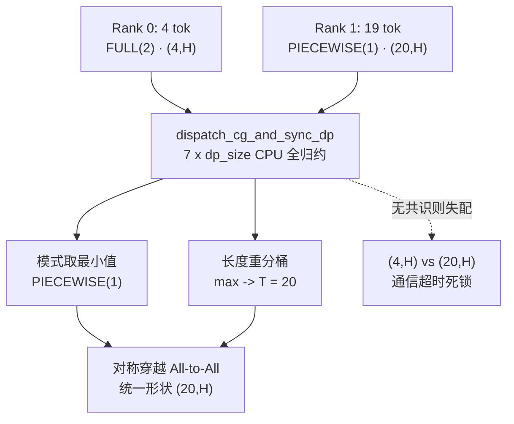
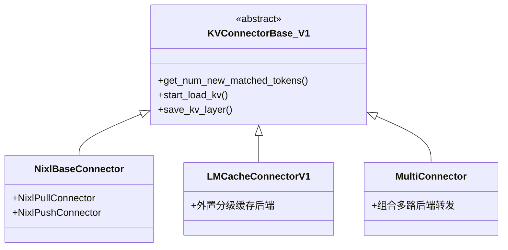
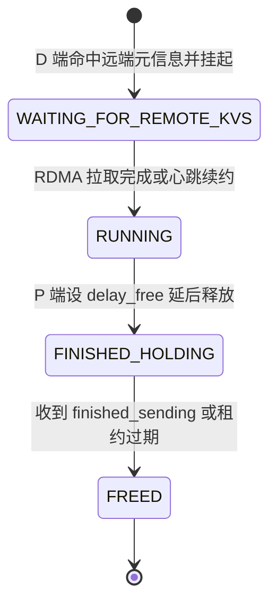
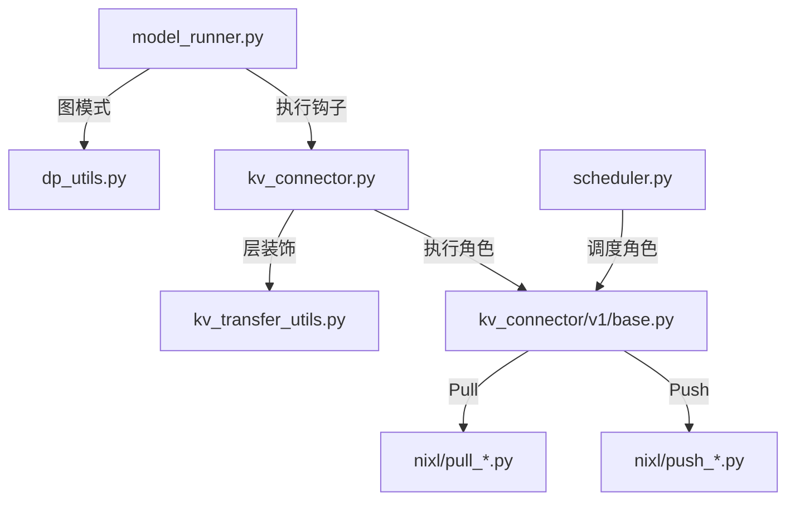

在[第 2 章：运行拓扑、并行映射与进程通信](../02-runtime-topology-and-parallel-mapping/)和[第 6 章：异步执行模型与发射墙](../06-async-execution-and-launch-wall/)里，多副本由 `DPCoordinator` 统一统筹波次，单节点则靠异步流水线压低发射延迟。当推理服务迈入多机多卡集群后，执行栈还要面对两道跨进程协同边界。同一数据并行组内的各卡必须先对齐图模式，以免集合通信死锁；预填充与解码拆分部署后，跨实例的块缓存与调度状态也需要安全交接。

## 多卡 DP 共识与集合通信防死锁

理解跨卡图模式对齐，需要先区分两类集群拓扑。对普通稠密模型做标准 **DP（Data Parallelism，数据并行）**部署时，每张卡持有完整权重并在本地前向，层间没有跨副本的激活交换。此时即便 Rank 0 跑整图、Rank 1 跑分段图，双方各自推进也互不干扰。

进入 **MoE（Mixture-of-Experts，混合专家架构）**混合并行后，情况发生质变。前序注意力仍在各 DP 卡本地计算，紧接着的专家分发与合并却必须在融合通信组内执行跨卡 `All-to-All` 集合通信[^vllm-dp-utils]。这里每张卡按 **EP（Expert Parallelism，专家并行）**持有部分路由专家，通信长度和计算图状态必须全组一致。

假设某一步中，Rank 0 仅承载 $4$ 个解码 token 并准备走 `FULL` 整图，张量形状为 `(4, H)`。Rank 1 却混排了 $19$ 个预填充与解码 token，按分桶对齐到 $20$ 并退回 `PIECEWISE` 分段图，张量形状为 `(20, H)`。两卡抵达同一层 `All-to-All` 时不仅张量长度失配，算子入图状态也不统一，直接触发通信超时或死锁。

为此，`GPUModelRunner` 在每次前向计算前都会调用 `dispatch_cg_and_sync_dp`，在主机端完成一轮不阻塞设备计算流的联合裁决[^vllm-dp-utils][^vllm-model-runner]。各卡在 CPU 上把批长度、图模式枚举、`uniform_token_count` 与其余 $4$ 项约束写入 $7 \times \text{dp\_size}$ 整数张量，再执行 `cpu_all_reduce_()` 完成全组交换[^vllm-dp-utils]。

若开启集群容错，协议还会先做主机侧张量并行屏障，并剔除已失效副本的列再聚合结果[^vllm-dp-utils]。随后所有存活卡按同一套保守规则落地执行参数：全局图模式取枚举最小值（`NONE = 0`、`PIECEWISE = 1`、`FULL = 2`），只要任意一卡降级，全组同步降级。

若仍有卡维持静态图执行，全组取活卡中的最大 token 数在共享档位中重新查表对齐，并保留本地请求数以免分段图触发多余填充[^vllm-dp-utils]。一旦各卡对均匀查询长度意见不一，统一置为 `None` 并退出均匀解码路径。

沿用前面的 `(4, FULL)` 与 `(19, PIECEWISE)` 示例，全组最终一致对齐到 `PIECEWISE` 与分桶 $T = 20$。所有副本从而以对称形状 `(20, H)` 穿越每一层 `All-to-All`，流程如图 1 所示。



主机共识输出包装在 `BatchExecutionDescriptor` 与 `DPSyncState` 中，直接驱动下游执行图管理器。GPU 端交由 `ModelCudaGraphManager` 查表命中整图或分段图[^vllm-cudagraph-utils]，单卡三层包装契约见[《推理执行图》第 4 章](../../execgraph/04-vllm-cudagraph-modes/)。昇腾 NPU 端则由 `ModelAclGraphManager` 协同通信算子执行，详见[《vLLM-Ascend》第 4 章](../../vllm-ascend/04-hccl-mc2-and-dynamic-eplb/)。

## 多节点内部负载均衡与单引擎阶段隔离

未配置外部转发时，多机多副本服务启用内部负载均衡 `DPLBAsyncMPClient`。各节点上的 `API Server` 与 `EngineCore` 通过共享套接字与 `DPCoordinator` 构成如图 2 所示的控制面网络。


同组多卡步调一致后，另一项架构矛盾来自阶段混合部署。Prefill（预填充）偏爱大批量矩阵乘与计算吞吐，Decode（解码）依赖低延迟访存。把两者挤在同一个 `EngineCore` 内，长上下文计算仍会拉高解码尾延迟，生产集群因此普遍拆分为独立 P/D 实例，如[《分布式并行与跨卡通信》第 2 章](../../distributed/02-parallelism-and-disaggregation/)所述。

vLLM 未改动核心引擎主循环，而是抽象出双角色接口 `KVConnectorBase_V1` 与混合组接口 `SupportsHMA`，类继承与角色分工如图 3 所示[^vllm-kv-base]。



连接器按 `KVConnectorRole` 在两类进程中分别实例化：`SCHEDULER` 随核心调度引擎探测远端命中并签发延迟释放，`WORKER` 随工作进程注册显存并驱动异步搬运。近期官方博客还基于双描述符视图将 NIXL PD 分离扩展至 Mamba 混合 SSM 架构[^vllm-ssm-disagg]。混合注意力场景下，连接器实现 `SupportsHMA` 后由 `request_finished_all_groups` 统一交付多组块列表[^vllm-kv-base][^vllm-sched-hook]。

## 调度端状态机与延迟释放租约

在调度引擎内部，`Scheduler` 通过远端匹配、块分配更新与完成回调三个固定钩子接入跨机状态[^vllm-sched-hook]。如图 4 所示，请求借助 `WAITING_FOR_REMOTE_KVS` 挂起等待拉取。P 端则靠 `delay_free` 标记延后物理块回收[^vllm-sched-hook][^vllm-nixl-lease][^vllm-nixl-pull-sched]。



P 端若在计算完立刻回收块，D 端 **RDMA（Remote Direct Memory Access，远程直接内存访问）**读取就会读到被覆写的脏数据[^vllm-sched-hook]。因此连接器签发初始 $30$ 秒的可续期租约[^vllm-nixl-lease]：D 端每 $5$ 秒发送批量心跳顺延 $20$ 秒；若 D 端失联则 P 端超时自动回收，D 端读前也会重检截止时间将过期任务归入 `failed_recving`[^vllm-nixl-lease][^vllm-nixl-pull-worker]。

## 执行端异步加载与逐层挂接

调度器生成的连接器元数据随 `SchedulerOutput` 广播给各卡的 Worker。随后 `GPUModelRunner` 经 `ActiveKVConnector` 驱动连接器的 `WORKER` 角色搬运数据[^vllm-gpu-kv][^vllm-model-runner]。

在模型前向之前，`pre_forward` 先调用 `handle_preemptions` 处理被抢占请求并绑定元数据[^vllm-gpu-kv]。只有需要同步加载的本地外部缓存才在前向之前触发 `start_load_kv`；PD 分离等异步远端读取则推迟到 `post_forward` 内部发射，以免把控制面准备开销放入关键计算路径[^vllm-gpu-kv]。

支持边计算边传输的连接器，会在注意力函数外层挂载 `@maybe_transfer_kv_layer` 装饰器[^vllm-kv-utils]。进入第 $i$ 层前调用 `wait_for_layer_load` 等待该层键值就绪，算出键值写回缓存后立即调用 `save_kv_layer` 异步写出。

因为 `FULL` 整图重放会跳过图外 Python 回调，逐层连接器必须重写 `requires_piecewise_for_cudagraph` 并返回真[^vllm-kv-base]。该声明强制引擎退回分段图执行，从而在分段之间保留 Python 同步点。

步末阶段，`post_forward` 先调用 `wait_for_save()` 完成保存同步，再调用 `get_transfer_results` 汇总异步状态[^vllm-kv-base][^vllm-gpu-kv]。返回对象包含 `finished_sending`、`finished_recving` 与 `failed_recving` 三个请求集合。

`EngineCore` 收到回传后同步完成两件事：放行 D 端处于 `WAITING_FOR_REMOTE_KVS` 状态的请求进入解码，并回收 P 端已完成投递的缓存块[^vllm-sched-hook]。图 5 上半部分串联了这两套角色的跨步交互，下半部分则对比了三种传输时序差异。


## Pull 与 Push 逐层流水权衡

在相同的 `KVConnectorBase_V1` 协议骨架下，数据传输方向与粒度直接决定了 P 端显存驻留时长和用户感知的首字延迟。上游 NIXL 与昇腾 Mooncake 生态演化出三类典型实现，核心权衡如下表所示：

| 传输模式       | 触发方向与粒度             | P 端持块与显存驻留          | 适用场景与工程前提                                                                        |
| -------------- | -------------------------- | --------------------------- | ----------------------------------------------------------------------------------------- |
| NIXL Pull      | D 端在等待队列主动 READ    | 跨排队与整块传输全程锁定    | 默认稳健路径，P 无需预知目标 D 地址[^vllm-nixl-pull-worker]                               |
| NIXL Push      | D 预注册，P 后台线程 WRITE | 写完即刻释放，省去 D 排队锁 | 减少通知往返，需额外 `nixl-push-writer` 线程[^vllm-nixl-push-doc][^vllm-nixl-push-worker] |
| Layerwise Push | 逐层计算完即触发写出       | 传输与后续层计算并行重叠    | 首字延迟更低，依赖分段图与逐层回调[^vllm-kv-utils][^ascend-mooncake-layerwise]            |

在默认 Pull 模式下，P 端需跑完全部 $L$ 层预填充并由 `request_finished` 返回元信息。请求经代理落入 D 端排队后，才由 `NixlPullConnectorWorker` 发起 `NIXL READ`[^vllm-nixl-pull-worker]。整块拉完并由 D 端向所有源卡发回完成通知后，P 端才会解锁显存[^vllm-nixl-pull-worker]。

为了剪掉 D 端入队等待和反拉往返，NIXL 提供了基于 `NIXL WRITE` 的 Push 模式[^vllm-nixl-push-doc][^vllm-nixl-push-sched]。D 端在 `update_state_after_alloc` 分配好目标块后，通过 `PUSH_REG` 消息把逻辑块号和通信地址提前推送给 P 端的专用后台写线程 `nixl-push-writer`[^vllm-nixl-push-worker]。P 端预填充一结束，写线程立刻把块配对并直接写入 D 端显存，大幅缩短请求完成后的 P 端驻留窗口。

更进一步的做法是逐层流水推送。上游 `NixlConnector` 当前仍以请求粒度提交整批读写操作，其 `save_kv_layer` 为空实现[^vllm-nixl-facade]。借助 `KVConnectorBase_V1` 的逐层钩子，第 $0$ 层算完即可与后续层前向并行下发通信，时序如图 5 下段所示。

在华为昇腾侧，`vllm-ascend` 围绕 Mooncake 引擎落地了常规 Pull 与 `MooncakeLayerwiseConnector` 边算边推[^ascend-mooncake-layerwise]。针对主机中转场景，它还实现了先转存本机 2 MiB 大页内存再由对端拉取的 `MooncakeD2RHConnectorV1`[^ascend-mooncake-d2rh]。这三类昇腾侧传输栈将在[《vLLM-Ascend》第 5 章](../../vllm-ascend/05-mooncake-pd-and-kv-pool/)展开细节。

## 多卡协同与 KV 连接器源码结构

多卡 DP 共识与 PD 分离传输分属 `v1/worker/gpu/` 与 `distributed/kv_transfer/` 两条源码目录树。前者的目标是在前向计算前统一各副本的图模式与补齐长度，后者则把控制面的调度决策与执行面的显存传输拆进双角色接口中。

```text
vllm/
├── v1/worker/gpu/
│   ├── dp_utils.py                 # dispatch_cg_and_sync_dp 与主机全归约共识
│   ├── cudagraph_utils.py          # BatchExecutionDescriptor 与静态图模式裁决
│   ├── kv_connector.py             # ActiveKVConnector 管理 pre/post_forward 钩子
│   └── model_runner.py             # 前向入口：先对齐 DP 再触发连接器传输
├── v1/core/sched/
│   └── scheduler.py                # 调度侧挂接匹配、挂起与 delay_free 租约
├── model_executor/layers/attention/
│   └── kv_transfer_utils.py        # maybe_transfer_kv_layer 逐层加载与保存装饰器
└── distributed/kv_transfer/kv_connector/v1/
    ├── base.py                     # KVConnectorBase_V1 抽象基类与 SupportsHMA 混入
    ├── multi_connector.py          # MultiConnector 组合多路后端
    └── nixl/
        ├── connector.py            # NixlPullConnector / NixlPushConnector 门面类
        ├── pull_scheduler.py       # Pull 模式调度侧元数据与释放协调
        ├── pull_worker.py          # Pull 模式执行端异步拉取与完成状态收集
        ├── push_scheduler.py       # Push 模式调度侧地址登记
        └── push_worker.py          # Push 模式专用 nixl-push-writer 后台写线程
```

如图 6 所示，阅读跨实例协同代码时可沿两条线切入：左路跟踪运行器如何对齐多卡图模式，右路跟踪连接器如何在调度进程与 Worker 进程中各自实例化不同角色：



下表总结了多卡 DP 共识与 PD 分离连接器在双仓中的核心落点：

| 集群协同与传输维度 | GPU（`vllm` `99b0b0b0`）                  | 昇腾 NPU（`vllm-ascend` `b776261`）                 |
| ------------------ | ----------------------------------------- | --------------------------------------------------- |
| 多卡 DP 图模式共识 | `dispatch_cg_and_sync_dp` 主机全归约      | 复用主机共识协议对齐批次与图模式                    |
| PD 分离抽象接口    | `KVConnectorBase_V1` 双角色与 HMA 混入    | 继承同接口体系拓展 Mooncake 与主机中转连接器        |
| 传输模式与逐层流水 | `NixlPullConnector` / `NixlPushConnector` | Mooncake Pull / `MooncakeLayerwiseConnector` / D2RH |

当 DP 共识锁住跨卡形状对称、双角色连接器接管好跨实例显存交接后，在线推理集群的运行骨架已经完整落地。接下来要解决的则是单步生成带宽受限与智能体输出可控性两道高阶问题，下一章[08 投机解码引擎、拒绝采样与异步回退](../08-speculative-decoding-engine/)将展开多步草稿生成（Propose / Draft）与异步验证机制。

[^vllm-dp-utils]: `vllm` 项目（commit `99b0b0b0`），`vllm/v1/worker/gpu/dp_utils.py:49-369` 中的 `sync_cudagraph_and_dp_padding` 与 `dispatch_cg_and_sync_dp`（通过 `cpu_all_reduce_` 聚合 7 项调度状态并取保守图模式与最大 token 上限），Apache-2.0。

[^vllm-model-runner]: `vllm` 项目（commit `99b0b0b0`），`vllm/v1/worker/gpu/model_runner.py:1933-1955, 2177-2221, 2390-2393`（调用 `dispatch_cg_and_sync_dp` 并在前向前后驱动 `kv_connector` 生命周期），Apache-2.0。

[^vllm-cudagraph-utils]: `vllm` 项目（commit `99b0b0b0`），`vllm/v1/worker/gpu/cudagraph_utils.py:74-142, 154-641` 中的 `BatchExecutionDescriptor`、`CudaGraphManager` 与 `ModelCudaGraphManager`，Apache-2.0。

[^vllm-kv-base]: `vllm` 项目（commit `99b0b0b0`），`vllm/distributed/kv_transfer/kv_connector/v1/base.py:89-146, 373-783` 中的 `KVConnectorTransferResults`、`SupportsHMA`、`KVConnectorRole` 与 `KVConnectorBase_V1`，Apache-2.0。

[^vllm-sched-hook]: `vllm` 项目（commit `99b0b0b0`），`vllm/v1/core/sched/scheduler.py:1152-1174, 1536-1595, 1818-1821, 3220-3258, 3537-3595, 3727-3792`（调度器集成远端匹配、块登记、`WAITING_FOR_REMOTE_KVS` 挂起与延迟释放），Apache-2.0。

[^vllm-nixl-lease]: `vllm` 项目（commit `99b0b0b0`），`docs/design/nixl_kv_cache_lease.md:17-92`（默认 30s 租期、心跳批量续期与陈旧读取安全边际校验），Apache-2.0。

[^vllm-nixl-pull-sched]: `vllm` 项目（commit `99b0b0b0`），`vllm/distributed/kv_transfer/kv_connector/v1/nixl/pull_scheduler.py:37-301` 中的 `NixlPullConnectorScheduler`，Apache-2.0。

[^vllm-gpu-kv]: `vllm` 项目（commit `99b0b0b0`），`vllm/v1/worker/gpu/kv_connector.py:65-184` 中的 `ActiveKVConnector`（`pre_forward`、`post_forward` 与 `finalize_step`），Apache-2.0。

[^vllm-kv-utils]: `vllm` 项目（commit `99b0b0b0`），`vllm/model_executor/layers/attention/kv_transfer_utils.py:15-61` 中的 `@maybe_transfer_kv_layer`（在注意力算子前后触发 `wait_for_layer_load` 与 `save_kv_layer`），Apache-2.0。

[^vllm-nixl-pull-worker]: `vllm` 项目（commit `99b0b0b0`），`vllm/distributed/kv_transfer/kv_connector/v1/nixl/pull_worker.py:49-127, 537-826` 中的 `NixlPullConnectorWorker` 与 `vllm/distributed/kv_transfer/kv_connector/v1/nixl/base_worker.py:3482-3524` 中的 `get_transfer_results`，Apache-2.0。

[^vllm-nixl-push-doc]: `vllm` 项目（commit `99b0b0b0`），`docs/design/nixl_kv_push_connector.md:1-194, 299-385`（`PUSH_REG` 线格式、双表匹配与写线程唤醒模型），Apache-2.0。

[^vllm-nixl-push-sched]: `vllm` 项目（commit `99b0b0b0`），`vllm/distributed/kv_transfer/kv_connector/v1/nixl/push_scheduler.py:54-357` 中的 `NixlPushConnectorScheduler`，Apache-2.0。

[^vllm-nixl-push-worker]: `vllm` 项目（commit `99b0b0b0`），`vllm/distributed/kv_transfer/kv_connector/v1/nixl/push_worker.py:85-280, 885-925` 中的 `NixlPushConnectorWorker`（`nixl-push-writer` 写线程与状态清理），Apache-2.0。

[^vllm-nixl-facade]: `vllm` 项目（commit `99b0b0b0`），`vllm/distributed/kv_transfer/kv_connector/v1/nixl/connector.py:323-336, 374-420` 中的 `NixlPullConnector` 与 `NixlPushConnector`，Apache-2.0。

[^ascend-mooncake-layerwise]: `vllm-ascend` 项目（commit `b776261`），`vllm_ascend/distributed/kv_transfer/kv_p2p/mooncake_layerwise_connector.py:214-240, 835-905` 中的 `MooncakeLayerwiseConnector`，Apache-2.0。

[^ascend-mooncake-d2rh]: `vllm-ascend` 项目（commit `b776261`），`vllm_ascend/distributed/kv_transfer/kv_p2p/mooncake_d2rh_connector.py:463-515, 727-845` 中的 `D2RHCPUCacheManager` 与 `D2RHThread`，Apache-2.0。

[^vllm-ssm-disagg]: 官方工程博客 [_Disaggregated Serving for Hybrid SSM Models in vLLM_](https://vllm.ai/blog/2026-04-21-hybrid-ssm-disagg)（混合状态空间模型在 NIXL PD 分离下的双描述符块映射）。
