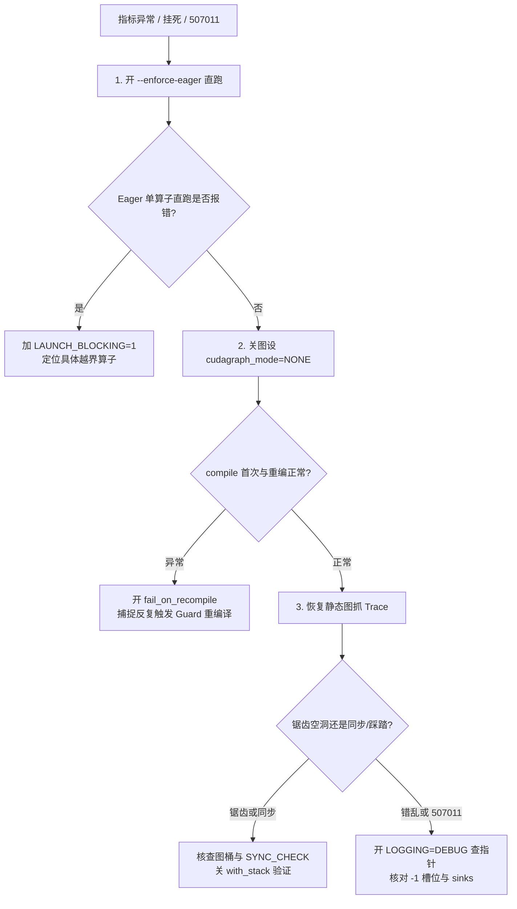

import ProfilerSignaturesExplainer from '../../../../explainers/vllm/ProfilerSignaturesExplainer';

当推理引擎把连续批调度、异步发射队列、无 Guard 分段编译以及静态图重放全部串联运行后，线上压测与新模型适配期的问题很少表现为明显的语法报错，更常见的是服务吞吐跌落、解码间隔周期性拉长、多卡集合通信挂死，或模型间歇吐出乱码。排查这类运行期缺陷的第一步，是把业务侧感知的服务指标拆解到对应的硬件子系统与调度环节。

## 推理服务时延指标与观测映射

评价大模型在线推理服务通常盯住三个核心指标：**首字延迟（Time to First Token，TTFT）**、**解码步间延迟（Time Per Output Token，TPOT，也常按逐 token 间隔记为 ITL）**以及**有效吞吐（Goodput）**。TTFT 度量请求进入系统到吐出第一个输出 token 所经历的时间，主要受调度队列排队等待时间、前缀缓存（prefix cache）命中率以及 Prefill 阶段矩阵乘算力吞吐支配；一旦 TTFT 恶化，观测焦点应落在长提示词分块（chunked prefill）占比、`token_budget` 排队拥堵与 TensorCore / Cube 算力利用率上。

TPOT 度量自回归生成阶段连续输出两个 token 之间的平均时间间隔。由于每步解码只处理少量新 token 却要完整搬运一次模型权重与历史 KV Cache，健康的解码步应当受限于高带宽显存（HBM）的访存带宽；倘若 TPOT 在低并发时就异常偏高，往往意味着静态图未能命中而退回 CPU 逐算子发射（Launch Wall）或混入了主机同步等待，而 TPOT 的长尾毛刺则多源自 KV 显存不足触发的请求抢占（preemption）或跨卡同步长尾等待。Goodput 进一步把吞吐约束在同时满足 TTFT 与 TPOT 服务等级目标（SLO）的请求范围内——盲目放大并发批大小虽然能推高总 token 产出率，但一旦引起 Prefill 阻塞或频繁抢占使尾部延迟越过 SLO 阈值，有效吞吐反而会显著下降。

| 业务观测指标     | 主导硬件与调度瓶颈               | 首选核查观测目标                    |
| ---------------- | -------------------------------- | ----------------------------------- |
| 首字延迟 TTFT    | 调度排队、Prefill 算力与分块配额 | 队列深度、前缀命中率与 Cube 利用率  |
| 解码延迟 TPOT    | HBM 带宽、发射墙与静态图回退     | 图桶命中率、Host 发射间隔与同步等待 |
| 有效吞吐 Goodput | SLO 约束下的并发混排与 KV 抢占   | 分块抢占次数与 DP 跨卡同步尾延迟    |

## Trace 采集工具链与采样失真规避

把指标异常落实到算子时间线，需要借助平台剖析器采集主机（Host）与设备（Device）双轨 Trace。在 NVIDIA GPU 上，vLLM 通过 `ProfilerConfig` 封装了 `torch`、`cuda` 与 Triton `proton` 三种采集模式[^vllm-profiler-cfg]；追求接近零开销的真实时间线时序时，通常首选 Nsight Systems（`nsys profile --trace-fork-before-exec=true --cuda-graph-trace=node`）[^vllm-profiling-doc]，把调度线程、CUDA API 与静态图内部重放节点完整摊在同一条时间轴上。在华为昇腾 NPU 上，`TorchNPUProfilerWrapper` 调用 `torch_npu.profiler` 并开启 `ProfilerLevel.Level1` 与 `AiCMetrics.PipeUtilization`，同时导出 CPU 调度事件以及 NPU 上 Cube 计算单元、Vector 向量单元与 MTE 数据搬运引擎的利用率占比[^ascend-profiler]。

采集性能时序 Trace 时，必须避开两个极易扭曲分析结论的配置陷阱。第一项是**做延迟与吞吐归因时务必关闭 `with_stack=True`**（即传入 `--profiler-config.torch_profiler_with_stack=false`；在昇腾侧对应 `with_modules` 参数）[^vllm-profiler-cfg][^ascend-profiler]。`ProfilerConfig` 默认开启该选项以方便定位代码调用栈，但开启后 PyTorch 会在每一次算子发射时在主机侧现场回溯 Python 调用栈，给每次提交额外增加数微秒的 CPU 开销。在一个本身健康的分段图或 Eager 短区间上，这笔采集开销会把 Host 发射块拉得比 Device 内核还要宽，人为制造出“CPU 发射跟不上硬件”的锯齿假指纹，误导排障方向。

第二项陷阱针对昇腾平台：`TorchNPUProfilerWrapper` 启用 `torch_npu.profiler` 时，严禁同时开启常驻监控守护进程 `msmonitor_use_daemon`[^ascend-profiler]。两者都会抢占底层 CANN 性能计数器与事件采集通道，并行开启不仅会导致数据损坏，Wrapper 初始化时也会直接检测到冲突并抛出异常中断启动。

## 五类 Profiler 轨迹指纹诊断

获取干净的 Trace 文件后，我们可以通过主机发射轨、设备计算轨与通信轨的相对形态，将大多数线上异常归类到五种典型时间线指纹中。下面的交互诊断面板对比了健康基线与四类故障指纹在三轨上的时序特征，可通过步进切换逐一观察。

<ProfilerSignaturesExplainer
  client:visible
  title="图 1：nsys 与 torch_npu.profiler 五类故障指纹诊断推演"
/>

健康重放基线呈现最紧凑的时序结构（图 1 第 1 步）。Host Python 轨上只出现一根持续约 0.08 ms 的单次图重放发射条（`cudaGraphLaunch` 或昇腾 `aclmdlRI` 重放实例），随后主机线程立刻进入下一轮步进元数据准备；设备轨上的 Norm、Attention、MoE 与 Head 等算子首尾紧贴，几乎没有空闲缝隙，算力或带宽利用率稳定维持在 90% 以上，HCCL / NCCL 拷贝与通信则藏在计算流重叠窗口内。

启动受限锯齿指纹则暴露了静态图静默退回（图 1 第 2 步）。在确认已关闭 `with_stack=True` 的前提下，如果设备轨被无数空白间隔切碎，同时主机轨密密麻麻排满宽度甚至超过算子自身执行时间的逐算子发射块，说明模型请求绕过了静态图分桶，退回到了逐算子 Eager 或 `CUDAGraphMode.NONE` 路径。常见诱因包括批大小超出最大捕获档位且未配置分桶回退、注意力后端因混合批能力受限触发启动期降级，或 `splitting_ops` 遗漏导致整段编译失败。

主机隐式同步墙指纹表现为突发性全流排空（图 1 第 3 步）。当时间线上突然出现长条状阻塞调用（`cudaStreamSynchronize` 或 `aclrtSynchronizeStream`）且紧邻一次 4 字节的设备到主机（D2H）拷贝，同时设备轨计算队列已经执行完前序算子并陷入大段空白空转时，几乎可以断定热路径中混入了 `.item()`、`.cpu()` 或 `torch.nonzero()` 等主机同步读写操作，迫使异步发射流水线排空等待。

跨卡长尾等待指纹常发生在数据并行结合专家并行的 MoE 集群中（图 1 第 4 步）。此时快卡（例如仅处理少量短解码请求的 Rank 0）本地计算耗时极短，但进入 `NCCL` / `HCCL` 通信轨后却出现大段空等块，根源往往是同伴卡（例如 Rank 1）承接了超长上下文 Prefill 计算导致 Attention 耗时翻倍，或者 `dispatch_cg_and_sync_dp` 阶段未正确收齐负载，令快卡长期停在 `All-to-All` 集合屏障前空等。

最隐蔽的一类是脏 Padding 尾部越界覆写与异步内存错误指纹（图 1 第 5 步）。从时间线外观上看，主机仍只发射一条图重放指令，设备计算块也紧凑无空洞，但线上输出却间歇出现乱码，或在昇腾设备上于后续无关同步点触发异步错误码 507011。这类故障的根因通常有二：要么批大小缩容时忘记将超出真实 token 数的尾部 `slot_mapping` 刷写为 `PAD_SLOT_ID = -1`，令重放 Kernel 带着脏指针覆写其他请求的 KV 物理块[^vllm-block-table][^vllm-attn-utils]；要么如第 6 章所述，传入异步 `FULL` 图的持久缓冲（如 `sinks`）生命周期提前结束[^ascend-sparse-mla]。

## 从指标异常到二分隔离与诊断开关

面对复杂模型或新硬件驱动栈暴露出的混合故障，同时打开 `torch.compile`、静态图重放与异步调度会让根因难以拆解。把服务症状、四步二分隔离法与两端平台的诊断环境变量串联起来，就能沿唯一分支逐步剥离问题层，具体排障决策路径如图 2 所示。



沿图 2 逐层下钻时，四组开关逐层缩小范围：首先用 `--enforce-eager` 绕过全部编译与静态图封装，如果在 Eager 单算子直跑阶段依然报错或数值失真，打开 `CUDA_LAUNCH_BLOCKING=1`（GPU）或 `ASCEND_LAUNCH_BLOCKING=1`（NPU）强迫每个算子同步提交，把异步越界错误精确定位到触发它的那一行算子[^vllm-troubleshoot]。

若 Eager 单算子直跑完全正常，再放开 `VLLM_COMPILE` 但把 `--compilation-config` 中的 `cudagraph_mode` 设为 `NONE`，专门隔离 `split_graph` 与后端编译（如 `Inductor` 或 `npugraph_ex`）引入的错误；若怀疑运行期因动态输入反复触发重编译，可借助 `torch.compiler.set_stance("fail_on_recompile")` 拦截隐藏的 Guard 失败[^vllm-wrapper]。确认编译子图无误后再恢复静态图捕获，此时结合 `VLLM_LOGGING_LEVEL=DEBUG` 自动校对每次重放的输入张量 `data_ptr()` 是否漂移[^vllm-cudagraph-wrapper][^ascend-aclgraph]，配合 `VLLM_GPU_SYNC_CHECK` 抓出隐式同步点[^vllm-sync-debug]，最终核查 `PAD_SLOT_ID = -1` 尾部刷写与长效张量生命周期，即可把绝大部分隐蔽问题定位清楚。

## 跨请求静默污染复现与双仓对照

为了直观验证第 5 类故障的破坏力，下面的自包含 PyTorch 脚本构造了一段跨请求 KV 缓存污染复现：物理 KV 池共有 8 个槽位，正在健康解码的请求 Req B 占用物理块 `[4, 5]` 并拥有干净的注意力输出基准；同一时刻，同批静态图（容量 $B_{\text{cap}} = 4$）上的请求 Req A 从上一步的 $B = 4$（曾用槽 `[0, 1, 4, 5]`）缩容为本步的 $B = 2$（仅用 `[0, 1]`），且其第 3、4 槽填充位置带有垃圾激活值。脚本对比了“未刷写尾部槽位导致直接覆写物理块 4 和 5”与“刷写 `PAD_SLOT_ID = -1` 并由 `slot >= 0` 掩码跳过写回”两种路径下，Req B 注意力输出余弦相似度与最大绝对误差的显著差异。

```python
import torch
import torch.nn.functional as F

PAD_SLOT_ID = -1
NUM_PHYSICAL_SLOTS = 8
SINK_SLOT = NUM_PHYSICAL_SLOTS

# 物理 KV 池末尾多挂 1 个 Padding 吸收槽（Sink slot），用于在固定形状下模拟核内 slot >= 0 跳过写回
kv_pool_ext = torch.zeros((NUM_PHYSICAL_SLOTS + 1, 4), dtype=torch.float32)
kv_pool_ext[4] = torch.tensor([1.0, 2.0, -1.0, 0.5])
kv_pool_ext[5] = torch.tensor([-0.5, 1.5, 2.0, -1.0])
q_b = torch.tensor([[1.0, 0.5, -0.5, 1.0]], dtype=torch.float32)


def attn_req_b(pool_ext: torch.Tensor) -> torch.Tensor:
    """计算健康请求 Req B 在物理槽 [4, 5] 上的注意力输出。"""
    k = pool_ext[4:6]
    scores = torch.softmax((q_b @ k.T) / (4 ** 0.5), dim=-1)
    return scores @ k


ref_out_b = attn_req_b(kv_pool_ext)

# Req A 本步从 B=4 缩容为 B=2（实际占用物理槽 [0, 1]），尾部填充位带入无效激活
new_kv_a = torch.tensor(
    [
        [0.2, 0.1, 0.3, 0.4],
        [0.5, 0.2, 0.1, 0.3],
        [-4.0, -3.0, 4.0, -2.0],
        [-3.0, -4.0, 3.0, -3.0],
    ],
    dtype=torch.float32,
)

# 故障路径：静态图尾部残留上轮旧槽位 [4, 5]，越界覆写 Req B 的活跃 KV 块
buggy_pool = kv_pool_ext.clone()
buggy_slots = torch.tensor([0, 1, 4, 5], dtype=torch.int64)
buggy_pool.index_copy_(0, buggy_slots, new_kv_a)
corrupted_out_b = attn_req_b(buggy_pool)

# 修复路径：尾部刷写为 PAD_SLOT_ID = -1，由 slot >= 0 掩码屏蔽物理块写入
fixed_pool = kv_pool_ext.clone()
fixed_slots = torch.tensor([0, 1, PAD_SLOT_ID, PAD_SLOT_ID], dtype=torch.int64)
routed_slots = torch.where(fixed_slots >= 0, fixed_slots, SINK_SLOT)
fixed_pool.index_copy_(0, routed_slots, new_kv_a)
safe_out_b = attn_req_b(fixed_pool)

cos_buggy = F.cosine_similarity(ref_out_b, corrupted_out_b, dim=-1).mean().item()
err_buggy = (ref_out_b - corrupted_out_b).abs().max().item()
cos_fixed = F.cosine_similarity(ref_out_b, safe_out_b, dim=-1).mean().item()
err_fixed = (ref_out_b - safe_out_b).abs().max().item()
assert err_fixed == 0.0 and cos_buggy < 0.0 and err_buggy > 1.0

print(f"buggy_req_b: cos_sim={cos_buggy:.6f}, max_err={err_buggy:.6f}")
print(f"fixed_req_b: cos_sim={cos_fixed:.6f}, max_err={err_fixed:.6f}")
```

运行上述验证脚本，输出如下：

```text
buggy_req_b: cos_sim=-0.891582, max_err=5.457450
fixed_req_b: cos_sim=1.000000, max_err=0.000000
```

在未刷写 $-1$ 槽位的情况下，仅两个填充位置越界写入就让无关请求 Req B 的注意力输出方向完全反转（余弦相似度跌至 $-0.891582$，最大误差达 $5.457450$）；而加入 `PAD_SLOT_ID = -1` 擦除与 `slot >= 0` 掩码保护后，Req B 物理块保持完整，输出误差严格归零。下表归纳了双仓在观测工具、调试检查与越界隔离上的工程实现。

| 观测与诊断维度     | NVIDIA GPU（`vllm` `bb23c0a8`）               | 华为昇腾 NPU（`vllm-ascend` `3649b8ff`）                    |
| ------------------ | --------------------------------------------- | ----------------------------------------------------------- |
| Profiler 引擎封装  | `ProfilerConfig` 驱动 `torch`/`cuda`/`proton` | `TorchNPUProfilerWrapper`（`PipeUtilization` 禁并用）       |
| 地址与同步调试开关 | `VLLM_LOGGING_LEVEL=DEBUG` 与同步检测钩子     | `ACLGraphWrapper` Debug 态指针断言与 `device_print`         |
| 同步定界与异步错误 | `CUDA_LAUNCH_BLOCKING=1` 定位算子报错现场     | `ASCEND_LAUNCH_BLOCKING=1` 捕获 207008 与 507011 现场       |
| 脏尾部写入槽防护   | `BlockTables` 槽位 Kernel 擦除 $-1$ 槽        | 复用 $-1$ 槽规则并校验持久 `sinks` 引用[^ascend-sparse-mla] |

从连续批调度的 KV 块池与异步发射队列，到无 Guard 分段编译、静态图四道硬边界、三层同心包装、DP 跨卡共识、昇腾 `UpdatableGraph` 热更新以及最终的 Profiler 观测与二分定位，推理引擎运行时的七个环节构成了一条从服务指标到底层硬件指令流的可验证运行链路。如需回顾各层模块的全局依赖，可返回[《vLLM 与昇腾推理引擎》导览](../)，或对照[《推理与异构硬件基础》](../../foundations/)、[《分布式并行与跨卡通信》](../../distributed/)与[《DeepSeek 架构演进》](../../deepseek/)进一步查看底层算子、跨卡通信与前沿模型结构之间的接口契约。

[^vllm-profiler-cfg]: `vllm` 项目（commit `bb23c0a8`），`vllm/config/profiler.py:65-145` 中的 `ProfilerConfig`（`torch` / `cuda` / `proton` 采集模式与默认开启的 `torch_profiler_with_stack`）及 `vllm/profiler/wrapper.py:240-310`。

[^vllm-profiling-doc]: `vllm` 项目（commit `bb23c0a8`），`docs/contributing/profiling.md:1-65, 231-265`（Nsight Systems `nsys profile --trace-fork-before-exec=true --cuda-graph-trace=node` 与 PyTorch Profiler 开销说明）。

[^ascend-profiler]: `vllm-ascend` 项目（commit `3649b8ff`），`vllm_ascend/profiler/torch_npu_profiler.py:29-86` 中的 `TorchNPUProfilerWrapper`（`ProfilerLevel.Level1`、`AiCMetrics.PipeUtilization`、`with_modules` 开销注释及与 `msmonitor_use_daemon` 的互斥异常）。

[^vllm-block-table]: `vllm` 项目（commit `bb23c0a8`），`vllm/v1/worker/gpu/block_table.py:346-427` 中的 `_compute_slot_mappings_kernel`（从真实 token 数到 `max_num_tokens` 刷写 `PAD_ID = -1`）。

[^vllm-attn-utils]: `vllm` 项目（commit `bb23c0a8`），`vllm/v1/attention/backends/utils.py:55` 中的 `PAD_SLOT_ID = -1`。

[^ascend-sparse-mla]: `vllm-ascend` 项目（commit `3649b8ff`），`vllm_ascend/attention/sparse_flash_mla.py:63-78` 中的 `_ensure_sinks`（长效引用约束与异步报错 507011）。

[^vllm-troubleshoot]: `vllm` 项目（commit `bb23c0a8`），`docs/usage/troubleshooting.md:39`（使用 `CUDA_LAUNCH_BLOCKING=1` 定位算子故障）及 `vllm-ascend` 集成测试配置 `ASCEND_LAUNCH_BLOCKING`。

[^vllm-wrapper]: `vllm` 项目（commit `bb23c0a8`），`vllm/compilation/wrapper.py:220-229`（`torch.compiler.set_stance("fail_on_recompile")` 重编译拦截）。

[^vllm-cudagraph-wrapper]: `vllm` 项目（commit `bb23c0a8`），`vllm/compilation/cuda_graph.py:190, 343-352`（`VLLM_LOGGING_LEVEL=DEBUG` 地址一致性检查）。

[^ascend-aclgraph]: `vllm-ascend` 项目（commit `3649b8ff`），`vllm_ascend/compilation/acl_graph.py:118, 235-290`（`ACLGraphWrapper` Debug 态指针断言及 207008 资源上限提示）。

[^vllm-sync-debug]: `vllm` 项目（commit `bb23c0a8`），`vllm/utils/gpu_sync_debug.py:30-83`（`VLLM_GPU_SYNC_CHECK` 主机-设备同步检测）。
