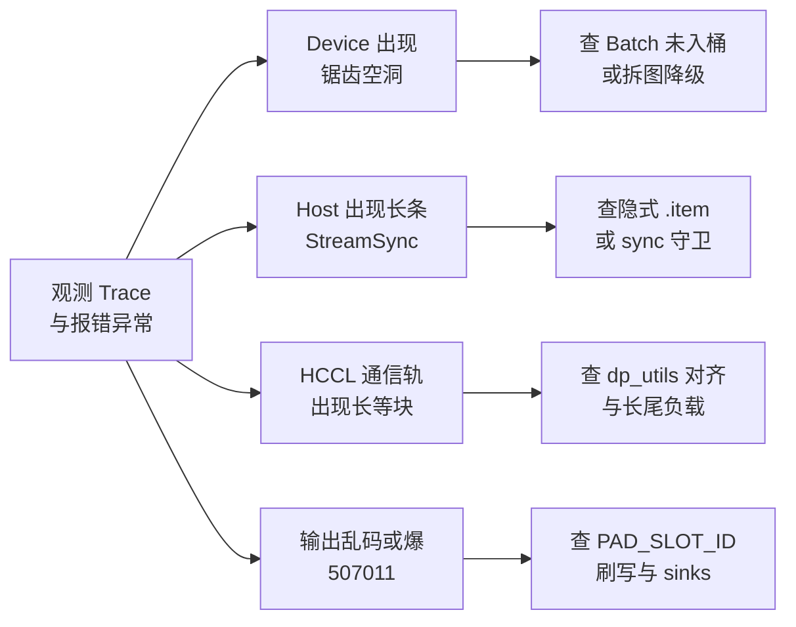
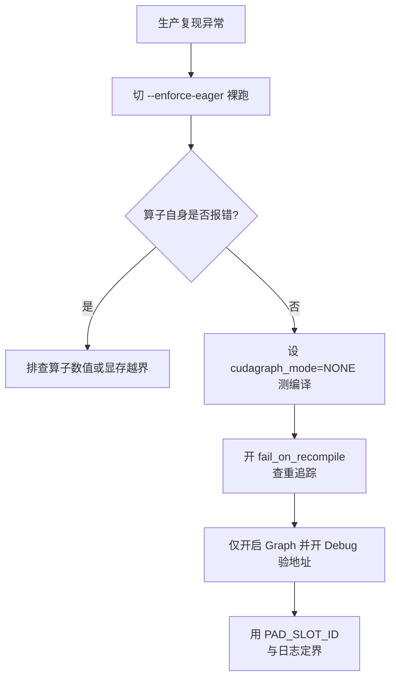

import ProfilerSignaturesExplainer from '../../../../explainers/vllm/ProfilerSignaturesExplainer';

经过前六章的拆解，我们已经把 GPU 与昇腾 NPU 从调度、异步流水、分段编译到静态图与 DP 对齐的整个架构拼合完整。然而在线上压测与模型适配过程中，引擎很少因为明显语法错误崩溃，更常见的是**性能突然掉回 Eager、莫名挂死、或是无声无息地吐出乱码**。

真正厉害的推理引擎工程师，并不靠“盲猜改参数”排障，而是打开 Nsight Systems（`nsys`）或 `torch_npu.profiler`，一眼从时间线指纹直接反推出对应源码模块。

## 五类真实 Profiler 故障指纹交互诊断

在采集 Trace 前，需记住两项平台采样配置要点：GPU 侧通过 `ProfilerConfig` 配置 `torch` / `cuda` / `proton` 三类采集器[^1]；而 Ascend 侧的 `TorchNPUProfilerWrapper` 使用 `torch_npu.profiler`（`ProfilerLevel.Level1` 与 `AiCMetrics.PipeUtilization`），官方源码明确警告**不要轻易开启耗时的 `with_stack`（映射到 `with_modules`），也不能与守护进程 `msmonitor_use_daemon` 同时开启**[^2]。

拿到时间轴后，先用**图 1** 的交互诊断面板逐一核对健康基线与四类典型病态指纹：

<ProfilerSignaturesExplainer
  client:visible
  title="图 1：nsys 与 torch_npu.profiler 五类故障指纹诊断推演"
/>

顺着**图 1** 的五个步进特征，我们可以精确读懂每张 Trace 的弦外之音：

1. **健康指纹（Step 1）**：`Host` 轨仅有一根 `0.08 ms` 左右的窄发射棒（`cudaGraphLaunch` / `aclmdlRI`），而 `Device` 轨几乎填满连续计算块，利用率超过 $90\%$。
2. **启动受限锯齿（Step 2）**：`Host` 轨堆满比核函数还宽的密集发射调用，`Device` 轨碎成无数空白间隔——这是典型静默掉回 `--enforce-eager` 或 `CUDAGraphMode.NONE` 的铁证。
3. **Host 隐式同步墙（Step 3）**：时间线上冒出阻塞整步的 `cudaStreamSynchronize` / `aclrtSynchronizeStream` 以及紧邻的 4 字节 D2H 传回，说明某处漏出了 `.item()` 或 `torch.nonzero()`。
4. **DP 跨卡长尾等待（Step 4）**：`HCCL` / `NCCL` 通信轨突然出现大段阻塞等待，根源在于某卡长序列 Prefill 计算慢或 `dp_utils` 对齐异常。
5. **脏 Padding 尾部写穿（Step 5）**：图本身正常重放不卡顿，但业务输出间歇乱码，或触发底层异步越界陷阱 **`507011`**——往往是 Batch 从大变小（例如 $B=4 \to 2$）时未将尾部槽位刷回 `PAD_SLOT_ID = -1`[^3]。

## 五类症状根因决策树与二分排障流

为了在半夜告警响应中实现秒级归因，**图 2** 总结了面向以上五类症状的根因定位树；而一旦需要现场复现隔离，则按**图 3** 的四步二分法剥离编译、静图、重编与具体层问题。



当面对一个完全陌生的模型或新硬件升级导致的崩坏时，遵循**图 3** 的二分隔离原则可以避免把 Eager 算子 Bug、Dynamo 编译 Bug 与 CUDA/ACL Graph 地址 Bug 混为一谈：先用 `--enforce-eager` 验清裸算子正确性；再以 `cudagraph_mode=NONE` 仅验证分段编译；随后打开重编译失败中断捕捉隐藏动态 Guard；最终锁定精确失效算子与层号。



## PyTorch 脏 Padding 复现与双仓调试对照

下面这段自包含的 PyTorch 测试代码直观再现了最隐蔽的第 5 类故障：第 1 步 $B=4$ 写入槽 `[2, 3, 4, 5]` 后，第 2 步批缩小至 $B=2$ 仅改写前两位而不把 `[2:]` 置 `-1`，会导致 `new_keys` 的无效激活直接污染物理位置 `[4, 5]`：

```python
import torch

PAD_SLOT_ID = -1
kv_blocks = torch.zeros(16, dtype=torch.float32)

# Step N (B=4): 正常写入物理槽 [2, 3, 4, 5]
slot_mapping = torch.tensor([2, 3, 4, 5], dtype=torch.int64)
kv_blocks[slot_mapping] = torch.tensor([10.0, 11.0, 12.0, 13.0])

# Step N+1 (缩容为 B=2): 尾部填充位置带入垃圾值 999.0
new_keys = torch.tensor([20.0, 21.0, 999.0, 999.0])
buggy_slots = slot_mapping.clone()
buggy_slots[:2] = torch.tensor([6, 7])
buggy_kv = kv_blocks.clone()
buggy_kv[buggy_slots] = new_keys  # 未刷写 [-1]，槽 4 和 5 被 999.0 覆写破坏!
assert buggy_kv[4].item() == 999.0 and buggy_kv[5].item() == 999.0

# 正确修复: 缩容尾部显式置 PAD_SLOT_ID = -1，写前掩码跳过
fixed_slots = buggy_slots.clone()
fixed_slots[2:] = PAD_SLOT_ID
fixed_kv = kv_blocks.clone()
mask = fixed_slots >= 0
fixed_kv[fixed_slots[mask]] = new_keys[mask]
assert fixed_kv[4].item() == 12.0 and fixed_kv[5].item() == 13.0
```

在 `torch 2.15.0` 上运行该片段精确复现损坏与保护差异：
`buggy_kv[4:6]=[999.0, 999.0], fixed_kv[4:6]=[12.0, 13.0]`。

| 观测与诊断维度        | NVIDIA GPU（`vllm` `bb23c0a8`）                               | 华为昇腾 NPU（`vllm-ascend` `3649b8ff`）                             |
| --------------------- | ------------------------------------------------------------- | -------------------------------------------------------------------- |
| Profiler 引擎封装     | `ProfilerConfig` 支持 `torch`/`cuda`/`proton`[^1]             | `TorchNPUProfilerWrapper`（`PipeUtilization`，禁与 daemon 并用）[^2] |
| 地址漂移 Debug 检查   | `VLLM_LOGGING_LEVEL=DEBUG` 自动断言输入 `data_ptr()`          | 同左，`ACLGraphWrapper` Debug 态逐一核对输入地址                     |
| 静态图资源 / 内存陷阱 | `CUDA_LAUNCH_BLOCKING=1` 抓同步现场                           | `207008` 流上限、`507011` 释放态读写异步报错提示[^4]                 |
| 脏尾部写入槽防护      | `_compute_slot_mappings_kernel` 强制刷 `PAD_SLOT_ID = -1`[^3] | 复用 `PAD_SLOT_ID = -1` 规则防止向量散列写入踩踏                     |

走到这里，你已经顺着真实工业级代码的纹理，走完了从 PagedAttention 连续批调度、异步发射队列、无 Guard 分段编译、CUDA Graph 四大边界、DP 跨卡共识、昇腾 ACLGraph 热更新直到 Profiler 指纹定位的全部七章。

你可以随时回到[vLLM 与昇腾推理引擎导览](../)梳理全局依赖关系，或结合[基础底座](../../foundations/)、[分布式并行](../../distributed/)与[DeepSeek 架构演进](../../deepseek/)对照前沿模型算子设计（MLA、DSA、MoE、Engram 与 mHC）与底层执行运行时之间环环相扣的设计契约。

[^1]: `vllm/config/profiler.py`（`bb23c0a8`），`ProfilerConfig` 定义了 `torch`、`cuda` 与 `proton` 采集后端与参数规范。

[^2]: `vllm_ascend/profiler/torch_npu_profiler.py`（`3649b8ff`），`TorchNPUProfilerWrapper` 配置 `Level1` + `PipeUtilization` 并禁与 `msmonitor_use_daemon` 混用。

[^3]: `vllm/v1/attention/backends/utils.py` & `vllm/v1/worker/gpu/block_table.py`（`bb23c0a8`），`PAD_SLOT_ID = -1` 与尾部覆写逻辑。

[^4]: `vllm_ascend/attention/sparse_flash_mla.py`（`3649b8ff`），详细记录了生命周期失效引起异步报错 `507011` 的排障线索。
