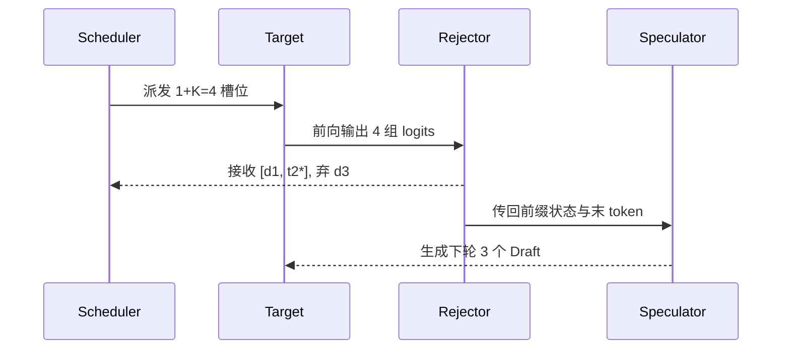
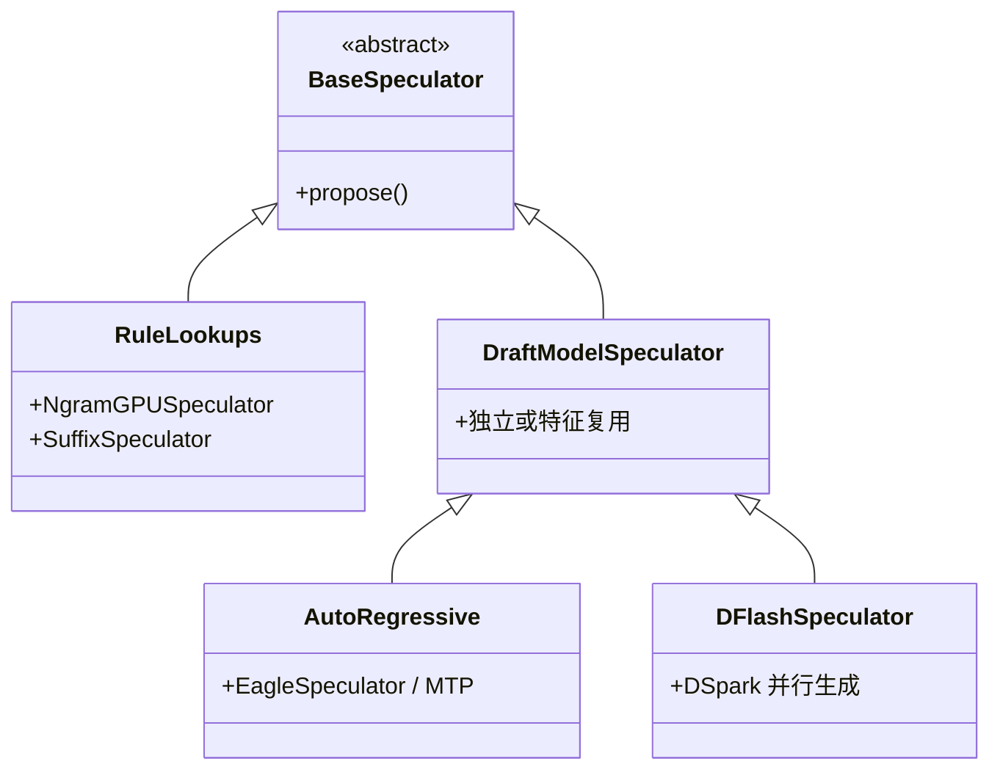
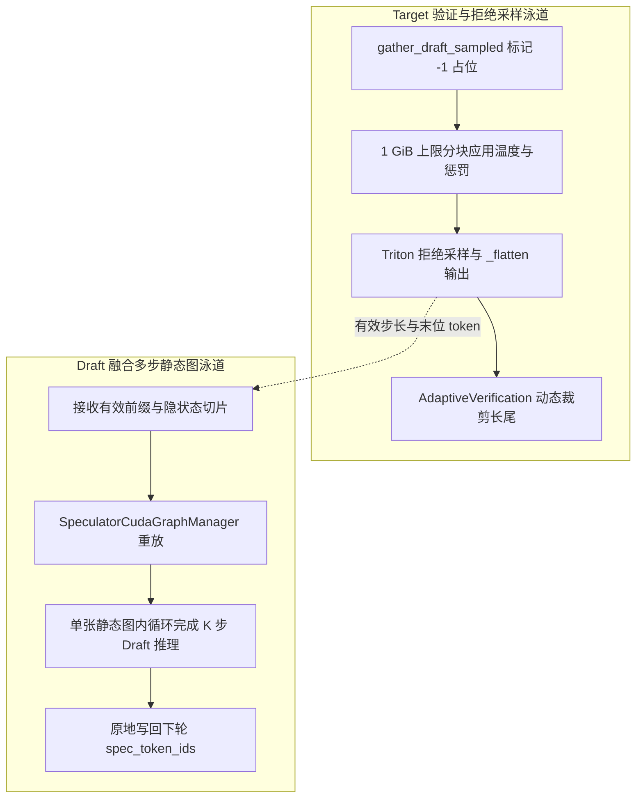
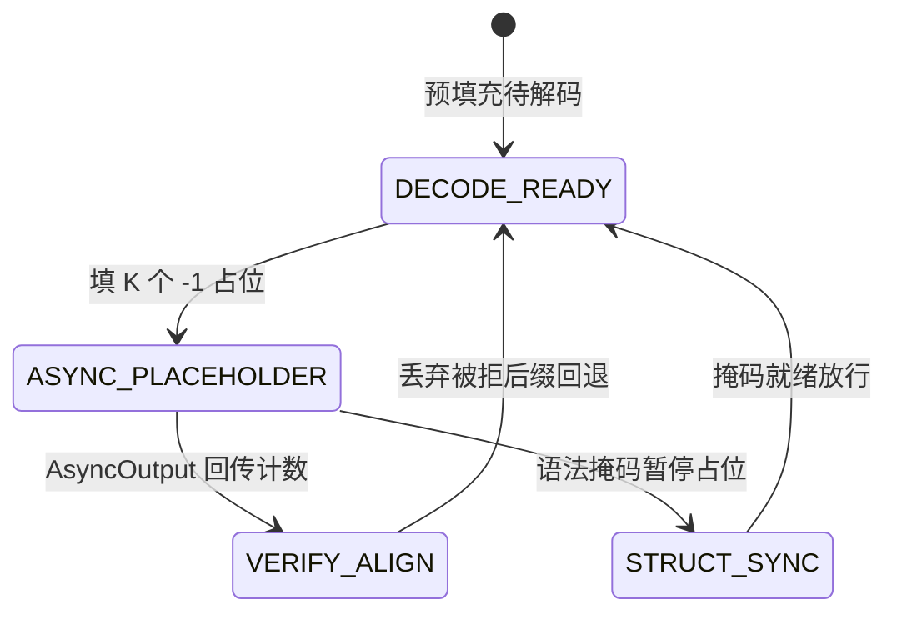
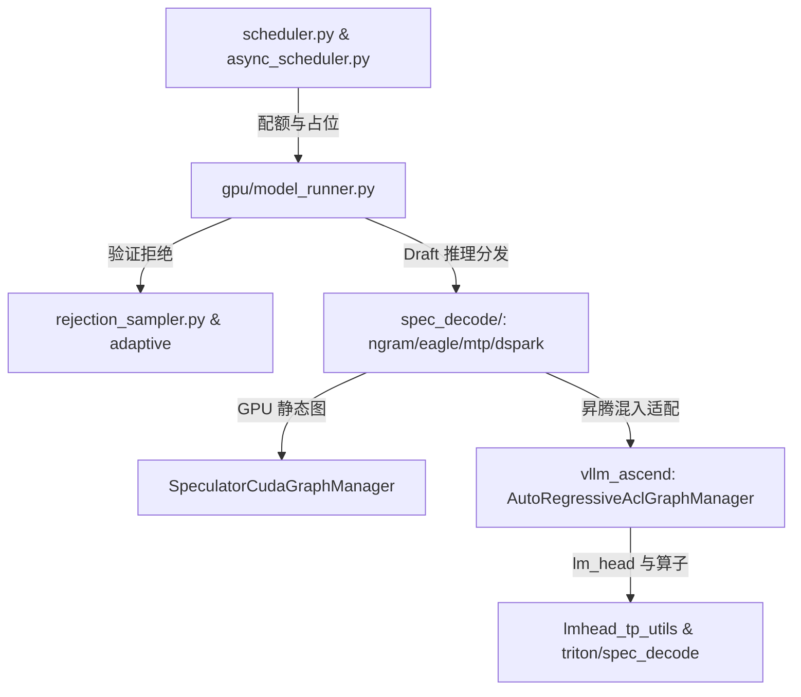

在[《DeepSeek 架构演进》第 9 章](../../deepseek/09-mtp-and-dspark/)中，我们推导过 **Speculative Decoding（投机解码）**的无损拒绝采样定理。该章同时对比了 DeepSeek-V3 因果 MTP 与 V4.1 DSpark 并行草稿模型。

但把“先猜 $K$ 个 token、目标模型一次验证 $1 + K$ 个位置”落地到在线引擎时，真正的挑战才刚刚开始。统一调度器如何扣减配额与物理块？被拒绝的草稿后缀如何在异步占位与 HBM 状态表中回退？本章回到 `vllm` 与 `vllm-ascend` 运行时本身，拆解整条引擎链路。

## 单步草稿验证与回退机制

先用一组小规模参数跟踪单步验证过程。设目标模型配置 `num_speculative_tokens` 为 $3$，已算长度 `num_computed_tokens` 为 $10$。本步需验证基准输入及 $3$ 个 Draft token `[d1, d2, d3]`，共计 $1 + 3 = 4$ 个 token。

在统一调度循环 `Scheduler.schedule()` 中，系统先为该请求预留 $4$ 槽计算配额，并确保 KV 块表能容纳推进后的全部物理槽位[^vllm-sched-spec]。目标模型一次前向只需搬运一次完整权重，并行产出 $4$ 组概率分布向量。

进入 `RejectionSampler` 后[^vllm-rej-sampler]，位置 $0$ 上的 `d1` 命中采样接受规则被保留，位置 $1$ 上的 `d2` 被拒绝并从残差分布重采样为修正 token `t2*`，尾部 `d3` 随之废弃。

本步实际有效前进量为 $2$ 个 token，状态回写遵循三条硬约束：

- **有效输出写回**：向客户端输出 `[d1, t2*]`，持久化已算进度从 $10$ 推进到 $12$，而非 $14$。
- **未命中后缀作废**：`d3` 对应的 KV 槽位无需昂贵清零，留在旧游标外侧由下轮新 token 自然覆写。
- **权重带宽摊销**：单次权重读取产出了 $2$ 个合法 token，若下一轮 Draft 全中，单步最多推进 $1 + K = 4$ 个 token。

图 1 展示了单步内从草稿生成（Propose / Draft）、目标批量前向到拒绝重采样与下轮生成的完整交互时序。



## V1 候选生成器家族与选型权衡

不同业务对显存与接受率的要求各异。vLLM V1 通过 `BaseSpeculator` 与 `DraftModelSpeculator` 抽象出五类 **Speculator（候选生成器）**，继承关系如图 2 所示[^vllm-spec-base]。



围绕无权重规则、隐藏特征复用与独立并行生成三条设计方向，五类方案在工程代价上各有取舍[^vllm-spec-ngram][^vllm-spec-suffix][^vllm-spec-eagle]：

| 候选生成器家族 | 典型代表类                  | 额外权重开销      | Draft 推理耗时特征 | 适用负载与关键约束                                           |
| :------------- | :-------------------------- | :---------------- | :----------------- | :----------------------------------------------------------- |
| 前缀查找类     | `NgramGPUSpeculator`        | 零权重、零 KV 占  | 微秒级 token 匹配  | 适合 RAG 引用与代码补全等高重复上下文[^vllm-spec-ngram]      |
| 后缀树统计     | `SuffixSpeculator`          | 零权重、纯主存树  | 短前缀局部查询     | 适合多轮对话与格式化文本，无需训练[^vllm-spec-suffix]        |
| 特征复用 AR    | `EagleSpeculator` / MTP     | 轻量单层或双层头  | $K$ 步串行小模型   | 通用加速主力，EAGLE-3 直接融合多层特征[^vllm-spec-eagle]     |
| 独立小模型     | `StandaloneARSpeculator`    | 独立完整词表与 KV | 独立自回归小步     | 异构大小模型配对，独立维护 Draft 页表[^vllm-spec-standalone] |
| 半自回归并行   | `DFlashSpeculator` / DSpark | 窄瓶颈与并行 SWA  | 一次前向出多槽     | 大幅压缩生成步数，配合自适应校验[^vllm-spec-dspark]          |

对于无权重查找路径，`NgramGPUSpeculator` 直接在设备端比对近期序列窗口，无需额外模型参数[^vllm-spec-ngram]。而依赖隐藏态的 `EagleSpeculator` 与 MTP 同归入 `TargetDependentARSpeculator`[^vllm-spec-tdar]，直接借用主模型特征省去了重算整网底层表示的开销。

## 拒绝采样与融合多步草稿静态图

在模型运行器 MRV2 中，验证端与 Draft 推理端都围绕“消除 CPU 同步与步间发射墙”设计，双侧流水泳道如图 3 所示[^vllm-rej-sampler][^vllm-spec-cg]。



左侧验证泳道有四处工程细节直接决定稳定性与显存峰值[^vllm-rej-sampler]：

1. **占位符屏蔽**：`gather_draft_sampled` 检测尚未越过预填充边界的 Padding 槽位，将其置为 `-1` 交由算子拒绝。
2. **1 GiB 分块保护**：`_verify_in_chunks` 按 `1 GiB` FP32 缓冲上限切分批验证，防止大词表高并发验证时爆发显存尖峰。
3. **验证模式扩展**：除逐槽校验外，`RejectionSampler` 还支持整块校准验证与基于窗口熵的 `fly` 策略分流。
4. **自适应长度裁剪**：`AdaptiveVerificationManager` 联合估计接收率曲线与批量拥挤度，在拥堵时动态收窄下步 Draft 长度[^vllm-adaptive]。

右侧 Draft 泳道则解决了小模型多步 Draft 推理的发射墙难题。传统做法每生成 $1$ 步草稿就重放一次微秒级小图，Python 调度和图重放开销成倍累加。`AutoRegressiveSpeculator` 与 `SpeculatorCudaGraphManager` 直接把 $K$ 步循环压进同一张复合计算图，步间仅原地刷新位置与元数据[^vllm-spec-ar][^vllm-spec-cg]。

## 异步调度占位与草稿回退状态机

开启第 6 章拆解的跨步异步调度后，CPU 编排第 $N+1$ 步时并不知道第 $N$ 步究竟接受了几个 Draft token。为此，`AsyncScheduler` 与 `Request` 状态对象建立了一套两阶段占位与校验回退协议，请求状态流转如图 4 所示[^vllm-async-sched][^vllm-sched-spec]。



在每次调度收尾阶段，`AsyncScheduler` 会先将 `spec_token_placeholders` 填入请求对象并累加占位输出计数 `num_output_placeholders`[^vllm-async-sched]。如果同一请求同时启用了 JSON 语法限制，标志位 `has_structured_output_spec_decode` 会触发状态校验，避免无效草稿提前占位污染语法状态机。

等到下轮设备结果异步回传，`EngineCore` 用真实被接受的 `num_sampled` 减去此前乐观扣除的占位量。当部分或全部草稿被拒时，被拒槽位对应的进度计数被干净撤回，`ModelRunner` 侧紧接着在设备物理行中覆写最新游标，全程不触发跨进程重新分配物理块。

## 投机解码源码目录与昇腾双端适配

在源码仓库中，投机解码按“调度占位、运行器 Draft 推理与拒绝验证、昇腾硬件融合与图适配”分层落位：

```text
vllm/v1/
├── core/sched/
│   ├── scheduler.py                     # 统一配额分配与 num_tokens_with_spec 截断
│   └── async_scheduler.py               # 乐观占位 [-1]*K 与结构化协同门控
└── worker/gpu/spec_decode/
    ├── speculator.py                    # BaseSpeculator / DraftModelSpeculator 基类
    ├── rejection_sampler.py             # 分块校验与 Triton 拒绝重采样入口
    ├── adaptive_verification.py         # 动态草稿长度裁决器
    ├── ngram/ & suffix/                 # 无额外权重的提示词与后缀树查找器
    ├── eagle/ & mtp/                    # 特征复用型自回归候选生成器
    └── autoregressive/ & dspark/        # 多步融合静态图与并行低秩草稿链

vllm_ascend/
├── ops/triton/spec_decode/              # 昇腾重采样、熵校验与 SWA 索引算子
└── worker/v2/spec_decode/
    ├── lmhead_tp_utils.py               # lm_head 并行切分下的草稿 logits 汇总
    └── target_dependent_ar/aclgraph.py  # 昇腾多步草稿 ACLGraph 对齐管理器
```

如图 5 所示，主干调度分配每步 Draft 槽位，执行端分派至具体 Speculator 并在步末完成拒绝采样。昇腾插件则接管倍增分桶、`lm_head` 汇总与 Triton 重采样算子[^vllm-spec-base][^ascend-spec-acl][^ascend-spec-lmhead]：



下表汇总了 GPU 主干与昇腾 NPU 在部署投机解码时的工程边界与必查约束[^ascend-spec-doc][^ascend-spec-acl][^ascend-spec-lmhead]：

| 工程适配维度     | GPU（`vllm` `99b0b0b0`）                          | 昇腾 NPU（`vllm-ascend` `b776261`）                                           |
| :--------------- | :------------------------------------------------ | :---------------------------------------------------------------------------- |
| 候选生成方法覆盖 | 全量支持（N-gram/Suffix/EAGLE/MTP/DFlash/DSpark） | 同款九类方法完整接入，MTP/DSpark 已深度适配                                   |
| 单轮验证长度上限 | 受 KV 预算与 1 GiB 分块限制                       | `FIA` 算子要求单轮解码 `K + 1 <= 16`[^ascend-spec-doc]                        |
| 静态图分桶对齐   | 按步长批量捕获与降级                              | `cudagraph_capture_sizes` 须配为 `n * (K + 1)`[^ascend-spec-doc]              |
| 并行度与 PD 配对 | Speculator 支持 TP 独立切分                       | `draft_tp` 仅限 $1$ 或与主模型相等，混合部署 P/D 须按需对齐[^ascend-spec-doc] |
| 输出头并行汇总   | 标准词表切片采样                                  | `LmheadTPDraftSamplingMixin` 对齐 Draft 词表切分[^ascend-spec-lmhead]         |

投机解码解决了“每步只生成 1 个 token 导致权重带宽利用率过低”的问题。但在线上智能体（Agent）与工具调用场景里，生成出来的 token 不仅要快，还必须严格符合 JSON Schema 语法，并实时拆分出思考链与工具参数。下一章[09 结构化输出、采样管线与工具解析](../09-structured-outputs-and-parsing/)将沿着 `Logits` 到流式 SSE 的最后一公里展开这部分链路。

[^vllm-sched-spec]: `vllm`（commit `99b0b0b0`），`vllm/v1/core/sched/scheduler.py:327-388, 999-1015, 1354-1405`（`num_spec_tokens` 配置、`scheduled_spec_decode_tokens` 裁剪与物理块容量校验），Apache-2.0。

[^vllm-rej-sampler]: `vllm`（commit `99b0b0b0`），`vllm/v1/worker/gpu/spec_decode/rejection_sampler.py:32-149, 152-483`（`MAX_CHUNK_BYTES = 2**30`、`gather_draft_sampled` 与 `RejectionSampler` 分块校验），Apache-2.0。

[^vllm-spec-base]: `vllm`（commit `99b0b0b0`），`vllm/v1/worker/gpu/spec_decode/speculator.py:74-200`（`BaseSpeculator` 与 `DraftModelSpeculator` 抽象骨架），Apache-2.0。

[^vllm-spec-ngram]: `vllm`（commit `99b0b0b0`），`vllm/v1/worker/gpu/spec_decode/ngram/speculator.py:151-260`（`NgramGPUSpeculator`），Apache-2.0。

[^vllm-spec-suffix]: `vllm`（commit `99b0b0b0`），`vllm/v1/worker/gpu/spec_decode/suffix/speculator.py:501-720`（`SuffixSpeculator` 后缀树构建与查询），Apache-2.0。

[^vllm-spec-eagle]: `vllm`（commit `99b0b0b0`），`vllm/v1/worker/gpu/spec_decode/eagle/speculator.py:12-120` 与 `eagle/config.py:34-90`（`EagleSpeculator` 与 `Eagle3SpeculatorConfig`），Apache-2.0。

[^vllm-spec-standalone]: `vllm`（commit `99b0b0b0`），`vllm/v1/worker/gpu/spec_decode/standalone_ar/speculator.py:32-120`（`StandaloneARSpeculator`），Apache-2.0。

[^vllm-spec-dspark]: `vllm`（commit `99b0b0b0`），`vllm/v1/worker/gpu/spec_decode/dflash/speculator.py:40-495` 与 `dspark/speculator.py:53-120`（`DFlashSpeculator` 与 `DSparkSpeculator`），Apache-2.0。

[^vllm-spec-tdar]: `vllm`（commit `99b0b0b0`），`vllm/v1/worker/gpu/spec_decode/target_dependent_ar/speculator.py:23-120`（`TargetDependentARSpeculator`），Apache-2.0。

[^vllm-spec-ar]: `vllm`（commit `99b0b0b0`），`vllm/v1/worker/gpu/spec_decode/autoregressive/speculator.py:24-120`（`AutoRegressiveSpeculator`），Apache-2.0。

[^vllm-spec-cg]: `vllm`（commit `99b0b0b0`），`vllm/v1/worker/gpu/spec_decode/autoregressive/cudagraph_utils.py:23-120`（`SpeculatorBatchDescriptor` 与 `SpeculatorCudaGraphManager`），Apache-2.0。

[^vllm-adaptive]: `vllm`（commit `99b0b0b0`），`vllm/v1/worker/gpu/spec_decode/adaptive_verification.py:214-290`（`AdmittedDraftCounts` 与 `AdaptiveVerificationManager`），Apache-2.0。

[^vllm-async-sched]: `vllm`（commit `99b0b0b0`），`vllm/v1/core/sched/async_scheduler.py:18-62`（`spec_token_placeholders`、占位计数与结构化输出协同），Apache-2.0。

[^ascend-spec-acl]: `vllm-ascend`（commit `b776261`），`vllm_ascend/worker/v2/spec_decode/target_dependent_ar/aclgraph.py:47-210`（`AutoRegressiveAclGraphManager` 捕获与重放），Apache-2.0。

[^ascend-spec-lmhead]: `vllm-ascend`（commit `b776261`），`vllm_ascend/worker/v2/spec_decode/lmhead_tp_utils.py:16-95`（`LmheadTPDraftSamplingMixin`），Apache-2.0。

[^ascend-spec-doc]: `vllm-ascend`（commit `b776261`），`docs/source/user_guide/feature_guide/speculative_decoding.md:12-65, 141-158`（支持方法清单、`K + 1 <= 16` 与 `cudagraph_capture_sizes` 对齐要求），Apache-2.0，另见 [vLLM 投机解码文档](https://docs.vllm.ai/en/latest/features/spec_decode/)。
