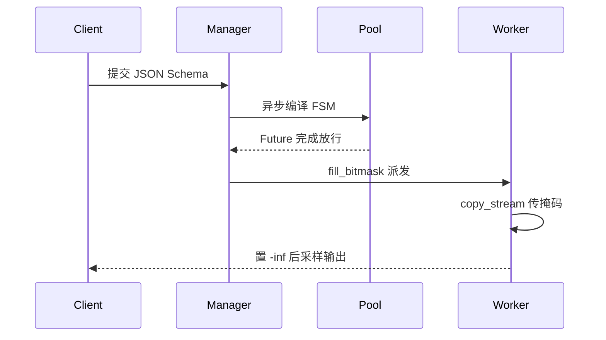
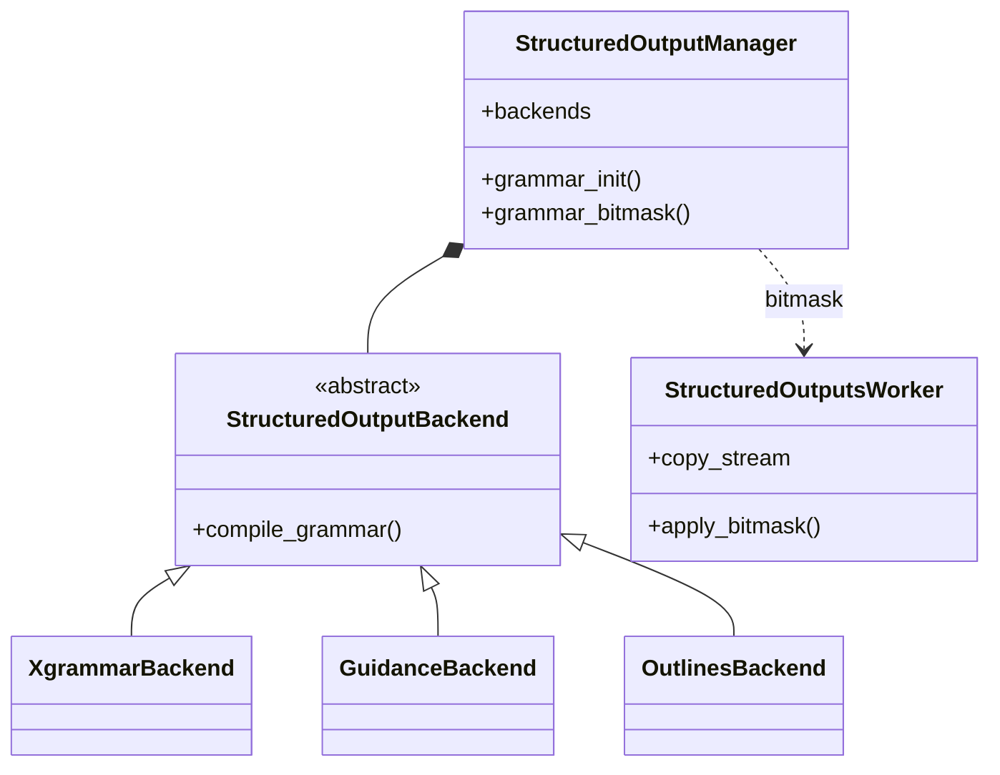
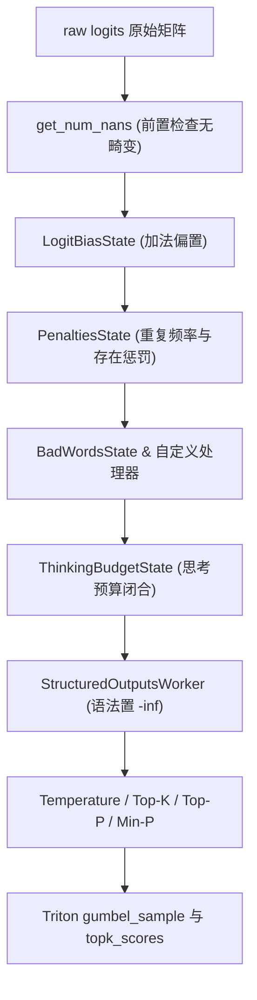
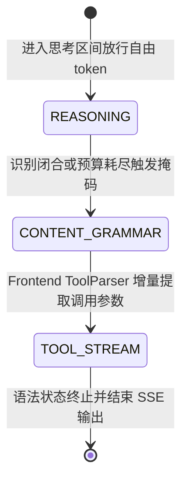
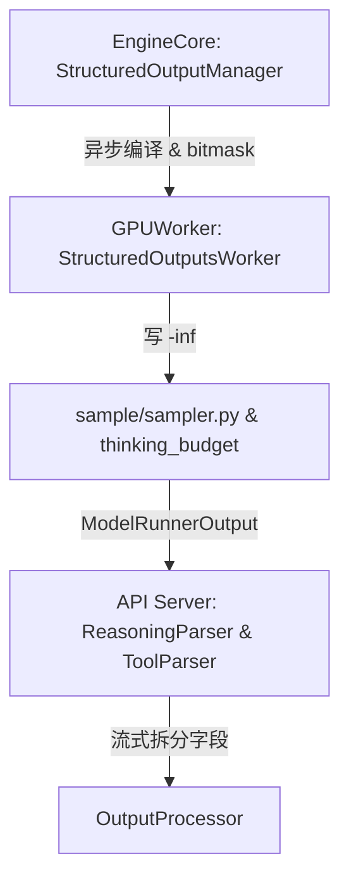

大模型在前向结束时只输出一条覆盖整张词表的原始 `logits` 向量。对智能体（Agent）与函数调用服务而言，哪怕模型输出漏掉了一个闭合大括号或引号，下游业务解析器也会直接报错中断。

与此同时，现代推理服务还要在同一套采样管线里叠加惩罚项、思考预算、`logprobs` 回传，以及流式拆出思考链 `<think>` 与工具调用参数。如果把这些约束简单放入主机端 Python 循环，高并发下的 CPU 与 **HBM（High Bandwidth Memory，高带宽显存）**带宽立刻成为瓶颈。

## 一条 JSON 约束请求的位掩码手算

我们先用一组数字看清结构化约束如何在调度端与设备端低成本交接。设模型词表规模 `vocab_size = 128000`，请求要求按 JSON Schema 输出天气查询，且启用 $K = 3$ 的投机解码。

由于每个 token 只需 $1$ 比特表示“当前状态是否合法”，系统按 `int32`（每字 $32$ 比特）打包压缩位掩码。单行 logits 对应的整数词数为 $\lceil 128000 / 32 \rceil = 4000$ 个，占内存 $16,000\text{ B}$。启用投机解码后，调度器需按步长 `mask_stride` $= 1 + K = 4$ 预留草稿与奖励位置，单请求每步共传 $4 \times 16,000 = 64,000\text{ B}$ 位掩码。

在设备端，`StructuredOutputsWorker` 通过独立 `copy_stream` 异步将位掩码搬进显存。随后算子按分块宽度 `GRAMMAR_BITMASK_BLOCK_SIZE = 8192` 启动 Triton Kernel 执行原地置零屏蔽[^vllm-gpu-struct]：

- **掩码解包映射**：每线程块一次读取 $8192 / 32 = 256$ 个 `int32` 整数，按位右移展开成 $8192$ 个布尔过滤位。
- **跳过裁剪无效位**：当投机长度被动态裁剪后，计算 Kernel 比对真实边界 `cu_num_logits`，超出范围的槽位直接跳过写操作。
- **零侵入原地掩码**：仅对非法 token 位置写入 `-inf`，合法位置保持原始 logits 数值不动。

图 1 串起了请求进入后异步编译语法、步级填表与设备流掩码的协同全过程。



## 四大语法后端与异步编译防死锁

vLLM V1 在调度引擎内聚了统一的 `StructuredOutputManager` 接口，兼容四套主流语法编译后端[^vllm-struct-mgr][^vllm-struct-backends]，整体抽象与依赖关系如图 2 所示。



针对不同复杂度的正则、JSON Schema 与无上下文语法，工程团队可在四类后端之间按需切换[^vllm-struct-backends]：

| 语法后端             | 核心编译引擎与特性         | 适用场景与边界                                                                |
| :------------------- | :------------------------- | :---------------------------------------------------------------------------- |
| `xgrammar`           | 下推自动机预处理词表映射   | 默认推荐，官方博客报道重负载下 TPOT 最高提速 $5\times$[^vllm-struct-backends] |
| `guidance`           | 字节级 Earley / CFG 状态机 | 支持极复杂上下文无关语法，token 对齐精细[^vllm-struct-backends]               |
| `outlines`           | 有限状态机结合磁盘索引缓存 | 经典正则表达式与轻量 JSON，跨重启复用缓存[^vllm-struct-backends]              |
| `lm-format-enforcer` | 字符级增量词表过滤器       | 轻量无外部重依赖，复杂语法速度略慢于前两者[^vllm-struct-backends]             |

复杂 Schema 首次编译可能耗时几十毫秒。为此 `StructuredOutputManager` 默认启用后台线程池异步编译（线程数为核心半数），将请求暂置挂起态以避免阻塞调度循环[^vllm-struct-mgr]。

但源码里藏着一条严格的分布式禁区[^vllm-struct-mgr]：当分布式执行器工作在 `external_launcher` 模式时，每张 TP 卡运行独立调度器且假定全组做出完全一致的调度裁决。若开启异步编译，各卡后台完成编译的时间差会让挂起转换落在不同步上，直接引发集合通信死锁。因此该模式下引擎必须显式退回同步编译[^vllm-struct-mgr]。

同时，当并发结构化请求数超过阈值 $128$ 且未开启投机解码时，管理器会自动把掩码填充切给独立线程池按 $16$ 条一批并行生成，平滑消除主机侧填表尖峰[^vllm-struct-mgr]。

## MRV2 有序采样管线与不可交换约束

语法位掩码只是后处理流水线里的一环。在 ModelRunner V2 中，`Sampler` 按严格固定顺序将各类约束与惩罚施加到原始 logits 上[^vllm-gpu-sampler]，各环节数据流向如图 3 所示。



整条链路中有三项极易踩坑的设计原则[^vllm-gpu-sampler][^vllm-think-budget]：

- **加法与乘法不可交换**：偏置必须先加，惩罚系数后按正负号缩放，两者顺序调换会改变最终符号与相对排序[^vllm-gpu-sampler]。
- **故障诊断前置采集**：`get_num_nans` 必须在温度与乘法缩放之前执行，以免把上游矩阵溢出的 `NaN` 归因误导成采样参数错误[^vllm-gpu-sampler]。
- **快路径跳过开销**：通过请求级标记位让无约束请求跳过预处理算子[^vllm-gpu-sampler]。

值得单独关注的是思考预算控制器 `ThinkingBudgetState`[^vllm-think-budget]。推理模型有时会在思考区陷入死循环耗尽上下文。该模块在 **UVA（Unified Virtual Addressing，统一虚拟寻址）**常驻数组中为每条请求登记思考 token 上限。一旦算子扫描确认预算已满，立刻掩码强制当前步采样闭合标签，提前结束思考进入正文。

## 思考链、结构化输出与流式工具解析协同

现代模型经常把长篇思考链与受约束的工具 JSON 混在同一条响应中输出。vLLM 依托 `StructuredOutputManager` 内部的推理识别器（`ReasoningParser`）与 `AsyncScheduler` 状态门控，按图 4 的流转状态接管这一混合过程[^vllm-struct-mgr][^vllm-abs-reason][^vllm-abs-tool]。



在思考尚未闭合阶段，管理器默认不对自由思考 token 施加 JSON 语法约束，仅掩码拦截会提前跳入正文且语法非法的隐式结束 token[^vllm-struct-mgr]。当投机解码遇上思考结束与语法切换边界时，`trim_spec_tokens` 会剔除不合法的 Draft 后缀，确保状态机绝不踩空。

来到前端 `API Server` 进程后，增量解码器把还原出来的文本与 token 切片交由对应 `ReasoningParser` 与 `ToolParser`。解析器维护增量流式缓冲游标，将原始输出实时拆分进 OpenAI SSE 响应的 `reasoning_content`、`tool_calls` 与 `content` 字段[^vllm-abs-reason][^vllm-abs-tool]。

## 源码目录结构与双端适配对照

结构化输出、采样器与流式解析横跨 `v1/structured_output/`、`v1/worker/gpu/`、前端 `reasoning/` 与 `tool_parsers/` 四个目录：

```text
vllm/
├── v1/
│   ├── structured_output/
│   │   ├── __init__.py                 # StructuredOutputManager 异步编译与掩码填充
│   │   ├── backend_xgrammar.py         # XGrammar 自动机与词表位掩码实现
│   │   ├── backend_guidance.py         # Guidance 字节级文法后端
│   │   └── backend_outlines.py         # Outlines FSM 与磁盘索引缓存
│   └── worker/gpu/
│       ├── structured_outputs.py       # copy_stream 与 _apply_grammar_bitmask_kernel
│       └── sample/
│           ├── sampler.py              # 有序 logits 管线组装与 fast-path 裁剪
│           ├── penalties.py            # Triton _bincount 与惩罚缩放核函数
│           └── thinking_budget.py      # UVA 思考预算计数与强制闭合
├── reasoning/
│   └── abs_reasoning_parsers.py        # ReasoningParser 思考标签识别与状态剥离
└── tool_parsers/
    └── abstract_tool_parser.py         # ToolParser 增量流式工具参数提取基类
```

如图 5 所示，前端负责异步流式字段解析，调度引擎统一汇总语法状态并输出打包位掩码，GPU 与昇腾 NPU 则在同一套张量接口上完成位掩码过滤与采样算子执行[^vllm-ascend-struct]：



在华为昇腾侧，`vllm-ascend` 在控制面与前端完全复用上游四套语法编译后端和解析器体系[^vllm-ascend-struct]，设备端同样依托 `PrivateUse1` 分发机制驱动 Triton 位掩码与采样算子。下表总结了双端在约束管线各层的落地方式：

| 管线环节             | GPU（`vllm` `99b0b0b0`）                             | 昇腾 NPU（`vllm-ascend` `b776261`）                          |
| :------------------- | :--------------------------------------------------- | :----------------------------------------------------------- |
| 语法编译与位掩码生成 | `StructuredOutputManager` 多后端异步编译             | 复用完全一致的后端与 `mask_stride` 契约[^vllm-ascend-struct] |
| 设备端位掩码施加     | `copy_stream` 异步拷贝 + Triton $8192$ 分块写 `-inf` | `bishengir` Triton Kernel 同接口原位过滤                     |
| 惩罚、思考预算与采样 | MRV2 `Sampler` 有序管线与 Gumbel 采样                | 继承 `Sampler` 契约并延迟守卫裁剪校验                        |
| 思考链与工具增量解析 | `API Server` 独立解析器按步拆分 SSE 字段             | 完全一致的前端进程解析，不占用 NPU 算力                      |

到这一章为止，从进程拓扑、调度块池、MRV2 异步发射、多卡协同，再到投机解码与结构化采样，vLLM V1 在线推理引擎的功能版图已经悉数拼齐。

一旦这么多特性叠加在线上压测并跑，服务出现吞吐跌落、图静默退回、异步通信死锁或偶发乱码时，又该如何先梳理启动配置参数、再从时延指标下钻定位根因？下一章[10 生产启动配置、关键参数与调优](../10-launch-config-and-tuning/)将先把关键参数和调优规则整理清楚，再在收尾章[11 性能观测与线上故障定位](../11-profiling-and-debugging/)串联整套排障工具链。

[^vllm-gpu-struct]: `vllm`（commit `99b0b0b0`），`vllm/v1/worker/gpu/structured_outputs.py:12-134`（`GRAMMAR_BITMASK_BLOCK_SIZE = 8192`、`StructuredOutputsWorker` 与 Triton 位掩码核函数），Apache-2.0。

[^vllm-struct-mgr]: `vllm`（commit `99b0b0b0`），`vllm/v1/structured_output/__init__.py:52-460`（`StructuredOutputManager` 线程池异步编译、`external_launcher` 防死锁同步分支、并行 `fill_bitmask` 阈值与 `trim_spec_tokens`），Apache-2.0。

[^vllm-struct-backends]: `vllm`（commit `99b0b0b0`），`vllm/v1/structured_output/backend_xgrammar.py:38-250`、`backend_guidance.py`、`backend_outlines.py` 与 `backend_lm_format_enforcer.py`，另见 [vLLM 结构化输出文档](https://docs.vllm.ai/en/latest/features/structured_outputs/) 与官方 XGrammar 博客。

[^vllm-gpu-sampler]: `vllm`（commit `99b0b0b0`），`vllm/v1/worker/gpu/sample/sampler.py:42-180`（`Sampler` 不可交换处理器列表、前置 `get_num_nans` 与 `may_mask_logits` 标记），Apache-2.0。

[^vllm-think-budget]: `vllm`（commit `99b0b0b0`），`vllm/v1/worker/gpu/sample/thinking_budget.py:22-120`（`ThinkingBudgetState` 基于 `UvaBackedTensor` 的思考上限控制），Apache-2.0。

[^vllm-abs-reason]: `vllm`（commit `99b0b0b0`），`vllm/reasoning/abs_reasoning_parsers.py:26-235`（`ReasoningParser` 提取与流式结束判定接口），Apache-2.0。

[^vllm-abs-tool]: `vllm`（commit `99b0b0b0`），`vllm/tool_parsers/abstract_tool_parser.py:43-150`（`ToolParser` 增量工具调用提取接口），Apache-2.0。

[^vllm-ascend-struct]: `vllm-ascend`（commit `b776261`），`docs/source/user_guide/feature_guide/structured_output.md:1-19`（确认结构化输出功能与参数用法全面复用上游 vLLM），Apache-2.0。
