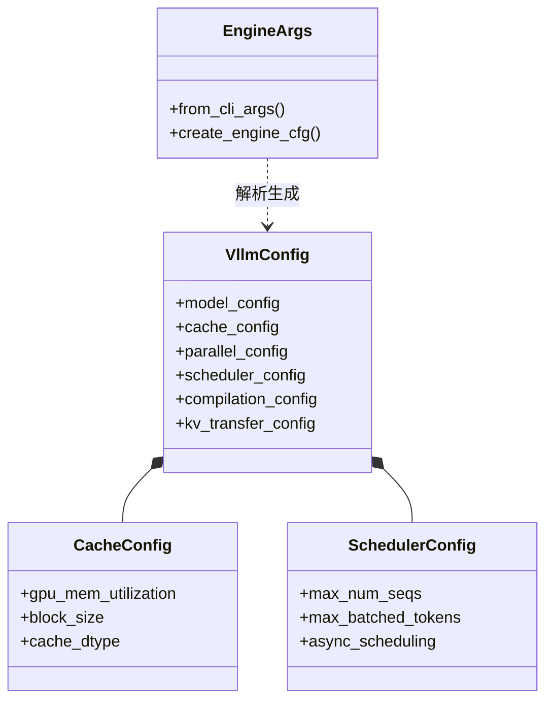
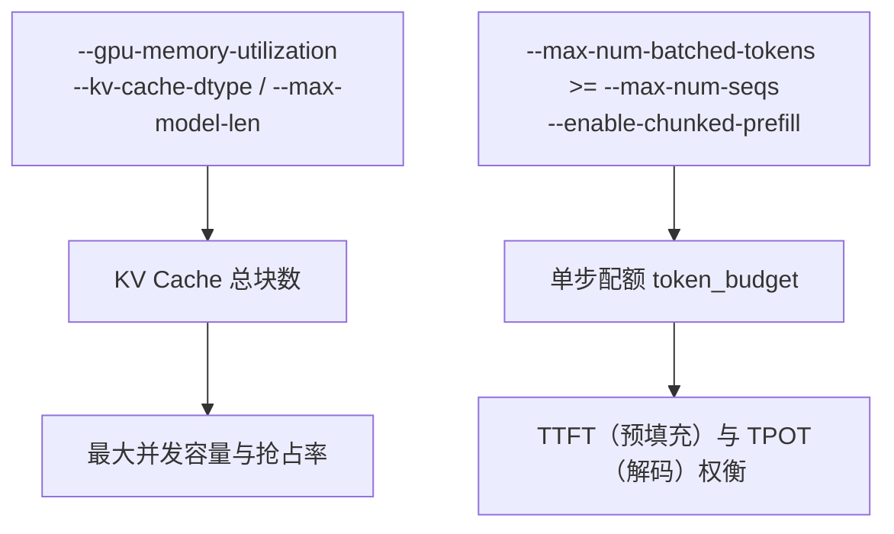
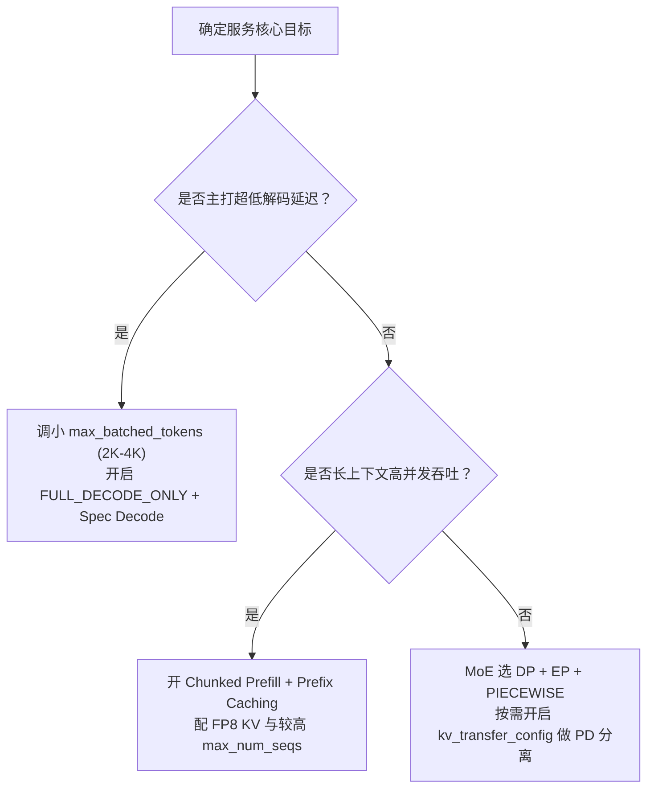
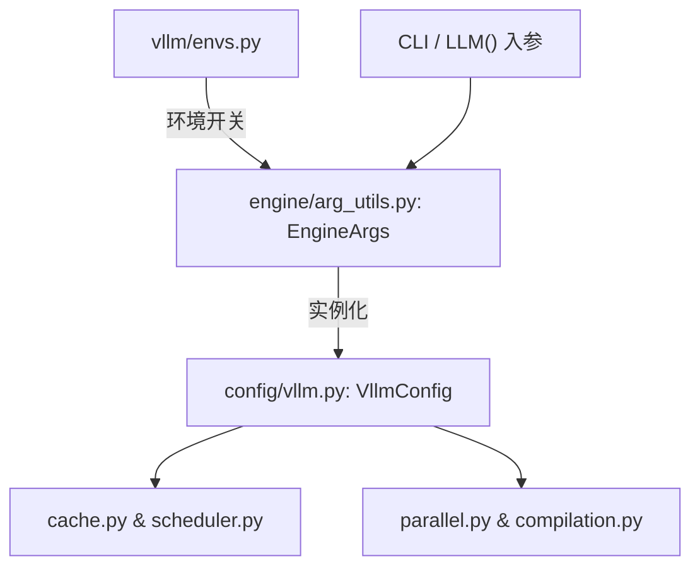

前九章拆解了 vLLM V1 从进程隔离、分页块表、连续批调度、MRV2 执行器到投机解码和结构化输出的全部内部机制。当服务真正要上线部署时，工程师面对的最直接界面是 `vllm serve` 命令行、Python `LLM()` 入口以及各类环境变量。

生产调优很少靠盲猜单个开关，因为显存预算、单步批上限、并行切分与图捕获档位彼此强耦合。如果把 `--max-num-batched-tokens` 设得小于 `--max-num-seqs`，引擎会在校验阶段报错退出。若盲目开启 `--enforce-eager`，静态图分桶与增量重放红利也会瞬间归零。

## 从 CLI 到 VllmConfig 的参数流向

在线服务命令 `vllm serve` 与离线类 `LLM()` 共用同一套参数解析骨架 `EngineArgs`[^vllm-arg-utils]。启动阶段，引擎先读取命令行参数与环境变量，再汇总装入全局唯一配置对象 `VllmConfig` 透传至全部前端、核心调度与工作进程[^vllm-vllm-cfg]。

如图 1 所示，`VllmConfig` 将上百个配置项拆入相互正交的子配置类中：



这种集中校验设计意味着绝大多数互斥规则与默认值推导都在拉起 Worker 之前完成，能在秒级时间内暴露非法组合，而不是等到加载数十 GB 权重后才崩溃[^vllm-arg-utils][^vllm-sched-cfg]。

## 显存、并发与调度核心参数

先用一道可手算的 80 GiB 单卡实例看清显存与调度参数的联动。设权重（含量化）占 $38\text{ GiB}$，激活峰值探测与静态图池占 $6\text{ GiB}$。

若设置 `--gpu-memory-utilization 0.9`，引擎显存预算上限为 $80 \times 0.9 = 72\text{ GiB}$。扣除权重与图开销后，实际划入 KV 缓存池的容量为 $72 - 38 - 6 = 28\text{ GiB}$；调高到 $0.95$ 虽能多出 $4\text{ GiB}$ 缓存，但会压缩通信临时缓冲余量。

表 1 汇总了最常用的显存、上下文与连续批调度参数及其源码默认值[^vllm-arg-utils][^vllm-cache-cfg][^vllm-sched-cfg]：

| 参数开关                   | 默认值或典型值                 | 工程作用与联动约束                                                    |
| :------------------------- | :----------------------------- | :-------------------------------------------------------------------- |
| `--gpu-memory-utilization` | 典型设 $0.9$                   | 限定引擎显存占用上限比例，决定可用 KV 块总数[^vllm-cache-cfg]         |
| `--max-model-len`          | 读模型配置或手动截断           | 限制单序列上下文上限，过大压低最大并发度[^vllm-arg-utils]             |
| `--kv-cache-dtype`         | `auto`（可选 FP8）             | 压缩 KV 缓存字节宽度，单块可纳 token 数翻倍[^vllm-cache-cfg]          |
| `--block-size`             | GPU 常设 $16\text{–}64$        | 决定页粒度与尾部填充开销，昇腾等后端有固定块大小约束[^vllm-cache-cfg] |
| `--enable-prefix-caching`  | 默认 `True`                    | 开启第 3 章链式前缀缓存，系统提示复用场景必开[^vllm-cache-cfg]        |
| `--max-num-seqs`           | 按设备容量设上限               | 限制单步并发激活序列行数，影响 MRV2 常驻行表[^vllm-sched-cfg]         |
| `--max-num-batched-tokens` | 默认配额（须 $\ge$ seqs）      | 控制单步 `token_budget`，源码强制不得小于并发数[^vllm-sched-cfg]      |
| `--enable-chunked-prefill` | 默认 `True`                    | 允许长提示分块嵌入解码批，平滑 TPOT 尾延迟[^vllm-sched-cfg]           |
| `--scheduling-policy`      | `fcfs` / `priority`            | 决定入队顺序以及块枯竭时的抢占淘汰顺序[^vllm-sched-cfg]               |
| `--async-scheduling`       | 按平台默认开启（深度 $\ge 2$） | 启用跨步乐观占位流水，掩盖主机编排与回传耗时[^vllm-sched-cfg]         |

图 2 梳理了显存预算与步级 token 预算两条耦合线如何共同约束首字延迟（TTFT）与解码步长（TPOT）：



调整调度参数时有一条经验红线：追求极致解码低时延，可将 `max_num_batched_tokens` 设在 $2048\text{–}4096$ 防止大块预填充拉宽单步时间。追求纯离线高吞吐，则可调高到 $8192$ 以上并适当放大 `max_num_seqs`[^vllm-sched-cfg]。

## 并行拓扑、图编译与高阶特性开关

在集群并行、执行图与高阶生产特性上，下列参数决定进程拓扑、发射壁垒与输出形态[^vllm-arg-utils][^vllm-comp-cfg][^vllm-envs]：

| 参数或环境变量                               | 常见取值                           | 核心工程影响                                                            |
| :------------------------------------------- | :--------------------------------- | :---------------------------------------------------------------------- |
| `-tp` / `-pp` / `-dp`                        | 正整数（$1, 2, 4, 8\dots$）        | 切分张量、流水与数据副本，`DP > 1` 触发波次协调器[^vllm-arg-utils]      |
| `--enable-expert-parallel`                   | `False` / `True`                   | 复用 `DP * PCP * TP` 为专家并行组，不增加卡数                           |
| `--distributed-executor-backend`             | `mp` / `ray` / `external_launcher` | `mp` 主打单机多卡，`ray` 管跨机，`external_launcher` 配 `torchrun`      |
| `--enforce-eager`                            | 默认 `False`                       | 关闭图编译与静态图，只用于问题隔离与调试[^vllm-arg-utils]               |
| `--compilation-config`                       | `cudagraph_mode` 等 JSON           | 切换 `NONE`/`PIECEWISE`/`FULL_AND_PIECEWISE` 及捕获档位[^vllm-comp-cfg] |
| `--speculative-config`                       | `method`、`num_speculative_tokens` | 配置第 8 章投机 Speculator 方案，与捕获分桶联动[^vllm-arg-utils]        |
| `--kv-transfer-config`                       | `kv_connector`、`kv_role`          | 配置第 7 章 NIXL / Mooncake 等 PD 分离连接器                            |
| `--reasoning-parser` / `--tool-call-parser`  | 模型对应解析器名                   | 开启第 9 章前端 `<think>` 思考链与流式工具参数提取                      |
| `VLLM_WORKER_MULTIPROC_METHOD`               | `fork` / `spawn`                   | 控制多进程拉起方式，CUDA 环境下建议或强制 `spawn`[^vllm-envs]           |
| `VLLM_LOGGING_LEVEL` / `VLLM_GPU_SYNC_CHECK` | `DEBUG` / `warn` / `error`         | 第 11 章定位张量指针漂移与隐式主机同步开关[^vllm-envs]                  |

针对不同业务 SLO 目标，可按图 3 的决策分支快速选定参数基线：



## 典型生产启动模板与优化级别

依据 vLLM 官方优化指南[^vllm-opt-guide]，命令行提供 `-O0` 至 `-O3` 四档优化级别，用于权衡冷启动时间与稳态性能：

| 优化级别 | 算子融合与图策略                        | 适用阶段                     |
| :------- | :-------------------------------------- | :--------------------------- |
| `-O0`    | 关闭编译融合与静态图                    | 极速拉起调试与功能验证       |
| `-O1`    | 快速编译、轻量融合与分段 CUDA Graph     | 开发环境或频繁换模场景       |
| `-O2`    | 默认值：拓展范围、额外融合与整图+分段图 | 绝大多数在线生产集群推荐配置 |
| `-O3`    | 预留激进且耗时更长的实验性融合          | 离线极限压测探索             |

为缩短冷启动耗时，官方优化指南推荐复用 `VLLM_CACHE_ROOT` 编译缓存，并设置 `VLLM_FORCE_AOT_LOAD=1` 拦截离线缓存失效后的意外编译。固定规格集群还可传入 `--kv-cache-memory` 跳过启动期峰值探测[^vllm-opt-guide]。

若出现 `Preemption (SWAP/RECOMPUTE)` 告警，可调高 `--gpu-memory-utilization`、开启 FP8 KV 缓存并启用前缀缓存[^vllm-opt-guide]。

下面给出三组可直接套用的在线服务启动骨架。模板一面向低时延对话，启用张量并行、前缀缓存与 EAGLE-3 投机解码：

```bash
VLLM_WORKER_MULTIPROC_METHOD=spawn \
vllm serve /models/Llama-3.1-70B-Instruct \
  -tp 4 \
  --gpu-memory-utilization 0.90 \
  --max-model-len 32768 \
  --max-num-batched-tokens 4096 \
  --enable-prefix-caching \
  --speculative-config '{"method":"eagle3","model":"/models/EAGLE3","num_speculative_tokens":3}'
```

模板二面向长上下文吞吐与智能体工具调用，重点压低 KV 占用并挂载前端思考与工具解析器：

```bash
vllm serve /models/Qwen3-32B \
  -tp 2 \
  --kv-cache-dtype fp8 \
  --max-model-len 65536 \
  --max-num-seqs 256 \
  --max-num-batched-tokens 16384 \
  --enable-chunked-prefill \
  --reasoning-parser qwen3 \
  --tool-call-parser hermes
```

模板三面向大规模 MoE 集群（启用内部数据并行负载均衡、专家并行与全异步队列）：

```bash
vllm serve /models/DeepSeek-V3 \
  -dp 2 -tp 8 \
  --enable-expert-parallel \
  --async-scheduling \
  --compilation-config '{"cudagraph_mode":"FULL_AND_PIECEWISE"}'
```

部署自检时务必避开三处高频参数冲突：

- **配额倒置崩溃**：`max_num_batched_tokens` 小于 `max_num_seqs` 时启动校验立即失败[^vllm-sched-cfg]。
- **外部启动死锁**：用 `external_launcher` 时须注意关闭异步语法编译带来的分支差异。
- **静默降级失速**：误留 `--enforce-eager` 或捕获分桶未覆盖真实批大小会跳过静态图，导致发射墙复现。

## 配置源码落点与向排障衔接

所有启动开关的解析、约束校验与环境变量懒求值集中在 `vllm/engine/arg_utils.py`、`vllm/envs.py` 与 `vllm/config/` 子目录下：

```text
vllm/
├── envs.py                     # 全部环境变量定义、校验与懒求值注册表
├── engine/
│   └── arg_utils.py            # EngineArgs / AsyncEngineArgs CLI 参数解析总入口
└── config/
    ├── vllm.py                 # VllmConfig 聚合根与各子配置交叉一致性检查
    ├── cache.py                # CacheConfig（显存利用率、块尺寸、缓存精度）
    ├── scheduler.py            # SchedulerConfig（配额上限、分块与异步深度）
    ├── parallel.py             # ParallelConfig（TP/PP/DP/EP 与执行器后端）
    └── compilation.py          # CompilationConfig（图模式枚举与捕获档位列表）
```

如图 4 所示，任何新加入的高级特性最终都通过 `EngineArgs` 落入对应子配置并在 `VllmConfig` 中统一完成交叉校验：



配置到位并拉起在线服务后，当集群在高并发压测中出现 TTFT 毛刺、静默降级或跨卡超时时，该如何采集轨迹并反推具体配置陷阱？系列收尾章[11 性能观测与线上故障定位](../11-profiling-and-debugging/)将展开完整排障体系。如果你部署在华为昇腾 NPU 集群，可进一步对照[《vLLM-Ascend》第 7 章：昇腾启动配置、扩展参数与环境变量](../../vllm-ascend/07-ascend-launch-config-and-env/)。

[^vllm-arg-utils]: `vllm`（commit `99b0b0b0`），`vllm/engine/arg_utils.py:485-880, 975-1420`（`EngineArgs` 字段默认值与 `add_cli_args` CLI 开关绑定），Apache-2.0。

[^vllm-vllm-cfg]: `vllm`（commit `99b0b0b0`），`vllm/config/vllm.py:444-560`（`VllmConfig` 聚合并校验全部子配置对象），Apache-2.0。

[^vllm-cache-cfg]: `vllm`（commit `99b0b0b0`），`vllm/config/cache.py:188-360, 496-510`（`CacheConfig` `gpu_memory_utilization`、`cache_dtype`、`block_size` 与 `enable_prefix_caching`），Apache-2.0。

[^vllm-sched-cfg]: `vllm`（commit `99b0b0b0`），`vllm/config/scheduler.py:47-285, 385-420`（`SchedulerConfig`、`max_num_batched_tokens >= max_num_seqs` 约束与 `async_scheduling_depth`），Apache-2.0。

[^vllm-comp-cfg]: `vllm`（commit `99b0b0b0`），`vllm/config/compilation.py:548-795`（`CompilationConfig`、`cudagraph_mode` 与 `cudagraph_capture_sizes`），Apache-2.0。

[^vllm-envs]: `vllm`（commit `99b0b0b0`），`vllm/envs.py:41-98, 687-980`（`VLLM_LOGGING_LEVEL`、`VLLM_WORKER_MULTIPROC_METHOD` 与 `VLLM_GPU_SYNC_CHECK`），Apache-2.0。

[^vllm-opt-guide]: [vLLM 官方优化与调优指南](https://docs.vllm.ai/en/latest/configuration/optimization/)（`-O0` 至 `-O3` 优化等级、`VLLM_CACHE_ROOT` 编译缓存复用及抢占缓解策略）。
