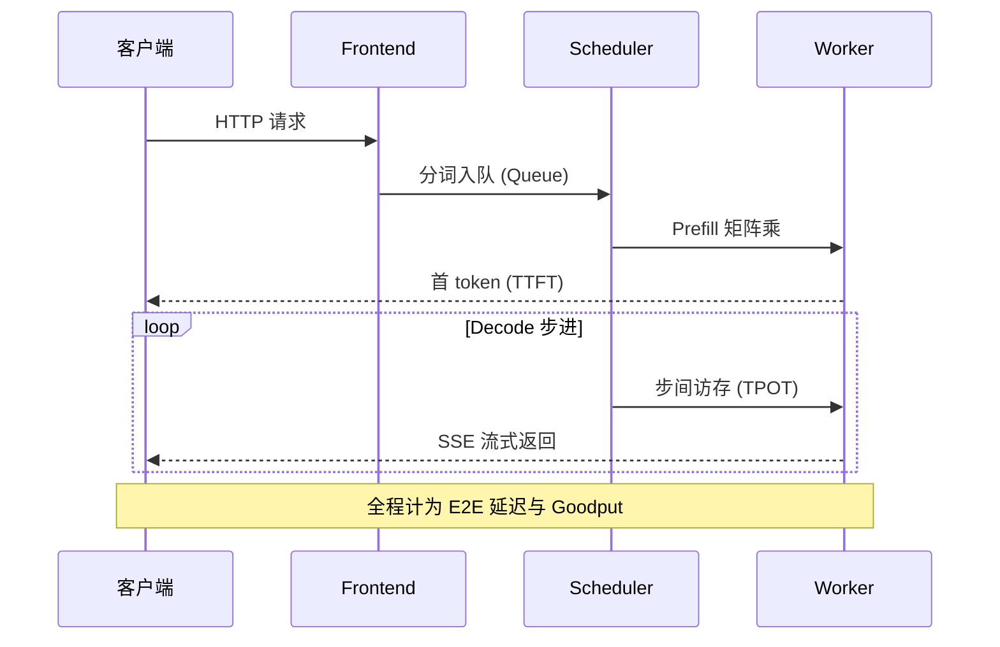
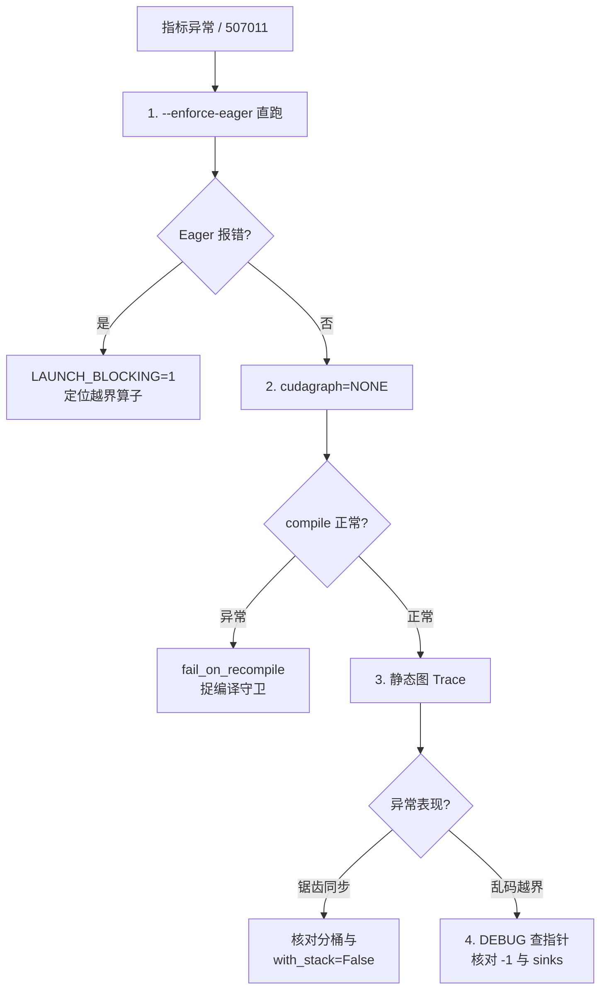

推理引擎把连续批调度、异步发射队列、分段编译以及静态图重放全部串联运行后，线上压测与新模型适配期的问题很少直接报出语法错误。更常见的是服务吞吐跌落、解码间隔周期性拉长、多卡集合通信阻塞死锁，或模型间歇输出乱码。排查这类运行期缺陷的第一步，是把业务侧感知的服务指标拆解到对应的硬件子系统与调度环节。

## 推理服务时延指标与观测映射

评价大模型在线推理服务核心看 **TTFT（Time to First Token，首字延迟）**与 **TPOT（Time Per Output Token，解码步间延迟）**。两者在 **SLO（Service Level Objective，服务等级目标）**下共同决定有效吞吐。如图 1 与图 2 所示，单条请求的延迟拆解对应排队、Prefill 计算与步间 HBM 访存三个阶段[^vllm-metrics-doc]。




对照图 1、图 2 与下表，可以把业务指标异常快速映射到具体的硬件瓶颈：

| 业务观测指标     | 主导硬件与调度瓶颈               | 首选核查观测目标                          |
| ---------------- | -------------------------------- | ----------------------------------------- |
| 首字延迟 TTFT    | 调度排队、Prefill 算力与分块配额 | 队列深度、前缀命中率与 Cube 利用率        |
| 解码延迟 TPOT    | HBM 带宽、发射墙与静态图回退     | 静态图分桶命中率、Host 发射间隔与同步等待 |
| 有效吞吐 Goodput | SLO 约束下的并发混排与 KV 抢占   | 分块抢占次数与 DP 跨卡同步尾延迟          |

盲目拉大并发批大小虽能推高总 token 产出，一旦触发长块阻塞或抢占抖动让尾部延迟越过服务目标，有效吞吐 Goodput 反而明显滑落。

## Trace 采集工具链与采样失真规避

把指标异常落实到算子时间线，需要借助平台剖析器采集 **Host（主机）**与 **Device（设备）**双轨 **Trace（执行时间线）**。在 NVIDIA GPU 上，vLLM 通过 `ProfilerConfig` 封装了 `torch`、`cuda` 与 Triton `proton` 三种采集模式[^vllm-profiler-cfg]。追求接近零开销的真实时序时，首选 `nsys profile` 配合图节点追踪参数，把调度线程、CUDA API 与静态图内部重放节点摊在同一时间轴上[^vllm-profiling-doc]。

在华为昇腾 **NPU（Neural Processing Unit，神经网络处理器）**上，`TorchNPUProfilerWrapper` 负责接入平台剖析能力。它调用 `torch_npu.profiler` 开启 `Level1` 与 `PipeUtilization` 管道指标[^ascend-profiler]。这样能同时导出 CPU 调度事件，以及 Cube、Vector 与 **MTE（Memory Transfer Engine，数据搬运引擎）**的利用率占比。昇腾侧剖析器与异常码深度排障见[vLLM-Ascend 第 6 章](../../vllm-ascend/06-quantization-custom-ops-and-tuning/)。

采集性能时序 Trace 时，必须避开两个极易扭曲分析结论的配置陷阱。第一项是做延迟与吞吐归因时务必关闭 `with_stack=True`（昇腾侧对应 `with_modules`），即把配置里的栈追踪选项设为 `false`[^vllm-profiler-cfg][^ascend-profiler]。

`ProfilerConfig` 默认开启该选项以方便定位调用栈，但这会让 PyTorch 在每次算子发射时在主机侧现场回溯 Python 栈，给每次提交平添数微秒 CPU 开销。在健康的分段图或 Eager 单算子短区间上，这笔采集开销会把 Host 发射块拉得比 Device Kernel 还宽，人为制造出“CPU 发射跟不上硬件”的锯齿假指纹，误导排障方向。

第二项陷阱针对昇腾平台：`TorchNPUProfilerWrapper` 启用 `torch_npu.profiler` 时，严禁同时开启常驻监控守护进程 `msmonitor_use_daemon`[^ascend-profiler]。两者都会抢占底层 **CANN（Compute Architecture for Neural Networks，异构计算架构）**性能计数器与事件采集通道。并行开启不仅会导致数据损坏，Wrapper 初始化时也会直接检测到冲突并抛出异常中断启动。

## 五类 Profiler 轨迹指纹诊断

获取可靠的 Trace 文件后，我们可以通过主机发射轨、设备计算轨与通信轨的相对形态，将大多数线上异常归类到五种时间线指纹中。如图 3 所示，健康基线与四类故障指纹在三轨上的时序特征对照如下。


健康重放基线呈现最紧凑的时序结构（图 3 指纹 1）。Host Python 轨上只出现一根持续约 $0.08\text{ ms}$ 的单次图重放发射条（`cudaGraphLaunch` 或昇腾 `aclmdlRI` 重放实例），随后主机线程立刻进入下一轮步进元数据准备。设备轨上的 Norm、Attention、MoE 与 Head 等算子首尾紧贴，算力或带宽利用率稳定维持在 $90\%$ 以上，通信拷贝则藏在计算流重叠窗口内。

发射受限（Launch-bound）锯齿指纹暴露了静态图静默退回（图 3 指纹 2）。确认已关闭 `with_stack=True` 后，若设备轨仍被大量空白切碎，主机轨排满比算子更宽的发射块，就说明请求绕过了静态图分桶。此时执行已退回逐算子 Eager 模式或 `CUDAGraphMode.NONE` 路径。常见诱因包括批大小超出最大捕获档位且未配置回退、注意力混合批能力受限触发降级，或 `splitting_ops` 遗漏导致编译失败。

主机隐式同步墙指纹表现为突发性全流排空（图 3 指纹 3）。当时间线出现长条阻塞调用（`cudaStreamSynchronize` 或 `aclrtSynchronizeStream`）并紧邻 $4$ 字节拷贝时，说明流已被打断。此时通常正在等待 **D2H（Device-to-Host，设备到主机）**传输，设备轨已算完并陷入大段空转。这几乎能断定热路径中混入了 `.item()`、`.cpu()` 或 `torch.nonzero()` 等同步读写操作，迫使异步发射流水线排空等待。

跨卡长尾等待指纹常见于结合了 **DP（Data Parallelism，数据并行）**与 **EP（Expert Parallelism，专家并行）**的混合专家集群。对照图 3 指纹 4，快卡（例如只处理少量短解码请求的 Rank 0）本地计算耗时极短，但进入 `NCCL` 或 `HCCL` 通信轨后却出现大段空等块。

根源通常是同组其他卡（如 Rank 1）承接了长上下文 Prefill，使注意力耗时成倍拉长。也可能是 `dispatch_cg_and_sync_dp` 未能收齐各卡负载，令快卡长期停在 `All-to-All` 屏障前空等[^vllm-dp-utils]。

最隐蔽的一类是 Padding 尾部越界覆写与异步内存错误指纹（图 3 指纹 5）。从时间线外观上看，主机仍只发射一条图重放指令，设备计算块也紧凑无空洞，但线上输出却间歇出现乱码，或在昇腾设备上于后续无关同步点触发异步错误码 507011。

这类故障通常源于两个原因：要么批缩容时忘了把超出真实 token 数的尾部 `slot_mapping` 刷写为 `PAD_SLOT_ID = -1`，令重放 Kernel 覆写其他请求的 KV 物理块[^vllm-block-table][^vllm-attn-utils]。要么如[vLLM-Ascend 第 6 章](../../vllm-ascend/06-quantization-custom-ops-and-tuning/)与[《推理执行图》第 7 章](../../execgraph/07-acl-graph-fullstack-and-vllm-ascend/)所述，传入异步 `FULL` 图的持久缓冲（如 `sinks`）生命周期提前结束[^ascend-sparse-mla]。

## 从指标异常到二分隔离与诊断开关

面对复杂模型或新硬件驱动栈暴露出的混合故障，同时打开 `torch.compile`、静态图重放与异步调度会让根因难以拆解。把服务症状、四步二分隔离法与两端平台的诊断环境变量串联起来，就能沿唯一分支逐步剥离问题层，排障决策路径如图 4 所示。



沿图 4 逐层下钻时，四组开关会逐级缩小排查范围。首先用 `--enforce-eager` 绕过全部编译与静态图封装。如果在 Eager 单算子直跑阶段依然报错或数值失真，就打开 `CUDA_LAUNCH_BLOCKING=1`（GPU）或 `ASCEND_LAUNCH_BLOCKING=1`（NPU）[^vllm-troubleshoot][^ascend-launch]。该开关强迫算子同步提交，能把异步越界错误直接定位到触发它的那一行算子。

若 Eager 直跑正常，再放开 `VLLM_COMPILE` 并把 `cudagraph_mode` 设为 `NONE`。这一步专门隔离计算图分段与后端编译（Inductor 或 `npugraph_ex`）引入的错误。怀疑运行期因动态输入反复触发重新编译时，可用 `torch.compiler.set_stance("fail_on_recompile")` 拦截隐藏的编译守卫失败[^vllm-wrapper]。

确认编译子图无误后再恢复静态图捕获，此时结合 `VLLM_LOGGING_LEVEL=DEBUG` 自动校对每次重放的输入张量 `data_ptr()` 是否漂移[^vllm-cudagraph-wrapper][^ascend-aclgraph]。同时配合 `VLLM_GPU_SYNC_CHECK` 抓出隐式同步点[^vllm-sync-debug]，最后核查 `PAD_SLOT_ID = -1` 尾部刷写与长效张量生命周期，绝大部分隐蔽问题都能查清。

## 跨请求静默污染复现与双仓对照

为了直观验证第 5 类故障的破坏力，下面的自包含 Python 脚本仅用标准库 `math` 构造了一段跨请求 KV 缓存污染复现。物理 KV 池共有 8 个槽位，健康解码中的请求 Req B 占用物理块 `[4, 5]` 并拥有稳定的注意力输出基准。

同一时刻，同批静态图（容量 $B_{\text{cap}} = 4$）上的请求 Req A 从上一步 $B = 4$（曾用槽 `[0, 1, 4, 5]`）缩容为本步 $B = 2$（仅用 `[0, 1]`），且第 3、4 槽填充位置带有垃圾激活。脚本对比了“未刷写尾部槽位导致覆写物理块 4 和 5”与“刷写 `PAD_SLOT_ID = -1` 并由掩码跳过写回”两种路径下，Req B 注意力输出余弦相似度与最大绝对误差的差异：

```python
import math

PAD_SLOT_ID = -1
NUM_PHYSICAL_SLOTS = 8
SINK_SLOT = NUM_PHYSICAL_SLOTS


def dot(a: list[float], b: list[float]) -> float:
    return sum(x * y for x, y in zip(a, b))


def softmax(xs: list[float]) -> list[float]:
    m = max(xs)
    exps = [math.exp(x - m) for x in xs]
    total = sum(exps)
    return [e / total for e in exps]


def cos_sim(a: list[float], b: list[float]) -> float:
    return dot(a, b) / (math.sqrt(dot(a, a)) * math.sqrt(dot(b, b)))


def attn_req_b(pool_ext: list[list[float]], q_b: list[float]) -> list[float]:
    """计算健康请求 Req B 在物理槽 [4, 5] 上的注意力输出。"""
    k = pool_ext[4:6]
    scale = math.sqrt(len(q_b))
    scores = softmax([dot(q_b, k_i) / scale for k_i in k])
    return [sum(scores[i] * k[i][d] for i in range(2)) for d in range(len(q_b))]


def index_copy(pool_ext: list[list[float]], slots: list[int], rows: list[list[float]]) -> list[list[float]]:
    out = [list(r) for r in pool_ext]
    for slot, row in zip(slots, rows):
        out[slot] = list(row)
    return out


# 物理 KV 池末尾多挂 1 个 Padding 吸收槽（Sink slot），用于在固定形状下模拟核内 slot >= 0 跳过写回
kv_pool_ext = [[0.0] * 4 for _ in range(NUM_PHYSICAL_SLOTS + 1)]
kv_pool_ext[4] = [1.0, 2.0, -1.0, 0.5]
kv_pool_ext[5] = [-0.5, 1.5, 2.0, -1.0]
q_b = [1.0, 0.5, -0.5, 1.0]

ref_out_b = attn_req_b(kv_pool_ext, q_b)

# Req A 本步从 B=4 缩容为 B=2（实际占用物理槽 [0, 1]），尾部填充位带入无效激活
new_kv_a = [
    [0.2, 0.1, 0.3, 0.4],
    [0.5, 0.2, 0.1, 0.3],
    [-4.0, -3.0, 4.0, -2.0],
    [-3.0, -4.0, 3.0, -3.0],
]

# 故障路径：静态图尾部残留上轮旧槽位 [4, 5]，越界覆写 Req B 的活跃 KV 块
buggy_pool = index_copy(kv_pool_ext, [0, 1, 4, 5], new_kv_a)
corrupted_out_b = attn_req_b(buggy_pool, q_b)

# 修复路径：尾部刷写为 PAD_SLOT_ID = -1，由 slot >= 0 掩码屏蔽物理块写入
fixed_slots = [0, 1, PAD_SLOT_ID, PAD_SLOT_ID]
routed_slots = [s if s >= 0 else SINK_SLOT for s in fixed_slots]
fixed_pool = index_copy(kv_pool_ext, routed_slots, new_kv_a)
safe_out_b = attn_req_b(fixed_pool, q_b)

cos_buggy = cos_sim(ref_out_b, corrupted_out_b)
err_buggy = max(abs(a - b) for a, b in zip(ref_out_b, corrupted_out_b))
cos_fixed = cos_sim(ref_out_b, safe_out_b)
err_fixed = max(abs(a - b) for a, b in zip(ref_out_b, safe_out_b))
assert err_fixed == 0.0 and cos_buggy < 0.0 and err_buggy > 1.0

print(f"buggy_req_b: cos_sim={cos_buggy:.6f}, max_err={err_buggy:.6f}")
print(f"fixed_req_b: cos_sim={cos_fixed:.6f}, max_err={err_fixed:.6f}")
```

运行上述验证脚本，输出如下：

```text
buggy_req_b: cos_sim=-0.891582, max_err=5.457450
fixed_req_b: cos_sim=1.000000, max_err=0.000000
```

在未刷写 $-1$ 槽位的情况下，仅两个填充位越界写入就让无关请求 Req B 的注意力输出方向反转，余弦相似度跌至 $-0.891582$，最大误差达 $5.457450$。加入 `PAD_SLOT_ID = -1` 擦除与 `slot >= 0` 掩码保护后，Req B 物理块保持完整，输出误差归零。下表归纳了双仓在观测工具、调试检查与越界隔离上的工程实现。

| 观测与诊断维度     | GPU（`vllm` `99b0b0b0`）              | 昇腾 NPU（`vllm-ascend` `b776261`）                |
| ------------------ | ------------------------------------- | -------------------------------------------------- |
| Profiler 引擎封装  | `ProfilerConfig`（cuda/torch）        | `TorchNPUProfilerWrapper`（Pipe 指标）             |
| 地址与同步调试开关 | `VLLM_LOGGING_LEVEL=DEBUG` 配同步检查 | `ACLGraphWrapper` 指针断言配 `device_print`        |
| 同步定位与异步错误 | `CUDA_LAUNCH_BLOCKING=1` 定位算子     | `ASCEND_LAUNCH_BLOCKING=1` 定位 207008/507011      |
| 尾部越界写入防护   | `BlockTables` 擦除 $-1$ 槽位          | 复用 $-1$ 槽并校验持久 `sinks`[^ascend-sparse-mla] |

从批调度与跨步异步发射，到多卡协同、投机与结构化管线、启动调优，再到 Profiler 轨迹定位，这十一章构成了从服务指标到底层指令流的完整可验证链路。

如需继续追踪硬件插件、自定义算子与昇腾剖析调优细节，请前往[vLLM-Ascend 昇腾插件与硬件拓展](../../vllm-ascend/)。深入编译器分段与静态图录制机制，可阅读[推理执行图：CUDA Graph 与 ACL Graph](../../execgraph/)。也可随时返回[vLLM 导览](../)，或查阅[《推理与异构硬件基础》](../../foundations/)、[《分布式并行与跨卡通信》](../../distributed/)与[《DeepSeek 架构演进》](../../deepseek/)。

[^vllm-profiler-cfg]: `vllm` 项目（commit `99b0b0b0`，Apache-2.0 协议），`vllm/config/profiler.py:65-160` 中的 `ProfilerConfig`（`torch` / `cuda` / `proton` 采集模式与默认开启的 `torch_profiler_with_stack`）及 `vllm/profiler/wrapper.py:229-320`。

[^vllm-profiling-doc]: `vllm` 项目（commit `99b0b0b0`），`docs/contributing/profiling.md:1-30, 230-278`（Nsight Systems `nsys profile --trace-fork-before-exec=true --cuda-graph-trace=node` 与 PyTorch Profiler 开销说明）。

[^ascend-profiler]: `vllm-ascend` 项目（commit `b776261`，Apache-2.0 协议），`vllm_ascend/profiler/torch_npu_profiler.py:29-86` 中的 `TorchNPUProfilerWrapper`（`ProfilerLevel.Level1`、`AiCMetrics.PipeUtilization`、`with_modules` 开销注释及与 `msmonitor_use_daemon` 的互斥异常）。

[^vllm-dp-utils]: `vllm` 项目（commit `99b0b0b0`），`vllm/v1/worker/gpu/dp_utils.py:232` 中的 `dispatch_cg_and_sync_dp`。

[^vllm-block-table]: `vllm` 项目（commit `99b0b0b0`），`vllm/v1/worker/gpu/block_table.py:351-432` 中的 `_compute_slot_mappings_kernel`（从真实 token 数到 `max_num_tokens` 刷写 `PAD_ID = -1`）。

[^vllm-attn-utils]: `vllm` 项目（commit `99b0b0b0`），`vllm/v1/attention/backends/utils.py:55` 中的 `PAD_SLOT_ID = -1`。

[^ascend-sparse-mla]: `vllm-ascend` 项目（commit `b776261`），`vllm_ascend/attention/sparse_flash_mla.py:63-78` 中的 `_ensure_sinks`（长效引用约束与异步报错 507011）。

[^vllm-troubleshoot]: `vllm` 项目（commit `99b0b0b0`），`docs/usage/troubleshooting.md:54-70`（`CUDA_LAUNCH_BLOCKING=1` 与 `VLLM_GPU_SYNC_CHECK=error` 定位算子故障）。

[^ascend-launch]: `vllm-ascend` 项目（commit `b776261`），`examples/run_dp_server.sh:12`（`ASCEND_LAUNCH_BLOCKING` 同步发射调试环境变量）。

[^vllm-wrapper]: `vllm` 项目（commit `99b0b0b0`），`vllm/compilation/wrapper.py:212-240`（`torch.compiler.set_stance("fail_on_recompile")` 重新编译拦截）。

[^vllm-cudagraph-wrapper]: `vllm` 项目（commit `99b0b0b0`），`vllm/compilation/cuda_graph.py:189-191, 343-352`（`VLLM_LOGGING_LEVEL=DEBUG` 地址一致性检查）。

[^ascend-aclgraph]: `vllm-ascend` 项目（commit `b776261`），`vllm_ascend/compilation/acl_graph.py:39-52, 123, 249-258, 289-296`（`ACLGraphWrapper` Debug 态指针断言及 207008 资源上限提示）。

[^vllm-sync-debug]: `vllm` 项目（commit `99b0b0b0`），`vllm/utils/gpu_sync_debug.py:30-83`（`VLLM_GPU_SYNC_CHECK` 主机-设备同步检测）。

[^vllm-metrics-doc]: `vllm` 项目（commit `99b0b0b0`），`docs/design/metrics.md` 与 [vLLM 性能指标设计文档](https://docs.vllm.ai/en/latest/design/metrics/)（`ARRIVED`/`QUEUED`/`SCHEDULED`/`TTFT`/`ITL` 区间定义）。
