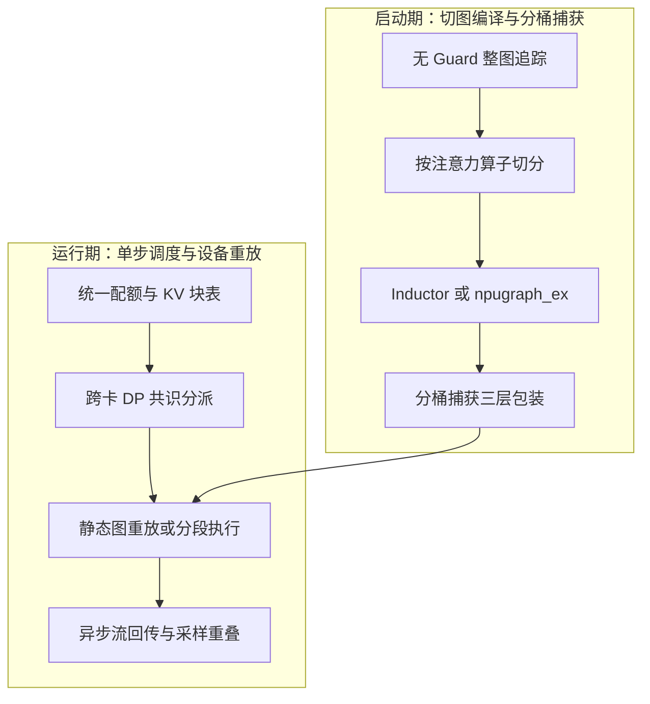

单卡计算与跨卡通信决定了一套模型的理论算力上限，但把模型真正拉上在线推理服务后，决定端到端吞吐与尾延迟的往往是引擎运行时。线上压测常见一种典型失衡：单卡理论算力与显存仍有明显余量，小批量解码吞吐却迟迟上不去，或者启用静态图后出现静默回退、跨卡挂死与输出异常。

在线推理运行时的吞吐与尾延迟由三项系统级资源调度决策共同支配。在显存侧，并发请求的提示词与生成长度持续变动，运行时需要在物理块粒度上按需映射 KV Cache、复用共享前缀，并在显存打满时有序抢占。在执行侧，小批量解码时大量算子在计算单元上只跑几微秒，短于 Python 解析与驱动下发耗时，一旦发生主机等待或队列断流就会露出计算空闲气泡。在编译与图执行侧，算子融合与硬件静态图要求张量地址与输入形状保持冻结，而线上流量每一步进入模型的请求数与上下文长度都在实时变动。

本系列围绕 **`vLLM` V1 调度架构（含 Model Runner V2，简称 MRV2，基于源码提交 `bb23c0a8`）** 与华为昇腾插件 **`vllm-ascend`（基于源码提交 `3649b8ff`）** 展开。后者运行在昇腾 **CANN（Compute Architecture for Neural Networks）** 计算架构之上，在请求调度与分页结构上复用上游设计，而在算子融合、图捕获与异步事件同步上适配了 NPU 硬件约束。

## 运行时双阶段架构：启动构图与单步执行

为了避免在线服务期间触发耗时数秒的即时重编译或图录制，现代推理引擎把静态优化全部前移到启动阶段，把动态请求匹配留在每一步的微秒级路径里，整体划分如图 1 所示。

在启动期，引擎先通过无 Guard 追踪一次捕获完整计算图，再沿注意力节点把模型拆成可静态编译的纯张量段与直调手写算子的隔离段，最后按预设批量桶捕获内外两层静态图并保留产物。

进入运行期后，每一步前向先由调度器按统一 token 预算分配物理 KV 块，接着在数据并行（DP）各卡之间就图模式与填充尺寸达成一致，直接命中对应图桶重放，并借助独立拷贝流把采样结果异步传回主机，使 CPU 有余力提前编排下一轮输入。

## 七章目录与学习路径

全系列按“显存分页与调度 → 主机发射与异步流 → 分段编译切图 → 静态图硬边界 → 运行时分发与 DP 共识 → 昇腾 NPU 图捕获落地 → Profiler 轨迹排障”七章递进展开：

| 章节                                                                        | 核心机制                                       | 解决的关键痛点                     | 双平台对照焦距                                         |
| --------------------------------------------------------------------------- | ---------------------------------------------- | ---------------------------------- | ------------------------------------------------------ |
| [第 1 章：PagedAttention 与连续批调度](./01-paged-attention-and-scheduler/) | `BlockPool`、`null_block`、统一 `token_budget` | KV 显存碎片、前缀重复计算、阶段墙  | `reshape_and_cache_flash` vs `npu_scatter_pa_kv_cache` |
| [第 2 章：异步执行与发射墙](./02-async-execution-and-launch-wall/)          | 异步 FIFO 入队、同步排空、`AsyncOutput`        | 小批解码设备空转、步间主机阻塞     | CUDA `copy_stream` vs CANN `TaskQueue`                 |
| [第 3 章：torch.compile 与分段编译](./03-torch-compile-and-piecewise/)      | Custom Op 封装、无 Guard 追踪、`split_graph`   | 逐算子访存与动态注意力断图         | `TorchInductor` vs `AscendCompiler`                    |
| [第 4 章：CUDA Graph 与四道硬边界](./04-cuda-graph-and-boundaries/)         | 指针冻结、安全填充、零同步、图内存池           | 重放读旧址、越界写与通信内存冲突   | `CUDAGraphWrapper` 与对称通信内存隔离                  |
| [第 5 章：运行时分发与 DP 共识](./05-runtime-dispatch-and-nesting/)         | 三层包装（内外两层静态图壳）、模式共识         | 混合负载兼容与多卡 DP 集合通信死锁 | `CudaGraphManager` 与 DP 跨卡同步分发                  |
| [第 6 章：昇腾 ACLGraph 与 npugraph_ex](./06-ascend-aclgraph-and-npugraph/) | 稀疏分桶、`UpdatableGraph`、`ExternalEvent`    | 流配额受限与动态参数原地刷新       | `ACLGraphWrapper` 与 `npugraph_ex`                     |
| [第 7 章：性能观测与线上定位](./07-profiling-and-debugging/)                | 五类 Trace 指纹与二分隔离流程                  | 静默回退、隐式同步与尾槽串扰       | `nsys` vs `torch_npu.profiler`                         |

建议从[第 1 章：PagedAttention 与连续批调度](./01-paged-attention-and-scheduler/)开始顺序阅读；需要补充硬件带宽模型、多卡集合通信语义或 DeepSeek 模型算子结构时，可随时对照[《推理与异构硬件基础》](../foundations/)、[《分布式并行与跨卡通信》](../distributed/)与[《DeepSeek 架构演进》](../deepseek/)。
