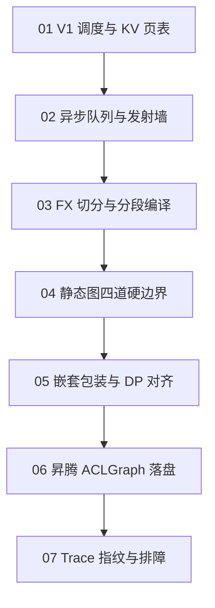

在[系列一：基础底座](../foundations/)、[系列二：分布式并行](../distributed/)与[系列三：DeepSeek 架构演进](../deepseek/)中，我们已经从数学与访存角度拆解了 MLA、DSA、MoE 与多卡通信为何省带宽。然而把真实权重拉上集群压测时，工程师最先撞上的往往是另一类运行时困惑。

即使单卡理论算力还空余大半、显存也远未打满，小批 Decode 吞吐却怎么也提不上去，甚至打开静态图后偶尔出现静默回退、跨卡挂死或尾部输出乱码。这些问题的根源不在模型公式本身，而在**调度器、PyTorch 发射队列与硬件计算图**三层之间的耦合规则。

本系列基于 **`vllm`（`bb23c0a8`，V1 / MRV2 架构）** 与 **`vllm-ascend`（`3649b8ff`）** 的真实源码，自顶向下串联出推理引擎执行的七层栈。每一章都会给出交互式推演视图、自包含的 PyTorch/NumPy 核心逻辑验证，以及 NVIDIA GPU 与华为昇腾 NPU 的双平台源码对照。

## 执行栈全貌：从请求队列到设备图流

引擎每推进一步的前向步，都会沿“请求配额 -> 主机异步入队 -> 图切分编译 -> 设备图重放 -> 跨卡对齐 -> 硬件落地与故障观测”逐层降维，整体主线如**图 1**所示。

前两章解决**“批处理怎么塞满”**与**“CPU 为什么会拖累硬件”**。后五章则沿着现代推理引擎降本增效的主线，拆解静态图是如何一步步绕过 Python 和驱动发射开销，又如何在跨平台（CUDA 与 CANN）与多卡 DP 场景下守住语义正确性。

## 七章目录与学习路径

| 章节                                                                        | 核心机制                                       | 解决的关键痛点                          | 双平台对照焦距                                           |
| --------------------------------------------------------------------------- | ---------------------------------------------- | --------------------------------------- | -------------------------------------------------------- |
| [第 1 章：PagedAttention 与连续批调度](./01-paged-attention-and-scheduler/) | `BlockPool`、`null_block`、统一 `token_budget` | KV 显存碎片、前缀重复计算、阶段墙空洞   | `reshape_and_cache_flash` vs `npu_scatter_pa_kv_cache`   |
| [第 2 章：异步执行与发射墙](./02-async-execution-and-launch-wall/)          | FIFO 入队、`.item()` 排空、`AsyncOutput`       | 小批 Decode 设备气泡、Host 同步踩踏流水 | CUDA `copy_stream` vs CANN `TaskQueue`                   |
| [第 3 章：torch.compile 与分段编译](./03-torch-compile-and-piecewise/)      | Dynamo 无 Guard、`split_graph` 分段隔离        | 逐算子访存爆炸与动态 Attention 阻断编译 | TorchInductor/Triton vs `AscendCompiler` (`npugraph_ex`) |
| [第 4 章：CUDA Graph 与四道硬边界](./04-cuda-graph-and-boundaries/)         | 指针冻结、Padding、零同步、副流闭环            | 重放读脏指针、超桶崩溃、通信内存池踩踏  | `CUDAGraphWrapper` + `nccl_symm_mem_context`             |
| [第 5 章：运行时分发与 DP 共识](./05-runtime-dispatch-and-nesting/)         | 两层嵌套壳、`BatchExecutionDescriptor`         | `FULL` 与 `PIECEWISE` 混用引发 MoE 死锁 | `dispatch_cg_and_sync_dp` 跨卡 `cpu_all_reduce_`         |
| [第 6 章：昇腾 ACLGraph 与 npugraph_ex](./06-ascend-aclgraph-and-npugraph/) | 稀疏分桶、`UpdatableGraph`、`ExternalEvent`    | 207008 流配额限制与 Tiling 动态参数刷新 | CUDA `Graph` vs CANN `ACLGraphWrapper` / `npugraph_ex`   |
| [第 7 章：性能观测与线上定位](./07-profiling-and-debugging/)                | 五类 Trace 诊断指纹与二分定位工作流            | 静默回退、隐式同步、长尾等待与 `507011` | `nsys` / CUDA Trace vs `torch_npu.profiler`              |

建议按顺序从第 1 章读至第 7 章，随时结合[系列一：基础底座](../foundations/)、[系列二：分布式并行](../distributed/)与[系列三：DeepSeek 架构演进](../deepseek/)对照模型算子与调度系统的边界约定。
