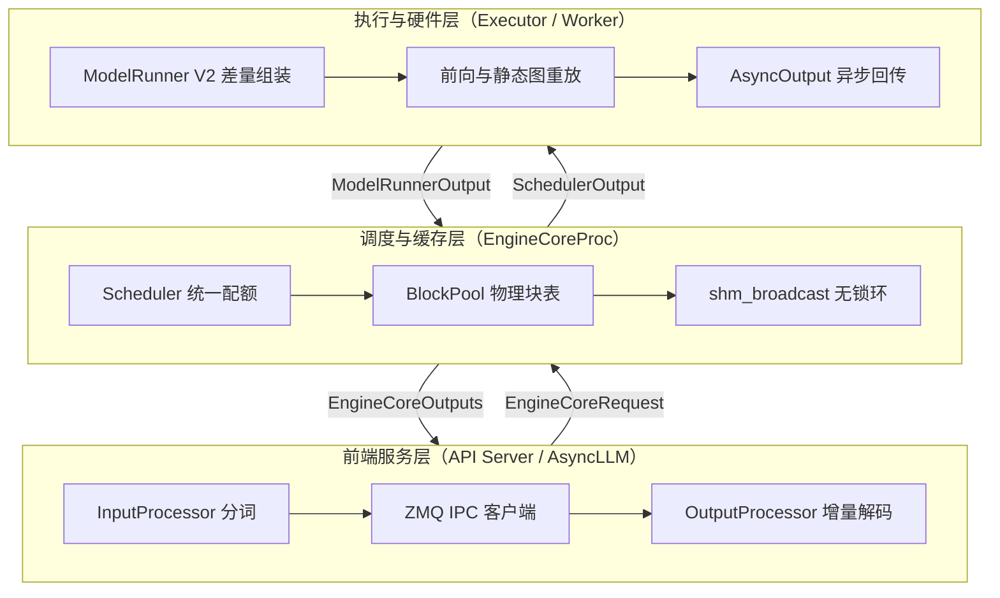

单卡计算与跨卡通信决定了一套模型的理论算力上限，但把模型真正拉上在线推理服务后，决定端到端吞吐与尾延迟的往往是引擎运行时。线上压测常见一种失衡：硬件理论算力与显存仍有余量，小批量解码吞吐却迟迟上不去，或者启用静态图后出现静默回退、跨卡挂死与输出异常。

要看清这些现象的根因，必须自顶向下理清推理引擎的三道结构边界：控制面如何把请求拆成不阻塞计算的进程流水，调度面如何把变长序列映射进统一物理显存池，以及执行面如何把动态调度单装填进静态张量与通信图。本系列以锁定提交的 `vLLM` V1 架构与 Model Runner V2[^vllm-repo]为基准，面向零基础推理开发者逐层拆解。

## 自顶向下的三层引擎边界

为了避免在在线服务期间触发高开销的同步阻塞或实时重新编译，vLLM V1 在进程、显存与执行流三个层面做了清晰切分。整体分层与数据流如图 1 所示。

在控制面，前端进程独立承担 HTTP 接流、分词与增量文本还原，不再把 Python **GIL（Global Interpreter Lock，全局解释器锁）**和字符串处理混入模型前向线程。调度进程只负责用统一配额编排批计划并维护分页块表，再通过无锁共享内存环把调度指令广播给各张卡上的 Worker 进程。

在执行面，Model Runner V2 把跨步不变的请求状态常驻在设备显存中，仅传递增量变化与槽位映射，再配合独立拷贝流把采样结果异步回传主机。

## 十一章路线与系列分工

本系列专注通用推理引擎的进程架构、显存虚拟化、批调度、执行器、集群协同以及投机与配置排障。昇腾硬件插件、多代 NPU 适配与自定义算子开发独立收归[《vLLM-Ascend 昇腾插件与硬件拓展》](../vllm-ascend/)。底层 `torch.compile`、CUDA Graph 与 ACL Graph 录制机制收归[《推理执行图：CUDA Graph 与 ACL Graph》](../execgraph/)。本系列按以下十一章自顶向下推进：

| 章节                                                                             | 核心机制                                | 解决痛点                 |
| :------------------------------------------------------------------------------- | :-------------------------------------- | :----------------------- |
| [01 vLLM V1 总体架构与请求生命周期](./01-vllm-v1-architecture/)                  | 三层进程边界、`VllmConfig` 切分         | 分词阻塞与加载爆显存     |
| [02 运行拓扑、并行映射与进程通信](./02-runtime-topology-and-parallel-mapping/)   | 5D 并行拓扑映射、`shm_broadcast` 环     | 进程拓扑与通信组混乱     |
| [03 PagedAttention 与分块 KV 缓存池](./03-paged-attention-and-block-kv-cache/)   | 页表寻址、链式 APC、混合 KV 分组        | 显存碎片与重复前缀计算   |
| [04 连续批处理、分块预填充与统一调度器](./04-continuous-batching-and-scheduler/) | 步级插队、统一 `token_budget`           | 阶段隔离毛刺与抢占恢复   |
| [05 Worker 启动与 ModelRunner V2](./05-worker-and-model-runner-v2/)              | 显存峰值探测、常驻请求行、`StagedWrite` | 状态复制开销与输入组装   |
| [06 异步执行模型与发射墙](./06-async-execution-and-launch-wall/)                 | 跨步乐观占位、`AsyncOutput` 回传        | 步间等待与 D2H 阻塞      |
| [07 多卡 DP 协同与 PD 分离 KV 传输](./07-dp-coordination-and-kv-transfer/)       | DP 图模式共识、`KVConnectorBase`        | 多卡阻塞与 PD 状态交接   |
| [08 投机解码引擎、拒绝采样与异步回退](./08-speculative-decoding-engine/)         | 五大 Draft 家族、融合图与占位回退       | 单步权重带宽利用不足     |
| [09 结构化输出、采样管线与工具解析](./09-structured-outputs-and-parsing/)        | 异步 FSM、`Bitmask` 与有序采样管线      | Agent 语法越界与流式解析 |
| [10 生产启动配置、关键参数与调优](./10-launch-config-and-tuning/)                | CLI 映射、显存与批预算耦合模板          | 启动报错与参数相互冲突   |
| [11 性能观测与线上故障定位](./11-profiling-and-debugging/)                       | 五类 Trace 指纹、二分隔离排障树         | 静默回退与尾槽越界污染   |

建议从[01 vLLM V1 总体架构与请求生命周期](./01-vllm-v1-architecture/)起步顺序阅读。若需补充芯片带宽模型、多卡集合通信语义或 DeepSeek 模型算子结构，可随时对照[《推理与异构硬件基础》](../foundations/)、[《分布式并行与跨卡通信》](../distributed/)与[《DeepSeek 架构演进》](../deepseek/)。

[^vllm-repo]: 上游推理引擎仓库 `vllm-project/vllm`，本文系列主要对照提交 `99b0b0b0`（Apache-2.0 协议）及 [vLLM 官方文档](https://docs.vllm.ai/)。
